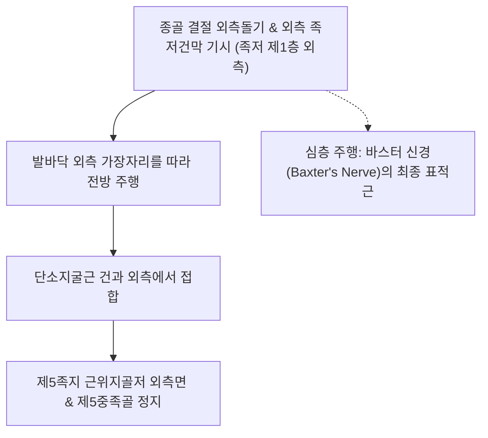

# [[소지외전근(발)]](Abductor Digiti Minimi of Foot / 새끼벌림근(발))

> **핵심 요약 (Key Summary)**:
> [[종골]] 결절 외측돌기 및 외측 족저건막에서 기시하여 새끼발가락(제5족지) 근위지골저 외측면에 정지하는 족저 제1층 가장 외측의 근육.
> [[외측족저신경]](S1-S2, 상위의 [[경골신경]] 및 [[좌골신경]] 분지) 본간의 지배를 받으며, 새끼발가락 외전 및 외측 세로 아치(Lateral Longitudinal Arch)를 동적 지지.
> 주치 병증은 바스터 신경염(Baxter's neuropathy), 제5중족골 부착부 건병증, 소건막류 및 발바닥 외측 통증.

---

## 📌 목차
1. [해부학적 정밀 구조 및 지배 신경/혈관](#1-해부학적-정밀-구조-및-지배-신경혈관)
2. [생체역학·토크 분석 & 근막 사슬 (Biomechanical Synergy)](#2-생체역학토크-분석--근막-사슬-biomechanical-synergy)
3. [근막통증증후군(TP) & 연관통 패턴 (Travell & Simons)](#3-근막통증증후군tp--연관통-패턴-travell--simons)
4. [초음파 해부학(Sonoanatomy) 및 중재 시술 랜드마크](#4-초음파-해부학sonoanatomy-및-중재-시술-랜드마크)
5. [⭐ 원장님 심층 임상 고찰 및 원본 필기 (Clinical Pearls)](#5--원장님-심층-임상-고찰-및-원본-필기-clinical-pearls)
6. [관련 임상 질환 및 운동손상 증후군 총괄](#6-관련-임상-질환-및-운동손상-증후군-총괄)
7. [추나·도수치료(MET/PIR) & 침구·약침·재활 프로토콜](#7-추나도수치료metpir--침구약침재활-프로토콜)
8. [출처 및 학술 참고 문헌 (References)](#8-출처-및-학술-참고-문헌-references)

---

## 1. 해부학적 정밀 구조 및 지배 신경/혈관

### 1) 해부학 구조 상세

| 항목 | 상세 내용 |
| :--- | :--- |
| **기시 (Origin)** | [[종골]](Calcaneus) 결절의 **외측돌기(Lateral process)**, 내측돌기 일부, 종골하 건막 및 외측 근간중격 |
| **정지 (Insertion)** | **제5족지(새끼발가락) 근위지골저 외측면** 및 제5중족골 조면(일부 섬유 정지) |
| **신경 지배** | [[외측족저신경]](Lateral plantar nerve, S1-S2) 본간 |
| **혈관 공급** | 외측족저동맥(Lateral plantar artery) |
| **신경 포착 관계** | 기시부 심층([[무지외전근]] 및 [[족저방형근]] 사이)으로 외측족저신경의 제1분지인 **바스터 신경(Baxter's nerve)**이 주행하여 이 근육을 독점 지배 |

---

## 2. 생체역학·토크 분석 & 근막 사슬 (Biomechanical Synergy)

### 1) 기능 및 생체역학
* **새끼발가락 외전 및 굴곡 보조**:
  * 새끼발가락을 바깥쪽으로 벌리고 바닥으로 눌러 보행 착지기 전족부 외측 지면 지지면(BOS)을 확장.
* **외측 세로 아치(Lateral Longitudinal Arch) 능동 거상**:
  * [[단소지굴근(발)]], [[장비골근]], [[단비골근]]과 협동하여 체중 부하 시 외측 아치가 바닥으로 붕괴되는 것을 방어.
* **내측의 [[후경골근]], [[무지외전근]]과 대칭을 이루어 내측 아치와의 역학적 밸런스**:
  * 내측의 [[무지외전근]]과 대칭을 이루어 발바닥 돔 구조의 좌우 평형을 유지.

### 2) 근막 사슬 (Anatomy Trains)
* **외측선(Lateral Line)**: 제5족지에서 소지외전근 → 종골 외측 → 비골근건 및 장경인대로 이어지는 외측 안정화 사슬의 족저 기저부로 상부의 [[대퇴근막장근]] 및 [[장경인대]]로 연결.

---

## 3. 근막통증증후군(TP) & 연관통 패턴 (Travell & Simons)

### 1) 발통점(Trigger Point) 위치 및 연관통
* **발통점 위치**: 종골 외측돌기 전방 2~3cm 지점, 발바닥 바깥쪽 오목한 부위의 근복.
* **연관통 양상**:
  * **발바닥 외측 및 제5중족골두 통증**: 발바닥 바깥쪽 모서리를 따라 쑤시는 통증 집중.
  * 새끼발가락 바닥면과 뒤꿈치 외측으로 둔통 방사.
* **임상적 특징**: 보행 착지 시 발바닥 바깥쪽이 아파 체중을 안쪽으로 피하려다 평발([[평발]])과 무지외반 변형을 2차 악화시킴.

---

## 4. 초음파 해부학(Sonoanatomy) 및 중재 시술 랜드마크

### 1) 초음파 스캔 뷰
* **종골 외측돌기 전방 종단 스캔**:
  * 족저건막 외측 밴드 아래 위치하는 저에코성 소지외전근 근복 식별.
  * 바스터 신경 포착 시 관찰되는 근복의 지방 침윤(Fatty infiltration) 및 고에코성 위축 양상 확인.

### 2) 침도 및 안전 자침 마진
* **경골(BL64) 후하방 / 종골 외측 함요처**: 종골 외측연을 향해 15~20mm 사자.

---

## 5. ⭐ 원장님 심층 임상 고찰 및 원본 필기 (Clinical Pearls)

### 1) 바스터 신경 포착증(Baxter's Neuropathy)의 결정적 영상학적 지표 (원장님 핵심 팁 100% 보존)
* **MRI 상 소지외전근 선택적 위축**:
  * 외측족저신경 제1분지(바스터 신경)가 포착되면, 이 신경의 순수 운동 지배를 받는 **소지외전근이 선택적으로 신경성 위축(Denervation atrophy)에 빠져 T1 강조영상에서 고신호 지방 침윤**을 보임.
  * 만성 발뒤꿈치 통증 환자에서 단순 족저근막염 치료에 반응이 없고 소지외전근 위축이 동반되어 있다면 바스터 신경 포착을 확진하고 기시부 도침 박리를 시행해야 함.

### 2) 소건막류와의 감별 및 외측 족궁 보호
* 제5중족골두 외측 통증 시 점액낭염뿐만 아니라 소지외전근 정지부의 만성 견인 건병증을 함께 치료해야 재발을 방지할 수 있음.

---

## 6. 관련 임상 질환 및 운동손상 증후군 총괄

| 임상 질환 / 증후군 | 병리적 연관 기전 | 주요 증상 및 이학적 검사 | 핵심 교정 타깃 |
| :--- | :--- | :--- | :--- |
| **바스터 신경 포착증** | 바스터 신경 압박으로 인한 소지외전근 지방 위축 | 종골 전내측 통증, 소지외전근 위약 및 저림 | 무지외전근-방형근 심부 도침 감압 |
| **제5중족골 부착부 건병증** | 소지외전근 건의 반복 견인으로 인한 골막염 | 제5중족골 조면 압통, 보행 시 외측통 | 부착부 도침 박리, 소염 약침 |
| **외측 아치 피로 증후군** | 장시간 기립 시 소지외전근 내재근 탈진 및 [[평발]] 악화 | 보행 후 발바닥 바깥쪽 뻐근한 경련감 | 외측 족궁 지지 인솔, 내재근 강화 |

* **새끼발가락 능동 외전 검사**: 환자에게 새끼발가락을 바깥쪽으로 힘껏 벌리게 할 때, 반대측에 비해 벌림 각도가 현저히 작거나 벌리지 못하면 소지외전근 마비 및 바스터 신경병증 의심.

---

## 7. 추나·도수치료(MET/PIR) & 침구·약침·재활 프로토콜

### 1) 한의 침구 및 약침 요법
* **침구 치료**: 경골(BL64), 속골(BL65), 통곡(BL66), 지음(BL67) 자침.
* **도침 요법**: 종골 결절 외측돌기 기시부 및 제5중족골 부착부 만성 섬유화 부위 소침도 절개 박리.
* **약침 치료**: 소지외전근 근복 및 신경 주행로에 신바로약침 0.5cc 주입.

### 2) 도수 치료 및 재활
* **외측 족저 근막 롤링**: 골프공을 발바닥 바깥쪽 아치에 대고 서서 체중을 실어 2~3분간 굴려 근막 이완.
* **새끼발가락 외전 재교육**: 발가락을 바닥에 붙인 채 새끼발가락만 바깥쪽으로 벌리는 능동 제어 훈련.

---

## 8. 출처 및 학술 참고 문헌 (References)

* Standring S. *Gray's Anatomy: The Anatomical Basis of Clinical Practice*. 42nd ed. Elsevier, 2020: 1364.
  * `[연구 요약]`: 소지외전근의 종골 외측돌기 기시, 제5족지 정지 해부학 및 외측족저신경 본간 지배 분석.
* Chundru U, et al. *Plantar fasciitis and calcaneal spur formation are associated with abductor digiti minimi atrophy on MRI of the foot*. Skeletal Radiol, 2008; 37(6): 505-510. [PMID: 18286281](https://pubmed.ncbi.nlm.nih.gov/18286281/)
  * `[연구 요약]`: 족저근막염 및 종골 골극 환자에서 바스터 신경(Baxter's nerve) 포착에 따른 소지외전근의 선택적 지방 위축 MRI 상관관계 및 영상의학적 진단 기준 확립.
* Travell, J. G., & Simons, D. G. *Myofascial Pain and Dysfunction*. Williams & Wilkins, 1999.
  * `[연구 요약]`: 소지외전근 발통점과 발바닥 외측 방사통 패턴.
