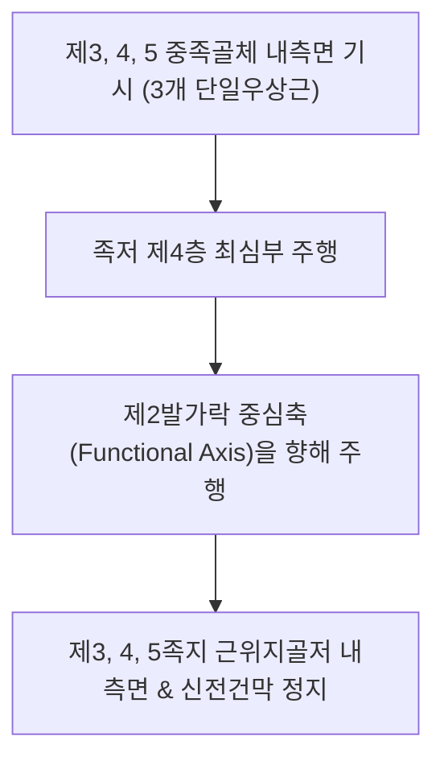

# [[장측골간근(발)]](Plantar Interossei of Foot / 바닥쪽뼈사이근(발))

> **핵심 요약 (Key Summary)**:
> 제3, 4, 5 중족골체 내측면 및 기저부에서 단일 두(Unipennate)로 기시하여 해당 3~5번째 발가락 근위지골저 내측면에 정지하는 족저 제4층 최심부 3개의 근육.
> [[외측족저신경]](S2-S3, 상위의 [[경골신경]] 및 [[좌골신경]] 분지) 심분지의 지배를 받으며, **제2발가락을 기준축으로 3~5지 발가락 내전(PAD)** 및 전족부 횡아치를 결속.
> 주치 병증은 개장족(Splayfoot), 전족부 바닥 통증, 중족골두 통증 및 발가락 쥐남(Cramps).

---

## 📌 목차
1. [해부학적 정밀 구조 및 지배 신경/혈관](#1-해부학적-정밀-구조-및-지배-신경혈관)
2. [생체역학·토크 분석 & 근막 사슬 (Biomechanical Synergy)](#2-생체역학토크-분석--근막-사슬-biomechanical-synergy)
3. [근막통증증후군(TP) & 연관통 패턴 (Travell & Simons)](#3-근막통증증후군tp--연관통-패턴-travell--simons)
4. [초음파 해부학(Sonoanatomy) 및 중재 시술 랜드마크](#4-초음파-해부학sonoanatomy-및-중재-시술-랜드마크)
5. [⭐ 원장님 심층 임상 고찰 및 원본 필기 (Clinical Pearls)](#5--원장님-심층-임상-고찰-및-원본-필기-clinical-pearls)
6. [관련 임상 질환 및 운동손상 증후군 총괄](#6-관련-임상-질환-및-운동손상-증후군-총괄)
7. [추나·도수치료(MET/PIR) & 침구·약침·재활 프로토콜](#7-추나도수치료metpir--침구약침재활-프로토콜)
8. [출처 및 학술 참고 문헌 (References)](#8-출처-및-학술-참고-문헌-references)

---

## 1. 해부학적 정밀 구조 및 지배 신경/혈관

### 1) 해부학 구조 상세

| 항목 | 상세 내용 |
| :--- | :--- |
| **기시 (Origin)** | • **제1장측골간근**: 제3 중족골 체부 내측면 및 기저부 • **제2장측골간근**: 제4 중족골 체부 내측면 및 기저부 • **제3장측골간근**: 제5 중족골 체부 내측면 및 기저부 |
| **정지 (Insertion)** | 각각 해당하는 **제3, 4, 5번째 발가락 근위지골저 내측면** 및 배측 신전건막 |
| **정렬 기준축 (Axis)** | **제2발가락(2nd toe)**을 향해 모으는 단일우상근 (손과 달리 3개만 존재) |
| **신경 지배** | [[외측족저신경]](Lateral plantar nerve, S2-S3) 심분지 |
| **혈관 공급** | 족저동맥궁(Plantar arch)의 족저중족동맥 분지 |
| **해부학적 층 (Layer)** | 발바닥 제4층(Fourth layer of sole)의 최심부에 위치 |

---

## 2. 생체역학·토크 분석 & 근막 사슬 (Biomechanical Synergy)

### 1) 기능 및 생체역학
* **발가락 내전 (Plantar Adduction: PAD — [[배측골간근(발)]] 외전과 길항)**:
  * 3, 4, 5번째 발가락을 제2발가락 쪽으로 단단히 오므려 보행 중 발가락들이 바깥으로 흩어지는 것을 결속.
* **MTP 관절 굴곡 보조**:
  * 발가락 뿌리 관절을 바닥으로 눌러주어 보행 추진기 발끝의 일체화된 지면 반발력 형성.
* **전족부 횡아치(Transverse Arch) 능동 압축 결속**:
  * 중족골들을 중앙으로 모아주어 체중 부하 시 발볼이 넓어지는 것을 방지하여 [[무지외반증]] 및 [[소지외전근(발)]] 보상 과부하를 차단.
* **[[배측골간근(발)]]과의 횡적 밸런스**:
  * 배측골간근의 외전 장력과 길항 균형을 이루어 발가락의 좌우 정렬을 유지.

### 2) 근막 사슬 (Anatomy Trains)
* **심층후방선(Deep Back Line)**: 전족부 심층 건막에서 [[충양근(발)]], [[단지굴근]], [[족저방형근]]을 거쳐 하지 심부의 [[후경골근]], [[장지굴근]], [[슬와근]]으로 연결.

---

## 3. 근막통증증후군(TP) & 연관통 패턴 (Travell & Simons)

### 1) 발통점(Trigger Point) 위치 및 연관통
* **발통점 위치**: [[종골]] 전방 및 제3~5 중족골 간격의 발바닥 심층 근복.
* **연관통 양상**:
  * **전족부 발바닥 통증**: 3, 4, 5번째 발가락 뿌리 바닥면이 디딜 때마다 뻐근하고 저림.
  * 중족골두 하방으로 멍든 듯한 연관통 집중.
* **임상적 특징**: 발가락을 꽉 오므릴 때 통증이 유발되거나 수면 중 쥐(경련)가 자주 발생.

---

## 4. 초음파 해부학(Sonoanatomy) 및 중재 시술 랜드마크

### 1) 초음파 스캔 뷰
* **발바닥 전족부 횡단 스캔**:
  * 제3~5 중족골 골체 내측면에 밀착된 저에코성 근복 확인.
  * 굴근건 심층에서 중족골 간격을 메우고 있는 골간근 음영 식별.

### 2) 침도 및 안전 자침 마진
* **용천(KI1) 외측 지간부위 / 발바닥 함요처**: 골간막을 향해 사자 15~20mm (족저동맥궁 손상 방지).

---

## 5. ⭐ 원장님 심층 임상 고찰 및 원본 필기 (Clinical Pearls)

### 1) 발볼 벌어짐(Splayfoot, 개장족)과 장측골간근 약화 (원장님 핵심 팁 100% 보존)
* **횡아치 붕괴의 숨은 원인**:
  * 나이가 들면서 발볼이 넓어지고 신발 사이즈가 커지는 **개장족(Splayfoot)** 환자는 장측골간근이 약화되어 중족골들을 중앙으로 모아주지 못하는 것이 근본 원인임.
  * 중족골 사이 장측골간근 전침 치료 및 횡아치 결속 테이핑을 병행하면 발볼이 조여지고 전족부 굳은살 통증이 극적으로 개선됨.

### 2) 지간신경염과의 감별
* 3-4지 지간신경통 환자에서 신경종 수술을 해도 통증이 잔류하는 경우, 심부 장측골간근의 만성 단축 연축이 원인인 경우가 많으므로 골간근 도침 감압이 필수적임.

---

## 6. 관련 임상 질환 및 운동손상 증후군 총괄

| 임상 질환 / 증후군 | 병리적 연관 기전 | 주요 증상 및 이학적 검사 | 핵심 교정 타깃 |
| :--- | :--- | :--- | :--- |
| **개장족(Splayfoot)** | 장측골간근 약화로 중족골간 결속력 상실, 발볼 확장 | 발볼 넓어짐, 중족골두 굳은살, [[무지외반증]] 및 보행통 | 장측골간근 강화, 횡아치 패드 |
| **전족부 바닥 통증** | 장측골간근 TrP 활성화로 3~5지 기저부 방사통 | 체중 부하 시 발가락 뿌리 압통 | 장측골간근 침구 및 근막 이완 |
| **발가락 경련(Cramps)** | 장측골간근 만성 피로 및 저산소성 연축 | 보행 시 발가락이 뒤틀리며 오므라듦 | 전침 치료, 작약감초탕 처방 |

* **발가락 내전 저항 검사**: 발가락 사이에 종이를 끼우고 환자에게 발가락을 오므리게 한 후 검사자가 종이를 잡아당길 때 쉽게 빠지면 장측골간근 위약 확진.

---

## 7. 추나·도수치료(MET/PIR) & 침구·약침·재활 프로토콜

### 1) 한의 침구 및 약침 요법
* **침구 치료**: 통곡(BL66), 내정(ST44), 협계(GB43), 팔풍(EX-LE10) 자침.
* **도침 요법**: 3~5 중족골 기저부 장측골간근 부착부의 만성 유착 부위 소침도 절개 박리.
* **약침 치료**: 발바닥 심부 건막염 부위에 신바로약침 0.3cc 주입.

### 2) 도수 치료 및 재활
* **발가락 오므리기 저항 운동**: 발가락 사이에 펜이나 손가락을 끼우고 안쪽으로 꽉 조이는 내전근 강화 운동 (5초 유지 x 15회).
* **횡아치 압축 마사지**: 전족부 양측을 손으로 감싸 쥐고 횡아치를 모아주는 도수 교정.

---

## 8. 출처 및 학술 참고 문헌 (References)

* Standring S. *Gray's Anatomy: The Anatomical Basis of Clinical Practice*. 42nd ed. Elsevier, 2020: 1368.
  * `[연구 요약]`: 장측골간근의 3~5중족골 기시, 제2지 중심축 내전 구조 및 외측족저신경 지배 분석.
* McKeon PO, et al. *The foot core system: a new paradigm for understanding intrinsic foot muscle function*. Br J Sports Med, 2015; 49(5): 290. [PMID: 24659509](https://pubmed.ncbi.nlm.nih.gov/24659509/)
  * `[연구 요약]`: 발 코어 시스템(The foot core system) 패러다임 — 장측골간근 등 족저 내재근이 횡아치 동적 결속 및 보행 추진력 형성에 미치는 핵심 역학 규명.
* Travell, J. G., & Simons, D. G. *Myofascial Pain and Dysfunction*. Williams & Wilkins, 1999.
  * `[연구 요약]`: 장측골간근 발통점과 전족부 바닥 방사통 패턴.
