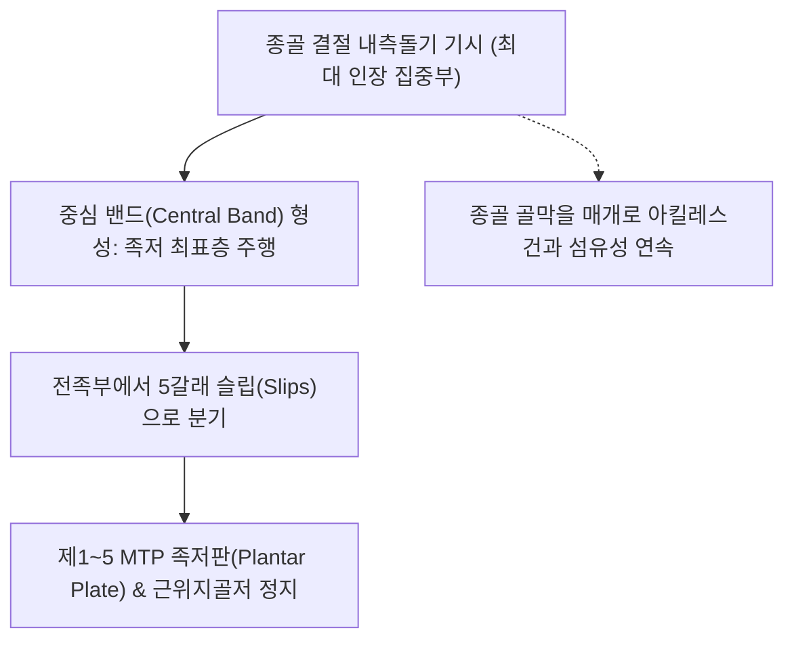

# [[족저근막]](Plantar Fascia / 발바닥근막 / 족저건막)

> **핵심 요약 (Key Summary)**:
> [[종골]] 결절 내측돌기에서 기시하여 5갈래 슬립으로 나뉘어 각 발가락 MTP 관절 족저판 및 근위지골저에 정지하는 발바닥 최표층의 두껍고 강인한 결합조직 건막.
> [[내측족저신경]] 및 [[외측족저신경]] 분지의 감각 지배를 받으며, 윈들러스 기전(Windlass mechanism)을 통해 유연한 충격 흡수기를 단단한 전방 추진 지렛대로 전환.
> 주치 병증은 [[족저근막염]](Plantar fasciitis), 종골 골극(Heel spur), 아침 첫 발 뒤꿈치 극통 및 내측 종아치 붕괴([[평발]]).

---

## 📌 목차
1. [해부학적 정밀 구조 및 지배 신경/혈관](#1-해부학적-정밀-구조-및-지배-신경혈관)
2. [생체역학·토크 분석 & 근막 사슬 (윈들러스 기전 / Windlass Mechanism)](#2-생체역학토크-분석--근막-사슬-윈들러스-기전--windlass-mechanism)
3. [근막통증증후군(TP) & 연관통 패턴 (Travell & Simons)](#3-근막통증증후군tp--연관통-패턴-travell--simons)
4. [초음파 해부학(Sonoanatomy) 및 중재 시술 랜드마크](#4-초음파-해부학sonoanatomy-및-중재-시술-랜드마크)
5. [⭐ 원장님 심층 임상 고찰 및 원본 필기 (Clinical Pearls)](#5--원장님-심층-임상-고찰-및-원본-필기-clinical-pearls)
6. [관련 임상 질환 및 운동손상 증후군 총괄](#6-관련-임상-질환-및-운동손상-증후군-총괄)
7. [추나·도수치료(MET/PIR) & 침구·약침·재활 프로토콜](#7-추나도수치료metpir--침구약침재활-프로토콜)
8. [출처 및 학술 참고 문헌 (References)](#8-출처-및-학술-참고-문헌-references)

---

## 1. 해부학적 정밀 구조 및 지배 신경/혈관

### 1) 해부학 구조 상세

| 항목 | 상세 내용 |
| :--- | :--- |
| **기시 (Origin)** | [[종골]](Calcaneus) 결절의 **내측돌기(Medial process of calcaneal tuberosity)** - 임상적 최대 호발 병변부(Enthesis) |
| **주행 및 분지** | 중심부(Central band)가 가장 두껍고 강인하며, 전방으로 주행하며 5개의 슬립(Slips)으로 분지 |
| **정지 (Insertion)** | 제1~5 중족족지관절(MTP joint) 부위의 **족저판(Plantar plate)**, 굴근건초 및 근위지골 기저부 |
| **신경 지배** | 내측 및 외측 족저신경의 감각 분지, 후경골신경 분지 |
| **혈관 공급** | 후경골동맥의 내외측 족저동맥 분지망 |
| **아킬레스건 연속성** | 종골 골막을 매개로 **[[아킬레스건]]([[비복근]]·[[가자미근]] 건)**과 직접적인 섬유성 장력 연속성을 유지 |

---

## 2. 생체역학·토크 분석 & 근막 사슬 (윈들러스 기전 / Windlass Mechanism)

### 1) 닻감개 기전(Windlass Mechanism)
* **보행 추진기(Push-off) 단단한 지렛대화**:
  * 발뒤꿈치가 들리고 발가락이 배측굴곡(Dorsiflexion)될 때, 족저근막이 중족골두를 도르래처럼 감아 돌며 강력한 인장력이 발생.
  * 종골과 중족골두 사이 거리가 좁혀지면서 **내측 종아치가 거상(Elevate arch)**되고 족근골들이 단단히 맞물려(Close-packed), 발이 유연한 완충기에서 **단단한 전방 추진 지렛대(Rigid lever)**로 전환.

### 2) 착지기(Heel Strike) 충격 흡수 스프링
* 뒤꿈치가 바닥에 닿을 때 족저근막이 신장되면서 지면 충격 에너지를 탄성 에너지로 흡수·저장.

### 3) 근막 사슬 (Anatomy Trains)
* **표면후방선(Superficial Back Line, SBL)**: **족저근막** → 아킬레스건/비복근 → [[슬괵근]] → [[대둔근]] → 척추기립근 → 모상건막으로 연결되는 후면 전신 신전 사슬의 최하단 주춧돌.

---

## 3. 근막통증증후군(TP) & 연관통 패턴 (Travell & Simons)

### 1) 발통점(Trigger Point) 위치 및 연관통
* **발통점 위치**: 종골 결절 내측돌기 부착부(Enthesis) 및 족저근막 중앙 밴드 중심.
* **연관통 양상**:
  * **발뒤꿈치 내측 극통**: 아침 기상 후 첫 발을 디딜 때 "유리 조각을 밟는 듯한 찢어지는 통증".
  * 발바닥 안쪽 아치를 따라 타는 듯한 작열통 방사.
* **임상적 특징**: 몇 걸음 걸으면 통증이 일시적으로 줄어들다가 오래 서 있거나 오후가 되면 다시 통증 악화.

---

## 4. 초음파 해부학(Sonoanatomy) 및 중재 시술 랜드마크

### 1) 초음파 스캔 뷰
* **종골 부착부 종단 스캔**:
  * 정상 족저근막 두께: **< 4.0 mm** (고에코성 균일 섬유).
  * [[족저근막염]] 병변 두께: **$\ge$ 4.5~5.0 mm** (저에코성 비후, 섬유 불규칙, 삼출액, 종골 골극).

### 2) 침도 및 안전 자침 마진
* **종골 결절 내측돌기 부착부**: 내측에서 외측으로 족저 지방패드를 통과하여 건막 부착부에 15~20mm 사자 (종골하 지방패드 위축 주의).

---

## 5. ⭐ 원장님 심층 임상 고찰 및 원본 필기 (Clinical Pearls)

### 1) 아침 첫 발 극통의 병태생리 (원장님 핵심 팁 100% 보존)
* **야간 단축과 조조 미세 열상**:
  * 수면 중에는 발목이 자연스럽게 족저굴곡되어 족저근막이 단축된 상태로 밤새 치유·수축함.
  * 아침에 일어나 첫 발을 디디는 순간 체중 부하로 급격히 배굴 신장되면서 밤새 아물던 미세 결합조직이 다시 찢어지며 극심한 통증 유발.
  * 따라서 기상 전 누운 상태에서 발목과 발가락을 부드럽게 젖혀주는 **'기상 전 스트레칭'**이 조조통 차단의 핵심임.

### 2) 종골 골극(Heel Spur)의 진실
* X-ray 상 종골 아래 뾰족한 뼈(골극)는 통증의 직접 원인이 아니라, 만성적인 족저근막 견인력에 대항하기 위해 인체가 만들어낸 생체역학적 골화 방어 반응임. 무증상 골극도 흔하므로 골극 자체를 제거할 필요는 없음.

---

## 6. 관련 임상 질환 및 운동손상 증후군 총괄

| 임상 질환 / 증후군 | 병리적 연관 기전 | 주요 증상 및 이학적 검사 | 핵심 교정 타깃 |
| :--- | :--- | :--- | :--- |
| **[[족저근막염]]** | 기시부 반복 미세 손상 및 만성 퇴행성 건막염 | 아침 첫 발 극통, 종골 내측 결절 국소 압통 | 족저근막 도침 박리, 충격파, 약침 |
| **바스터 신경염 오진** | 무지외전근 심층 신경 포착과 족저근막염 혼재 | 발뒤꿈치 내측 작열통, 방사통 동반 | 무지외전근-방형근 감압, 신경 도침 |
| **족저근막 파열** | 무리한 달리기나 과도한 스테로이드 주사 후 급성 파열 | "뚝" 소리와 함께 체중 부하 불능, 반상출혈 | 고정 깁스, 재생 약침 치료 |

* **윈들러스 검사(Windlass Test)**: 환자의 엄지발가락을 수동으로 힘껏 젖힐 때 종골 부착부에 찌르는 듯한 통증이 재현되면 족저근막염 확진.
* **초음파 두께 추적**: 체외충격파(ESWT) 또는 도침 치료 4~8주 후 초음파 상 근막 두께가 4mm 이하로 감소하면 조직학적 재생 확진.

---

## 7. 추나·도수치료(MET/PIR) & 침구·약침·재활 프로토콜

### 1) 한의 침구 및 약침 요법
* **침구 치료**: [[태계(KI3)]], 곤륜(BL60), 연곡(KI2), 용천(KI1) 자침.
* **도침 요법**: 종골 결절 내측돌기 부착부의 만성 비후 섬유성 유착을 종축으로 절개 감압.
* **약침 치료**: 종골 부착부에 신바로약침 또는 중성어혈약침 0.5cc 국소 주입.

### 2) 자가 재활 및 테이핑 (개념 학습 보충 패키지 융합)
* **저염색 테이핑(Low-Dye Taping)**: 발바닥 종아치를 아래에서 받쳐 올려 윈들러스 장력을 즉시 40% 이상 감압.
* **아킬레스건-족저근막 복합 스트레칭**: 벽 밀기 스트레칭 및 캔/골프공 롤링을 매일 3회 이상 시행.

---

## 8. 출처 및 학술 참고 문헌 (References)

* Standring S. *Gray's Anatomy: The Anatomical Basis of Clinical Practice*. 42nd ed. Elsevier, 2020: 1364.
  * `[연구 요약]`: 족저근막의 종골 기시, 5갈래 슬립 주행 및 MTP 족저판 정지 해부학 분석.
* Bolgla LA, et al. *Plantar fasciitis and the windlass mechanism: a biomechanical link to clinical practice*. J Athl Train, 2004; 39(1): 77-82. [PMID: 16558682](https://pubmed.ncbi.nlm.nih.gov/16558682/)
  * `[연구 요약]`: 족저근막염과 윈들러스 기전(Windlass mechanism)의 생체역학적 상관관계 — 종골-MTP 관절 간 인장력 분산 및 보존적 재활 치료의 역학적 근거 확립.
* Travell, J. G., & Simons, D. G. *Myofascial Pain and Dysfunction*. Williams & Wilkins, 1999.
  * `[연구 요약]`: 족저근막 및 단지굴근 발통점과 발뒤꿈치 방사통 패턴.
