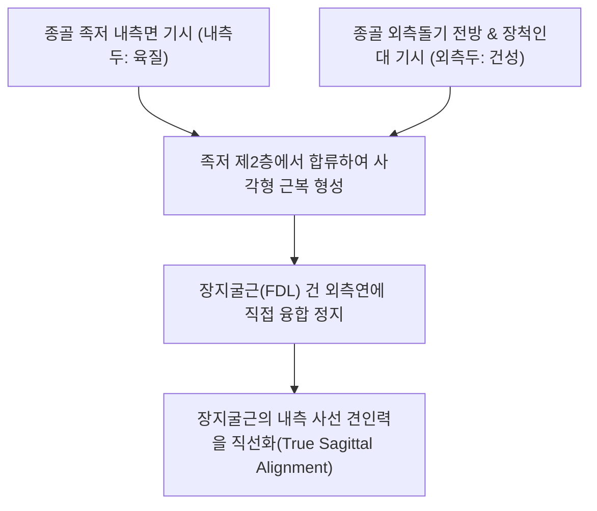

# [[족저방형근]](Quadratus Plantae / Flexor Accessorius / 발바닥네모근)

> **핵심 요약 (Key Summary)**:
> [[종골]] 족저면 내·외측 결절에서 두 갈래로 기시하여 족저 제2층에서 **[[장지굴근]](FDL) 건의 외측연 및 분지부**에 정지하는 사각형 근육.
> [[외측족저신경]](S1-S2, 상위의 [[경골신경]] 및 [[좌골신경]] 분지) 본간의 지배를 받으며, 장지굴근의 사선 견인력을 직선화하여 발가락의 순수 시상면 굴곡을 완성.
> 주치 병증은 발바닥 중앙 심부 통증, 바스터 신경염(Baxter's neuropathy), 발가락 굴곡 불균형 및 만성 족저 피로.

---

## 📌 목차
1. [해부학적 정밀 구조 및 지배 신경/혈관](#1-해부학적-정밀-구조-및-지배-신경혈관)
2. [생체역학·토크 분석 & 근막 사슬 (Biomechanical Synergy)](#2-생체역학토크-분석--근막-사슬-biomechanical-synergy)
3. [근막통증증후군(TP) & 연관통 패턴 (Travell & Simons)](#3-근막통증증후군tp--연관통-패턴-travell--simons)
4. [초음파 해부학(Sonoanatomy) 및 중재 시술 랜드마크](#4-초음파-해부학sonoanatomy-및-중재-시술-랜드마크)
5. [⭐ 원장님 심층 임상 고찰 및 원본 필기 (Clinical Pearls)](#5--원장님-심층-임상-고찰-및-원본-필기-clinical-pearls)
6. [관련 임상 질환 및 운동손상 증후군 총괄](#6-관련-임상-질환-및-운동손상-증후군-총괄)
7. [추나·도수치료(MET/PIR) & 침구·약침·재활 프로토콜](#7-추나도수치료metpir--침구약침재활-프로토콜)
8. [출처 및 학술 참고 문헌 (References)](#8-출처-및-학술-참고-문헌-references)

---

## 1. 해부학적 정밀 구조 및 지배 신경/혈관

### 1) 해부학 구조 상세

| 항목 | 상세 내용 |
| :--- | :--- |
| **기시 (Origin)** | 2개의 두(Heads)로 기시: • **내측두(Medial head)**: 종골 족저면의 오목한 내측면 (크고 육질) • **외측두(Lateral head)**: 종골 결절 외측돌기 전방 및 장척인대 (작고 건성) |
| **정지 (Insertion)** | 발바닥 중앙에서 **[[장지굴근]](FDL) 건의 외측연 및 4개 분지 건막**에 직접 부착 융합 |
| **신경 지배** | [[외측족저신경]](Lateral plantar nerve, S1-S2) 본간 |
| **혈관 공급** | 외측족저동맥(Lateral plantar artery) |
| **해부학적 층 (Layer)** | 족저 제2층(Second layer of sole)에 위치하며, [[단지굴근]] 심층에서 4개의 발 [[충양근(발)]]과 층을 공유 |

---

## 2. 생체역학·토크 분석 & 근막 사슬 (Biomechanical Synergy)

### 1) 기능 및 생체역학
* **장지굴근 건의 사선 견인력 직선화 (True Sagittal Alignment)**:
  * 장지굴근 건은 내과 뒤쪽(안쪽)에서 비스듬히 발바닥으로 들어오므로, 단독 수축 시 발가락을 내측 사선 방향으로 비틀며 구부리게 됨.
  * 족저방형근이 바깥쪽 뒤(종골 외측)에서 건을 잡아당겨 **발가락이 완벽한 시상면 직선 방향으로 구부러지도록 정렬을 교정하는 유일무이한 조타수 역할**을 수행.
* **발가락 굴곡력 직접 보조**:
  * 장지굴근이 느슨해진 족저굴곡 상태에서도 발가락 끝 지면 파지력을 유지하여 [[단지굴근]], [[단무지굴근(발)]]과 협응.

### 2) 근막 사슬 (Anatomy Trains)
* **심층후방선(Deep Back Line)**: 종골에서 장지굴근 건을 거쳐 경골 후면의 [[후경골근]] 및 [[슬와근]]으로 연결.

---

## 3. 근막통증증후군(TP) & 연관통 패턴 (Travell & Simons)

### 1) 발통점(Trigger Point) 위치 및 연관통
* **발통점 위치**: 종골 전방 3~4cm 지점, [[종골]] 결절 전방 발바닥 중앙 깊은 곳.
* **연관통 양상**:
  * **발뒤꿈치 전방 및 발바닥 중심부 둔통**: 디딜 때마다 발바닥 한가운데 뼈 속 깊은 곳이 욱신거림.
  * 발가락 2~4지 바닥 쪽으로 뻗치는 통증 동반.
* **임상적 특징**: 딱딱한 구두를 신고 오래 걸었을 때 발바닥 깊은 곳이 뻐근하게 굳는 느낌 발생.

---

## 4. 초음파 해부학(Sonoanatomy) 및 중재 시술 랜드마크

### 1) 초음파 스캔 뷰
* **발바닥 종골 전방 단축 스캔**:
  * 표층의 단지굴근 바로 아래에서 장지굴근 건 외측에 밀착된 저에코성 족저방형근 근복 식별.
  * 근복 표층을 비스듬히 가로지르는 외측족저신경혈관속 관찰.

### 2) 침도 및 안전 자침 마진
* **용천(KI1) 하방 1.5촌**: 단지굴근을 관통하여 심층 족저방형근 근복에 20~25mm 직자.

---

## 5. ⭐ 원장님 심층 임상 고찰 및 원본 필기 (Clinical Pearls)

### 1) 장지굴근 사선 견인력 교정과 발가락 변형 방어 (원장님 핵심 팁 100% 보존)
* **보행의 정밀 조타수**:
  * 족저방형근이 마비되거나 약화되면, 장지굴근의 사선 견인력 때문에 발가락들이 안쪽으로 비틀리며 구부러지는 족지 변형 및 발가락 외측 티눈이 빈발함.
  * 보행 시 발가락이 일직선으로 지면을 밀지 못하고 헛돌 때 족저방형근 자침이 필수적임.

### 2) 바스터 신경(Baxter's Nerve)과의 해부학적 포착 연계
* 외측족저신경 제1분지(바스터 신경)는 무지외전근 심부 근막과 족저방형근 내측연 사이를 통과함.
* 족저방형근의 만성 긴장은 바스터 신경을 직접 압박하여 [[소지외전근(발)]] 위축과 [[무지외전근]] 주위 발뒤꿈치 내측 통증을 유발함.

---

## 6. 관련 임상 질환 및 운동손상 증후군 총괄

| 임상 질환 / 증후군 | 병리적 연관 기전 | 주요 증상 및 이학적 검사 | 핵심 교정 타깃 |
| :--- | :--- | :--- | :--- |
| **발바닥 심부 근막통** | 족저방형근 과부하로 발바닥 중심부 심부 압통 | 오래 서 있을 때 발바닥 심부 둔통 | 족저방형근 심부 침술, 용천혈 자침 |
| **바스터 신경염 연계** | 족저방형근 비후로 인접 바스터 신경 기계적 압박 | 발뒤꿈치 내측 작열통, 소지외전근 위약 | 방형근 내측연 도침 감압술 |
| **발가락 사선 굴곡 장애** | 족저방형근 부전으로 장지굴근 건 축 정렬 상실 | 보행 시 발가락이 안쪽으로 비틀림 | 족저방형근 강화, 발가락 쥐기 재활 |

* **발가락 시상면 굴곡 검사**: 환자에게 발가락을 구부리게 했을 때 발가락이 일직선으로 굽혀지지 않고 내측으로 심하게 쏠리면 족저방형근 약화 확진.

---

## 7. 추나·도수치료(MET/PIR) & 침구·약침·재활 프로토콜

### 1) 한의 침구 및 약침 요법
* **침구 치료**: 용천(KI1), 연곡(KI2), 수천(KI5), [[태계(KI3)]] 심부 자침.
* **도침 요법**: 종골 전방 족저방형근 기시부 및 장지굴근 접합부 만성 유착 소침도 절개 박리.
* **약침 치료**: 족저방형근 심부 근막에 신바로약침 0.5cc 주입.

### 2) 도수 치료 및 재활
* **골프공 심부 롤링**: 발바닥 중앙에 골프공을 대고 체중을 실어 깊숙이 굴려 제2층 근막 이완.
* **수건 쥐어짜기(Towel Scrunches)**: 발가락 끝으로 수건을 시상면 일직선으로 당기는 교정 훈련.

---

## 8. 출처 및 학술 참고 문헌 (References)

* Standring S. *Gray's Anatomy: The Anatomical Basis of Clinical Practice*. 42nd ed. Elsevier, 2020: 1365.
  * `[연구 요약]`: 족저방형근의 종골 기시, 장지굴근 건 외측연 정지 해부학 및 외측족저신경 지배 분석.
* Hur MS, et al. *An anatomic study of the quadratus plantae in relation to tendinous slips of the flexor hallucis longus for gait analysis*. Clin Anat, 2011; 24(6): 768-773. [PMID: 21812033](https://pubmed.ncbi.nlm.nih.gov/21812033/)
  * `[연구 요약]`: 족저방형근(Quadratus plantae)과 장지굴근/장모지굴근 건 슬립 간의 해부학적 접합 양상 및 보행 역학에서 발가락 굴곡 축 직선화 기전 규명.
* Travell, J. G., & Simons, D. G. *Myofascial Pain and Dysfunction*. Williams & Wilkins, 1999.
  * `[연구 요약]`: 족저방형근 발통점과 발뒤꿈치 전방 방사통 패턴.
