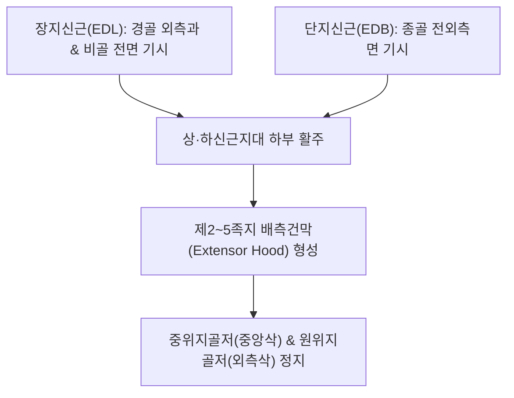

# [[총지신근]](Extensor Digitorum / 발가락폄근 복합체)

> **핵심 요약 (Key Summary)**:
> 종아리 전방 구획의 외재근인 **[[장지신근]](EDL)**과 발등의 내재근인 **[[단지신근]](EDB)**이 발가락 배측에서 지배건막(Extensor expansion)을 통해 융합된 기능적 발가락 신전근 복합체.
> [[심비골신경]](L4-S1, 상위의 [[비골신경]] 분지)의 지배를 받으며, 발목 족배굴곡 및 2~5지 발가락 관절 신전을 통합 제어.
> 주치 병증은 발등 신근 건초염, [[망치족]](Hammer toe), 발가락 신전 경련 및 [[전경골근]] 부전 시 보상 과사용통.

---

## 📌 목차
1. [해부학적 정밀 구조 및 지배 신경/혈관](#1-해부학적-정밀-구조-및-지배-신경혈관)
2. [생체역학·토크 분석 & 근막 사슬 (Biomechanical Synergy)](#2-생체역학토크-분석--근막-사슬-biomechanical-synergy)
3. [근막통증증후군(TP) & 연관통 패턴 (Travell & Simons)](#3-근막통증증후군tp--연관통-패턴-travell--simons)
4. [초음파 해부학(Sonoanatomy) 및 중재 시술 랜드마크](#4-초음파-해부학sonoanatomy-및-중재-시술-랜드마크)
5. [⭐ 원장님 심층 임상 고찰 및 원본 필기 (Clinical Pearls)](#5--원장님-심층-임상-고찰-및-원본-필기-clinical-pearls)
6. [관련 임상 질환 및 운동손상 증후군 총괄](#6-관련-임상-질환-및-운동손상-증후군-총괄)
7. [추나·도수치료(MET/PIR) & 침구·약침·재활 프로토콜](#7-추나도수치료metpir--침구약침재활-프로토콜)
8. [출처 및 학술 참고 문헌 (References)](#8-출처-및-학술-참고-문헌-references)

---

## 1. 해부학적 정밀 구조 및 지배 신경/혈관

### 1) 해부학 구조 상세

| 항목 | 상세 내용 |
| :--- | :--- |
| **복합체 구성** | • **장지신근(EDL)**: [[경골]](Tibia) 외측과 및 [[비골]](Fibula) 전면 기시 (외재근) • **단지신근(EDB)**: [[종골]](Calcaneus) 상외측면 족근동 기시 (내재근) |
| **정지 (Insertion)** | 2~5번째 발가락의 **배측건막(Extensor hood)**을 형성하여 중위지골저 및 원위지골저에 정지 |
| **신경 지배** | [[심비골신경]](Deep fibular nerve, L4-S1) 본간 및 외측 말초 분지 |
| **혈관 공급** | 전경골동맥 및 족배동맥 분지망 |
| **기능적 구조** | 전방 신근지대(Extensor retinaculum) 아래를 통과하며 활액초(Synovial sheath)에 둘러싸여 마찰을 완충 |

---

## 2. 생체역학·토크 분석 & 근막 사슬 (Biomechanical Synergy)

### 1) 기능 및 생체역학
* **발목 족배굴곡 및 발가락 신전 통합 토크**:
  * 보행 유각기 동안 지면 클리어런스를 확보하고, 착지 직전 발가락을 들어 올려 발끝 충돌을 방어.
* **외재근과 내재근의 협응**:
  * 장지신근이 전반적인 강한 신전력을 제공하고, 단지신근이 발가락 개별 관절의 정밀한 각도를 미세 조율.
* **[[장지굴근]]과의 길항 균형**:
  * 족저 굴곡근의 강력한 지면 파지력에 대항하여 발가락의 신전-굴곡 시상면 중립을 유지.

### 2) 근막 사슬 (Anatomy Trains)
* **표면전방선(Superficial Front Line)**: 발가락 끝에서 신근지대를 거쳐 [[전경골근]], [[제3비골근]], [[대퇴사두근]], [[슬개골]]로 연결.

---

## 3. 근막통증증후군(TP) & 연관통 패턴 (Travell & Simons)

### 1) 발통점(Trigger Point) 위치 및 연관통
* **발통점 위치**: 종아리 전외측 상부 1/3(장지신근 근복) 및 외과 전하방 족근동 부위(단지신근 근복).
* **연관통 양상**:
  * 발목 전면 중앙에서 발등 전체와 제2~4 발가락 등쪽 끝으로 쑤시고 타는 듯한 통증 방사.
  * 보행 시 발가락을 들어 올릴 때 발등이 끊어질 듯한 극통 발현.

---

## 4. 초음파 해부학(Sonoanatomy) 및 중재 시술 랜드마크

### 1) 초음파 스캔 뷰
* **발목 전면 횡단 스캔**:
  * 하하신근지대 Y자 분지부(Frondiform ligament) 아래를 통과하는 신근건들의 활액초 비후 및 활액 저류 감별.

### 2) 침도 및 안전 자침 마진
* **[[족삼리(ST36)]] 외측 / 해계(ST41) 외측**: 족배동맥 맥동을 확인하여 피하고 건막 사이로 15~25mm 사자.

---

## 5. ⭐ 원장님 심층 임상 고찰 및 원본 필기 (Clinical Pearls)

### 1) 장지신근 vs 단지신근 vs 총지신근 용어 및 임상 실체 (원장님 핵심 팁 100% 보존)
* **해부학적 용어 혼선 정리**:
  * 상지에는 '총지신근(EDC)'이라는 단일 근육이 존재하지만, 하지에서는 통상 종아리의 **장지신근(EDL)**과 발등의 **단지신근(EDB)**을 합쳐 임상적으로 '발가락 신전근 복합체(총지신근)'로 통칭함.
  * 치료 시 종아리의 TrP(장지신근)와 발등 외과의 TrP(단지신근)를 동시에 자침해야 발등 통증이 재발하지 않음.

### 2) 전경골근 약화 보상과 망치족(Hammer Toe) 변형 사슬
* 전경골근이 억제되면 보행 유각기 발끝을 들기 위해 신전근 복합체가 상시 과수축하여 MTP 과신전 및 **[[망치족]](Hammer toe)** 변형 유발.

---

## 6. 관련 임상 질환 및 운동손상 증후군 총괄

| 임상 질환 / 증후군 | 병리적 연관 기전 | 주요 증상 및 이학적 검사 | 핵심 교정 타깃 |
| :--- | :--- | :--- | :--- |
| **발등 신근 건초염** | 신근지대 하부 건 마찰 및 꽉 조이는 신발 압박 | 발등 부종, 마찰음(Crepitus), 발가락 신전통 | 신근지대 도침 박리, 소염 약침 |
| **[[망치족]](Hammer Toe)** | 신전근 과수축으로 MTP 과신전 및 지간관절 굴곡 고착 | 발가락 등쪽 굳은살, 신발 마찰통 | 신전근 PIR, 내재근 강화 |
| **전방 구획 증후군 연계** | 장지신근 내압 상승으로 신경혈관 허혈 | 정강이 앞쪽 팽만감, 감각 저하 | 전방 구획 도침 감압술 |

* **발가락 신전 저항 검사**: 2~5지 발가락을 위로 힘껏 젖히게 하고 검사자가 아래로 저항할 때 발등 중앙 및 종아리 전외측에 통증이 나타나면 신전근 복합체 병증 확진.

---

## 7. 추나·도수치료(MET/PIR) & 침구·약침·재활 프로토콜

### 1) 한의 침구 및 약침 요법
* **침구 치료**: [[족삼리(ST36)]] 외측, 풍륭(ST40), 해계(ST41), 함곡(ST43) 심부 자침.
* **도침 요법**: 하하신근지대 하부의 만성 건막 비후 부위 소침도 종축 절개 감압.

### 2) 도수 치료 및 재활
* **신전근 복합체 수동 스트레칭**: 발목을 완전 저측굴곡시키고 발가락 2~5지를 족저 방향으로 구부려 20초간 유지.
* **발가락 수건 쥐기(Towel Curls)**: 내재근을 활성화하여 보상적 신전근 과긴장을 차단.

---

## 8. 출처 및 학술 참고 문헌 (References)

* Standring S. *Gray's Anatomy: The Anatomical Basis of Clinical Practice*. 42nd ed. Elsevier, 2020: 1363-1367.
  * `[연구 요약]`: 장지신근 및 단지신근의 기시·정지, 배측건막 형성 해부학과 심비골신경 지배 분석.
* Zember J, et al. *The frondiform ligament and pseudotenosynovitis of the extensor digitorum longus tendon: MRI evaluation with cadaveric correlation*. Skeletal Radiol, 2016; 45(8): 1121-1127. [PMID: 27107999](https://pubmed.ncbi.nlm.nih.gov/27107999/)
  * `[연구 요약]`: 하하신근지대(Frondiform ligament)와 발가락 신전근 건 복합체의 해부학적 마찰 및 가성 건초염(Pseudotenosynovitis) 병태생리를 MRI와 사체 해부로 규명.
* Travell, J. G., & Simons, D. G. *Myofascial Pain and Dysfunction*. Williams & Wilkins, 1999.
  * `[연구 요약]`: 발가락 신전근 발통점과 발등 및 발가락 방사통 패턴.
