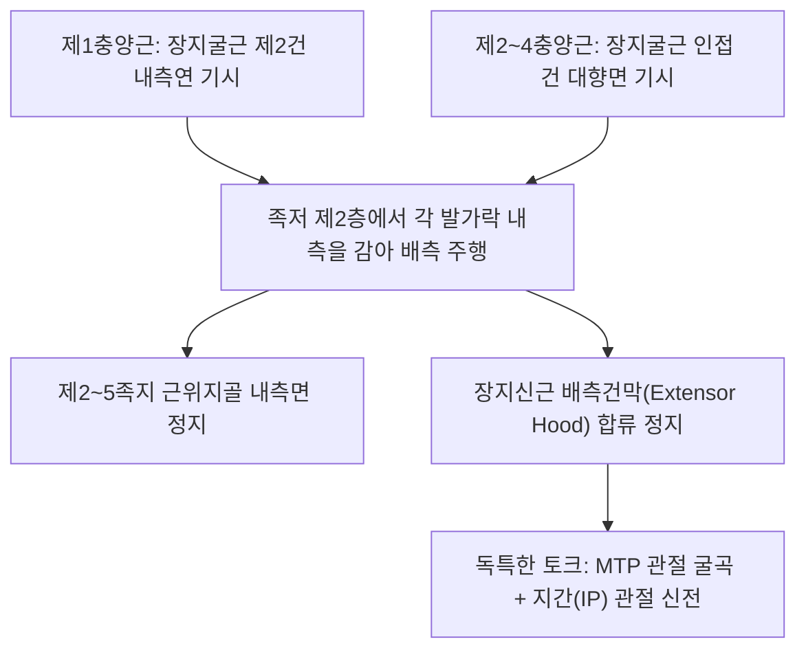

# [[충양근(발)]](Lumbricals of Foot / 벌레근(발))

> **핵심 요약 (Key Summary)**:
> 족저 제2층에서 **[[장지굴근]](FDL)의 4개 건**에서 기시하여 2~5번째 발가락 근위지골 내측면 및 배측 신전건막에 정지하는 4개의 벌레 모양 작은 내재근.
> 제1충양근은 [[내측족저신경]](S2-S3), 제2~4충양근은 [[외측족저신경]](S2-S3, 상위의 [[경골신경]] 및 [[좌골신경]] 분지)의 지배를 받으며, **MTP 관절 굴곡 + 지간관절(IP) 신전**의 정밀 토크를 발휘.
> 주치 병증은 [[망치족지]](Hammer toe), **갈퀴족지(Claw toe)**, 당뇨병성 족부 궤양 고압력 및 전족부 지간통.

---

## 📌 목차
1. [해부학적 정밀 구조 및 지배 신경/혈관](#1-해부학적-정밀-구조-및-지배-신경혈관)
2. [생체역학·토크 분석 & 근막 사슬 (Biomechanical Synergy)](#2-생체역학토크-분석--근막-사슬-biomechanical-synergy)
3. [근막통증증후군(TP) & 연관통 패턴 (Travell & Simons)](#3-근막통증증후군tp--연관통-패턴-travell--simons)
4. [초음파 해부학(Sonoanatomy) 및 중재 시술 랜드마크](#4-초음파-해부학sonoanatomy-및-중재-시술-랜드마크)
5. [⭐ 원장님 심층 임상 고찰 및 원본 필기 (Clinical Pearls)](#5--원장님-심층-임상-고찰-및-원본-필기-clinical-pearls)
6. [관련 임상 질환 및 운동손상 증후군 총괄](#6-관련-임상-질환-및-운동손상-증후군-총괄)
7. [추나·도수치료(MET/PIR) & 침구·약침·재활 프로토콜](#7-추나도수치료metpir--침구약침재활-프로토콜)
8. [출처 및 학술 참고 문헌 (References)](#8-출처-및-학술-참고-문헌-references)

---

## 1. 해부학적 정밀 구조 및 지배 신경/혈관

### 1) 해부학 구조 상세

| 항목 | 상세 내용 |
| :--- | :--- |
| **기시 (Origin)** | • **제1충양근**: 장지굴근 제2지 건의 내측연 (단일우상근 Unipennate) • **제2, 3, 4충양근**: 장지굴근 인접한 2개 건의 대향면 (이우상근 Bipennate) |
| **정지 (Insertion)** | 각 발가락(제2~5족지) **근위지골 내측면** 및 배측 **[[장지신근]] 신전건막(Extensor hood)**에 합류 정지 |
| **신경 지배** | • **제1충양근**: [[내측족저신경]](Medial plantar nerve, S2-S3) • **제2~4충양근**: [[외측족저신경]](Lateral plantar nerve 심분지, S2-S3) |
| **혈관 공급** | 족저동맥궁의 족저중족동맥 분지망 |
| **해부학적 층 (Layer)** | 족저 제2층(Second layer of sole)에서 [[족저방형근]]과 함께 장지굴근 건에 부착 주행 |

---

## 2. 생체역학·토크 분석 & 근막 사슬 (Biomechanical Synergy)

### 1) MTP 관절 굴곡 + 지간관절(PIP/DIP) 신전의 독보적 토크
* **발가락 지면 접촉 면적 최적화**:
  * MTP 관절 회전축의 족저면을 지나므로 MTP는 구부리고, 신전건막에 합류하므로 지간관절은 펴줌.
  * 장지굴근 단독 수축 시 발가락이 과도하게 오므라드는 컬링(Curling)을 중간에서 저지하여 발가락이 바닥에 평평하게 닿도록 유지.
* **풍부한 근방추와 정밀 고유수용성 감각**:
  * 인체 내재근 중 근방추 밀도가 가장 높아, 보행 시 지면의 미세한 요철을 실시간으로 중추신경계에 피드백하는 센서 역할 수행.

### 2) 근막 사슬 (Anatomy Trains)
* **심층후방선(Deep Back Line)**: 전족부 지골에서 [[장지굴근]], [[족저방형근]], [[후경골근]]으로 이어지는 발바닥 심부 코어 사슬.

---

## 3. 근막통증증후군(TP) & 연관통 패턴 (Travell & Simons)

### 1) 발통점(Trigger Point) 위치 및 연관통
* **발통점 위치**: 제2~5 중족골 간격 족저면, 장지굴근 건 사이 심부 근복.
* **연관통 양상**:
  * **발가락 족저면 및 지간 통증**: 2~5번째 발가락 바닥과 발가락 사이가 화끈거리고 찌릿하게 아픔.
  * 보행 시 발가락 끝이 바닥을 제대로 디디지 못하고 허공에 뜨는 느낌 발현.
* **임상적 특징**: 발가락에 힘이 들어가지 않아 슬리퍼를 신으면 자꾸 벗겨짐.

---

## 4. 초음파 해부학(Sonoanatomy) 및 중재 시술 랜드마크

### 1) 초음파 스캔 뷰
* **발바닥 전중부 횡단 스캔**:
  * 장지굴근 건 내측에서 출발하여 배측으로 감아 올라가는 충양근의 작은 방추형 근복 확인.
  * 중족골두 하방 신경혈관속과의 해부학적 인접 관계 감별.

### 2) 침도 및 안전 자침 마진
* **팔풍(EX-LE10) / 함곡(ST43) 지간부위**: 발가락 사이 웹 공간에서 중족골두를 향해 15~20mm 사자.

---

## 5. ⭐ 원장님 심층 임상 고찰 및 원본 필기 (Clinical Pearls)

### 1) 망치족지/갈퀴족지 발생의 핵심: 충양근 기능 부전 (원장님 핵심 팁 100% 보존)
* **내재근 마이너스 족부 (Intrinsic-minus Foot)**:
  * 충양근과 골간근([[배측골간근(발)]], [[장측골간근(발)]])이 마비되거나 만성 피로로 약화되면, 'MTP 굴곡-IP 신전'의 균형추가 깨짐.
  * 장지신근의 배측 견인력이 MTP 관절을 뒤로 꺾고(과신전), 장지굴근이 IP 관절을 바닥으로 잡아당겨(과굴곡) 전형적인 **[[망치족지]](Hammer toe)** 및 **갈퀴족지(Claw toe)** 변형이 고착화됨.
  * 발가락 변형 초기 단계에서 충양근 근복 침구 치료 및 내재근 재활을 시행하면 수술 없이 정상 정렬 회복이 가능함.

### 2) 당뇨병성 족부 궤양 예방의 최전선
* 당뇨 환자에서 충양근 위축은 발가락 변형을 유발하고 중족골두 밑에 국소 고압력을 만들어 족부 궤양의 시발점이 됨. 충양근 근력 보존이 당뇨발 예방의 핵심 지표임.

---

## 6. 관련 임상 질환 및 운동손상 증후군 총괄

| 임상 질환 / 증후군 | 병리적 연관 기전 | 주요 증상 및 이학적 검사 | 핵심 교정 타깃 |
| :--- | :--- | :--- | :--- |
| **[[망치족지]] / 갈퀴족지** | 충양근 마비로 MTP 과신전 및 IP 과굴곡 고착 | 발가락 중간 마디 등쪽 마찰 굳은살, 보행통 | 충양근 전침 자극, 굴근건 스트레칭 |
| **중족골두 압박통** | 충양근 약화로 발가락 접지력 소실, 중족골두 하중 집중 | 보행 시 전족부 바닥이 타는 듯한 작열통 | 숏풋 운동, 충양근 강화 훈련 |
| **지간 신경 압박통** | 충양근 연축으로 족저 지간신경 기계적 자극 | 2-3, 3-4 발가락 사이 저림 및 감각 이상 | 지간 침도 감압, 충양근 이완 |

* **충양근 기능 평가 검사**: 발목을 중립으로 한 상태에서 MTP 관절을 90도 구부리면서 동시에 IP 관절을 완전히 펴게 할 때, IP 관절이 구부러진다면 충양근 위약(Intrinsic-minus) 확진.

---

## 7. 추나·도수치료(MET/PIR) & 침구·약침·재활 프로토콜

### 1) 한의 침구 및 약침 요법
* **침구 치료**: 팔풍(EX-LE10), 함곡(ST43), 족임읍(GB41), 내정(ST44) 침구 치료.
* **도침 요법**: 중족골두 사이 심횡중족인대 및 충양근 건막 통과부 소침도 미세 감압술.
* **약침 치료**: 지간신경 부위에 신바로약침 0.3cc 주입.

### 2) 도수 치료 및 재활
* **충양근 분리 스트레칭**: MTP 관절을 수동 신전시키면서 IP 관절을 굴곡시키는 스트레칭.
* **구슬 집기(Marble Pick-up)**: 발가락으로 유리구슬을 집어 컵에 넣는 정밀 내재근 제어 훈련.

---

## 8. 출처 및 학술 참고 문헌 (References)

* Standring S. *Gray's Anatomy: The Anatomical Basis of Clinical Practice*. 42nd ed. Elsevier, 2020: 1366.
  * `[연구 요약]`: 충양근의 장지굴근 건 기시, 배측건막 정지 해부학과 내외측 족저신경 분지 지배 분석.
* Chakravarthi KK, et al. *Morphological Variations of Foot Lumbricals and Their Clinical Significance: A Cadaveric Study*. Cureus, 2024. [PMID: 40019125](https://pubmed.ncbi.nlm.nih.gov/40019125/)
  * `[연구 요약]`: 발 충양근의 기시·주행 해부학적 형태 변이와 갈퀴족지 변형 및 보행 생체역학 임상 의의 규명.
* Travell, J. G., & Simons, D. G. *Myofascial Pain and Dysfunction*. Williams & Wilkins, 1999.
  * `[연구 요약]`: 족저 충양근 발통점과 발가락 방사통 패턴.
