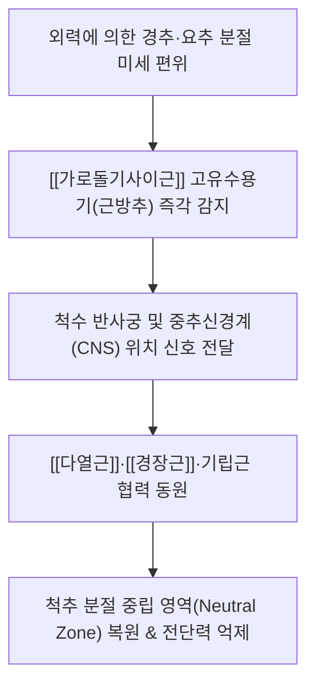
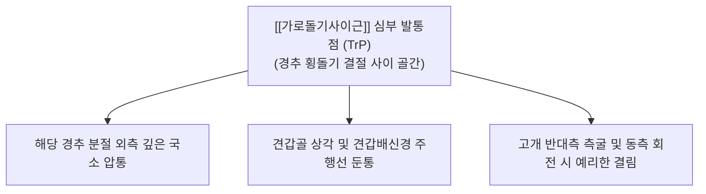

# [[가로돌기사이근]](Intertransversarii muscles)

> **핵심 요약 (Key Summary)**:
> 인접한 척추뼈의 가로돌기(횡돌기) 사이를 수직으로 연결하는 척추의 가장 짧은 심부 분절근육군으로, 경부(앞·뒤)·흉부·요부(가쪽·안쪽)로 정밀하게 구분됩니다.
> 척수신경 전지 및 후지의 이중 지배를 받으며, 미세한 측굴을 유도하지만 인체 최고 수준의 근방추(Muscle spindle) 밀도를 보유하여 척추 분절간 3차원 위치 감각 및 고유수용성 피드백을 제공하는 '키네시올로지컬 센서' 역할을 전담합니다.
> 경추성 두통, 편타 손상 후 만성 경항통, 척추 분절 불안정증 및 횡돌기간 신경혈관 포착의 핵심 병변근이며, 천정·천유·풍지 및 횡돌기 후결절 골막 도침·침구와 분절간 MET가 표적입니다.

---

## 📌 목차
1. [해부학적 정밀 구조 및 지배 신경/혈관](#1-해부학적-정밀-구조-및-지배-신경혈관)
2. [생체역학·토크 분석 & 근막 사슬 (Biomechanical Synergy)](#2-생체역학토크-분석--근막-사슬-biomechanical-synergy)
3. [근막통증증후군(TP) & 연관통 패턴 (Travell & Simons)](#3-근막통증증후군tp--연관통-패턴-travell--simons)
4. [초음파 해부학(Sonoanatomy) 및 중재 시술 랜드마크](#4-초음파-해부학sonoanatomy-및-중재-시술-랜드마크)
5. [⭐ 원장님 심층 임상 고찰 및 원본 필기 (Clinical Pearls)](#5-원장님-심층-임상-고찰-및-원본-필기-clinical-pearls)
6. [관련 임상 질환 및 운동손상 증후군 총괄](#6-관련-임상-질환-및-운동손상-증후군-총괄)
7. [추나·도수치료(MET/PIR) & 침구·약침·재활 프로토콜](#7-추나도수치료metpir--침구약침재활-프로토콜)
8. [출처 및 학술 참고 문헌 (References)](#8-출처-및-학술-참고-문헌-references)

---

## 1. 해부학적 정밀 구조 및 지배 신경/혈관

| 구분 | 기시 (Origin) | 정지 (Insertion) | 신경 지배 (Innervation) | 임상적 해부 랜드마크 |
| :--- | :--- | :--- | :--- | :--- |
| **앞경부가로돌기사이근** (Anterior cervical) | 상위 경추 횡돌기 전결절 (C2~C6 anterior tubercles) | 인접 하위 경추 횡돌기 전결절 | 척수신경 전지 (Cervical ventral rami) | 전결절 골면 부착, [[전사각근]] 및 [[경장근]] 기시부 인접 |
| **뒤경부가로돌기사이근** (Posterior cervical) | 상위 경추 횡돌기 후결절 (C2~C7 posterior tubercles) | 인접 하위 경추 횡돌기 후결절 | • 외측부: 척수신경 전지 • 내측부: 척수신경 후지 | 횡돌기간공 통과 [[추골동맥]] 후외측 보호 |
| **등가로돌기사이근** (Thoracic) | 흉추 횡돌기 (흔적성) | 인접 흉추 횡돌기 | 척수신경 후지 | 대부분 결손되거나 횡돌기간인대로 대체 |
| **가쪽허리가로돌기사이근** (Lateral lumbar) | 요추 늑골돌기(Costal process) | 인접 요추 늑골돌기 | 척수신경 전지 | 늑골돌기 사이를 수직 주행, 요방형근 심층 |
| **안쪽허리가로돌기사이근** (Medial lumbar) | 요추 부돌기(Accessory process) | 인접 요추 유두돌기(Mammillary process) | 척수신경 후지 | [[다열근]] 및 회선근군 외측에 밀착 주행 |

### 🔬 신경혈관 통로 및 횡돌기간공 주행 관계
* 경추부에서 앞경부가로돌기사이근과 뒤경부가로돌기사이근 사이의 틈새로 **척수신경 전지(Spinal nerve ventral ramus)**가 외측으로 빠져나옵니다.
* 두 근육 사이의 심부 공간에는 제1~6경추 횡돌기간공(Transverse foramen)을 수직 관통하는 **[[추골동맥]](Vertebral artery)**과 추골정맥총이 상행합니다. 따라서 경추 가로돌기사이근의 연축 및 비후는 신경근 자극뿐만 아니라 추골동맥 혈류 저하를 유발하는 해부학적 관문 역할을 합니다.

---

## 2. 생체역학·토크 분석 & 근막 사슬 (Biomechanical Synergy)

### ⚙️ 운동 토크 생성 vs 고유수용성 감각 센서 (Proprioceptive Sensor)
* **미세한 측굴 토크**:
  * 단일 분절을 연결하는 모멘트암이 1cm 미만으로 매우 짧아, 인체 척추 전체의 측굴력을 발휘하는 주동근은 아닙니다. 주된 기계적 역할은 인접 분절간의 과도한 측방 전단(Shear) 및 회전을 제어하는 '분절 스토퍼(Segmental stopper)'입니다.
* **인체 최고 수준의 근방추 밀도**:
  * 선행 조직학 연구(Amonoo-Kuofi)에 따르면, 가로돌기사이근은 표재성 척추 기립근에 비해 그램당 **근방추(Muscle spindle) 밀도가 5~10배 이상** 높습니다.
  * 이는 힘을 내는 근육(Force generator)이 아니라, 척추 분절의 3차원적 변위와 인장력을 실시간으로 모니터링하여 중추신경계에 전달하는 **키네시올로지컬 센서(Kinesiological sensor)**로 특화되었음을 증명합니다.
* **Panjabi 척추 안정화 모델과의 연계**:
  * 능동 하위시스템(Active subsystem)의 분절 조절기로서, 척추의 중립 영역(Neutral zone)이 비정상적으로 팽창하여 척추 불안정증이 발생하는 것을 방지합니다.

### 🔗 근막 사슬 연계 (Anatomy Trains)
* **외측선(Lateral Line)**: 비골근-장경인대-외복사근-늑간근을 거쳐 경추 횡돌기간근 및 [[두판상근]]으로 이어지는 신체 측면 관상면 안정화 축의 심부 정렬 지지대입니다.
* **심부 척추 슬링**: 인접 횡돌기간인대, 황색인대 및 척추 후관절낭과 결합조직성 근막으로 융합되어 척추 분절의 일체형 관절막 보호 장치를 형성합니다.

---

## 3. 근막통증증후군(TP) & 연관통 패턴 (Travell & Simons)

### ⚡ 발통점(TrP) 및 통증 방사 양상
* **발통점 위치**: 경추 횡돌기 전결절과 후결절 사이의 좁은 골간 틈새 또는 요추 늑골돌기 사이 심층.
* **연관통 특성**:
  * **경추 분절 국소 압통**: 환자가 손가락 하나로 "목 옆 뼈마디 깊은 곳이 쑤신다"고 정확히 짚는 핀포인트 둔통(Pinpoint ache).
  * **견갑골 상각 방사통**: C3~C5 가로돌기사이근의 TrP는 [[견갑거근]] 심층을 따라 견갑골 상각(Superior angle) 및 견갑배신경 분포 영역으로 묵직한 방사통을 투사.
  * **가동역 제한**: 목을 반대쪽으로 측굴(Side-bending)할 때 환측 횡돌기간근이 신장되면서 찢어지는 듯한 날카로운 저항감 발생.

### 🔬 유발 및 지속 인자
* 한쪽 귀와 어깨 사이에 전화기를 끼우고 통화하는 자세.
* 턱을 괴거나 모니터를 비스듬히 바라보는 만성 불균형 체위.
* 자동차 측면 추돌 시 경추에 가해지는 급격한 측방 채찍질(Whiplash) 전단 손상.

---

## 4. 초음파 해부학(Sonoanatomy) 및 중재 시술 랜드마크

* **초음파 스캔 프로토콜**:
  * 고주파 선형 프로브를 경추 외측부에 관상단면(Coronal view) 또는 사선 시상단면으로 거치.
  * C3~C6 횡돌기의 특징적인 **전결절(Anterior tubercle)**과 **후결절(Posterior tubercle)**의 골면 음영 확인 (전결절은 뾰족하고 후결절은 둥근 형태, C7은 전결절이 결손되어 편평한 단일 결절 형태).
  * 전결절과 후결절 사이의 저에코성 골간 근섬유가 가로돌기사이근이며, 그 사이를 관통하여 주행하는 척수신경 전지(Spinal nerve root)의 원형 저에코 다발 동정.
  * 컬러 도플러로 횡돌기간공 내부의 **[[추골동맥]](Vertebral artery)** 박동 혈류 신호를 필히 확인.

* **중재 시술 안전 랜드마크 (CRITICAL)**:
  * **추골동맥 및 신경근 손상 절대 방지**: 전결절과 후결절 사이 골간으로 무리하게 깊숙이 진침하면 추골동맥 천자나 신경근 손상이 발생할 수 있습니다.
  * **후결절 골면 안착(Bone touch) 원칙**: 침도(Acupotomy) 및 침구 시술 시 반드시 횡돌기 후결절의 외측 골면에 먼저 접촉(Bone touch)하여 깊이를 통제한 후, 골면을 따라 가볍게 1~2mm 미세 박리해야 안전합니다.

---

## 5. ⭐ 원장님 심층 임상 고찰 및 원본 필기 (Clinical Pearls)

### 1) 횡돌기 사이 미세 아탈구와 분절성 감각 왜곡 (원장님 필기 100% 보존)
* 환자가 "목 특정 마디가 콱 막힌 것 같고, 고개를 돌릴 때마다 그 마디에서 딱딱 소리와 함께 찌릿하다"고 호소하면 단순 표재근 긴장이 아니라 **횡돌기간근 연축과 관절돌기간 미세 아탈구(Subluxation)** 병소입니다.
* 가로돌기사이근은 근방추가 극도로 밀집되어 있어, 단 1mm의 미세 아탈구만 발생해도 과도한 구심성 통증 신호와 신경근 연축을 유발합니다. 표재근인 [[승모근]]이나 [[흉쇄유돌근]]만 치료해서는 해결되지 않으며, 해당 분절 횡돌기 외측연을 정확히 표적해야 합니다.

### 2) 추나 치료 시 분절 가동화(Segmental Mobilization) (원장님 필기 100% 보존)
* 거친 고속 저진폭(HVLA) 회전 스러스트 추나는 횡돌기간근의 신장 반사(Stretch reflex)를 자극하여 오히려 급성 경련을 악화시킬 수 있습니다.
* 시술자의 모지(엄지) 접촉면으로 환자의 환측 횡돌기 후결절을 가볍게 받치고, 경추를 반대측으로 미세 측굴시킨 상태에서 부드러운 측방 글라이딩(Lateral glide) 압력을 10~15초간 유지하는 **분절 가동화 기법**을 적용해야 근방추의 과흥분이 리셋됩니다.

### 3) 경추 외측 도침 치료 시 안전 수칙 (원장님 필기 100% 보존)
* 추골동맥이 주행하는 횡돌기간공을 침범하지 않도록, 반드시 후결절 골막에 Bone touch를 확인한 후 0.35×25mm 소형 침도로 횡돌기간 인대 및 근막의 유착만 1~2회 얕게 절개 박리합니다. 시술 직후 환자가 호소하던 고개 돌릴 때의 걸림 증상이 즉각 소실됩니다.

---

## 6. 관련 임상 질환 및 운동손상 증후군 총괄

| 임상 질환 / 증후군 | 병리적 연관 기전 | 주요 증상 및 이학적 검사 | 핵심 교정 타깃 |
| :--- | :--- | :--- | :--- |
| **경추 분절 불안정증** (Cervical Instability) | 가로돌기사이근 고유수용성 제어 억제 | 머리를 지탱하기 힘듦, 잦은 목 삐임 | 분절 안정화 재활 & 경장근 협동 강화 |
| **편타 손상 후유증** (Whiplash Associated Disorders) | 측방 가감속 손상에 의한 근막 미세 파열 | 편측 경추 지속 둔통, 경추 회전 장애 | 횡돌기 후결절 약침 & 분절 MET |
| **횡돌기간 신경근 포착** (Intertransverse Entrapment) | 근 비후 및 섬유화로 경신경 전지 압박 | 어깨 상부 저림, 상지 피부분절 감각 이상 | 횡돌기간 틈새 도침 미세 박리술 |
| **경추성 현기증** (Cervicogenic Dizziness) | 비대칭적 고유수용기 감각 입력 오류 | 고개 돌릴 때 순간적인 붕 뜨는 어지럼 | 횡돌기간근 이완 & 전정재활 연동 |

---

## 7. 추나·도수치료(MET/PIR) & 침구·약침·재활 프로토콜

### 👐 추나 및 도수치료 (MET/PIR)
* **분절간 등척성 수축-이완 (Segmental MET)**:
  * 환자를 앙와위로 눕히고, 시술자는 환자의 머리를 환측 횡돌기간근이 신장되는 반대측 측굴 장벽까지 부드럽게 거치합니다.
  * 환자에게 "머리를 제 손 저항 방향(환측 측굴)으로 15%의 가벼운 힘으로 미세요"라고 지시하며 5~7초간 등척성 저항을 유지합니다.
  * 호기와 함께 완전히 이완시킨 후, 새로운 측굴 범위로 15초간 유지하며 3회 반복합니다.

### 🎯 침구 및 약침 치료 프로토콜
* **주요 경혈 타깃**:
  * 천정(LI17): 흉쇄유돌근 후연, 횡돌기 높이.
  * 천유(TE16): 하악각 높이, 횡돌기 후결절 인접.
  * 부돌(LI18): 갑상연골 상연 높이, 횡돌기 전외측 접근.
* **침도 요법(Acupotomy)**:
  * 횡돌기 후결절 골면에 Bone touch 후 골막 유착 조직을 종축으로 1~2회 미세 절개하여 신경혈관 감압.
* **약침 처방**:
  * 신바로약침 또는 중성어혈약침 0.1~0.2cc를 횡돌기 후결절 골막 주위에 섬세하게 분주하여 무균성 신경근 염증 및 섬유성 유착 완화.

---

## 8. 출처 및 학술 참고 문헌 (References)

1. **Standring, S. (2020)**. *Gray's Anatomy: The Anatomical Basis of Clinical Practice* (42nd ed.). Elsevier, pp. 838-840.
   - [연구 요약] 경부 및 요부 가로돌기사이근의 전·후·내·외측 분절 해부학, 척수신경 전지 및 후지 지배 체계, 횡돌기간공 및 추골동맥과의 해부학적 주행 관계 분석.
2. **Travell, J. G., & Simons, D. G. (1999)**. *Myofascial Pain and Dysfunction: The Trigger Point Manual*, Vol. 1 (2nd ed.). Williams & Wilkins, pp. 462-475.
   - [연구 요약] 척추 심부 단분절 근육군의 발통점 활성화 기전, 횡돌기간 핀포인트 압통 및 척추 회전 제한의 임상적 연관통 패턴 규명.
3. **Amonoo-Kuofi, H. S. (1983)**. The density of muscle spindles in the medial, intermediate and lateral columns of human intrinsic postvertebral muscles. *J Anat*, 136(Pt 3), 509-519. [PMID: 6224767](https://pubmed.ncbi.nlm.nih.gov/6224767/)
   - [연구 요약] 인체 고유 배근 중 가로돌기사이근을 포함한 심층 단분절 근육군이 표재근에 비해 월등히 높은 근방추 밀도를 보유하여 척추 자세 제어의 고유수용성 센서로 기능함을 입증.
4. **Panjabi, M. M. (1992)**. The stabilizing system of the spine. Part I. Function, dysfunction, adaptation, and enhancement. *J Spinal Disord*, 5(4), 383-389. [PMID: 1490034](https://pubmed.ncbi.nlm.nih.gov/1490034/)
   - [연구 요약] 척추 안정화의 3대 요소(능동·수동·신경 조절계) 모델을 제시하고, 심부 분절근의 고유수용성 피드백이 척추 중립 영역(Neutral Zone) 유지에 미치는 영향 규명.
5. **Bogduk, N. (1982)**. The clinical anatomy of the cervical dorsal rami. *Spine*, 7(4), 319-330. [PMID: 7135065](https://pubmed.ncbi.nlm.nih.gov/7135065/)
   - [연구 요약] 경신경 후지의 분지와 경추 심부 근육군(뒤가로돌기사이근 내측부 등)의 해부학적 지배 관계 및 만성 경추성 통증의 신경해부학적 기전 분석.
