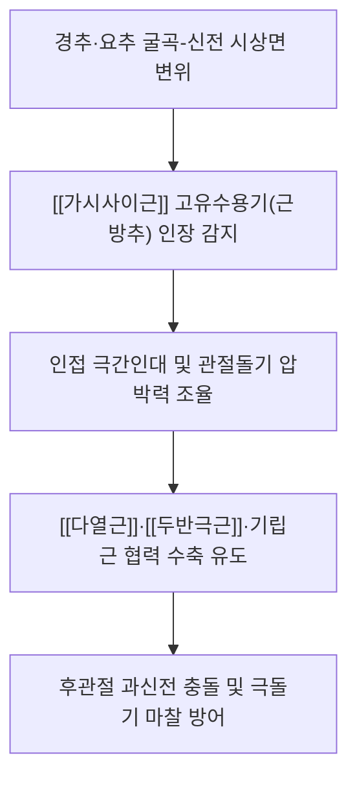
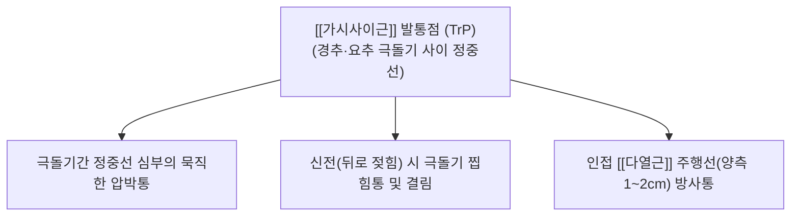

# [[가시사이근]](Interspinales muscles)

> **핵심 요약 (Key Summary)**:
> 인접한 척추뼈의 가시돌기(극돌기) 사이를 수직으로 연결하는 척추의 가장 짧은 정중 심부 근육군으로, 목가시사이근(경극간근)·등가시사이근(흉극간근)·허리가시사이근(요극간근)으로 구분됩니다.
> 척수신경 후지 내측지(Medial branches of dorsal rami)의 지배를 받으며, 극간인대와 협력하여 척추의 과도한 굴곡을 제한하고 분절 신전을 보조하지만, 극도로 풍부한 근방추를 바탕으로 척추 시상면의 미세 동적 정렬을 감지하는 핵심 고유수용성 모니터링 역할을 수행합니다.
> 바스트룹 증후군(Kissing spine), 경추 및 요추 극간인대염, 편타 손상 후 과신전성 찝힘통, 척추 후관절 증후군의 핵심 병변근이며, 대추·아문·명문 등 독맥 혈위 침구, 극돌기 골막 도침 감압술 및 시상면 신장 MET가 표적입니다.

---

## 📌 목차
1. [해부학적 정밀 구조 및 지배 신경/혈관](#1-해부학적-정밀-구조-및-지배-신경혈관)
2. [생체역학·토크 분석 & 근막 사슬 (Biomechanical Synergy)](#2-생체역학토크-분석--근막-사슬-biomechanical-synergy)
3. [근막통증증후군(TP) & 연관통 패턴 (Travell & Simons)](#3-근막통증증후군tp--연관통-패턴-travell--simons)
4. [초음파 해부학(Sonoanatomy) 및 중재 시술 랜드마크](#4-초음파-해부학sonoanatomy-및-중재-시술-랜드마크)
5. [⭐ 원장님 심층 임상 고찰 및 원본 필기 (Clinical Pearls)](#5-원장님-심층-임상-고찰-및-원본-필기-clinical-pearls)
6. [관련 임상 질환 및 운동손상 증후군 총괄](#6-관련-임상-질환-및-운동손상-증후군-총괄)
7. [추나·도수치료(MET/PIR) & 침구·약침·재활 프로토콜](#7-추나도수치료metpir--침구약침재활-프로토콜)
8. [출처 및 학술 참고 문헌 (References)](#8-출처-및-학술-참고-문헌-references)

---

## 1. 해부학적 정밀 구조 및 지배 신경/혈관

| 구분 | 기시 (Origin) | 정지 (Insertion) | 신경 지배 (Innervation) | 임상적 해부 랜드마크 |
| :--- | :--- | :--- | :--- | :--- |
| **목가시사이근** (Interspinales cervicis) | 상위 경추 극돌기 하연 (C2~C7 spinous processes) | 인접 하위 경추 극돌기 상연 | 척수신경 후지 내측지 (Cervical dorsal rami medial branches) | C2 축추 극돌기가 이분(Bifid)되어 있어 가장 두텁고 뚜렷하게 쌍(Pair)으로 발달 |
| **등가시사이근** (Interspinales thoracis) | 흉추 극돌기 (흔적성) | 인접 흉추 극돌기 | 척수신경 후지 내측지 | 흉곽 구조로 인해 T1-T2, T11-T12 제외 대부분 결손 또는 극간인대로 대체 |
| **허리가시사이근** (Interspinales lumborum) | 상위 요추 극돌기 하연 (L1~L5 spinous processes) | 인접 하위 요추 극돌기 상연 | 척수신경 후지 내측지 (Lumbar dorsal rami medial branches) | 넓은 판상 요추 극돌기 사이에서 극간인대 양측에 쌍으로 배치 |

### 🔬 극간인대 및 극상인대와의 해부학적 결합 관계
* 가시사이근은 극돌기간 공간의 정중선을 차지하는 **극간인대(Interspinous ligament)**의 양측면에 직접 부착되어 주행합니다.
* 극돌기 첨부를 잇는 단단한 섬유성 띠인 극상인대(Supraspinous ligament) 및 항인대(Ligamentum nuchae)의 심층에 위치하며, 척추 굴곡 시 인대와 근육이 동시에 장력을 받아 척주 후방 장력대(Posterior tension band)의 최심부 앵커를 형성합니다.

---

## 2. 생체역학·토크 분석 & 근막 사슬 (Biomechanical Synergy)

### ⚙️ 분절 신전 보조 vs 시상면 고유수용성 센서
* **미세한 신전 토크와 인대 보조**:
  * 가시사이근의 모멘트암은 척추 굴신 운동 중심축(Instantaneous axis of rotation)에 매우 가깝기 때문에, 두경부나 상체를 통째로 들어 올리는 대단위 신전 토크는 척추기립근([[최장근]], [[장늑근]])이나 [[두반극근]]에 비해 미미합니다(전체 신전력의 2~3% 미만).
  * 주된 기계적 역할은 척추가 굴곡될 때 신장되면서 극간인대의 긴장도를 조절하고, 과도한 과굴곡을 제동하는 것입니다.
* **시상면 고유수용성 모니터링 (Proprioceptive Sensor)**:
  * 선행 조직학 연구(Amonoo-Kuofi)에 따르면, 가시사이근은 높은 밀도의 근방추를 보유하여 극돌기 사이의 0.1mm 단위 미세 간격 변화를 실시간으로 계측합니다.
  * 척추가 신전될 때 후관절(Facet joint)이 과도하게 압박되거나 극돌기간 충돌(Kissing spine)이 발생하지 않도록 중추신경계에 브레이크 신호를 보냅니다.
* **Panjabi 척추 안정화 모델**:
  * 척추 중립 영역(Neutral Zone)의 시상면 안정성을 담당하는 능동 하위시스템의 핵심 요소입니다.

### 🔗 근막 사슬 연계 (Anatomy Trains)
* **표재후방선(Superficial Back Line, SBL)**: 족저근막에서 햄스트링, 천골결절인대를 거쳐 척주 정중선을 타고 후두골로 상행하는 전신 신전선의 최심부 척주 축입니다.

---

## 3. 근막통증증후군(TP) & 연관통 패턴 (Travell & Simons)

### ⚡ 발통점(TrP) 및 통증 방사 양상
* **발통점 위치**: 경추(특히 C2-C3, C5-C6) 및 요추(L4-L5, L5-S1) 극돌기간 정중선 심부 결절.
* **연관통 특성**:
  * **정중선 국소 압박통**: 환자가 척추 뼈마디 정중앙을 가리키며 "뼈 사이가 멍든 것처럼 깊게 아프다"고 호소.
  * **신전 시 찝힘통(Impingement Ache)**: 고개를 뒤로 젖히거나 허리를 젖힐 때 극돌기 사이가 물리적으로 맞부딪히거나 찝히는 듯한 날카로운 압통 유발.
  * **외측 방사통**: 인접한 [[다열근]] 및 회선근군 섬유로 연관통이 번져 척추 정중선 양측 1~2cm 부위가 묵직하게 결림.

### 🔬 유발 및 지속 인자
* 높은 베개를 베거나 엎드려 고개를 돌리고 자는 습관.
* 천장을 오래 올려다보는 작업(도배, 페인트칠, 천장 배관 작업).
* 요추 전만 과다(Hyperlordosis) 및 힐을 자주 신어 골반이 전방경사된 체형.

---

## 4. 초음파 해부학(Sonoanatomy) 및 중재 시술 랜드마크

* **초음파 정중 시상면 스캔 (Midline Sagittal Scan)**:
  * 선형 프로브를 척추 정중선에 종단(Long-axis)으로 거치.
  * 인접한 두 극돌기(Spinous processes)의 둥근 고에코성 골 피질과 그 하방의 짙은 음향 음영(Acoustic shadow) 확인.
  * 극돌기 상하연 사이를 연결하는 고에코 섬유성 극간인대와 그 양측에 위치한 저에코 가시사이근 근섬유 단면 동정.
  * 극돌기 사이 심층에서 고에코 띠로 관찰되는 황색인대(Ligamentum flavum) 및 경막외강 랜드마크 확인.

* **중재 시술 안전 랜드마크 (CRITICAL)**:
  * **경막외강 및 척수강 침범 절대 방지**: 극돌기간 정중선으로 맹목적으로 깊이 직자하면 황색인대를 관통하여 경막외강 천자나 척수 손상을 일으킬 수 있습니다.
  * **극돌기 골면 접촉(Bone touch) 원칙**: 침도(Acupotomy) 및 침 시술 시 반드시 상위 극돌기의 하연 또는 하위 극돌기의 상연 골면에 침끝을 접촉(Bone touch)시켜 자침 깊이를 완벽히 통제한 상태에서 골막 유착을 안전하게 박리해야 합니다.

---

## 5. ⭐ 원장님 심층 임상 고찰 및 원본 필기 (Clinical Pearls)

### 1) 바스트룹 증후군(Baastrup's disease / Kissing spine) 감별과 도침 (원장님 필기 100% 보존)
* 노인성 척추 퇴행이나 요추 과전만 환자에서 인접 극돌기가 서로 맞닿아 마찰을 일으키며 극간 활액낭염과 가시사이근의 허혈성 섬유화가 호발합니다.
* 환자가 "허리나 목을 뒤로 젖힐 때 척추 정중앙 뼈마디가 찌릿하게 찝힌다"고 호소하면 100% 바스트룹 병변입니다. 극돌기간 인대 부착부에 소형 침도로 유착을 미세 절개 박리해주면 즉각 신전 가동역이 회복되고 찝힘통이 사라집니다.

### 2) C2-C3 극간 긴장과 두통 연계 (원장님 필기 100% 보존)
* 축추(C2) 극돌기는 매우 크고 이분되어 있어 [[대후두직근]], [[하두사근]], 경반극근 및 목가시사이근이 집중 부착됩니다.
* 일자목 및 거북목 환자에서 C2-C3 사이 가시사이근의 과긴장은 축추의 후방 변위를 고착화시켜 **후두하신경(Suboccipital nerve)**과 [[대후두신경]]을 연쇄 포착하고, 인접한 [[경판상근]], [[두판상근]], [[견갑거근]]의 보상적 단축을 초래하므로 만성 후두통 치료 시 C2-C3 극간 이완은 필수 관문입니다.

### 3) 극간인대염(Interspinous Desmopathy)과 침구 배오 (원장님 필기 100% 보존)
* 급성 요통이나 낙침(落枕) 시 극돌기 사이를 꾹 눌러 날카로운 압통이 확인되면 가시사이근과 극간인대의 미세 염좌입니다.
* 독맥 혈위(대추, 신주, 명문, 요양관)에 수직 직자하기보다는, 극돌기 골면을 향해 45도 사자로 골막을 자극(Bone touch)하고 항염 약침을 극간 인대에 미량 투여하면 통증이 드라마틱하게 감소합니다.

---

## 6. 관련 임상 질환 및 운동손상 증후군 총괄

| 임상 질환 / 증후군 | 병리적 연관 기전 | 주요 증상 및 이학적 검사 | 핵심 교정 타깃 |
| :--- | :--- | :--- | :--- |
| **바스트룹 증후군** (Baastrup's disease) | 극돌기간 마찰로 인한 활액낭염 및 근 섬유화 | 요추 신전 시 극돌기간 압박통, 영상상 골경화 | 극돌기간 도침 박리 & 요추 굴곡 추나 |
| **경추 극간인대염** (Cervical Interspinous Desmopathy) | 굴곡-신전 채찍질 손상 후 인대 미세 파열 | 경추 극돌기간 압통, 목 뒤로 젖힘 제한 | 극돌기 골막 소염약침 & 안정 |
| **경추 후관절 증후군** (Cervical Facet Syndrome) | 가시사이근 억제로 인한 후관절 과신전 부하 | 후경부 편측 둔통, 경추 신전·회전 시 악화 | 분절 신장 MET & 후관절 도침 |
| **낙침(落枕) 및 급성 경항통** | 가시사이근의 급격한 보호성 연축 | 기상 시 목을 전혀 움직이지 못함, 정중선 압통 | C2-C7 극간 침구 & PIR 이완 |

---

## 7. 추나·도수치료(MET/PIR) & 침구·약침·재활 프로토콜

### 👐 추나 및 도수치료 (MET/PIR)
* **안구 연동 시상면 굴곡-신전 MET**:
  * 환자 앙와위에서 시술자는 후두부를 감싸고 목을 부드럽게 굴곡 장벽에 거치합니다.
  * 환자에게 시선만 위쪽(천장)을 바라보며 머리를 뒤로 15% 힘으로 미세 저항하게 한 뒤(5초간 등척성 수축), 호기와 함께 시선을 아래로 떨어뜨리며 굴곡 범위를 부드럽게 확장합니다 (3회 반복).

### 🎯 침구 및 약침 치료 프로토콜
* **주요 경혈 타깃 (독맥 중심)**:
  * 대추(GV14): C7-T1 극간.
  * 도도(GV13): T1-T2 극간.
  * 아문(GV15): C1-C2 극간 (절대 심자 금기, 얕은 사자).
  * 명문(GV4), 요양관(GV3): L2-L3, L4-L5 극간.
* **침도 요법(Acupotomy)**:
  * 바스트룹 증후군이나 만성 극간인대염 부위에서 극돌기 상연 또는 하연 골면에 Bone touch 후, 인대 및 근막 유착 부위를 종축으로 1~2회 미세 절개하여 감압.
* **약침 처방**:
  * 신바로약침 또는 중성어혈약침 0.1~0.2cc를 극돌기간 인대 접합부에 미세 분주하여 국소 무균성 염증 완화.

---

## 8. 출처 및 학술 참고 문헌 (References)

1. **Standring, S. (2020)**. *Gray's Anatomy: The Anatomical Basis of Clinical Practice* (42nd ed.). Elsevier, pp. 839-841.
   - [연구 요약] 척주 전장에 걸친 가시사이근의 분절 해부학, 극간인대와의 결합 관계 및 척수신경 후지 내측지 지배 체계 기술.
2. **Travell, J. G., & Simons, D. G. (1999)**. *Myofascial Pain and Dysfunction: The Trigger Point Manual*, Vol. 1 (2nd ed.). Williams & Wilkins, pp. 476-485.
   - [연구 요약] 척추 정중 심부 근육군의 발통점 활성화 양상, 극돌기간 찝힘통 및 척추 신전 가동역 제한의 임상 병리 규명.
3. **Amonoo-Kuofi, H. S. (1982)**. The number and distribution of muscle spindles in human intrinsic postvertebral muscles. *J Anat*, 135(Pt 4), 811-819. [PMID: 6218153](https://pubmed.ncbi.nlm.nih.gov/6218153/)
   - [연구 요약] 인체 고유 배근 심층 단분절 근육군(가시사이근 등)의 근방추 정량 계측 — 척추 시상면 자세 제어와 미세 정렬 감지의 신경생리학적 기전 입증.
4. **Panjabi, M. M. (1992)**. The stabilizing system of the spine. Part II. Neutral zone and instability hypothesis. *J Spinal Disord*, 5(4), 390-396. [PMID: 1490035](https://pubmed.ncbi.nlm.nih.gov/1490035/)
   - [연구 요약] 척추 중립 영역(Neutral Zone)의 팽창과 척추 불안정증 가설 제시 — 심부 분절근의 동적 센서 기능이 중립 영역 유지에 미치는 영향 규명.
5. **Bogduk, N. (1982)**. The clinical anatomy of the cervical dorsal rami. *Spine*, 7(4), 319-330. [PMID: 7135065](https://pubmed.ncbi.nlm.nih.gov/7135065/)
   - [연구 요약] 경신경 후지 내측지의 분지와 경추 가시사이근, 다열근 및 후관절낭의 신경 지배 분석.
