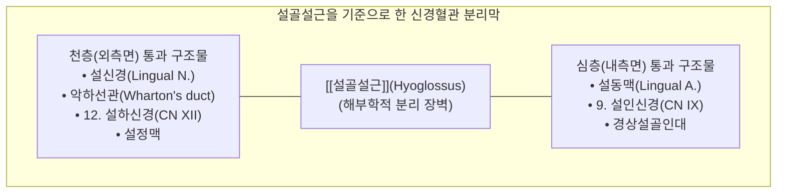
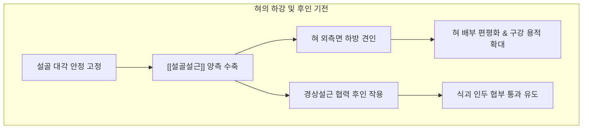
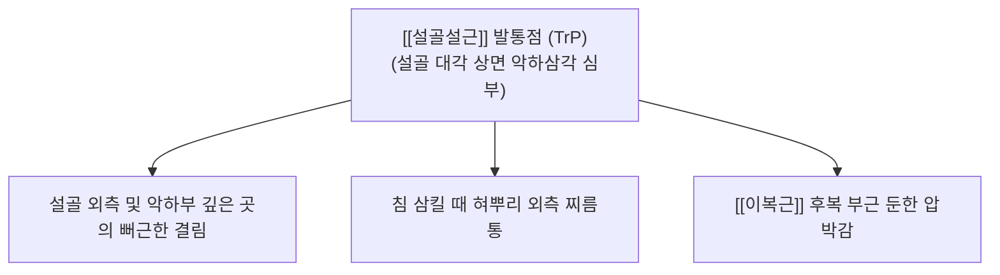

# [[설골설근]](Hyoglossus)

> **핵심 요약 (Key Summary)**:
> [[설골]] 대각의 전체 길이와 체부 외측에서 기원하여 혀의 외측면에 수직 상방으로 정지하는 얇고 사각형 형태의 외재성 설근입니다.
> [[12. 설하신경|설하신경]](CN XII)의 운동 지배를 받으며, 혀의 측면을 아래로 강하게 끌어당겨 혀를 하강(Depression)시키고 설골 고정 시 구강저 압력을 조절합니다.
> 설하신경 마비, 설근 유착, [[연하장애]], **구음장애(Dysarthria)**의 핵심 병변근이며, 설동맥과 설하신경을 분리하는 결정적 신경혈관 랜드마크로서 염천 및 악하 부위 치료가 적용됩니다.

---

## 📌 목차
1. [해부학적 정밀 구조 및 지배 신경/혈관](#1-해부학적-정밀-구조-및-지배-신경혈관)
2. [생체역학·토크 분석 & 경부 근막 사슬](#2-생체역학토크-분석--경부-근막-사슬)
3. [근막통증증후군(TP) & 연관통 패턴 (Travell & Simons)](#3-근막통증증후군tp--연관통-패턴-travell--simons)
4. [초음파 해부학(Sonoanatomy) 및 중재 시술 랜드마크](#4-초음파-해부학sonoanatomy-및-중재-시술-랜드마크)
5. [⭐ 원장님 심층 임상 고찰 및 원본 필기 (Clinical Pearls)](#5-원장님-심층-임상-고찰-및-원본-필기-clinical-pearls)
6. [관련 임상 질환 및 운동손상 증후군 총괄](#6-관련-임상-질환-및-운동손상-증후군-총괄)
7. [추나·도수치료(MET/PIR) & 침구·약침·재활 프로토콜](#7-추나도수치료metpir--침구약침재활-프로토콜)
8. [출처 및 학술 참고 문헌 (References)](#8-출처-및-학술-참고-문헌-references)

---

## 1. 해부학적 정밀 구조 및 지배 신경/혈관

| 해부학 항목 | 상세 기술 내용 |
| :--- | :--- |
| **기시 (Origin)** | [[설골]](Hyoid bone)의 대각(Greater horn) 전장 및 체부(Body) 외측면 |
| **정지 (Insertion)** | 혀의 외측면(Lateral sides of tongue), **경상설근(Styloglossus)** 및 하종설근 섬유 사이로 합류 |
| **신경 지배 (Innervation)** | [[12. 설하신경|설하신경]](Hypoglossal nerve, 제12뇌신경, CN XII) 운동 분지 |
| **혈관 공급 (Vascular Supply)** | **설동맥(Lingual artery)**의 주간 및 배설동맥(Dorsal lingual artery) |
| **기능 (Action)** | 혀의 하강(Depression), 혀 측면을 낮추어 혀 배부를 편평하게 만듦, 혀 후인(Retraction) 보조 |
| **상대적 해부 위치** | 악하삼각(Submandibular triangle)의 바닥을 이루며, [[악설골근]] 후연의 심부에 위치 |

---

## 2. 생체역학·토크 분석 & 경부 근막 사슬

* **혀의 하강 및 편평화 (Depression & Flattening)**:
  * [[설골설근]]이 양측성으로 수축하면 혀의 외측변을 설골 방향으로 강하게 하향 견인합니다. 이로써 혀의 융기를 낮추어 구강 내 용적을 최대화하고, 저작된 음식물을 구강저에서 인두 입구로 원활하게 넘길 수 있는 공간을 마련합니다.
* **혀의 후인 보조 (Retraction)**:
  * 경상설근과 협력하여 전방으로 돌출된 혀를 구강 내로 당겨 들이는 후인 작용을 담당합니다.
* **근막경선(Anatomy Trains) 연계**:
  * **심부전방선(Deep Front Line, DFL)**: 경장근과 [[사각근]] 심부 근막에서 연장되어 [[설골]](Hyoid bone)을 중심 허브로 삼고, [[설골설근]]을 거쳐 혀의 측벽과 구강 천장으로 이어집니다.
  * [[설골]] 위치의 상하·전후 비대칭 변위는 설골설근의 비대칭 장력을 유발하여 혀의 회전 및 편위 부정렬을 초래합니다.

---

## 3. 근막통증증후군(TP) & 연관통 패턴 (Travell & Simons)

* **발통점(TrP) 및 통증 방사 양상**:
  * **발통점 위치**: 하악각 내측과 설골 대각 사이의 악하삼각 심부 근섬유에 호발합니다.
  * **연관통 패턴**:
    * 설골 외측 및 악하부 깊은 곳으로 뻐근하고 결리는 통증 방사.
    * 침이나 음식물을 삼킬 때 혀뿌리 외측에서 목구멍 뒤쪽으로 뻗치는 찌르는 듯한 통증.
    * 턱밑에서 귀 아래 부위([[이복근]] 후복 부근)로 이어지는 둔한 압박감.
* **유발 및 지속 인자**:
  * [[턱관절 통증|턱관절 장애]](TMD)로 인한 편측 저작 습관.
  * 구강 내 궤양이나 치주염으로 인한 지속적인 혀의 보상성 비대칭 운동.
  * 과도한 발성 및 고음 노래 시 설골을 하방으로 과긴장시키는 습관.

---

## 4. 초음파 해부학(Sonoanatomy) 및 중재 시술 랜드마크

* **고주파 초음파 스캔 프로토콜**:
  * **탐촉자 위치**: 악하삼각 부위에 고주파 선형 프로브를 비스듬히 대고(Oblique coronal scan) 악하선과 설골 대각을 관찰합니다.
  * **층별 확인**:
    1. 피부 및 피하조직
    2. 악하선(Submandibular gland)의 균질한 중등도 에코
    3. [[악설골근]](Mylohyoid)의 후연
    4. [[설골설근]](Hyoglossus): 설골 대각 상면에서 혀의 외측으로 올라가는 얇은 판상 근육층
  * **도플러 필수 랜드마크**:
    * [[설골설근]] 바로 안쪽(심부)에서 박동하는 **설동맥(Lingual artery)**의 혈류 신호를 도플러로 반드시 확인합니다.
* **중재 안전 구역 및 침구 안전 가이드 (CRITICAL)**:
  * 악하부 자침 시 설골설근의 심층에는 설동맥 주간이 지나므로, 외측에서 깊숙이 침을 찌르는 행위는 동맥 손상 및 급성 구강저 혈종을 유발할 위험이 매우 높습니다.
  * 반드시 설골 대각의 골성 랜드마크를 손가락으로 촉진하여 확인한 후, 골 표면을 향해 얕고 완만하게 자침해야 합니다.

---

## 5. ⭐ 원장님 심층 임상 고찰 및 원본 필기 (Clinical Pearls)

### 1) 설하신경 마비와 설근 편위 감별 기전 (원장님 필기 100% 보존)
* 설골설근은 [[12. 설하신경|설하신경]](CN XII)의 지배를 받는 대표적 외재성 설근입니다.
* **원장님 핵심 진단 팁**:
  * 환자에게 "혀를 앞으로 쑥 내밀어 보세요" 했을 때, 혀가 환측(마비된 쪽)으로 삐뚤어지는 이유는 주동근인 [[이설근]]의 환측 마비 때문입니다.
  * 반대로 구강 내에서 혀를 아래로 내리거나 뒤로 당길 때 혀가 환측으로 쏠리는 것은 [[설골설근]]의 편측성 마비나 구축을 의미합니다.
  * 설하신경 마비 초기에는 염천혈 및 설골 대각 부착부에 저주파 전침을 걸어주어 설골설근의 조기 위축을 방지하는 것이 설근 재활의 성패를 가릅니다.

### 2) 신경과 혈관을 가르는 '해부학적 커튼'의 의미
* 설골설근은 악하삼각에서 설신경, 설하신경과 같은 신경계통을 외측(천층)에 두고, 설동맥이라는 대혈관을 내측(심층)에 두는 완벽한 방화벽입니다.
* 악하부 침 치료 시 찌릿한 신경 감전감은 외측면의 설신경이나 설하신경 분지 자극이며, 박동감이 느껴질 때는 심층 설동맥에 근접한 신호이므로 즉시 침을 0.2~0.3cm 후퇴시켜야 혈종 형성을 예방할 수 있습니다.

### 3) 설통증(Glossodynia) 및 구음장애 연계
* 원인 모를 혀의 통증이나 발음 부정확을 호소하는 환자에서, 설골 대각 상연의 설골설근 기시부를 촉진하면 펄쩍 뛸 정도의 극심한 압통점이 발견됩니다.
* 이곳을 도침으로 미세 감압하거나 자하거약침을 소량 주입하면 혀의 굳은 느낌과 발음 꼬임이 즉각 개선됩니다.

---

## 6. 관련 임상 질환 및 운동손상 증후군 총괄

| 임상 질환 / 증후군 | 병리적 연관 기전 | 주요 증상 및 이학적 검사 | 핵심 교정 타깃 |
| :--- | :--- | :--- | :--- |
| [[연하장애]] | 설골설근 구축으로 인한 혀 하강·편평화 장애 | 식괴 인두 추진 지연, 삼킴 시 목 이물감 | 설골 대각 부착부 도침 및 전침 |
| **구음장애(Dysarthria)** | 설근 긴장 및 설하신경 전도 장애 | 설음(ㄴ, ㄷ, ㄹ, ㅌ) 발음 어눌함 | 염천·악하 부위 침구 재활 |
| **설통증(Glossodynia)** | 설골설근 발통점 연관통 및 설신경 자극 | 혀뿌리 외측 작열통, 혀의 뻐근함 | 설골설근 기시부 약침 주입 |
| 설하신경 포착 | 악하삼각 심부 근막 유착으로 CN XII 압박 | 혀 내밀 때 편위, 편측 설근 위축 | 설골 대각 상방 수액박리 침구 |
| [[턱관절 통증|턱관절 장애]] | 편측 저작으로 인한 구강저 장력 불균형 | 개구 시 설골 편위, 턱밑 뻐근함 | 설골상근군 균형 추나 치료 |

---

## 7. 추나·도수치료(MET/PIR) & 침구·약침·재활 프로토콜

* **한의학 경혈 배오 및 침구 치료**:
  * **염천(CV23)**: 설골 상연 정중앙에서 혀뿌리를 향해 1.0~1.5촌 사상방 자침.
  * **상염천(Extra)**: 염천혈 상방 1촌 부위에서 하악골 내측 설근부를 향해 자침.
  * **예풍(TE17) 및 협거(ST6)**: 설하신경 주행 경로 및 악관절 저작근 동시 배오.
* **약침 처방 (Pharmacopuncture)**:
  * **자하거약침**: 설하신경 마비 후유증, 설근 만성 위축 및 구음장애 환자의 설골 대각 부위에 0.3~0.5cc 주입.
  * **황련해독탕약침**: 설통증, 구강 내 작열감 환자의 악하삼각 근막층 주입.
* **추나 및 설골 가동 도수치료 (Hyoid Mobilization)**:
  * 시술자가 엄지와 검지로 환자의 설골 대각 양끝을 부드럽게 쥐고 좌우로 미세하게 활주(Lateral glide).
  * 설골설근이 단축된 쪽의 저항 장벽에서 10초간 부드럽게 견인 유지.
* **설근 기능 재활 훈련 (Tongue Resistance Exercise)**:
  * 설압자나 스푼을 혀끝에 대고 환자가 혀를 아래로 누르며 5초간 등척성 저항 유지 (10회 반복).

---

## 8. 출처 및 학술 참고 문헌 (References)

1. **Fregosi, R. F., & Fuller, D. D. (1997)**.
   - *Respiratory-related control of hypoglossal motoneurons in mammals*. *J Appl Physiol*, 83(6), 1777-1786.
   - [연구 요약] 설하신경의 호흡 및 연하 운동 제어와 설골설근의 혀 위치 안정화 생체역학 분석.
2. **Kim, S. Y., & Standring, S. (2023)**.
   - *Anatomy, Head and Neck: Hyoglossus Muscle*. *StatPearls Publishing*. [PMID: 34662079]
   - [연구 요약] 설골설근의 3차원 기시·정지, 설동맥과 설하신경을 분리하는 해부학적 장벽 구조 및 임상적 손상 징후 수록.
3. **Sonne, J., & Lopez-Ojeda, W. (2023)**.
   - *The Hypoglossal Nerve*. *StatPearls Publishing*. [PMID: 37055141]
   - [연구 요약] 제12뇌신경 설하신경의 주행 경로, 설골설근 운동 지배 및 뇌졸중 후 설근 편위 감별 진단 확립.
4. **Travell, J. G., & Simons, D. G. (1999)**.
   - *Myofascial Pain and Dysfunction: The Trigger Point Manual* (Vol. 1, 2nd ed.). Williams & Wilkins, pp. 290-305.
   - [연구 요약] 악하부 및 설골 상·하근군의 발통점 기전과 삼킴통 연관통 패턴 분석.
