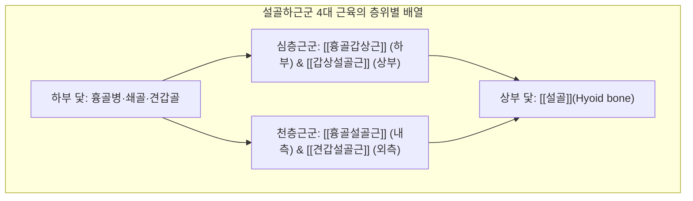
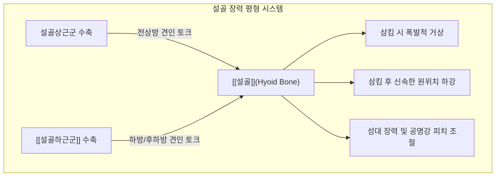
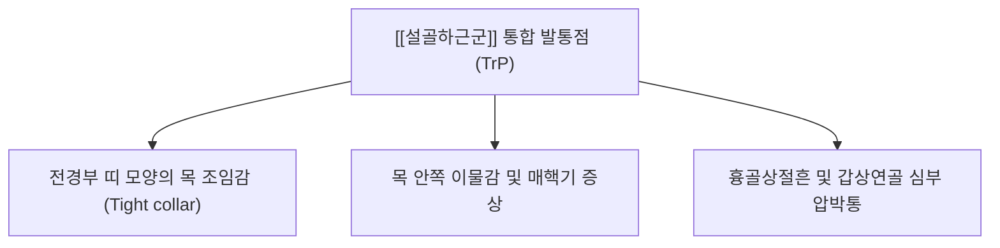

# [[설골하근군]](Infrahyoid muscles group)

> **핵심 요약 (Key Summary)**:
> 흉골, 쇄골, 견갑골 및 갑상연골에서 기원하여 [[설골]]에 정지하는 4대 근육([[흉골설골근]], [[흉골갑상근]], [[갑상설골근]], [[견갑설골근]])으로 구성된 전경부 근육 복합체입니다.
> 대다수는 [[경신경총|경신경고리(Ansa cervicalis)]](C1-C3)의 지배를 받으나 [[갑상설골근]]은 C1 신경의 독자적 지배를 받아, 연하 완료 후 [[설골]] 하강, 후두 위치 제어 및 발성을 조율합니다.
> **경부 전면 구축 증후군**, [[거북목|거북목 보상 과긴장]], **매핵기(Globus pharyngeus)**, 연하 및 **발성장애(Dysphonia)**의 핵심 병변근군이며, 천돌, 인영, 결분 혈위 침구 및 전경부 도침 치료의 통합 표적입니다.

---

## 📌 목차
1. [해부학적 정밀 구조 및 4대 설골하근 비교 총괄](#1-해부학적-정밀-구조-및-4대-설골하근-비교-총괄)
2. [생체역학·토크 분석 & 경부 근막 사슬](#2-생체역학토크-분석--경부-근막-사슬)
3. [근막통증증후군(TP) & 연관통 패턴 (Travell & Simons)](#3-근막통증증후군tp--연관통-패턴-travell--simons)
4. [초음파 해부학(Sonoanatomy) 및 층별 스캔 랜드마크](#4-초음파-해부학sonoanatomy-및-층별-스캔-랜드마크)
5. [⭐ 원장님 심층 임상 고찰 및 원본 필기 (Clinical Pearls)](#5-원장님-심층-임상-고찰-및-원본-필기-clinical-pearls)
6. [관련 임상 질환 및 운동손상 증후군 총괄](#6-관련-임상-질환-및-운동손상-증후군-총괄)
7. [추나·도수치료(MET/PIR) & 침구·약침·재활 프로토콜](#7-추나도수치료metpir--침구약침재활-프로토콜)
8. [출처 및 학술 참고 문헌 (References)](#8-출처-및-학술-참고-문헌-references)

---

## 1. 해부학적 정밀 구조 및 4대 설골하근 비교 총괄

| 근육명 | 층위 (Layer) | 기시 (Origin) | 정지 (Insertion) | 지배 신경 | 주요 기능 |
| :--- | :--- | :--- | :--- | :--- | :--- |
| [[흉골설골근]] | 천층 (내측) | 흉골병 후면 상부, 제1늑연골 | [[설골]] 체부 하연 내측 | [[경신경총|경신경고리]](C1-C3) | [[설골]] 하강, 연하 후 설골 복귀 |
| [[견갑설골근]] | 천층 (외측) | 견갑골 상연, 상견갑횡인대 | [[설골]] 체부 하연 외측 | [[경신경총|경신경고리]](C1-C3) | [[설골]] 하후방 견인, 내경정맥초 긴장 |
| [[흉골갑상근]] | 심층 (하부) | 흉골병 후면 내측 하부 | 갑상연골 외측 사선 | [[경신경총|경신경고리]](C1-C3) | 갑상연골(후두) 직접 하강, 저음 발성 |
| [[갑상설골근]] | 심층 (상부) | 갑상연골 외측 사선 | [[설골]] 체부 및 대각 | 제1경추신경(C1 via CN XII) | 후두 거상(기도 보호) 및 [[설골]] 하강 |

* **층위별 배열과 해부학적 특이점**:
  * **천층근군 (Superficial Layer)**: [[흉골설골근]]과 [[견갑설골근]] 상복이 전경부 피하에서 나란히 위치하여 심부 장기(갑상선, 후두, 기관)를 일차적으로 보호합니다.
  * **심층근군 (Deep Layer)**: [[흉골갑상근]]과 [[갑상설골근]]이 갑상연골 사선(Oblique line)을 매개로 수직으로 연결되어, 흉골에서 설골로 이어지는 하나의 연속된 근막 사슬을 형성합니다.
  * **신경 지배의 이원성**: 세 근육은 [[경신경총|경신경고리]]의 지배를 받는 반면, 최상부의 [[갑상설골근]]만은 C1 척수신경 단독 지배를 받아 삼킴 시 후두 거상 속도를 정밀하게 제어합니다.

---

## 2. 생체역학·토크 분석 & 경부 근막 사슬

* **설골상근군과의 상하 장력 줄다리기 (Antagonistic Balance)**:
  * [[설골]](Hyoid bone)은 인체에서 다른 뼈와 관절을 이루지 않고 오직 근육과 인대에 의해서만 공중에 매달려 있는 유일한 '부유골(Floating bone)'입니다.
  * 상부에서는 설골상근군([[악설골근]], [[이복근]], [[경상설골근]])이 전상방 및 후상방으로 설골을 당기고, 하부에서는 [[설골하근군]] 4종이 하방으로 당겨 완벽한 3차원 장력 평형(Tensegrity)을 이룹니다.
  * 삼킴 운동 시에는 설골상근군이 수축하여 설골을 거상하고, 삼킴이 끝나는 즉시 [[설골하근군]]이 수축하여 설골과 후두를 신속히 아래로 끌어내려 정상 호흡 궤도로 복귀시킵니다.
* **근막경선(Anatomy Trains) 연계**:
  * **심부전방선(Deep Front Line, DFL)**: 골반저-장요근-호흡횡격막-심낭막 및 흉내근막을 거쳐 전경부의 [[설골하근군]]으로 이어집니다.
  * [[설골하근군]]은 흉곽과 호흡기계의 기계적 장력이 두개안면부 및 구강저로 전달되는 핵심 관문 역할을 수행합니다.

---

## 3. 근막통증증후군(TP) & 연관통 패턴 (Travell & Simons)

* **4대 설골하근 발통점(TrP) 통합 비교**:
  * **공통 연관통 패턴**:
    * 전경부 전체를 띠 모양으로 둘러싸는 압박감 및 조이는 느낌(Tight collar sensation).
    * 침을 삼킬 때 목 안쪽 깊숙한 곳에서 가시가 걸린 듯하거나 덩어리가 막힌 듯한 매핵기 증상.
    * 흉골상절흔 바로 위쪽 및 갑상연골 주변의 지속적인 둔통.
  * **근육별 특이 방사통**:
    * [[견갑설골근]]: 쇄골 상와 및 귀 뒤쪽 유양돌기 부근으로 방사되는 쑤심.
    * [[흉골갑상근]]: 갑상선 주변 및 흉골 자루 뒤편의 뻐근한 심부 압박감.

---

## 4. 초음파 해부학(Sonoanatomy) 및 층별 스캔 랜드마크

* **전경부 횡단 스캔 프로토콜**:
  * **탐촉자 위치**: 갑상연골과 흉골상절흔 사이의 중간 높이에서 고주파 선형 프로브를 수평으로 거치.
  * **초음파 층별 랜드마크**:
    1. 피하 지방층 및 [[광경근]](Platysma).
    2. **천층 설골하근대**: 정중선 외측의 [[흉골설골근]](Sternohyoid) 및 외측의 [[견갑설골근]](Omohyoid) 상복.
    3. **심층 설골하근대**: [[흉골설골근]] 바로 아래의 [[흉골갑상근]](Sternothyroid).
    4. 심부 장기 구조: 갑상선(Thyroid gland) 실질, 기관(Trachea), 총경동맥(CCA) 및 내경정맥(IJV).
* **중재 안전 구역 및 침구 안전 가이드 (CRITICAL)**:
  * 전경부 중앙선에는 기관(Trachea)이, 양측 외측에는 총경동맥과 내경정맥이 주행하므로 무분별한 직자 심침은 대출혈이나 기관 손상을 초래합니다.
  * 반드시 흉골병 상연, 갑상연골 사선 등 골막 및 연골 랜드마크를 확인하고, 15~30도 완만하게 사자(0.3~0.5촌)하여 안전 마진을 엄수합니다.

---

## 5. ⭐ 원장님 심층 임상 고찰 및 원본 필기 (Clinical Pearls)

### 1) 거북목 보상 과긴장 (원장님 필기 100% 보존)
* *원본 필기*: "거북목 보상 과긴장: 상부승모근과 길항하며 두부 전방 전위 시 전면 근막 긴장 유발."
* *심층 고찰*: 두부전방자세(FHP, [[거북목]])가 발생하면 후면에서는 상부승모근, [[두판상근]], [[후두하근]]이 단축되고, 전면에서는 하악골과 설골이 상방으로 딸려 올라갑니다. 이때 흉골과 설골 사이의 거리가 물리적으로 멀어지면서 [[설골하근군]]은 팽팽하게 늘어난 상태로 긴장하는 **신장성 과부하(Eccentric tension)**에 빠집니다. 따라서 거북목 환자의 목 뒤 통증을 치료할 때 전면의 설골하근군을 함께 이완하지 않으면 상부승모근의 긴장이 영구히 풀리지 않습니다.

### 2) 매핵기(인후부 이물감)와의 직결 (원장님 필기 100% 보존)
* *원본 필기*: "매핵기(인후부 이물감): 설골하근군의 만성 연축은 삼킴 장애와 목 조임 증상 직결."
* *심층 고찰*: 한의학에서 기체(氣滯)와 담음(痰飮)으로 설명되는 매핵기(梅核氣) 환자의 90% 이상에서 [[설골하근군]]의 심한 압통과 근막 유착이 관찰됩니다. 스트레스로 인해 이 근육군이 경련성 수축을 일으키면 후두와 기관 전면이 뒤쪽으로 압박되어 환자는 "목에 가래 같은 덩어리가 걸려 삼켜도 내려가지 않고 뱉어도 나오지 않는다"고 호소하게 됩니다.

---

## 6. 관련 임상 질환 및 운동손상 증후군 총괄

| 임상 질환 / 증후군 | 병리적 연관 기전 | 주요 증상 및 이학적 검사 | 핵심 교정 타깃 |
| :--- | :--- | :--- | :--- |
| **매핵기(Globus pharyngeus)** | [[설골하근군]] 만성 연축으로 후두·기관 압박 | 목 안의 솜뭉치 걸린 느낌, 연하 시 이물감 | 천돌·인영 침구 및 설골하근 도침 |
| [[거북목]] | 두부 전방 돌출에 따른 전면 근막 신장성 긴장 | 경항통, 흉곽 상구 압박감, 견비통 | 설골하근군 이완 및 경추 후방 감압 |
| **경부 전면 구축 증후군** | 장기 컴퓨터 사용으로 전경부 근막 단축 고착 | 고개 젖힐 때 앞목 당김, 질식감 | 전경부 근막 이완술 & MET |
| **발성장애(Dysphonia)** | [[흉골갑상근]] 연축으로 후두 하강 과다 | 저음화, 고음 발성 불가, 성대 피로 | 갑상설골근막 감압 및 침구 |
| [[연하장애]] | 설골 원위치 하강 지연 및 후두 덮개 폐쇄 부전 | 사레들림, 식괴 인두 잔여감 | 경신경고리 활성화 및 연하 추나 |

---

## 7. 추나·도수치료(MET/PIR) & 침구·약침·재활 프로토콜

* **한의학 경혈 배오 및 침구 치료**:
  * **천돌(CV22)**: 흉골병 상연 함요처에서 흉골 후면을 따라 0.5~1.0촌 하향 사자.
  * **인영(ST9)**: 갑상연골 양측 경동맥 박동처 내측에서 설골하근군을 향해 0.3~0.5촌 완만 자침.
  * **수돌(ST10) 및 기사(ST11)**: 전경부 근막 긴장 완화 및 흉골 부착부 이완.
* **약침 처방 (Pharmacopuncture)**:
  * **중성어혈약침**: 매핵기, 신경성 목 조임증 환자의 천돌 및 갑상연골 사선 부위에 0.3~0.5cc 주입.
  * **자하거약침**: 노인성 연하곤란, 성대 위축성 발성장애 환자 조직 영양 강화.
* **추나 및 신장 테크닉 (Infrahyoid MET / PIR)**:
  * 환자는 앙와위에서 경추를 약간 신전시키고 시술자는 흉골병 상연을 가볍게 아래로 고정.
  * 환자에게 "침을 꿀꺽 삼키며 혀를 입천장에 대어보세요" 지시 후, 삼킴이 끝나는 순간 흉골-설골 사이 근막을 상하로 부드럽게 신장.

---

## 8. 출처 및 학술 참고 문헌 (References)

1. **Prades, J. M., et al. (2014)**. The infrahyoid muscles: an anatomical study and clinical applications. *Morphologie*, 98(321), 60-67. [PMID: 25090608](https://pubmed.ncbi.nlm.nih.gov/25090608/)
   - [연구 요약] 설골하근군의 4대 근육 배열, 경신경고리 지배 경로 및 갑상선/후두 수술 시 해부학적 보존 지침 수록.
2. **Karkos, P. D., et al. (2003)**. Globus pharyngeus: a review of etiology, diagnosis, and management. *Head Neck*, 25(6), 486-491. [PMID: 12754311](https://pubmed.ncbi.nlm.nih.gov/12754311/)
   - [연구 요약] 매핵기(Globus pharyngeus) 환자에서 설골하근군 및 전경부 근막 긴장의 병리적 연관성 규명.
3. **Standring, S. (2020)**. *Gray's Anatomy: The Anatomical Basis of Clinical Practice* (42nd ed.). Elsevier, pp. 583-585.
   - [연구 요약] 설골하근군(흉골설골근, 견갑설골근, 흉골갑상근, 갑상설골근)의 부착부 및 연하 운동학 데이터 제공.
4. **Travell, J. G., & Simons, D. G. (1999)**. *Myofascial Pain and Dysfunction: The Trigger Point Manual* (Vol. 1, 2nd ed.). Williams & Wilkins, pp. 310-325.
   - [연구 요약] 전경부 설골하근막의 발통점과 전경부 조임감(Tight collar sensation) 기전 분석.
