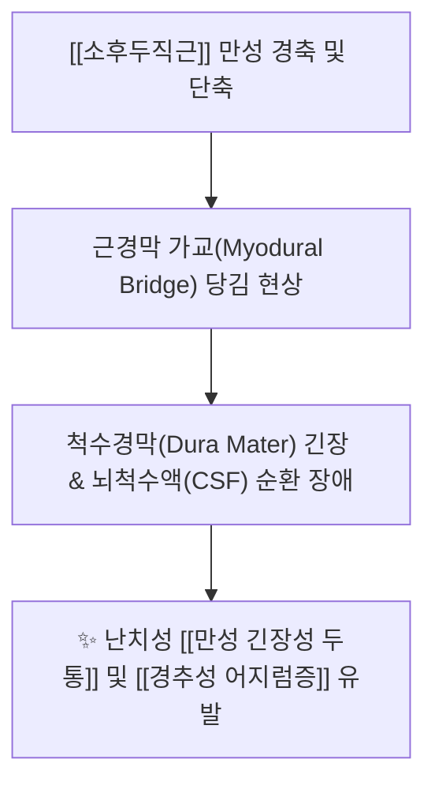
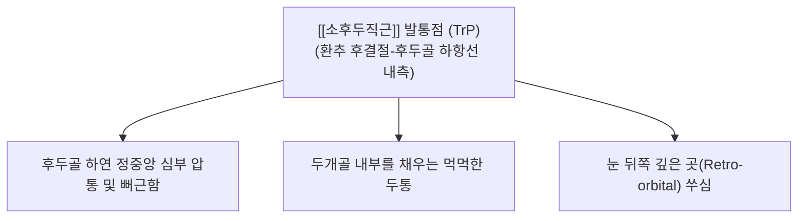

# [[소후두직근]](Rectus capitis posterior minor)

> **핵심 요약 (Key Summary)**:
> 제1경추 후결절에서 기원하여 후두골 하항선 내측부에 정지하며 척수경막과 근경막 가교를 형성하는 후두하 심부의 핵심 안정화 근육입니다.
> 제1경추신경 후지인 후두하신경의 지배를 받으며, 환추후두관절의 미세 신전 및 두경부 정밀 고유감각 피드백을 담당합니다.
> [[만성 긴장성 두통]], [[경추성 어지럼증]], 경막 장력 이상, 뇌 피로의 핵심 병변근이며, 아문·풍부·풍지 및 환추 후결절 부착부 침구가 표적입니다.

---

## 📌 목차
1. [해부학적 정밀 구조 및 지배 신경/혈관](#1-해부학적-정밀-구조-및-지배-신경혈관)
2. [생체역학·토크 분석 & 근막 사슬 (Biomechanical Synergy)](#2-생체역학토크-분석--근막-사슬-biomechanical-synergy)
3. [근막통증증후군(TP) & 연관통 패턴 (Travell & Simons)](#3-근막통증증후군tp--연관통-패턴-travell--simons)
4. [초음파 해부학(Sonoanatomy) 및 중재 시술 랜드마크](#4-초음파-해부학sonoanatomy-및-중재-시술-랜드마크)
5. [⭐ 원장님 심층 임상 고찰 및 원본 필기 (Clinical Pearls)](#5-원장님-심층-임상-고찰-및-원본-필기-clinical-pearls)
6. [관련 임상 질환 및 운동손상 증후군 총괄](#6-관련-임상-질환-및-운동손상-증후군-총괄)
7. [추나·도수치료(MET/PIR) & 침구·약침·재활 프로토콜](#7-추나도수치료metpir--침구약침재활-프로토콜)
8. [출처 및 학술 참고 문헌 (References)](#8-출처-및-학술-참고-문헌-references)

---

## 1. 해부학적 정밀 구조 및 지배 신경/혈관

| 해부학 항목 | 상세 기술 내용 |
| :--- | :--- |
| **기시 (Origin)** | 제1경추(환추, Atlas, C1)의 후결절(Posterior tubercle) 및 인접 외측부 |
| **정지 (Insertion)** | 후두골 **하항선(Inferior nuchal line)** 내측 1/3 부위 및 대후두공(Foramen magnum) 후연 사이 골면 |
| **신경 지배** | 제1경추신경 후지 (**후두하신경**, Suboccipital nerve, C1 dorsal ramus) |
| **혈관 공급** | 후두동맥(Occipital A.) 하행지 및 [[추골동맥]](Vertebral A.) 후두하 분지 |
| **인접 구조** | 외측으로 [[대후두직근]](Rectus capitis posterior major), 천층으로 [[두반극근]] |

```mermaid
graph LR
    AtlasPostTub["C1 후결절(Posterior tubercle)"] -->|수직 상방 주행| RCPMin["[[소후두직근]](RCP minor)"]
    RCPMin --> OcciputInf["후두골 하항선 내측 1/3"]
    
    subgraph MyoduralBridgeLink [근경막 가교 (MDB)]
        RCPMin -->|건막 섬유 관통| PAOM["환추후두후막(PAOM)"]
        PAOM -->|직접 섬유성 결합| Dura["경수 척수경막(Spinal Dura Mater)"]
    end
```

---

## 2. 생체역학·토크 분석 & 근막 사슬 (Biomechanical Synergy)



* **환추후두관절(Atlanto-occipital Joint, C0-C1)의 미세 조정**:
  * 환추 위에서 후두골의 정밀한 시상면 끄덕임(Nodding motion) 및 미세 신전(Micro-extension) 제어.
* **근경막 가교 (Myodural Bridge, MDB)의 기능적 정체성 (핵심)**:
  * 1995년 Hack 박사 연구팀에 의해 규명된 구조로, 소후두직근의 건막 섬유가 환추후두후막(PAOM)을 관통하여 **경수 척수경막(Spinal dura mater)**에 직접 연결.
  * 생리적으로 두부 굴곡 및 신전 시 척수경막이 접히거나 대후두공으로 감겨들어가지 않도록 팽팽하게 앵커링(Anchoring)하는 역할 수행.
* **인체 최상위 고유감각(Proprioception) 센서**:
  * 인체 전체에서 단위 근육량당 근방추(Muscle spindle) 밀도가 가장 높은 부위 중 하나로, 두부의 미세한 위치 변화를 전정신경핵 및 소뇌로 밀리초 단위로 전달.
* **근막 사슬 연계 (Anatomy Trains)**:
  * **표재후방선(Superficial Back Line, SBL)**: 족저근막에서 시작하여 척추기립근을 거쳐 후두하 공간에 도달한 후, [[소후두직근]]-경막 연결을 통해 중추신경계 경막 긴장도와 직접 소통.

---

## 3. 근막통증증후군(TP) & 연관통 패턴 (Travell & Simons)



* **발통점 및 연관통 특성**:
  * **후두골 하연 내측 심부 둔통**:
    * 아문혈 및 풍부혈 외측의 후두하 정중선 바로 옆 깊은 곳에 묵직하고 지속적인 압박통 형성.
  * **두개내 압박감 및 멍함**:
    * 단순 근육통을 넘어 "뇌 속이 붓는 것 같다", "머리 안쪽에 압력이 차오른다"는 두개강 내압 상승 유사 증상 호소.
  * **안구 깊은 곳의 통증**:
    * [[소후두직근]] TrP 자극 시 동측 또는 양측 안와 심부로 뻐근한 연관통 투사.

---

## 4. 초음파 해부학(Sonoanatomy) 및 중재 시술 랜드마크

* **초음파 스캔 프로토콜**:
  * **프로브 위치**: 후두골 외후두융기(EOP) 하방 정중선에서 C1-C2 레벨 종단면(Sagittal view) 또는 정중 횡단면 거치.
  * **층별 확인 (Superficial → Deep)**:
    1. 최표층: 항인대(Ligamentum nuchae) 및 승모근 건막.
    2. 제2층: [[두반극근]](Semispinalis capitis) 근복.
    3. 제3층: [[소후두직근]](Rectus capitis posterior minor) → 환추 후결절에서 후두골 하항선 내측으로 달리는 작고 두터운 근육 동정.
    4. 최심층: 환추후두후막(PAOM) 및 척수경막(Dura mater) 고에코 라인.
* **안전 마진 및 위험 구조물 회피 (CRITICAL)**:
  * **연수(Medulla oblongata) 및 척수강 진입 절대 회피**: C1에는 극돌기가 없고 편평한 후결절만 존재하므로, 침이나 도침이 후결절 골면을 벗어나 정중앙 심부로 깊이 직자되면 환추후두후막을 뚫고 척수강으로 진입할 위험이 있습니다.
  * **시술 원칙**: 침 끝(Needle tip)은 반드시 **환추 후결절의 골면(Bone touch) 또는 후두골 하항선 골면**에 정확히 안착시켜야 하며, 깊이를 2.0~2.5cm 이내로 엄격히 통제.

---

## 5. ⭐ 원장님 심층 임상 고찰 및 원본 필기 (Clinical Pearls)

### 1) 경막-후두하근 다리(Myodural Bridge)의 임상적 실체 (원장님 필기 100% 보존)
* 소후두직근과 척수경막이 직접 섬유성 연결을 이루고 있어, 상부 경추의 정렬 이상과 소후두직근의 단축은 **뇌척수액(CSF) 순환과 두개내 압력에 직접적인 영향**을 미칩니다.
* **원장님 임상 적용 노하우**:
  * 만성 두통 환자 중 진통제(NSAIDs, 트립탄)에 전혀 반응하지 않는 난치성 환자의 상당수는 이 **근경막 가교(MDB)의 과도한 견인** 때문입니다.
  * 후두골 하항선 내측 정지부의 긴장을 풀어주면 척수경막의 긴장도가 즉각 떨어지며 두개내압이 정상화되고 두통이 극적으로 소실됩니다.

### 2) 경추성 어지럼증(Cervicogenic Dizziness)의 치료 핵심 (원장님 필기 100% 보존)
* 이비인후과 검사상 이석증이나 전정신경염이 아닌데도 "몸이 붕 뜨는 것 같고 구름 위를 걷는 듯하다"고 호소하는 현기증 환자는 소후두직근의 고유수용기 이상이 원인입니다.
* 소후두직근의 근방추가 턱 들림 자세(Chin-out posture)로 인해 지속적으로 과흥분되면, 시각-전정기관-경추 고유감각 간의 일치성이 깨져 전정성 어지럼증과 메스꺼움(오심)이 발생합니다.

### 3) 두개천골요법(CST)의 CV4 기법과의 해부학적 일치
* 한의학의 아문(GV15)·풍부(GV16) 자침 및 CST의 제4뇌실 압박법(CV4 / 후두저 감압)은 정확히 소후두직근의 근막과 경막 가교를 이완시켜 제4뇌실 주변의 체액 순환을 촉진하는 원리입니다.

---

## 6. 관련 임상 질환 및 운동손상 증후군 총괄

| 임상 질환 / 증후군 | 병리적 연관 기전 | 주요 증상 및 이학적 검사 | 핵심 교정 타깃 |
| :--- | :--- | :--- | :--- |
| [[만성 긴장성 두통]] | 근경막 가교 견인에 따른 경막 장력 항진 | 두개골 내부를 쥐어짜는 두통, 뇌 피로감 | 후두골 하항선 골면 도침 감압 |
| [[경추성 두통]] | C1 신경 후지 자극 및 삼차신경 복합체 투사 | 후두부 압박통, 안와 심부 통증 | 풍부·천주 심부 침구 치료 |
| [[경추성 어지럼증]] | 환추 후결절 고유감각 센서의 피로 및 오류 | 고개 움직일 때 휘청거림, 구름 보행감 | 소후두직근 고유수용기 재훈련 |
| 뇌척수액 순환 장애 | PAOM 구축으로 인한 CSF 박동성 저항 증가 | 기상 시 머리 무거움, 집중력 저하 | 후두저 이완 수기 추나(CV4) |
| [[편타 손상]] | 급격한 굴곡-신전 시 경막 가교 미세 파열 | 후두저 강직, 만성 피로, 시야 피로 | 급성기 약침 주입 및 미세 MET |

---

## 7. 추나·도수치료(MET/PIR) & 침구·약침·재활 프로토콜

* **한의학 경혈 매핑**:
  * 아문(GV15), 풍부(GV16), 천주(BL10), 풍지(GB20)
* **침구 및 도침 시술 기법**:
  * **아문·풍부 부위 안전 자침**:
    * 환자는 고개를 약간 숙인 자세(환추후두 공간 개대).
    * 0.35x40mm 호침으로 후두골 하연 골면을 목표로 상향 사자(0.8~1.2촌). 절대 직자 심침 금기.
  * **C1 후결절 도침 박리술**:
    * 환추 후결절 골면(Bone touch)을 촉지하여 0.40x40mm 침도로 골면에 안착.
    * 건막 섬유를 1회 미세 절개하여 경막 견인 장력 해소.
* **약침 처방**:
  * **신바로약침 / 자하거약침**: 난치성 만성 두통, 뇌 피로, 경추성 어지럼증 환자의 후두골 하항선 부착부에 0.3~0.5cc 주입.
  * **중성어혈약침**: 외상성 편타 손상 후 항강통 환자 후결절 주위 주입.
* **추나 및 두개저 감압 기법 (Suboccipital Release & CV4)**:
  * 시술자의 양손 손가락 패드로 환자의 후두골 하연을 부드럽게 받침.
  * 머리의 자체 무게를 이용하여 후두골을 상방으로 부드럽게 견인하며 2~3분간 유지하여 근경막 가교 이완.

---

## 8. 출처 및 학술 참고 문헌 (References)

1. **Hack, G. D., et al. (1995)**.
   - *Anatomic relation between the rectus capitis posterior minor muscle and the dura mater*. *Spine*, 20(23), 2484-2486. [PMID: 8610241]
   - [연구 요약] 소후두직근과 경수 척수경막 사이의 직접적인 결합조직 연결(근경막 가교, Myodural bridge)을 최초로 규명하고 만성 두통 기전 제시.
2. **McPartland, J. M., & Brodeur, R. R. (1999)**.
   - *A proposed etiology of cervicogenic headache: the neurophysiologic basis and anatomic relationship between the dura mater and the rectus posterior capitis minor muscle*. *J Manipulative Physiol Ther*, 22(9), 630-635. [PMID: 10543584]
   - [연구 요약] 소후두직근의 높은 근방추 밀도와 고유감각 피드백 기능, 도수 치료 시 두개천골 순환 개선 기전 분석.
3. **Standring, S. (2020)**.
   - *Gray's Anatomy: The Anatomical Basis of Clinical Practice* (42nd ed.). Elsevier, pp. 579-581.
   - [연구 요약] 소후두직근의 C1 후결절 기시, 후두골 하항선 정지 및 C1 후두하신경 지배 해부학 데이터 수록.
