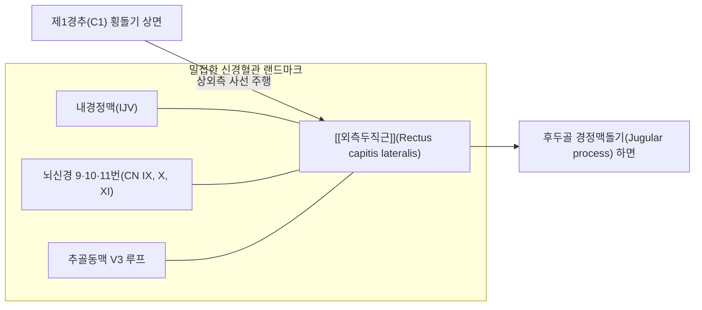
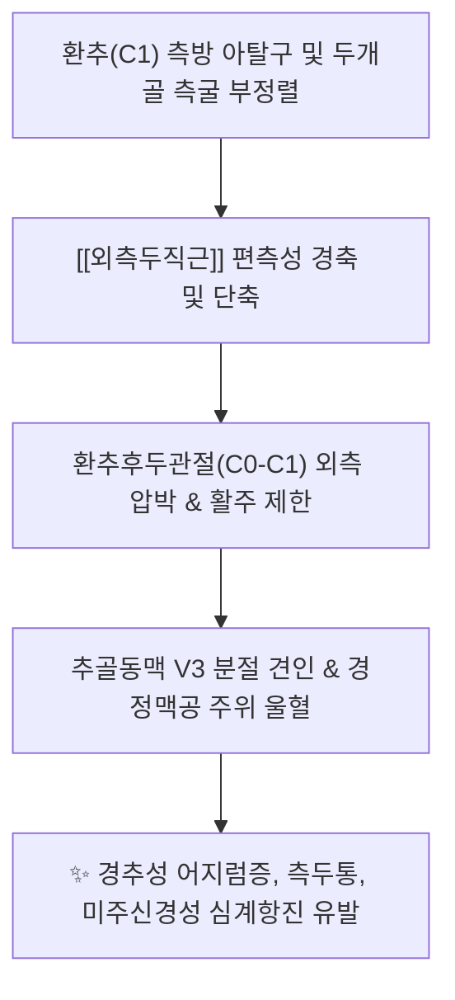
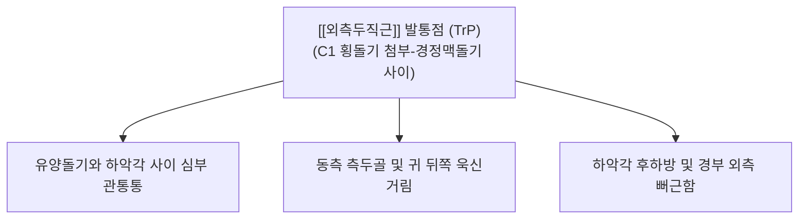

# [[외측두직근]](Rectus capitis lateralis)

> **핵심 요약 (Key Summary)**:
> 제1경추(환추, Atlas) 횡돌기 상면에서 기원하여 후두골 경정맥돌기(Jugular process) 하면에 정지하는 두경부 최상부 외측의 사각 판상 심부 안정화 근육입니다.
> 제1경추신경 전지(C1 anterior ramus)의 지배를 받으며, 환추후두관절(C0-C1)의 순수 동측 측굴(Lateral flexion) 및 두개골 측방 미세 안정성을 주도합니다.
> 경정맥공(Jugular foramen)을 통과하는 3대 뇌신경(CN IX, X, XI) 및 내경정맥(IJV), 추골동맥 V3 루프와 밀접하여, 상부 경추성 어지럼증, 후두-측두 방사통, 자율신경계 기능 이상의 핵심 병변근이며, C1 횡돌기 외측 랜드마크 기반 정밀 침구 및 도침이 표적입니다.

---

## 📌 목차
1. [해부학적 정밀 구조 및 지배 신경/혈관](#1-해부학적-정밀-구조-및-지배-신경혈관)
2. [생체역학·토크 분석 & 근막 사슬 (Biomechanical Synergy)](#2-생체역학토크-분석--근막-사슬-biomechanical-synergy)
3. [근막통증증후군(TP) & 연관통 패턴 (Travell & Simons)](#3-근막통증증후군tp--연관통-패턴-travell--simons)
4. [초음파 해부학(Sonoanatomy) 및 중재 시술 랜드마크](#4-초음파-해부학sonoanatomy-및-중재-시술-랜드마크)
5. [⭐ 원장님 심층 임상 고찰 및 원본 필기 (Clinical Pearls)](#5-원장님-심층-임상-고찰-및-원본-필기-clinical-pearls)
6. [관련 임상 질환 및 운동손상 증후군 총괄](#6-관련-임상-질환-및-운동손상-증후군-총괄)
7. [추나·도수치료(MET/PIR) & 침구·약침·재활 프로토콜](#7-추나도수치료metpir--침구약침재활-프로토콜)
8. [출처 및 학술 참고 문헌 (References)](#8-출처-및-학술-참고-문헌-references)

---

## 1. 해부학적 정밀 구조 및 지배 신경/혈관

| 해부학 항목 | 상세 기술 내용 |
| :--- | :--- |
| **기시부 (Origin)** | 제1경추(환추, Atlas, C1) 횡돌기(Transverse process) 상면 |
| **정지부 (Insertion)** | 후두골(Occipital bone) 경정맥돌기(Jugular process) 하면 및 대후두공 전외측 골면 |
| **신경 지배 (Innervation)** | 제1경추신경 전지 분지 (C1 anterior ramus / ventral ramus loop) |
| **혈관 공급 (Vascular Supply)** | [[추골동맥]](Vertebral A.) 후두하 분지, 상행인두동맥(Ascending pharyngeal A.), 후두동맥 경수막지 |
| **인접 근육 관계** | 내측으로 [[전두직근]](Rectus capitis anterior), 후내측으로 [[상두사근]](Obliquus capitis superior), 외측으로 [[판상근]] 및 [[견갑거근]] 기시부와 인접 |

* **해부학적 특이성**:
  * 두개골 기저부와 환추 횡돌기 사이를 잇는 가장 짧고 강력한 측방 근육입니다.
  * 발생학적으로 경추 횡돌기간근(Intertransversarii)의 최상위 연속체로 간주되며, 전두직근과 함께 후두하신경(C1 후지)이 아닌 **C1 척수신경의 전지(Ventral ramus)** 지배를 받는 독특한 신경학적 구분을 보입니다.
  * **경정맥공(Jugular foramen)의 즉각적 외측 받침대**: 내경정맥이 경정맥공을 빠져나와 하행하는 바로 뒤편 외측에 위치하여, 이 근육의 병적 비후나 연축은 경정맥 혈류 배출 및 뇌신경 주행에 물리적 영향을 미칠 수 있습니다.

---

## 2. 생체역학·토크 분석 & 근막 사슬 (Biomechanical Synergy)

* **환추후두관절(C0-C1)의 일차적 측굴 주동근 (Primary Pure Lateral Flexor)**:
  * 머리를 한쪽 어깨 방향으로 갸우뚱 기울이는 순수 측굴(Lateral flexion) 운동의 초기 5~10도를 정밀하게 구동합니다.
  * 양측 동시 수축 시 두개골을 환추 상관절와에 단단히 압착하여 수직 안정성(Vertical stability)을 부여하고 충격을 완충합니다.
* **두개골 미세 평형 조율 및 고유감각 피드백**:
  * 단위 체적당 매우 높은 근방추(Muscle spindle) 밀도를 보유하여, 안구 운동 및 전정기관 신호와 협동하여 지면과 수평을 유지하도록 머리의 공간 기울기를 밀리초 단위로 뇌간에 보고합니다.
* **근막 사슬 연계 (Anatomy Trains)**:
  * **외측선(Lateral Line, LL)**: 비골근-장경인대-복사근-늑간근-판상근/흉쇄유돌근을 거쳐 두개저 외측 경정맥돌기에 정지하는 외측 근막 장력의 최상부 앵커 포인트.
  * **심부전방선(Deep Front Line, DFL)**: 경추 전방 척추전근막(Prevertebral fascia)의 외측 경계부를 지지하며 두개저 내측 안정화에 기여.

---

## 3. 근막통증증후군(TP) & 연관통 패턴 (Travell & Simons)

* **발통점 형성 기전**:
  * 머리를 한쪽으로 기울인 채 스마트폰을 보거나 바이올린을 켜는 자세, 턱을 괸 채 편측으로 컴퓨터 모니터를 응시하는 습관에 의해 편측성 단축성 과부하 형성.
  * 교통사고 편타 손상 시 두개골의 급격한 측방 흔들림(Side-whiplash)으로 인한 견인성 손상.
* **연관통의 임상 양상**:
  * **유양돌기 심부 및 귀 뒤 관통통**:
    * 환자는 흔히 "귀 깊은 곳, 귓바퀴 뒤쪽 뼈 속이 쑤시고 묵직하다"고 호소하며, 중이염이나 이하선염으로 오진되는 경우가 흔함.
  * **측두부 방사통**:
    * 통증이 상방으로 뻗쳐 동측 관자놀이와 두정부 외측으로 방사되어 긴장형 두통 또는 비전형적 편두통 양상 유발.
  * **경추 측굴 시 잠김 현상(Locking)**:
    * 반대쪽으로 머리를 기울이려 할 때 후두골 외측 깊은 곳에서 팽팽한 저항과 함께 날카로운 통증이 발생하여 가동 범위가 절반 이하로 감소.

---

## 4. 초음파 해부학(Sonoanatomy) 및 중재 시술 랜드마크

* **고해상도 초음파 단면 스캔 프로토콜**:
  * **프로브 위치**: 유양돌기 첨부(Mastoid tip) 바로 아래에서 선형 프로브를 전하방-후상방 사선 관상면(Coronal oblique view)으로 거치.
  * **초음파 층별 랜드마크 (Superficial → Deep)**:
    1. 표재층: [[흉쇄유돌근]](SCM) 상부 근복 및 [[두판상근]] 외측연.
    2. 중간층: [[경장근]] 외측 및 [[견갑거근]] 최상부 기시 섬유.
    3. 심층 랜드마크: C1 횡돌기(Atlas TP)의 뚜렷한 고에코 음향 음영(Acoustic shadow) 확인.
    4. C1 횡돌기 상면과 후두골 기저부 경정맥돌기 사이를 수직으로 연결하는 작고 두터운 저에코 근육 밴드가 바로 [[외측두직근]].
* **인접 고위험 혈관 및 신경 (CRITICAL)**:
  * **내경정맥(IJV) 및 총경동맥/내경동맥**: 외측두직근의 바로 전방에 위치하므로 컬러 도플러로 혈관 위치를 반드시 확인.
  * **추골동맥 V3 분절**: 외측두직근의 내측 후방에서 C1 횡돌기공을 빠져나와 횡주하므로 자침 경로에서 내측 편위를 엄격히 금지.
  * **부신경(CN XI)**: C1 횡돌기 전외측을 비스듬히 교차 주행.
* **침구 및 도침 시술 절대 안전 수칙**:
  * **골면 접촉(Bone touch) 원칙**: 바늘 끝은 반드시 **C1 횡돌기 외측 첨부 또는 상면 골면**에 부드럽게 닿아야 하며, 뼈를 확인하지 않은 채 깊은 연부조직으로 침을 밀어 넣는 행위는 절대 금기.
  * **자침 깊이**: 체형에 따라 1.5~2.5cm 이내로 엄격히 제한하며, 침향을 후내측으로 향하지 않고 약간 전상방 골면을 향하도록 제어.

---

## 5. ⭐ 원장님 심층 임상 고찰 및 원본 필기 (Clinical Pearls)

### 1) 경정맥공 증후군(Jugular Foramen Syndrome)과의 기능적 연관성 (원장님 필기 100% 보존)
* 외측두직근은 후두골 경정맥돌기(Jugular process) 하면에 부착하며, 이 돌기 바로 앞이 [[9. 설인신경|설인신경]](CN IX), [[10. 미주신경|미주신경]](CN X), [[11. 부신경|부신경]](CN XI)이 빠져나오는 **경정맥공(Jugular foramen)**입니다.
* **원장님 핵심 진단 팁**:
  * 만성 상부 경추 편위나 외측두직근의 지속적 연축은 경정맥공 주변 연부조직의 유착과 내경정맥 혈류 저체를 초래하여, 목에 원인 모를 덩어리가 걸린 느낌([[악설골근|매핵기]]), 쉰 목소리, 연하 곤란, 연하 시 찌릿함, 원인 불명의 심계항진(미주신경 억제성 빈맥)을 유발할 수 있습니다.
  * 뇌신경 정밀 검사상 기질적 병변이 없음에도 이러한 증상이 지속될 때, C1 횡돌기-경정맥돌기 사이의 외측두직근 연축을 해소하면 극적인 증상 호전이 나타납니다.

### 2) C0-C1 관절 잠김과 경추성 현기증의 숨은 열쇠
* 환추후두관절(C0-C1)의 끄덕임 운동이 제한될 때 대개 [[후두하근]](대·[[소후두직근]], 상·[[하두사근]])만을 치료하지만, 고개가 한쪽으로 갸우뚱하게 잠긴 **측굴 가동역 결손 환자**에서는 외측두직근이 1순위 병변입니다.
* 외측두직근의 편측 단축은 환추를 외측으로 밀어내어(Lateral shift) 추골동맥 루프를 기계적으로 압박하며, 이로 인해 머리를 특정 방향으로 기울일 때 아찔한 현기증과 시야 흐림이 발생합니다.

### 3) 두개하악 복합체(Craniomandibular Complex) 및 유양돌기 부근 통증 감별
* 환자가 "귀 밑 턱관절 뒤쪽 뼈 속이 아프다"고 할 때 [[외익상근]]이나 [[흉쇄유돌근]]만 보지 말고, C1 횡돌기 바로 외측에 닿는 외측두직근을 촉진해야 합니다.
* 유양돌기 하단과 하악각 사이 오목한 틈에서 후상방 골면으로 침을 가볍게 대어주면 귀 안쪽 깊은 곳의 방사통이 즉시 소실됩니다.

---

## 6. 관련 임상 질환 및 운동손상 증후군 총괄

| 임상 질환 / 증후군 | 병리적 연관 기전 | 주요 증상 및 이학적 검사 | 핵심 교정 타깃 |
| :--- | :--- | :--- | :--- |
| [[경추성 두통]] | C1 전지 분지 자극 및 경정맥공 주위 연관통 | 귀 뒤쪽 깊은 둔통, 동측 관자놀이 방사통 | C1 횡돌기 외측 부착부 도침 |
| [[경추성 어지럼증]] | C0-C1 관절 고유수용기 왜곡 & V3 혈류 저하 | 머리 기울일 때 아찔함, 붕 뜨는 보행 장애 | [[외측두직근]] MET 및 추골동맥 감압 |
| 환추 측방 변위 | 외측두직근 편측 경축으로 C1 외측 아탈구 | 경추 측굴 비대칭, 안면 비대칭, 개구 장애 | 상부 경추 측방 교정 추나 |
| 연하 시 인후통 | 경정맥돌기 긴장으로 설인·미주신경 자극 | 침 삼킬 때 편측 목구멍 이물감, 목소리 잠김 | 경정맥공 하방 근막 이완 침구 |
| [[편타 손상]] | 측방 가속 손상으로 인한 근섬유 미세 파열 | 수상 후 지속되는 목 외측 통증 및 회전 제한 | 초기 약침 주입 후 점진적 가동술 |

---

## 7. 추나·도수치료(MET/PIR) & 침구·약침·재활 프로토콜

* **한의학 경혈 배오 및 침구 치료**:
  * **천유(TE16) 및 예풍(TE17)**: 유양돌기 하단 및 후하방 함요처에서 전하방으로 C1 횡돌기 방향을 향해 0.5~1.0촌 사자.
  * **풍지(GB20) 및 완골(GB12)**: 외측두직근과 기능적으로 맞물려 있는 상두사근 및 두판상근 외측 건막을 후방에서 동시 자침.
  * **도침(Acupotomy) 기법**:
    * 0.40x40mm 미세 침도를 유양돌기 첨부 전하방에서 C1 횡돌기 외측연 골면을 향해 진입.
    * 뼈를 명확히 터치(Bone touch)한 후, 횡돌기 상면에 부착하는 외측두직근 건막 섬유를 1~2회 미세 절개 박리.
* **약침 처방 (Pharmacopuncture)**:
  * **중성어혈약침 / 신바로약침**: 만성 환추 편위, 외상성 염좌 및 경정맥공 주위 신경 포착 환자의 C1 횡돌기 부착부에 0.3~0.5cc 분할 주입.
  * **황련해독탕약침**: 귀 뒤쪽 심부의 작열통, 혈관성 박동통 동반 시 염증 완화 목적으로 적용.
* **추나 및 도수치료 (MET / PIR 프로토콜)**:
  * **환추후두관절 측굴 PIR (Post-Isometric Relaxation)**:
    * 환자는 편안히 앙와위로 눕고, 시술자는 양손으로 환자의 두개골을 감싸 쥠.
    * 머리를 병변 반대측으로 부드럽게 측굴시켜 관절 장벽(End-feel) 형성.
    * 환자에게 "머리를 제 손 쪽으로 10% 정도의 아주 약한 힘으로 기울여 보세요(동측 측굴 저항)" 지시 (5초 유지).
    * 환자가 완전히 호기하며 힘을 뺄 때 머리를 반대측으로 1~2도 더 부드럽게 측굴 신장 (3회 반복).

---

## 8. 출처 및 학술 참고 문헌 (References)

1. **Amonoo-Kuofi, H. S. (1983)**. The number and distribution of muscle spindles in human rectus capitis lateralis muscle. *J Anat*, 137(Pt 2), 341-352. [PMID: 6224767](https://pubmed.ncbi.nlm.nih.gov/6224767/)
   - [연구 요약] 인간 외측두직근 내의 근방추 밀도와 형태학적 분포를 정밀 계측하여, 두개골 측방 정위 및 환추후두관절 고유감각 피드백의 핵심 센서임을 규명.
2. **Tubbs, R. S., et al. (2023)**. Rectus capitis lateralis muscle revisited: a histological study using human fetuses. *Anat Cell Biol*, 56(4), 481-488. [PMID: 37658911](https://pubmed.ncbi.nlm.nih.gov/37658911/)
   - [연구 요약] 외측두직근의 조직학적 기원, C1 신경 전지 지배 경로 및 경정맥돌기 부착부와 내경정맥/경정맥공 간의 발생학적 주행 관계 확립.
3. **Standring, S. (2020)**. *Gray's Anatomy: The Anatomical Basis of Clinical Practice* (42nd ed.). Elsevier, pp. 578-580.
   - [연구 요약] 외측두직근의 기시·정지, 제1경추 전지 분지 지배, 경정맥공 인접 해부학적 랜드마크 데이터 제공.
4. **Travell, J. G., & Simons, D. G. (1999)**. *Myofascial Pain and Dysfunction: The Trigger Point Manual* (Vol. 1, 2nd ed.). Williams & Wilkins, pp. 490-503.
   - [연구 요약] 후두하 및 상부 경추 심부 근육군의 발통점 기전과 유양돌기 주위 연관통 패턴 분석.
