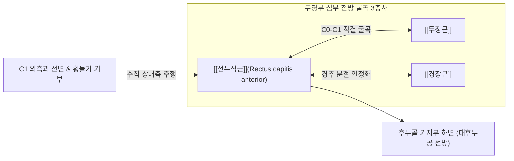
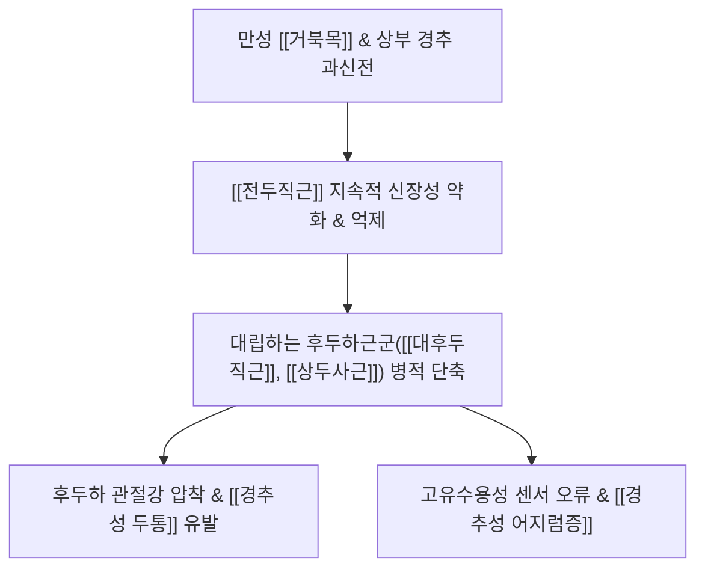
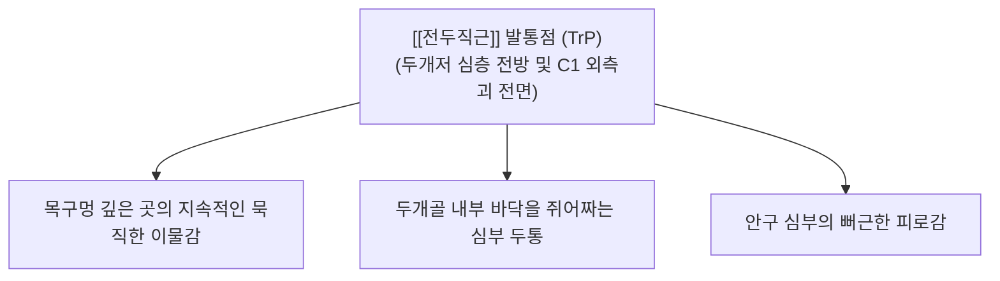

# [[전두직근]](Rectus capitis anterior)

> **핵심 요약 (Key Summary)**:
> 제1경추(환추, Atlas)의 외측괴 전면 및 횡돌기 기부에서 기원하여 후두골 기저부(저부) 하면에 정지하는 두경부 최심층 전두부 안정화 근육입니다.
> 제1경추신경 전지(C1 ventral ramus)의 지배를 받으며, 환추후두관절(C0-C1)의 순수 굴곡(Flexion) 및 머리의 미세 끄덕임(Nodding)을 주도합니다.
> [[두장근]], [[경장근]]과 함께 심부 경추 굴곡근 복합체(DCF)를 형성하며, [[거북목|거북목 증후군]], [[경추성 두통]], 환추후두관절 기능부전, [[경추성 어지럼증]]의 핵심 병변근이자 상부 경추 추나 및 턱당김 운동의 표적입니다.

---

## 📌 목차
1. [해부학적 정밀 구조 및 지배 신경/혈관](#1-해부학적-정밀-구조-및-지배-신경혈관)
2. [생체역학·토크 분석 & 경부 근막 사슬 (Biomechanical Synergy)](#2-생체역학토크-분석--경부-근막-사슬-biomechanical-synergy)
3. [근막통증증후군(TP) & 연관통 패턴 (Travell & Simons)](#3-근막통증증후군tp--연관통-패턴-travell--simons)
4. [초음파 해부학(Sonoanatomy) 및 중재 시술 랜드마크](#4-초음파-해부학sonoanatomy-및-중재-시술-랜드마크)
5. [⭐ 원장님 심층 임상 고찰 및 원본 필기 (Clinical Pearls)](#5-원장님-심층-임상-고찰-및-원본-필기-clinical-pearls)
6. [관련 임상 질환 및 운동손상 증후군 총괄](#6-관련-임상-질환-및-운동손상-증후군-총괄)
7. [추나·도수치료(MET/PIR) & 침구·약침·재활 프로토콜](#7-추나도수치료metpir--침구약침재활-프로토콜)
8. [출처 및 학술 참고 문헌 (References)](#8-출처-및-학술-참고-문헌-references)

---

## 1. 해부학적 정밀 구조 및 지배 신경/혈관

| 해부학 항목 | 상세 기술 내용 |
| :--- | :--- |
| **기시부 (Origin)** | 제1경추(환추, Atlas, C1) 외측괴(Lateral mass) 전면 및 횡돌기 기부 골면 |
| **정지부 (Insertion)** | 후두골 기저부 하면 (Basilar part of occipital bone, 대후두공 전방 골면, [[두장근]] 정지부 후내측) |
| **신경 지배 (Innervation)** | 제1경추신경 전지 분지 (C1 ventral ramus loop, C1-C2 전지 연결 가지) |
| **혈관 공급 (Vascular Supply)** | 상행인두동맥(Ascending pharyngeal A.) 척주지, [[추골동맥]](Vertebral A.) 전방 근육지 |
| **공간적 인접 관계** | 전방으로 [[두장근]](Longus capitis) 상부 섬유 및 인두후간극, 외측으로 [[외측두직근]](Rectus capitis lateralis), 후방으로 환추후두관절낭 및 환추후두전막(AAOM) |

* **해부학적 특이성**:
  * 환추 전궁과 두개골 바닥 사이를 수직으로 연결하는 매우 짧고 두터운 사각형 근육입니다.
  * [[외측두직근]]과 마찬가지로 경추 후신경총(후두하신경)이 아닌 **C1 척수신경 전지(Ventral ramus)**의 직접적인 지배를 받습니다.
  * 바로 뒤편에 환추후두관절(C0-C1)의 전방 관절낭이 밀접하게 붙어 있어, 관절낭의 긴장도와 고유수용성 감각을 역동적으로 조율합니다.

---

## 2. 생체역학·토크 분석 & 경부 근막 사슬 (Biomechanical Synergy)

* **환추후두관절(C0-C1)의 순수 굴곡 주동근 (Primary Pure Flexor)**:
  * 머리를 앞으로 끄덕이는 굴곡 운동(Flexion, Nodding)의 초기 5~10도를 전담하여 시동을 거는 핵심 근육입니다.
  * [[두장근]]이 경추 3~6번에서 시작하여 두개골을 큰 지렛대로 당긴다면, 전두직근은 환추(C1) 바로 위에서 두개골 기저부를 직접 하방으로 당겨 **C0-C1 분절의 미세 활주(Arthrokinematic Glide)**를 유도합니다.
* **상부 경추 과신전 억제 및 동적 전방 닻(Anterior Anchor)**:
  * 머리를 뒤로 젖힐 때 편심성 수축(Eccentric contraction)으로 과도한 신전을 방어하여, 연수(Medulla)와 상부 척수가 대후두공 후연에 압박되지 않도록 전방에서 지지합니다.
* **근막 사슬 연계 (Anatomy Trains)**:
  * **심부전방선(Deep Front Line, DFL)**: 골반저에서 척추전근막을 거쳐 후두골 기저부 정중선에 도달하는 인체 최심층 코어 인장선의 최상단 종착지.

---

## 3. 근막통증증후군(TP) & 연관통 패턴 (Travell & Simons)

* **발통점 형성 및 증상 특징**:
  * 장시간 턱을 앞으로 내밀고 고개를 젖힌 자세([[거북목]])로 모니터를 보거나 운전할 때 형성.
  * **두개골 내부 바닥의 심부 둔통**:
    * 환자는 "머리 속 바닥, 뇌가 얹혀 있는 뼈 속 깊은 곳이 묵직하게 조여온다"고 호소하며 두통약에 잘 반응하지 않음.
  * **인후부 이물감 및 연하 시 뻐근함**:
    * 근육 전방에 위치한 인두후벽 근막이 긴장하여 삼킴 시 목 안 깊숙한 곳의 뻐근함과 걸림 증상 투사.
  * **턱당김(Chin-tuck) 동작 시 날카로운 억제통**:
    * 턱을 당기려 할 때 두개저 전방에서 찌르는 듯한 저항이 발생하여 정상적인 턱당김 운동 수행 불가.

---

## 4. 초음파 해부학(Sonoanatomy) 및 중재 시술 랜드마크

* **초음파 스캔 프로토콜**:
  * **프로브 위치**: 하악각 바로 아래 경부 전외측에서 선형 프로브를 횡단 및 사선 단면으로 거치.
  * **층별 확인 (Superficial → Deep)**:
    1. 표재층: [[흉쇄유돌근]](SCM) 상부 근복.
    2. 중간층: 경동맥초([[내경동맥]], [[내경정맥]], [[10. 미주신경|미주신경]]) 및 [[두장근]] 상부 근복.
    3. 심층 랜드마크: C1 외측괴 전면의 고에코 골피질과 후두골 기저부 골면 사이의 얇은 심부 근육층 확인.
* **인접 고위험 혈관 및 뇌신경 랜드마크 (CRITICAL)**:
  * **내경동맥(ICA) & 추골동맥(VA)**: 전두직근 전외측을 내경동맥이, 외측 후방을 추골동맥이 주행.
  * **인두후간극(Retropharyngeal Space)**: 전방 자침 시 인두벽 관통 위험.
* **침구 및 중재 시술 절대 안전 원칙**:
  * **전방 맹목적 직자 절대 엄금**: 내경동맥 파열 및 인두 천공 위험이 극도로 높으므로 전방에서 직접 깊게 자침하지 않음.
  * **간접 감압 치료 원칙**: 후방의 풍지(GB20), 천주(BL10)를 통한 상부 경추 후두하 감압술 및 후두저 이완 수기 추나(Suboccipital release)를 통해 상반신경억제(Reciprocal inhibition)를 유도하여 안전하게 치료.

---

## 5. ⭐ 원장님 심층 임상 고찰 및 원본 필기 (Clinical Pearls)

### 1) 진정한 Chin-Tuck 굴곡 복합체의 전두부 핵심 (원장님 필기 100% 보존)
* 전두직근은 [[두장근]], [[경장근]]과 함께 '심부 경추 굴곡 복합체(Deep Cervical Flexors, DCF)'를 구성하는 핵심 유닛입니다.
* **원장님 임상 노하우**:
  * 환자가 턱당김을 할 때 턱을 목 쪽으로 우격다짐으로 당기면 [[흉쇄유돌근]]만 불거지고 전두직근은 전혀 수축하지 않습니다.
  * 진정한 수축은 **"귓구멍을 중심 회전축으로 삼아 코끝을 바닥 쪽으로 1cm만 살짝 끄덕인다"**는 느낌으로 환추 위에서 후두골만을 굴곡시킬 때 전두직근이 선택적으로 동원됩니다.

### 2) 거북목 보상적 과신전과 신장성 마비
* [[거북목]] 환자들은 전방 돌출된 머리의 시야를 확보하기 위해 환추후두관절(C0-C1)을 지속적으로 젖히는 보상적 과신전 자세를 취합니다.
* 이때 전두직근은 장기간 팽팽하게 늘어난 상태로 억제(Inhibition)되어 위축되고, 대립하는 후두하근군([[대후두직근]], [[상두사근]])은 병적으로 단축됩니다. 따라서 전두직근의 활성화 없이는 만성 거북목 교정이 불가능합니다.

### 3) 경추성 어지럼증과 두개저 고유수용기
* 인체에서 근방추 밀도가 가장 높은 후두하 영역의 전방 지지대로서, 두부의 전후 끄덕임 각도를 전정신경핵으로 실시간 전달합니다. 전두직근 기능부전 시 머리를 숙이거나 들 때 붕 뜨는 듯한 어지럼증이 유발됩니다.

---

## 6. 관련 임상 질환 및 운동손상 증후군 총괄

| 임상 질환 / 증후군 | 병리적 연관 기전 | 주요 증상 및 이학적 검사 | 핵심 교정 타깃 |
| :--- | :--- | :--- | :--- |
| [[경추성 두통]] | C0-C1 관절 기능부전 및 후두하근 연쇄 단축 | 두개저 심부 둔통, 관자놀이 방사통 | 후두저 감압 추나 & 전두직근 활성화 |
| [[거북목]] | 상부 경추 과신전에 따른 전두직근 신장성 약화 | 머리 전방 돌출, 경추 전만 소실 | **두개경추 굴곡 검사(CCFT)** 재활 |
| [[경추성 어지럼증]] | 환추후두관절 고유감각 센서 입력 불일치 | 고개 움직일 때 휘청거림, 시야 불안정 | 두경부 고유수용성 감각 훈련 |
| 환추 굴곡 잠김(Locking) | C0-C1 관절낭 유착 및 전두직근 연축 | 고개 숙일 때 두개저 통증 및 가동역 제한 | 환추후두관절 가동술 추나 |
| [[편타 손상]] | 급격한 감속 손상 시 전두직근 견인성 파열 | 수상 후 지속되는 목 깊은 통증 및 항강증 | 급성기 침구 후 점진적 등척성 훈련 |

---

## 7. 추나·도수치료(MET/PIR) & 침구·약침·재활 프로토콜

* **한의학 경혈 배오 및 간접 접근법**:
  * **풍지(GB20) 및 천주(BL10)**: 후방에서 후두하근군을 먼저 충분히 침도나 장침으로 이완시켜 상반억제 유도.
  * **인영(ST9) 외측 접근**: 경동맥초를 외측으로 안전하게 견인 후 0.3~0.5촌 완만 자침.
  * **천돌(CV22)**: 전면 척추전근막 장력 해소를 위한 하방 사자.
* **약침 처방 (Pharmacopuncture)**:
  * **신바로약침 / 자하거약침**: 만성 C0-C1 관절염, 두개저 심부통 환자의 풍지·천주 심부 골면에 0.3~0.5cc 주입.
  * **중성어혈약침**: 편타 손상 후 급성 경부 굴곡 장애 환자 적용.
* **추나 및 관절 가동술 (C0-C1 Mobilization & MET)**:
  * **환추후두관절 굴곡 유도 PIR**:
    * 환자는 앙와위, 시술자는 후두골을 감싸 쥐고 턱을 가볍게 당겨 C0-C1 굴곡 장벽 거치.
    * 환자에게 "시선만을 위로 향하며 머리를 10% 힘으로 아주 살짝 뒤로 젖히세요(신전 저항)" 지시 (5초 유지).
    * 호기와 함께 완전히 힘을 뺄 때 턱을 부드럽게 1~2도 더 당기며 후두골을 상방 견인 (3회 반복).

---

## 8. 출처 및 학술 참고 문헌 (References)

1. **Amonoo-Kuofi, H. S. (1983)**.
   - *The density of muscle spindles in the medial, intermediate and lateral columns of human intrinsic postvertebral muscles*. *J Anat*, 137(Pt 2), 341-352. [PMID: 6224767]
   - [연구 요약] 상부 경추 심부 근육군(전두직근 포함)의 근방추 밀도 계측 및 두경부 평형 조절 기전 규명.
2. **Jull, G., et al. (2004)**.
   - *Impairment in the cervical flexors: a comparison of whiplash and insidious onset neck pain patients*. *Man Ther*, 9(2), 89-94. [PMID: 15040968]
   - [연구 요약] 경추성 두통 및 목 통증 환자에서 전두직근/두장근 등 심부 경추 굴곡근의 기능부전과 임상 평가법 입증.
3. **Standring, S. (2020)**.
   - *Gray's Anatomy: The Anatomical Basis of Clinical Practice* (42nd ed.). Elsevier, pp. 578-580.
   - [연구 요약] 전두직근의 C1 외측괴 기시, 후두골 기저부 부착부 및 C1 전지 분지 지배 해부학 데이터 수록.
4. **Travell, J. G., & Simons, D. G. (1999)**.
   - *Myofascial Pain and Dysfunction: The Trigger Point Manual* (Vol. 1, 2nd ed.). Williams & Wilkins, pp. 490-503.
   - [연구 요약] 심부 경추 굴곡근군 발통점과 두개저 연관통 패턴 분석.
