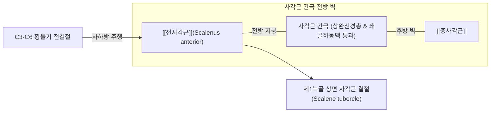
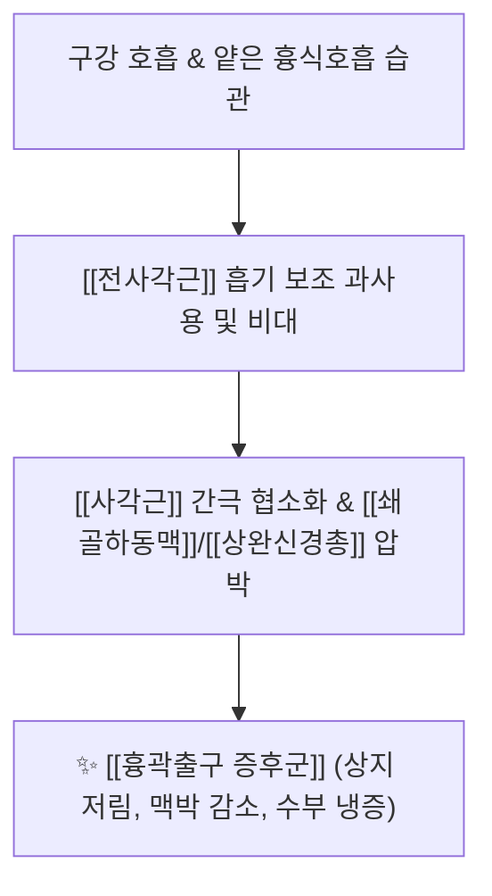
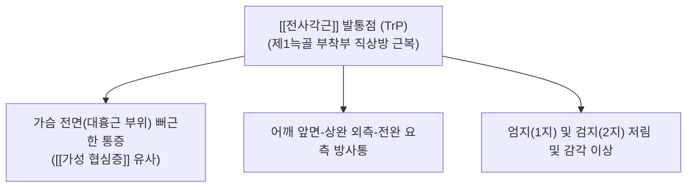

# [[전사각근]](Scalenus anterior)

> **핵심 요약 (Key Summary)**:
> 제3~6경추 횡돌기 전결절에서 기원하여 제1늑골의 [[사각근]] 결절에 정지하는 [[사각근]] 삼각의 전방 벽을 이루는 핵심 근육입니다.
> 경신경 전지(C4~C6)의 지배를 받으며, 경추의 굴곡·측굴·대측 회전 및 흡기 시 제1늑골 거상을 주도합니다.
> [[흉곽출구 증후군]](TOS), 상지 방사통, 수부 부종 및 저림, [[상부교차 증후군]]의 핵심 병변근이며, 결분·천정혈 도침 및 약침이 표적입니다.

---

## 📌 목차
1. [해부학적 정밀 구조 및 지배 신경/혈관](#1-해부학적-정밀-구조-및-지배-신경혈관)
2. [생체역학·토크 분석 & 근막 사슬 (Biomechanical Synergy)](#2-생체역학토크-분석--경부-근막-사슬-biomechanical-synergy)
3. [근막통증증후군(TP) & 연관통 패턴 (Travell & Simons)](#3-근막통증증후군tp--연관통-패턴-travell--simons)
4. [초음파 해부학(Sonoanatomy) 및 중재 시술 랜드마크](#4-초음파-해부학sonoanatomy-및-중재-시술-랜드마크)
5. [⭐ 원장님 심층 임상 고찰 및 원본 필기 (Clinical Pearls)](#5-원장님-심층-임상-고찰-및-원본-필기-clinical-pearls)
6. [관련 임상 질환 및 운동손상 증후군 총괄](#6-관련-임상-질환-및-운동손상-증후군-총괄)
7. [추나·도수치료(MET/PIR) & 침구·약침·재활 프로토콜](#7-추나도수치료metpir--침구약침재활-프로토콜)
8. [출처 및 학술 참고 문헌 (References)](#8-출처-및-학술-참고-문헌-references)

---

## 1. 해부학적 정밀 구조 및 지배 신경/혈관

| 항목 | 상세 내용 |
| :--- | :--- |
| **기시 (Origin)** | 제3~6경추(C3~C6) 횡돌기 전결절 (Anterior tubercles of transverse processes) |
| **정지 (Insertion)** | 제1늑골 상면 내측연의 [[사각근]] 결절 (Scalene tubercle on upper border of 1st rib) |
| **신경 지배** | 제4~6경추신경 전지 ([[경신경총]] 및 상완신경총 분지, C4~C6 anterior rami) |
| **혈관 공급** | 상행경동맥(Ascending cervical A.), 갑상경동맥(Thyrocervical trunk) 분지 |
| **삼각 경계** | [[사각근]] 간극(Interscalene space)의 전방 경계를 형성하여 쇄골하동맥 및 상완신경총과 접함 |

---

## 2. 생체역학·토크 분석 & 경부 근막 사슬 (Biomechanical Synergy)

* **경추 운동 및 두경부 안정화**:
  * **양측 수축 (Bilateral Action)**: 경추를 강력하게 전방 굴곡(Flexion)시키고, 머리가 뒤로 젖혀지는 충격을 지탱.
  * **일측 수축 (Unilateral Action)**: 경추의 동측 측굴(Lateral flexion) 및 **반대측 회전(Contralateral rotation)**을 유도 ([[흉쇄유돌근]](SCM)과 동일한 회전 방향 협력).
* **흡기 보조근 (Accessory Inspiratory Muscle)**:
  * [[횡격막]] 호흡이 무너진 환자에서 제1늑골을 상방으로 강하게 들어 올려 흉곽 상구를 억지로 확장시키는 보상 작용 수행.
* **근막 사슬 연계 (Anatomy Trains)**:
  * **심부전방선(Deep Front Line, DFL)**: [[장요근]]-[[횡격막]]-심부 흉부근막을 거쳐 경추 전방의 [[전사각근]] 및 [[경장근]]으로 이어지는 코어 축의 최상단 앵커.

---

## 3. 근막통증증후군(TP) & 연관통 패턴 (Travell & Simons)

* **발통점 및 연관통 특성**:
  * **어깨 및 상지 방사통 ([[경추 추간판 탈출증|목 디스크]] 오진 최다 원인)**:
    * 어깨 전면에서 상완 외측을 타고 내려가 [[요골신경]] 주행선을 따라 엄지와 검지(C6 신경근 영역)로 저림과 감각 이상 투사.
  * **전흉부 방사통 ([[가성 협심증]], Pseudo-angina)**:
    * 좌측 [[전사각근]] TrP 활성화 시 [[대흉근]] 부위로 통증이 뻗쳐 심장 질환([[협심증]])으로 오인하기 쉬움 (심전도상 정상).
  * **견갑골 내측연 통증**:
    * 견갑골 내측연과 [[능형근]] 부위로 깊은 쑤심을 방사하여 만성 등 통증 유발.

---

## 4. 초음파 해부학(Sonoanatomy) 및 중재 시술 랜드마크

* [[사각근]] **간극(Scalene Triangle / Interscalene Space) 구조**:
  * **전방 벽**: [[전사각근]] (Scalenus anterior)
  * **후방 벽**: [[중사각근]] (Scalenus medius)
  * **바닥**: 제1늑골(1st Rib) 상면
  * **내부 주행물**: [[상완신경총]](Brachial plexus) 신경간(Trunks: C5, C6, C7, C8, T1) 및 [[쇄골하동맥]](Subclavian A.)
* **초음파 단면 소견 (Interscalene View)**:
  * 쇄골 상와에서 선형 프로브를 횡단 배치하면, [[전사각근]]과 [[중사각근]] 사이에 [[상완신경총]] 신경근들이 원형의 저에코 음영으로 세로로 정렬된 '신호등 징후(Traffic Light Sign)' 관찰.
* [[전사각근]] **전면 랜드마크**:
  * [[횡격막신경]](Phrenic nerve): [[전사각근]] 전면 근막 위를 내측 사하방으로 가로지르므로 약침 주입 시 과도한 신경 차단 주의.
* **안전 마진 및 절대 금기 (CRITICAL)**:
  * **기흉(Pneumothorax) 방지**: [[전사각근]] 정지부 심부에는 폐첨부(Apex of lung / Cupula of pleura)가 위치하므로, 침이나 도침의 깊이를 엄격히 통제하고, 반드시 제1늑골 골면에 정확히 안착(Bone touch)시킨 상태에서만 수평 박리 시행 (폐첨부 방향 사자 절대 엄금).

---

## 5. ⭐ 원장님 심층 임상 고찰 및 원본 필기 (Clinical Pearls)

### 1) [[흉곽출구 증후군]](TOS)의 주범과 신경혈관 포착 (원장님 필기 100% 보존)
* [[전사각근]]과 [[중사각근]] 사이를 통과하는 [[상완신경총]]과 [[쇄골하동맥]]을 압박하여 상지 저림 및 혈류 장애를 유발합니다.
* **원장님 핵심 진단 팁**:
  * 환자가 "밤에 잘 때 팔이 저려서 깬다", "손이 붓고 찬물에 닿으면 시리다"고 호소하면 [[경추 추간판 탈출증|목 디스크]]보다 [[사각근]] 기원성 [[흉곽출구 증후군]](TOS)을 먼저 감별해야 합니다.
  * **애드슨 검사(Adson test)**: 환자의 턱을 들고 환측으로 고개를 돌린 뒤 심호흡을 들이마시게 했을 때 요골동맥 맥박이 급격히 약해지거나 소실되면 [[전사각근]]에 의한 [[쇄골하동맥]] 포착으로 확진.

### 2) 횡격막 호흡과의 연계 및 과호흡 증후군 (원장님 필기 100% 보존)
* [[전사각근]]은 대표적인 흡기 보조근으로, 스트레스나 불안으로 인해 복식호흡이 깨지고 얕은 흉식 과호흡이 지속되면 하루 2만 번 이상 과사용되어 만성 단축에 빠집니다.
* [[사각근]] 치료 시 침구 치료와 더불어 반드시 [[횡격막]] 복식호흡 재활을 병행해야 재발의 고리를 끊을 수 있습니다.

### 3) 목 디스크와의 감별과 [[더블 크러시 증후군]](Double Crush Syndrome)
* [[경추 추간판 탈출증]](HIVD) 환자 중 수술이나 신경차단술 후에도 상지 저림이 남는 경우, [[상완신경총]]이 [[사각근]] 간극에서 2차 포착된 [[더블 크러시 증후군]] 상태입니다. 결분혈-천정혈 부위의 [[전사각근]] 긴장을 도침으로 풀어주면 잔여 저림이 즉시 호전됩니다.

---

## 6. 관련 임상 질환 및 운동손상 증후군 총괄

| 임상 질환 / 증후군 | 병리적 연관 기전 | 주요 증상 및 이학적 검사 | 핵심 교정 타깃 |
| :--- | :--- | :--- | :--- |
| [[흉곽출구 증후군]] | [[사각근]] 간극 협소화로 신경혈관 압박 | 상지 저림, 파지력 약화, 애드슨 검사 양성 | 제1늑골 [[사각근]] 결절 도침 박리 |
| [[가성 협심증]] | 좌측 [[전사각근]] TrP 활성화 | 좌측 흉부 뻐근함, 숨찬 느낌, EKG 정상 | 전사각근 근복 침구 및 약침 |
| [[상부교차 증후군]] | 거북목 보상에 따른 전사각근 단축 | 어깨 말림, 머리 전방 돌출, 경항통 | 사각근 MET 및 자세 교정 |
| [[더블 크러시 증후군]] | 경추 신경근 병증 + 사각근간극 2차 포착 | 만성 상지 저림, 수부 위약감 | 결분혈 도침 및 신경가동술 |
| [[거북목|거북목 증후군]] | 흉식호흡 보상에 따른 사각근 비대 | 쇄골 상와 팽만감, 만성 피로 | 전사각근 이완 및 복식호흡 재활 |

---

## 7. 추나·도수치료(MET/PIR) & 침구·약침·재활 프로토콜

* **한의학 경혈 매핑**:
  * 결분(ST12), 천정(LI17), 수돌(ST10), 기사(ST11)
* **침구 및 침도(도침) 프로토콜**:
  * **결분혈(ST12) 도침 감압술**:
    * 쇄골 상와에서 쇄골하동맥 박동을 내측으로 견인 보호하고 제1늑골 상면 사각근 결절을 촉지.
    * 0.40x40mm 침도를 제1늑골을 향해 완만하게 사자하여 **반드시 제1늑골 골면에 Bone touch**.
    * 골막에 닿은 상태에서만 늑골 장축 방향으로 미세하게 1회 절개 박리.
* **약침 처방**:
  * **오공약침 / 봉약침**: 난치성 상지 저림, 신경인성 통증 환자의 결분-천정 라인 전사각근막층 0.3~0.5cc 분할 주입.
  * **중성어혈약침**: 외상성 손상, 급성 경부 회전 장애 환자 정지부 주입.
* **추나 및 신장 테크닉 (Scalene MET / PIR)**:
  * **전사각근 선택적 MET**:
    * 환자는 앙와위, 시술자는 경추를 반대측 측굴 + 동측 회전 + 약간 신전 장벽 거치.
    * 환자에게 20% 힘으로 "머리를 반대쪽으로 돌리며 턱을 당겨보세요" 지시 (5초 저항).
    * 호기와 함께 완전히 힘을 뺀 상태에서 15초간 부드럽게 신장 (3회 반복).

---

## 8. 출처 및 학술 참고 문헌 (References)

1. **Novak, C. B., & Mackinnon, S. E. (1996)**.
   - *Thoracic outlet syndrome*. *Orthop Clin North Am*, 27(4), 747-762. [PMID: 8823394]
   - [연구 요약] 전사각근 비대로 인한 흉곽출구증후군의 병태생리, 애드슨 검사의 민감도 및 보존적 중재 요법의 치료율 분석.
2. **Mackel, M. (2016)**.
   - *Thoracic Outlet Syndrome*. *Curr Sports Med Rep*, 15(5), 344-349. [PMID: 26963010]
   - [연구 요약] 사각근 간극 신경혈관 압박에 대한 임상적 진단 알고리즘과 감압 요법의 효과 검증.
3. **Standring, S. (2020)**.
   - *Gray's Anatomy: The Anatomical Basis of Clinical Practice* (42nd ed.). Elsevier, pp. 582-585.
   - [연구 요약] 전사각근의 C3-C6 횡돌기 전결절 기시, 제1늑골 결절 정지 및 상완신경총/쇄골하동맥과의 공간 해부학 데이터 수록.
4. **Travell, J. G., & Simons, D. G. (1999)**.
   - *Myofascial Pain and Dysfunction: The Trigger Point Manual* (Vol. 1, 2nd ed.). Williams & Wilkins, pp. 504-537.
   - [연구 요약] 전사각근 트리거포인트 방사통 경로와 상지 저림 및 가성 협심증 감별 임상 지침 확립.
