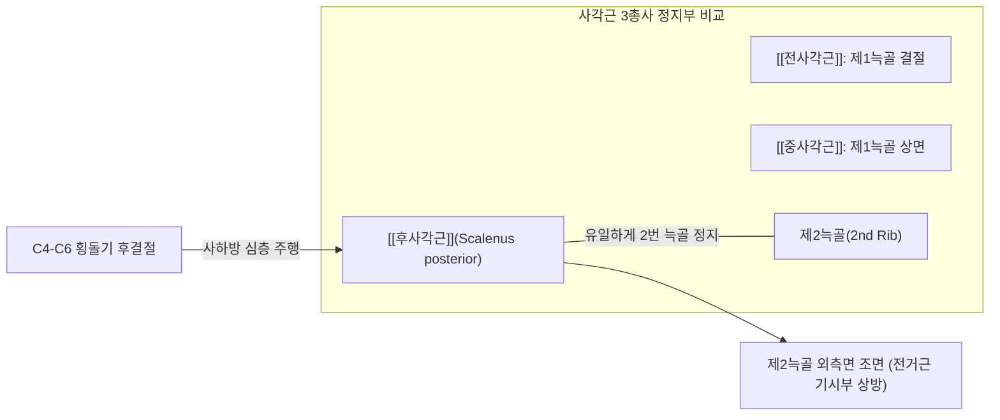
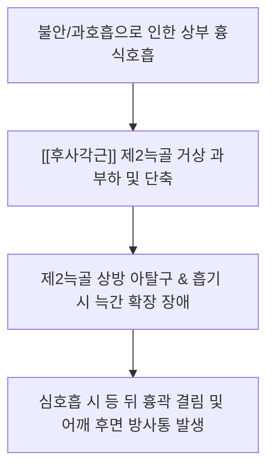
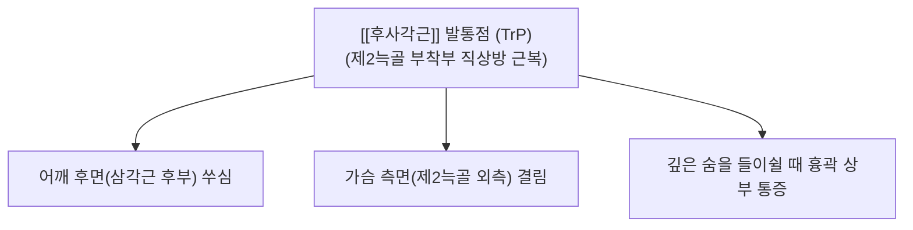

# 후사각근 (Scalenus Posterior Muscle)

> **핵심 요약 (Key Summary)**:
> 제4~6[[경추]] 횡돌기 후결절에서 기원하여 유일하게 제2늑골 외측면에 정지하는 사각근군 중 가장 심부에 위치한 근육입니다.
> 경신경 전지(C5~C8)의 지배를 받으며, 제2늑골 거상을 통한 심호흡 보조 및 [[경추]]의 동측 측굴을 담당합니다.
> [[흉곽출구 증후군]](TOS), **늑골 기능부전**, 호흡 시 흉곽 상부 통증, 견갑골 외측 통증의 핵심 병변근이며, 결분·천정혈 침구 및 도침이 표적입니다.

---

## 📌 목차
1. [해부학적 정밀 구조 및 지배 신경/혈관](#1-해부학적-정밀-구조-및-지배-신경혈관)
2. [생체역학·토크 분석 & 경부 근막 사슬 (Biomechanical Synergy)](#2-생체역학토크-분석--경부-근막-사슬-biomechanical-synergy)
3. [근막통증증후군(TP) & 연관통 패턴 (Travell & Simons)](#3-근막통증증후군tp--연관통-패턴-travell--simons)
4. [초음파 해부학(Sonoanatomy) 및 중재 시술 랜드마크](#4-초음파-해부학sonoanatomy-및-중재-시술-랜드마크)
5. [⭐ 원장님 심층 임상 고찰 및 원본 필기 (Clinical Pearls)](#5-원장님-심층-임상-고찰-및-원본-필기-clinical-pearls)
6. [관련 임상 질환 및 운동손상 증후군 총괄](#6-관련-임상-질환-및-운동손상-증후군-총괄)
7. [추나·도수치료(MET/PIR) & 침구·약침·재활 프로토콜](#7-추나도수치료metpir--침구약침재활-프로토콜)
8. [출처 및 학술 참고 문헌 (References)](#8-출처-및-학술-참고-문헌-references)

---

## 1. 해부학적 정밀 구조 및 지배 신경/혈관

| 항목 | 상세 내용 |
| :--- | :--- |
| **기시 (Origin)** | 제4~6[[경추]](C4~C6, 때로 C7 포함) 횡돌기 후결절(Posterior tubercles) |
| **정지 (Insertion)** | 제2늑골(2nd rib) 외측면 조면 ([[전거근]] 제1~2두 부착부 후상방) |
| **신경 지배** | 제5~8경추신경 전지 ([[상완신경총]] 하부 분지, C5~C8 anterior rami) |
| **혈관 공급** | 상행경동맥(Ascending cervical A.), 경횡동맥(Transverse cervical A.) 및 늑경동맥 분지, [[쇄골하동맥]] 분지 |
| **고유한 주행** | 제1늑골을 건너뛰어 유일하게 제2늑골에 정지하며 사각근군 중 가장 심후방에 위치 |

---

## 2. 생체역학·토크 분석 & 경부 근막 사슬 (Biomechanical Synergy)

* **제2늑골(2nd Rib) 거상의 전담 엔진**:
  * [[전사각근]]과 [[중사각근]]이 제1늑골을 들어 올릴 때, [[후사각근]]은 **제2늑골을 위로 견인하여 상부 흉곽의 전후·좌우 직경을 동시에 확장**시키는 핵심 심호흡 보조근.
* **경추 동측 측굴 보조**:
  * [[중사각근]] 심층에서 [[경추]]의 측방 굴곡력을 미세하게 지지하고, 경추 굴곡 시 후외측 관절의 과도한 회전을 억제.
  * 표층의 [[승모근]], [[견갑거근]], [[능형근]]과 함께 상부 흉곽-경추 복합체를 안정화.
* **근막 사슬 연계 (Anatomy Trains)**:
  * **측선(Lateral Line, LL)** 및 **심부전방선(Deep Front Line, DFL)**: 경추 횡돌기에서 흉곽 외측벽 [[전거근]] 라인으로 연결되는 호흡-체간 측면 슬링의 시발점.

---

## 3. 근막통증증후군(TP) & 연관통 패턴 (Travell & Simons)

* **발통점 및 연관통 특성**:
  * **어깨 후면 및 상완 외측 방사통**:
    * 전사각근이 엄지와 검지(C6 영역)로 방사통을 보낸다면, 후사각근은 어깨 후면과 상완 후외측으로 묵직한 통증을 투사.
  * **심호흡 시 흉통 (Inspiratory Chest Pain)**:
    * 숨을 깊게 들이마시거나 한숨을 쉴 때 제2늑골이 팽창하면서 [[후사각근]] 정지부에 날카로운 당김과 통증 격발.
  * **견갑골 상각(Superior Angle) 부위 결림**:
    * [[견갑거근]] 부착부와 맞닿아 있어 만성적인 상부 등 결림 및 [[상부교차 증후군]]의 숨은 원인으로 작용.

---

## 4. 초음파 해부학(Sonoanatomy) 및 중재 시술 랜드마크

* **초음파 스캔 프로토콜**:
  * **프로브 위치**: 쇄골 상와 외측 후방에서 사선 종단 스캔(Oblique sagittal view) 거치.
  * **단면 소견**: [[중사각근]] 후외측 심부에서 제1늑골을 건너뛰어 **제2늑골의 둥근 외측면 고에코 골피질 라인**에 부착하는 [[후사각근]] 건섬유 확인.
* **안전 마진 및 절대 금기 (CRITICAL)**:
  * **기흉(Pneumothorax) 발생 원천 차단**:
    * [[후사각근]] 정지부 바로 아래는 제2늑간극(2nd intercostal space)과 흉막(Pleura)이 위치합니다.
    * 자침이나 도침 시술 시 절대로 제2늑골의 뼈 감각(Bone touch) 없이 허공이나 늑간 공간으로 깊이 찌르면 안 됩니다.
    * **시술 절대 수칙**: 침 끝을 반드시 **제2늑골의 외측 골면에 정확히 안착(Bone touch)**시킨 뒤에만 미세한 박리를 시행해야 합니다.

---

## 5. ⭐ 원장님 심층 임상 고찰 및 원본 필기 (Clinical Pearls)

### 1) 제2늑골 거상의 주동근과 늑골 기능부전 (원장님 필기 100% 보존)
* 상부 늑간 호흡 시 제2늑골을 위로 들어 올리는 핵심 역할을 수행합니다.
* **원장님 임상 팁**:
  * 불안증, 공황장애, 만성 과호흡 환자는 제2늑골이 상방으로 변위되어 고착(Subluxated 2nd rib)됩니다.
  * 환자가 "가슴 윗부분이 답답하고 숨이 끝까지 안 들어간다", "기침할 때 등 뒤 갈비뼈가 결린다"고 호소할 때, [[늑간신경통]]으로 오진하지 말고 [[후사각근]] 제2늑골 부착부 긴장을 확인해야 합니다.

### 2) 상완신경총 하부 신경간(Lower Trunk) 포착 (원장님 필기 100% 보존)
* [[후사각근]]의 단축은 드물게 [[상완신경총]] 하부 신경간(C8-T1)을 상방으로 밀어올려, 4~5지(약지, 새끼손가락)의 저림과 [[척골신경]] 주행선 통증을 유발할 수 있습니다.
* 손의 4~5지가 저릴 때 [[주관절 터널 증후군|주관 증후군]](Cubital tunnel)이나 [[경추 추간판 탈출증|목 디스크]](C8)뿐만 아니라 [[후사각근]]의 하부 신경총 압박을 함께 감별해야 합니다.

### 3) 늑연골염(Tietze 증후군)과의 감별
* 앞가슴 2번 갈비뼈 접합부 통증으로 내원하는 환자 중 상당수는 앞쪽의 염증이 아니라, 뒤쪽 [[후사각근]]이 제2늑골을 뒤에서 강하게 잡아당겨 앞쪽 연골 부위에 견인성 통증이 발생하는 것입니다. [[후사각근]]을 풀어주면 앞가슴 통증이 즉각 사라집니다.

---

## 6. 관련 임상 질환 및 운동손상 증후군 총괄

| 임상 질환 / 증후군 | 병리적 연관 기전 | 주요 증상 및 이학적 검사 | 핵심 교정 타깃 |
| :--- | :--- | :--- | :--- |
| **늑골 기능부전** | [[후사각근]] 연축으로 제2늑골 상방 고착 | 심호흡 시 흉곽 상부 통증, 늑골 압통 | 제2늑골 도침 및 늑골 교정 추나 |
| [[흉곽출구 증후군]] | 상완신경총 하부 신경간(C8-T1) 포착 | 4~5수지 저림, 전완 척측 감각 이상 | 결분·천정 심부 도침 감압 |
| **가성 늑연골염** | [[후사각근]] 견인력의 흉골 전방 투사 | 제2늑연골 부위 뻐근함, 기침 시 악화 | [[후사각근]] TrP 이완 및 침구 |
| **상부 흉곽 호흡장애** | 심호흡 보조근 과부하 | 깊은 한숨 유발, 가슴 팽만감 저하 | 사각근 MET 및 [[횡격막]] 호흡 재활 |
| **견갑골 상각 연쇄통** | [[견갑거근]], [[능형근]]과의 근막 유착 | 목 돌릴 때 어깨 뒤쪽 깊은 결림 | [[후사각근]]-[[견갑거근]] 계면 박리술 |
| [[근막통증증후군]] | 제2늑골 부착부 만성 건막염 | 어깨 후면 심부 통증, 측와위 압통 | 소침도 박리 및 온열 요법 |

---

## 7. 추나·도수치료(MET/PIR) & 침구·약침·재활 프로토콜

* **한의학 경혈 매핑**:
  * 견외유(SI14), 결분(ST12), 천정(LI17), 견정(GB21)
* **침구 및 침도(도침) 프로토콜**:
  * **제2늑골 부착부 도침술 (절대 안전 수칙)**:
    * 쇄골 외측 후방에서 제2늑골 외측면을 손가락 끝으로 촉지하여 고정.
    * 0.40x40mm 침도를 제2늑골을 향해 완만하게 자침하여 **반드시 제2늑골 골면에 Bone touch**.
    * 골막에 닿은 상태에서만 늑골 장축 방향으로 미세하게 1회 절개 박리.
* **약침 처방**:
  * **중성어혈약침**: 만성 흉곽 결림, 제2늑골 변위 환자 정지부 0.3~0.5cc 주입.
  * **신바로약침**: 척골신경 주행선 저림 환자 신경 감압 목적 주입.
* **추나 및 늑골 교정 기법 (2nd Rib Mobilization & MET)**:
  * 환자는 좌위, 시술자는 한 손으로 제2늑골 상면을 하방으로 지지.
  * 경추를 반대측 측굴 + 반대측 회전 + 약간의 굴곡 장벽에 거치.
  * 환자에게 20%의 힘으로 "머리를 원래 자리로 돌리며 들이마시세요" 지시 (5초 저항).
  * 호기와 함께 제2늑골을 하후방으로 부드럽게 감압 신장 (3회 반복).

---

## 8. 출처 및 학술 참고 문헌 (References)

1. **Novak, C. B., & Mackinnon, S. E. (1996)**.
   - *Thoracic outlet syndrome*. *Orthop Clin North Am*, 27(4), 747-762. [PMID: 8823394]
   - [연구 요약] 후사각근을 포함한 사각근 복합체의 상완신경총 하부 신경간(C8-T1) 포착 기전과 흉곽출구증후군 치료율 분석.
2. **Bordoni, B., & Zanier, E. (2013)**.
   - *Anatomic connections of the diaphragm: influence of respiration on the body system*. *J Multidiscip Healthc*, 6, 281-291. [PMID: 23940419]
   - [연구 요약] 호흡 횡격막과 사각근군(후사각근 제2늑골 부착부 포함)의 기능적 근막 연결과 과호흡 증후군 역학 분석.
3. **Standring, S. (2020)**.
   - *Gray's Anatomy: The Anatomical Basis of Clinical Practice* (42nd ed.). Elsevier, pp. 582-585.
   - [연구 요약] 후사각근의 C4-C6 횡돌기 후결절 기시, 제2늑골 정지 및 상완신경총 하부 분지 지배 해부학 데이터 수록.
4. **Travell, J. G., & Simons, D. G. (1999)**.
   - *Myofascial Pain and Dysfunction: The Trigger Point Manual* (Vol. 1, 2nd ed.). Williams & Wilkins, pp. 504-537.
   - [연구 요약] 후사각근 발통점과 어깨 후면 연관통 및 심호흡 시 흉곽 상부 통증 분석.
