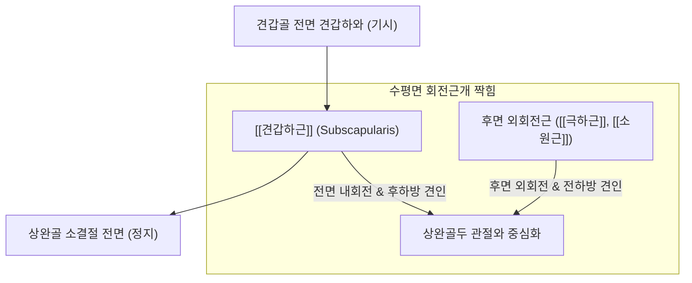
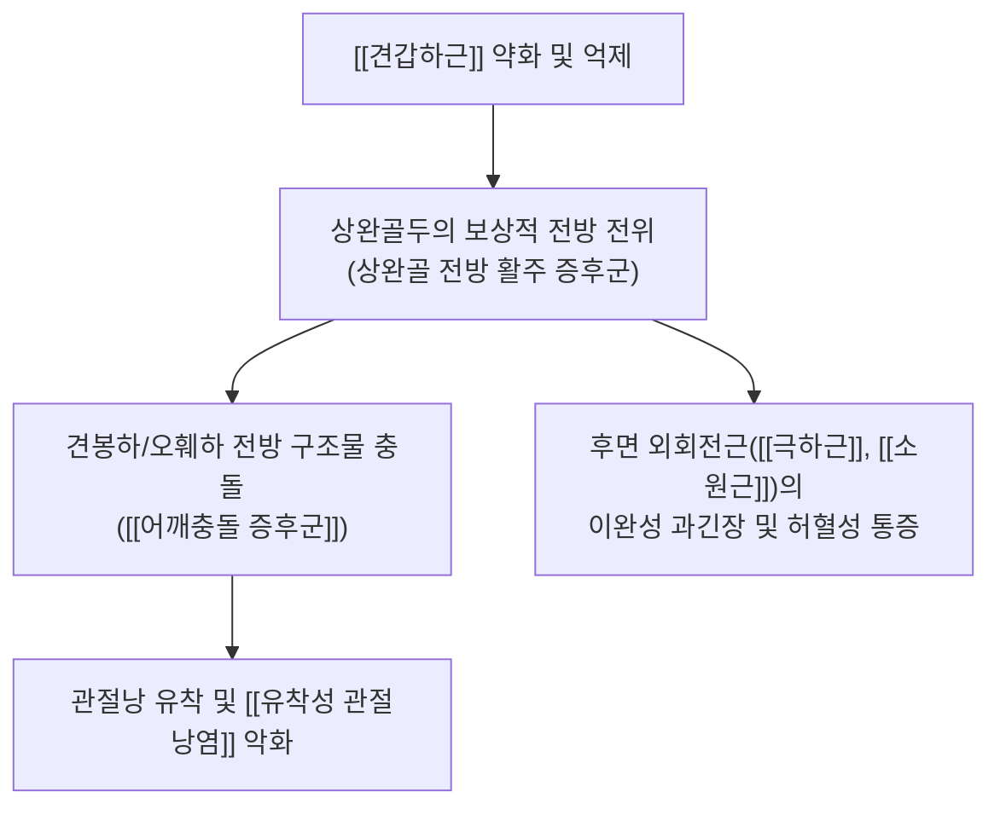
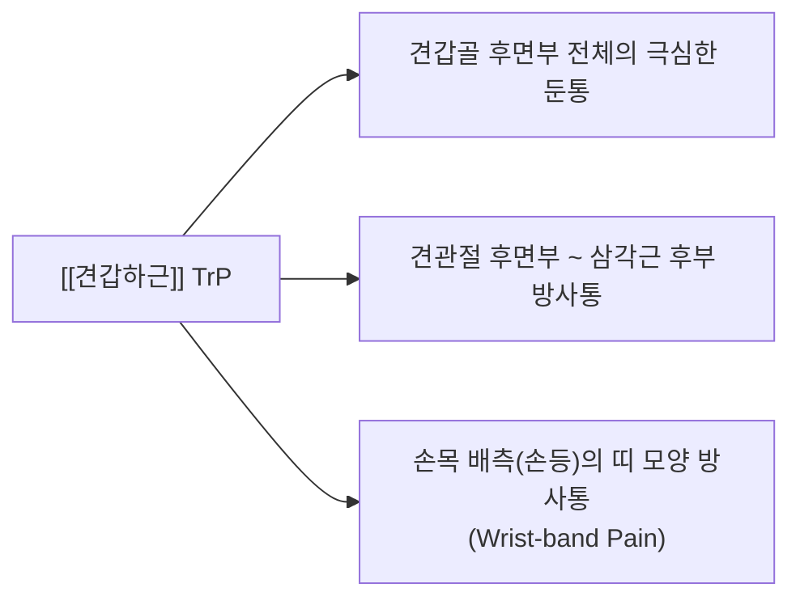

# 견갑하근 (Subscapularis Muscle)

> **핵심 요약 (Key Summary)**:
> [[회전근개]] 중 유일하게 [[견갑골]] 전면에 위치하여 상완골두를 후하방으로 강력하게 당겨 관절와에 중심화(Centration)시키는 핵심 안정화 근육입니다.
> **상견갑하신경** 및 **하견갑하신경**(C5-C7)의 지배를 받으며, 상완골의 가장 강력한 내전·내회전 토크를 발휘하고 **상완골 전방 활주 증후군**을 능동적으로 차단합니다.
> [[유착성 관절낭염]](오십견), [[어깨충돌 증후군|견관절 충돌증후군]] 호발 근육으로, 특수 검사(Belly-Press, Bear-Hug), 초음파 소결절 뷰, 견갑골 후방접근 자침 및 PIR 외회전 가동화가 핵심입니다.

---
## 📌 목차
1. [해부학적 정밀 구조 및 지배 신경/혈관](#1-해부학적-정밀-구조-및-지배-신경혈관)
2. [생체역학·토크 분석 & 근막 사슬 (Biomechanical Synergy)](#2-생체역학토크-분석--근막-사슬-biomechanical-synergy)
3. [근막통증증후군(TP) & 연관통 패턴 (Travell & Simons)](#3-근막통증증후군tp--연관통-패턴-travell--simons)
4. [초음파 해부학(Sonoanatomy) 및 중재 시술 랜드마크](#4-초음파-해부학sonoanatomy-및-중재-시술-랜드마크)
5. [⭐ 원장님 심층 임상 고찰 및 원본 필기 (Clinical Pearls)](#5-원장님-심층-임상-고찰-및-원본-필기-clinical-pearls)
6. [관련 임상 질환 및 운동손상 증후군 총괄](#6-관련-임상-질환-및-운동손상-증후군-총괄)
7. [추나·도수치료(MET/PIR) & 침구·약침·재활 프로토콜](#7-추나도수치료metpir--침구약침재활-프로토콜)
8. [출처 및 학술 참고 문헌 (References)](#8-출처-및-학술-참고-문헌-references)

---
## 1. 해부학적 정밀 구조 및 지배 신경/혈관

| 항목 | 상세 내용 |
| :--- | :--- |
| **기시 (Origin)** | [[견갑골]] 늑골면(전면)의 견갑하와(Subscapular fossa) 내측 2/3 및 하각 건막 능선 |
| **정지 (Insertion)** | 상완골 소결절(Lesser tubercle) 및 견관절낭 전면, 결절간구 내측능 |
| **신경 지배** | **상견갑하신경**(Upper subscapular N., C5-C6) 및 **하견갑하신경**(Lower subscapular N., C5-C6) |
| **혈관 공급** | **견갑하자동맥**(Subscapular A.), **액와동맥**(Axillary A.) 분지, **전상완회선동맥**(Anterior humeral circumflex A.) |
| **해부학적 특징** | 다우상근(Multipennate) 구조로 강력한 토크 생성에 최적화 상부 건성 섬유(소결절 상부 부착)와 하부 근육성 섬유(소결절 하부 및 상완골 경부 부착)로 기능 분화 건 상외측 섬유는 오훼상완인대(CHL)와 함께 회전근개 간격(Rotator interval) 형성 |

### 📐 해부학적 구조 및 짝힘 관계도

---
## 2. 생체역학·토크 분석 & 근막 사슬 (Biomechanical Synergy)

### (1) 관절 중심화(Centration) 및 짝힘(Force Couple) 메커니즘
* **상완골두 후하방 견인 벡터**:
  * 팔을 외전(Abduction)하거나 굴곡할 때 [[삼각근]]이 상완골두를 상방으로 당기는 전단력(Shearing force)을 발생시킵니다.
  * 이때 [[견갑하근]]은 상완골두를 **후방(Posteriorly) 및 하방(Inferiorly)**으로 강하게 당겨 관절와(Glenoid fossa)의 중심에 안착시키는 핵심 음압/압박력(Joint compression)을 제공합니다.
* **수평면 짝힘 (Transverse Force Couple)**:
  * 전면의 [[견갑하근]]과 후면의 [[극하근]], [[소원근]]이 완벽한 장력 균형을 이루어야 상완골두가 전후방으로 흔들리지 않고 중심축 회전을 유지할 수 있습니다.

### (2) 근막 사슬 연계 (Anatomy Trains)
* **심부전방상지선(Deep Front Arm Line)**:
  * [[소흉근]] $\rightarrow$ 쇄흉근막 $\rightarrow$ [[견갑하근]] $\rightarrow$ 상완골 소결절 $\rightarrow$ 요골 골막으로 이어지는 근막 라인의 핵심 정거장입니다.
  * 컴퓨터 작업, 스마트폰 사용 등 [[라운드 숄더]] 자세에서 이 라인이 단축되면 견갑골 전방경사와 상완골 내회전이 고착화됩니다.

---
## 3. 근막통증증후군(TP) & 연관통 패턴 (Travell & Simons)

### ⚡ 발통점(TP) 및 임상 방사통 특징
* **견갑골 외측연/상부 발통점 (TP 1)**:
  * **방사통**: 견갑골 후면부 전체에 걸쳐 깊고 묵직한 통증을 방사하며, 견관절 후면 및 상완 후면으로 퍼집니다.
  * **특징적 원격 연관통**: **손목 배측(손등 쪽 손목)에 시계 밴드를 찬 것처럼 띠 모양의 통증(Wrist-band pattern)**을 유발하여 손목 건초염으로 오진되기 쉽습니다.
* **견갑골 하각 부위 발통점 (TP 2)**:
  * **방사통**: 견갑골 하각 주변 및 상완 전면부로 연관통을 방사합니다.
* **가동범위 제한 (ROM Restriction)**:
  * **외회전(External Rotation)의 현저한 제한**: 팔을 바깥으로 벌리는 동작이 심하게 제한되며, 외회전 시 어깨 앞쪽에서 날카로운 통증이 발생합니다.
  * **수평 외전(Horizontal Abduction) 제한**: 가슴을 펴는 동작 시 견갑골 전면의 조임과 통증이 유발됩니다.

---
## 4. 초음파 해부학(Sonoanatomy) 및 중재 시술 랜드마크

### (1) 표준 초음파 스캔 뷰
* **환자 자세**: 팔꿈치를 90° 굴곡하고 전완을 회외(Supination)시킨 상태에서 상완골을 **수동 외회전(External Rotation)**시켜 소결절에 부착된 견갑하근 건을 전방으로 노출시킵니다.
* **장축 스캔 (Long-axis View)**:
  * 프로브를 횡축(수평)으로 위치시키면 오훼돌기 외측에서 상완골 소결절로 주행하는 부채꼴 모양의 견갑하근 건 섬유 다발(Fibrillar pattern)을 관찰할 수 있습니다.
* **단축 스캔 (Short-axis View)**:
  * 프로브를 수직으로 회전하여 상하 건 섬유의 두께와 결절간구 내 건과의 경계를 확인합니다.

### (2) 침도/약침 시술 시 안전 마진 (Safety Margin)
* ⚠️ **액와신경 및 혈관 손상 방지**:
  * 오훼돌기 내측으로 너무 깊게 자침하면 [[상완신경총]](Brachial plexus) 및 액와동정맥 손상 위험이 있으므로, 반드시 **오훼돌기 외측 1~1.5cm 지점**을 촉지하고 소결절 골면을 타깃으로 진입합니다.
* ⚠️ **기흉(Pneumothorax) 방지 안전각도**:
  * 견갑하근 체부에 접근할 때는 늑골 방향으로 직자하지 않고, 견갑골 전면 골면을 스치듯이(Bone contact) 바늘을 평행하게 유도합니다.

---
## 5. ⭐ 원장님 심층 임상 고찰 및 원본 필기 (Clinical Pearls)

### 💡 100% 원본 필기 보존 및 심층 해설
1. **후방접근법(Posterior Approach Needling) 노하우**:
   * *원본 필기*: "환자의 팔을 내회전시켜 등 뒤로 올리는 '열중쉬어 자세'를 취하게 하면, 견갑골이 흉벽에서 들리면서 익상(Winging)이 자연스럽게 유도됩니다. 견갑골 내측연 하부 틈새로 침을 진입시켜 견갑골 전면(늑골면) 골면과 흉벽 사이 공간을 따라 상완골두 방향으로 45~60° 사자합니다. 늑골 방향이 아닌 견갑골 골면을 타고 전진하므로 기흉 위험 없이 심부 근복을 완벽하게 자극할 수 있습니다."
   * *심층 고찰*: 견갑하근은 전면에서 접근하기 극히 어렵고 신경혈관 위험이 큽니다. 원장님의 후방접근법은 견갑골을 흉곽에서 인위적으로 띄워 안전하게 전면 골면을 활주하는 가장 탁월하고 안전한 임상 침구/도침 테크닉입니다.
2. **앙와위(Supine) 촉진 및 허혈성 압박법**:
   * *원본 필기*: "환자의 팔을 90° 외전시킨 상태에서 시술자가 액와와 후벽을 파지합니다. 엄지손가락으로 견갑골 전면을 타고 깊숙이 파고들어 견갑하근 근복을 직접 압박하면서 동시에 환자의 팔을 외회전시키면 단축된 근섬유가 효과적으로 신장됩니다."
   * *심층 고찰*: 액와 후벽을 통한 직접 수기 압박은 오십견 초기의 외회전 각도 회복에 즉각적인 효과를 발휘합니다.
3. **손목 시계 밴드(Wrist-band pattern) 방사통의 임상 함정**:
   * *원본 필기*: "손목 배측(손등 쪽)에 시계 줄을 찬 것처럼 삥 둘러 아프다고 호소하는 환자 중 수근관 증후군이나 드퀘르벵 건초염 검사에서 음성인 경우, 십중팔구 원인은 견갑하근의 상부 TrP입니다. 손목 치료에 매달리지 않고 견갑하근 압통점을 침구·약침으로 해소하면 손목 통증이 즉각 소실됩니다."
4. **견갑하근 강화 운동 (Rehabilitation)**:
   * *원본 필기*: "배꼽 누르기 운동(Belly-Press Exercise): 손바닥을 배꼽 위에 얹고 팔꿈치를 몸 앞쪽으로 유지한 상태에서 배꼽을 손바닥으로 꾹 누르며 5초간 유지. 밴드 내회전 운동: 팔꿈치와 옆구리 사이에 수건을 끼우고 0°~45° 내회전 구간에서 부드럽게 원심성 운동 수행."

---
## 6. 관련 임상 질환 및 운동손상 증후군 총괄

| 임상 질환 / 증후군 | 병리적 연관 기전 | 주요 증상 및 이학적 검사 | 핵심 교정 타깃 |
| :--- | :--- | :--- | :--- |
| **상완골 전방 활주 증후군** | 견갑하근 후방 견인력 상실로 대흉근이 상완골두를 전방 밀어냄 | 수평 외전/신전 시 어깨 전면 통증, 후방 밀기 시 통증 소실 | 견갑하근 강화 + [[대흉근]] 이완 |
| [[유착성 관절낭염]](오십견) | 견갑하근 아래 점액낭 유착 및 하부 관절낭 섬유화 수축 | 모든 방향(특히 외회전, 열중쉬어) 능동/수동 ROM 소실 | 견갑하 점액낭 박리 도침 + 관절수기 |
| [[회전근개 파열]](견갑하근 파열) | 외상성 과신전/외회전 손상 또는 오훼하 충돌 | Belly-Press (+), Bear-Hug (+), Lift-Off (+) | 건 정지부 약침 + 안정화 재활 |
| **상완이두근 장두 건 탈구** | 견갑하근 건 상부 섬유(지지띠) 파열 | 결절간구 부위 '뚝'하는 염발음(Popping/Clicking) | 회전근개 간격 안정화 및 도침 |
| [[어깨충돌 증후군]] | 상완골두 중심화 부전으로 견봉하 마찰 | 팔 외전 시 찝힘 통증, 통증호 양성 | 견갑하근 후하방 견인력 회복 |

---
## 7. 추나·도수치료(MET/PIR) & 침구·약침·재활 프로토콜

### 👐 추나 관절 가동 및 PIR 스트레칭
* **PIR 스트레칭 (Post-Isometric Relaxation)**:
  1. 환자의 팔을 견관절 외회전 제한 장벽(Barrier)까지 부드럽게 위치시킵니다.
  2. 환자에게 "손을 배 쪽으로 돌리며 20% 힘으로 가볍게 내회전하세요"라고 지시하며 5~7초간 등척성 저항을 줍니다.
  3. 환자가 숨을 내쉬며 완전히 이완할 때 새로운 외회전 가동범위로 부드럽게 신장합니다.

### 🎯 침구 및 침도(도침) 프로토콜
* **한의학 경혈 매핑**: 견정(肩貞), 천종(天宗), 극천(極泉), 견우(肩髃)
* **소결절 정지부 도침 박리술**:
  * 소결절 정지부의 만성 건병증 및 유착 부위에 소결절 골면을 확인한 후 건 섬유 주행 방향과 평행하게 유착을 절개 박리합니다.
* **약침 치료**:
  * 견갑하근 후방접근 심부 및 소결절 부착부에 신바로 약침 또는 중성어혈 약침 0.3~0.5cc를 주입하여 유착성 염증을 치료합니다.

---
## 8. 출처 및 학술 참고 문헌 (References)

1. **Travell, J. G., & Simons, D. G. (1998)**. *Myofascial Pain and Dysfunction: The Trigger Point Manual*, Vol. 1 (2nd ed.). Williams & Wilkins.
   - [연구 요약]: 견갑하근 TrP가 유발하는 손목 배측 띠 모양 연관통(Wrist-band pain) 및 견관절 외회전 가동범위 제한 기전 규명.
2. **Sahrmann, S. (2002)**. *Diagnosis and Treatment of Movement Impairment Syndromes*. Mosby.
   - [연구 요약]: 견갑하근 약화 시 대흉근/광배근 우세로 인한 상완골 전방 활주 증후군(Humeral Anterior Glide)의 병태생리 및 교정 원리 수록.
3. **Arai, R., et al. (2010)**.
   - *Functional anatomy of the superior glenohumeral and coracohumeral ligaments and the subscapularis tendon in view of stabilization of the long head of the biceps*. *J Shoulder Elbow Surg*, 19(1), 58-64. [PMID: 19535271](https://pubmed.ncbi.nlm.nih.gov/19535271/)
   - [연구 요약]: 견갑하근 건·상관절와상완인대·오훼상완인대의 기능해부를 규명 — 상완이두장두 안정화 및 견관절 전방 안정성에 기여하는 견갑하근 상부 부착부의 구조적 역할.
