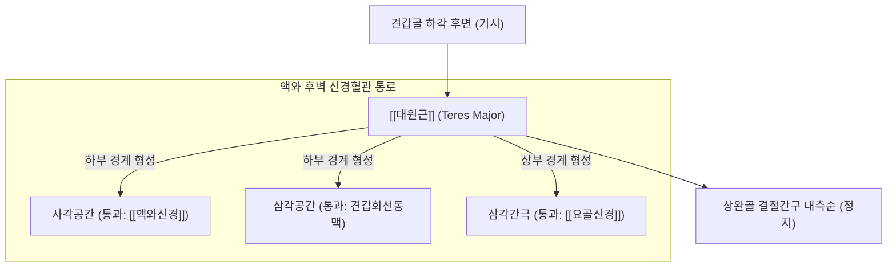
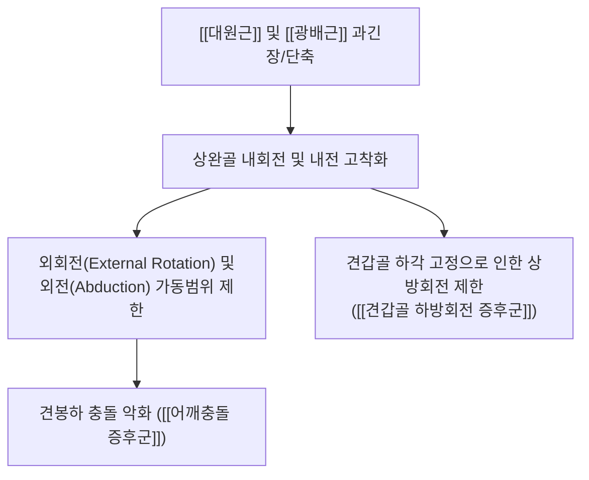
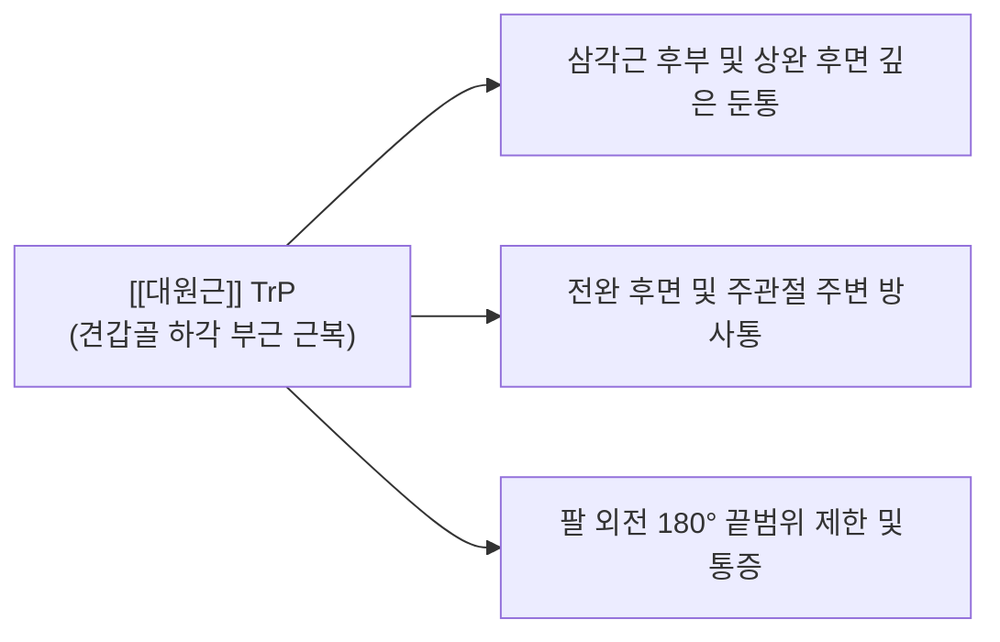

# 대원근 (Teres Major Muscle)

> **핵심 요약 (Key Summary)**:
> [[견갑골]] 하각에서 시작하여 상완골 결절간구 내측순에 정지하며, [[광배근]]의 강력한 동반자('소배근')로서 상완골의 내전·내회전·신전을 담당하는 핵심 근육입니다.
> **하견갑신경**(C5-C7)의 지배를 받으며, 상부의 [[소원근]] 및 [[상완삼두근]] 장두와 함께 **사각공간**(Quadrilateral space)과 삼각공간(Triangular space)의 하부 경계를 형성합니다.
> 턱걸이·클라이밍 후 180° 거상 제한, 견갑하각 골면 부착부 촉진 감별 및 견정(肩貞)혈 자침·추나 MET 상완 외전/외회전 가동화가 핵심 치료 프로토콜입니다.

---
## 📌 목차
1. [해부학적 정밀 구조 및 지배 신경/혈관](#1-해부학적-정밀-구조-및-지배-신경혈관)
2. [생체역학·토크 분석 & 광배근과의 협응 (Biomechanical Synergy)](#2-생체역학토크-분석--광배근과의-협응-biomechanical-synergy)
3. [근막통증증후군(TP) & 연관통 패턴 (Travell & Simons)](#3-근막통증증후군tp--연관통-패턴-travell--simons)
4. [초음파 해부학(Sonoanatomy) 및 중재 시술 랜드마크](#4-초음파-해부학sonoanatomy-및-중재-시술-랜드마크)
5. [⭐ 원장님 심층 임상 고찰 및 원본 필기 (Clinical Pearls)](#5-원장님-심층-임상-고찰-및-원본-필기-clinical-pearls)
6. [관련 임상 질환 및 운동손상 증후군 총괄](#6-관련-임상-질환-및-운동손상-증후군-총괄)
7. [추나·도수치료(MET/PIR) & 침구·약침·재활 프로토콜](#7-추나도수치료metpir--침구약침재활-프로토콜)
8. [출처 및 학술 참고 문헌 (References)](#8-출처-및-학술-참고-문헌-references)

---
## 1. 해부학적 정밀 구조 및 지배 신경/혈관

| 항목 | 상세 내용 |
| :--- | :--- |
| **기시 (Origin)** | [[견갑골]] 하각(Inferior angle) 후면 타원형 부위 및 외측연 하부 1/3 |
| **정지 (Insertion)** | 상완골 결절간구 내측순(Medial lip of intertubercular sulcus) |
| **신경 지배** | **하견갑신경**(Lower subscapular N., C5-C7) |
| **혈관 공급** | **견갑하자동맥**(Subscapular A.) 및 **흉배동맥**(Thoracodorsal A.) |
| **해부학적 경계** | • **사각공간(Quadrilateral space)**의 하부 경계 형성 ([[액와신경]], 후상완회선동맥 통과) • **삼각공간(Triangular space)**의 하부 경계 형성 (견갑회선동맥 통과) • **삼각간극(Triangular interval)**의 상부 경계 형성 ([[요골신경]], 상완심동맥 통과) |

### 📐 해부학적 구조 및 공간 경계 모식도

---
## 2. 생체역학·토크 분석 & 광배근과의 협응 (Biomechanical Synergy)

### (1) '소배근(Little Helper of Latissimus Dorsi)' 역할
* **파워풀한 내전 및 내회전**:
  * 대원근은 짧고 두꺼운 지레 구조를 가져 [[광배근]]과 함께 상완골을 강력하게 몸통 쪽으로 끌어당기고(내전) 안쪽으로 돌립니다(내회전).
  * 수영(자유형/접영의 풀 동작), 클라이밍, 턱걸이(풀업) 동작에서 핵심 파워를 발휘합니다.

### (2) 근막 사슬 연계 (Anatomy Trains)
* **심부후방상지선(Deep Back Arm Line)** 및 **기능선(Functional Line)**:
  * 대원근은 [[광배근]]과 건막을 공유하며 체간 후면의 나선선 및 기능선과 강력하게 연결됩니다.
  * 골반-요추-흉추의 회전력이 어깨를 통해 상지로 전달되는 핵심 중간 정거장입니다.

---
## 3. 근막통증증후군(TP) & 연관통 패턴 (Travell & Simons)

### ⚡ 발통점(TP) 및 임상 방사통 특징
* **발통점 위치**: 견갑골 하각 상외측 2~3cm 부근의 대원근 근복 (한의 경혈학상 견정혈 외하방).
* **연관통 패턴**:
  * [[삼각근]] 후부 깊은 곳과 상완 후면에 뻐근하고 쑤시는 통증을 방사합니다.
  * 팔을 머리 위로 외전하거나 등 뒤로 외회전할 때 견갑골 하각 주변에서 심한 당김 통증이 유발됩니다.
* **운동 제한**:
  * 팔을 귀 옆으로 완전히 붙이는 180° 거상 동작 시 견갑골 하각이 팽팽하게 조여 오며 마지막 20~30°의 굴곡/외전이 차단됩니다.

---
## 4. 초음파 해부학(Sonoanatomy) 및 중재 시술 랜드마크

### (1) 표준 초음파 스캔 뷰 (Posterior Axillary View)
* **스캔 랜드마크**:
  * 액와 후벽에서 프로브를 위치시키면 두꺼운 대원근 근복과 그 표층을 감싸는 [[광배근]] 건을 구분할 수 있습니다.
  * 대원근 상연에서 삼각공간을 통과하는 견갑회선동맥(Circumflex scapular A.)의 도플러 신호를 확인합니다.
* **자침 안전 마진**:
  * 견갑골 하각 골면을 확실히 파지한 후 흉벽을 향하지 않고 상완골 방향으로 비스듬히 자침하여 기흉을 원천 차단합니다.

---
## 5. ⭐ 원장님 심층 임상 고찰 및 원본 필기 (Clinical Pearls)

### (1) 광배근(Latissimus Dorsi)과의 감별 포인트 (원장님 임상 팁)
* **기시부 해부학적 감별**:
  * **[[광배근]]**: 흉요근막 및 장골능에서 시작하여 견갑골 하각 '표면'을 스치듯 지나 상완골로 주행합니다.
  * **[[대원근]]**: 견갑골 하각 후면 '골면 자체'에 단단히 부착되어 상완골로 주행합니다.
* **촉진 감별법**:
  * 견갑골 하각을 손가락으로 집었을 때 뼈에 직결된 두꺼운 근육 덩어리는 대원근이며, 그 위를 덮고 있는 넓은 막성 조직이 광배근입니다.

### (2) 견정(肩貞)혈 치료점 (원장님 팁)
* 액와 후벽 주름 상방 1촌 지점의 견정혈은 [[소원근]]과 [[대원근]], [[광배근]]이 교차하는 핵심 혈자리로 약침 및 도침 치료의 핵심 포인트입니다.
* 팔을 90° 이상 거상할 때 견갑골 하각이 찝히거나 당기는 증상은 견정혈 부위에서 대원근 건막 유착을 박리하면 즉각 해소됩니다.

### (3) 턱걸이(풀업) 및 클라이밍 후 어깨 통증 감별
* 턱걸이나 로우(Rowing) 운동 후 어깨 뒤쪽과 견갑골 하각에 뻐근한 통증이 발생했을 때, 환자들은 흔히 회전근개 손상으로 오인합니다.
* 이때 팔을 머리 위로 완전히 올리게(180° 거상) 했을 때 끝 범위에서 견갑골 하각 부위가 팽팽하게 당기며 제한된다면, 회전근개가 아닌 대원근의 원심성 신장 부전이 원인입니다.

---
## 6. 관련 임상 질환 및 운동손상 증후군 총괄

| 임상 질환 / 증후군 | 병리적 연관 기전 | 주요 증상 및 이학적 검사 | 핵심 교정 타깃 |
| :--- | :--- | :--- | :--- |
| **대원근-광배근 과긴장 증후군** | 풀업/로우 등 당기기 운동 과사용으로 인한 단축 | 팔을 180° 끝까지 올리지 못함, 외회전 시 당김 | 대원근 침도 박리 + MET 외전 스트레칭 |
| [[견갑골 하방회전 증후군]] | 대원근 단축 시 견갑골 하각 고정으로 상방회전 결손 | 팔 거상 시 견갑골 상방회전 부족, 견봉하 찝힘 | 대원근 이완 + [[전거근]] 강화 |
| **사각공간 압박 증후군** | 대원근 상연 비후로 사각공간 하부 통로 협착 | 삼각근 후부 둔통, 외전 시 통증 악화 | 대원근 상연 침도 박리 + 신경가동술 |

---
## 7. 추나·도수치료(MET/PIR) & 침구·약침·재활 프로토콜

### (1) 한의학 경혈 매핑 & 치료점
* **경혈 매핑**: 견정(肩貞), 천종(天宗)
* **약침 및 침도 시술법**:
  * 견정혈에서 대원근 근복 및 정지부 방향으로 사자하여 근막 유착을 해소합니다.
  * [[중성어혈약침]]을 견갑골 하각 부착부 골막에 0.5cc 주입하여 만성 장력성 염증을 가라앉힙니다.

### (2) 대원근 MET (근에너지기법)
* **외전/외회전 가동화**:
  1. 환자의 팔을 120° 이상 굴곡/외전 및 외회전시켜 대원근의 제한 장벽에 놓습니다.
  2. 환자에게 "20% 힘으로 팔을 아래로 끌어당기며 안쪽으로 돌리세요(내전/내회전 저항)"라고 지시하며 5초간 등척성 수축을 유도합니다.
  3. 호기 시 팔을 위로 더 부드럽게 밀어올려 대원근을 완전히 신장합니다.

---
## 8. 출처 및 학술 참고 문헌 (References)

1. **Cahill BR, Palmer RE (1983)**. *J Hand Surg Am*, 8(1), 65-69.
   - *Quadrilateral space syndrome*. [PMID: 6827057](https://pubmed.ncbi.nlm.nih.gov/6827057/)
   - **[연구 요약]**: 사각공간 증후군에서 대원근 상연과 소원근·삼두근 장두 사이의 액와신경 포착 병태생리 정립.
2. **Neumann DA (2017)**.
   - *Kinesiology of the Musculoskeletal System: Foundations for Rehabilitation* (3rd ed.). Elsevier.
   - **[연구 요약]**: 대원근과 광배근의 공통 작용선 분석 및 상완골 내전·내회전 토크 생성 메커니즘.
3. **Travell JG, Simons DG (1998)**.
   - *Myofascial Pain and Dysfunction: The Trigger Point Manual*, Vol. 1 (2nd ed.). Williams & Wilkins.
   - **[연구 요약]**: 대원근 TrP의 삼각근 후부 및 상완 후면 방사통 양상 규명.
4. **StatPearls (2023)**.
   - *Anatomy, Shoulder and Upper Limb, Teres Major Muscle*.
   - **[임상 가이드]**: 하견갑신경 주행, 사각공간/삼각공간 해부학적 경계 및 임상적 중요성.
