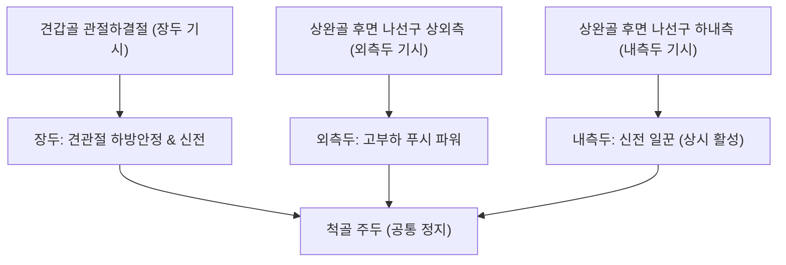
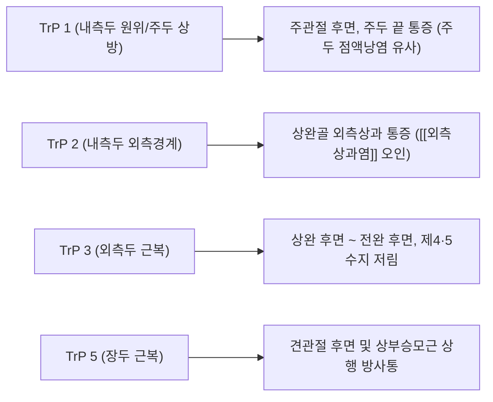

# 상완삼두근 (Triceps Brachii Muscle)

> **핵심 요약 (Key Summary)**:
> [[견갑골]] 관절하결절(장두) 및 상완골 후면 요골신경구 상·하부(외측두·내측두)에서 기원하여 척골 주두에 정지하는 주관절 유일의 3두 주동 신전근입니다.
> [[요골신경]](C6-C8)의 지배를 받으며, 강력한 팔꿈치 신전 토크를 제공하고 장두(Long head)는 견관절 후하방 안정화 및 신전·내전에 기여합니다.
> 나선구 요골신경 포착, [[외측상과염]](테니스 엘보 유사 연관통), [[주두 점액낭염]], 상완골두 상방 변위에 의한 [[어깨충돌 증후군]]의 핵심 표적근입니다.

---
## 📌 목차
1. [해부학적 정밀 구조 및 지배 신경/혈관](#1-해부학적-정밀-구조-및-지배-신경혈관)
2. [생체역학·토크 분석 & 근막 사슬 (Biomechanical Synergy)](#2-생체역학토크-분석--근막-사슬-biomechanical-synergy)
3. [근막통증증후군(TP) & 연관통 패턴 (Travell & Simons)](#3-근막통증증후군tp--연관통-패턴-travell--simons)
4. [초음파 해부학(Sonoanatomy) 및 중재 시술 랜드마크](#4-초음파-해부학sonoanatomy-및-중재-시술-랜드마크)
5. [⭐ 원장님 심층 임상 고찰 및 원본 필기 (Clinical Pearls)](#5-원장님-심층-임상-고찰-및-원본-필기-clinical-pearls)
6. [관련 임상 질환 및 운동손상 증후군 총괄](#6-관련-임상-질환-및-운동손상-증후군-총괄)
7. [추나·도수치료(MET/PIR) & 침구·약침·재활 프로토콜](#7-추나도수치료metpir--침구약침재활-프로토콜)
8. [출처 및 학술 참고 문헌 (References)](#8-출처-및-학술-참고-문헌-references)

---
## 1. 해부학적 정밀 구조 및 지배 신경/혈관

| 항목 | 상세 내용 |
| :--- | :--- |
| **기시 (Origin)** | • **장두 (Long head)**: [[견갑골]] 관절하결절(Infraglenoid tubercle) 및 관절순 후하방 • **외측두 (Lateral head)**: 상완골 후면 요골신경구 상외측부 및 외측 근간중격 • **내측두 (Medial head)**: 상완골 후면 요골신경구 하내측 전체 (심층에 광범위하게 위치) 및 내측 근간중격 |
| **정지 (Insertion)** | 척골(Ulna) 주두(Olecranon process)의 상면 및 후면, 전완 심근막 |
| **신경 지배** | [[요골신경]](Radial nerve, C6, C7, C8 - 주로 C7 분지) • 장두: 액와부에서 분지하는 근위부 가지 • 외측두/내측두: 나선구(Spiral groove) 주행 중 분지 |
| **혈관 공급** | 상완심동맥(Profunda brachii A., 나선구 동행) 및 상완동맥 분지 |

### 📐 해부학적 구조 및 3개 두 모식도

---
## 2. 생체역학·토크 분석 & 근막 사슬 (Biomechanical Synergy)

### (1) 주관절 신전(Elbow Extension)의 3두 협응 역학
* **내측두 (Medial head)**: 주관절 신전의 ‘일꾼(Workhorse)’으로 불리며, 부하가 없거나 모든 각도의 주관절 신전 동작에서 가장 먼저 지속적으로 활성화됩니다.
* **외측두 (Lateral head)**: 저항 부하가 중간 이상일 때 강력하게 동원되며, 순간적인 푸시 파워 토크를 생성합니다.
* **장두 (Long head)**: 2관절 근육(Bi-articular muscle)으로, 주관절 신전뿐 아니라 견관절 신전 및 내전을 보조합니다. 특히 팔이 거상된 상태에서 신전할 때 가장 효율적인 근육 길이를 확보합니다.

### (2) 견관절 후하방 안정화 기전
* 장두는 견관절 와상완관절 하방을 지지하며, 상완골두가 비정상적으로 상방 전위되는 것을 하방 인장력으로 제어하여 견봉하 공간을 보존합니다.

### (3) 사각공간 & 삼각공간 형성
* **사각공간**: 장두 외측 ([[소원근]], [[대원근]], 상완골 경부, 장두) $\rightarrow$ [[액와신경]] 통과.
* **삼각공간**: 장두 내측 ([[소원근]], [[대원근]], 장두) $\rightarrow$ 견갑회선동맥 통과.
* **삼각간극**: 장두 하방 ([[대원근]], 상완골체, 장두) $\rightarrow$ [[요골신경]] 및 상완심동맥 통과.

---
## 3. 근막통증증후군(TP) & 연관통 패턴 (Travell & Simons)

### ⚡ 발통점(TP) 및 임상 방사통 특징
* **TrP 1 (내측두 원위부/주두 바로 상방)**: 주관절 후면, 주두 끝, 그리고 상완 후면 내측으로 통증 투사. 주두 점액낭염과 유사한 극심한 압통 유발.
* **TrP 2 (내측두 외측경계 / 외측상과 근처)**: 상완골 외측상과로 강하게 통증을 투사하여 [[외측상과염]](테니스 엘보)으로 오인되기 쉬움.
* **TrP 3 (외측두 근복 중앙부)**: 상완 후면을 따라 전완 후면으로 하행하며, 제4·5수지(약지 및 새끼손가락) 배측까지 방사통과 저림 투사.
* **TrP 5 (장두 근복 중앙부)**: 상완 후면 전체와 견관절 후면, 승모근 상부 부근으로 상행 방사통 투사.

---
## 4. 초음파 해부학(Sonoanatomy) 및 중재 시술 랜드마크

* **상완 후면 횡단 스캔 (Axial View of Posterior Arm)**:
  * 프로브를 상완골 후면 중간 1/3에 위치시키면, 상완골 피질 위에 심층의 내측두, 천층 외측의 외측두, 천층 내측의 장두가 관찰됩니다.
* **나선구(Spiral Groove) 및 요골신경 확인**:
  * 외측두와 내측두 사이의 상완골 피질 고유 홈(Radial sulcus)을 주행하는 원형 고에코의 [[요골신경]]과 상완심동맥 맥동을 도플러로 확인합니다.
* **원위 주두건 종단 스캔 (Longitudinal View of Triceps Tendon)**:
  * 척골 주두 부착부 상방 2~3cm 지점에서 건의 섬유성 평행 선상 구조 및 주두 피하점액낭의 삼출액 유무를 스캔합니다.

---
## 5. ⭐ 원장님 심층 임상 고찰 및 원본 필기 (Clinical Pearls)

### (1) 상완삼두근 과긴장/단축의 2대 치명적 병리 메커니즘
1. **요골신경 포착**:
   * 상완골 후면 나선구(Spiral groove) 부위에서 상완삼두근 외측두와 내측두 사이의 근간중격 및 섬유성 아케이드가 비후되면 [[요골신경]]을 직접 압박/포착합니다.
   * 이로 인해 [[외측상과염]](테니스 엘보)과 거의 구별되지 않는 외측 주관절 및 전완 배측 방사통·저림이 촉발됩니다.
2. **상완골두 상방 변위 및 견봉하 충돌 촉발**:
   * 상완삼두근 장두가 만성적으로 단축·구축되면 견관절의 생체역학적 짝힘(Force couple)이 붕괴되어 상완골두를 비정상적으로 견봉 방향으로 밀어 올리게 됩니다.
   * 결과적으로 견봉하 공간 협소화, 점액낭 압박, [[극상근]] 건 마찰이 악화되어 극심한 [[어깨충돌 증후군]]을 촉발합니다.

### (2) 팔꿈치 신전 제한(Elbow Extension Loss) 치료의 황금률
* 팔꿈치가 끝까지 다 펴지지 않는 신전 가동범위 제한 환자를 치료할 때는 **주동근인 [[상완삼두근]]과 길항근인 [[상완이두근]], [[상완근]]을 반드시 동시에 치료포인트로 설정**해야 합니다.
* 굴곡근군의 단축 구축이 신전을 막고, 신전근군의 상호억제 약화 및 건부착부 허혈성 긴장이 겹쳐있기 때문입니다.

### (3) 주두 점액낭염 및 테니스 엘보 오진 방지 팁
* 환자가 "팔꿈치 뒤쪽 뼈가 쑤시고 닿기만 해도 아프다"고 할 때 주두 국소만을 볼 것이 아니라, 주두 상방 2~4cm 지점의 상완삼두근 건-근복 이행부(TrP 1)를 강하게 압진하여 동일한 통증이 재현되는지 확인하십시오.

---
## 6. 관련 임상 질환 및 운동손상 증후군 총괄

| 임상 질환 / 증후군 | 병리적 연관 기전 | 주요 증상 및 이학적 검사 | 핵심 교정 타깃 |
| :--- | :--- | :--- | :--- |
| **나선구 요골신경 포착** | 나선구 부위 외측두/내측두 비후로 인한 신경 압박 | 상완 후외측 찌릿함, 외측상과 압통 | 나선구 근간중격 침도 이완 |
| [[외측상과염]](테니스 엘보 유사증) | 상완삼두근 TrP 2 연관통 및 전완 신근군 긴장 유발 | 주관절 외측 통증, Cozen 검사 시 삼두근 압통 병발 | TrP 2 및 건막 박리술 |
| [[어깨충돌 증후군]] | 장두 구축으로 인한 상완골두 상방 편위 | 견관절 외전 60~120도 통증호, Neer 검사 | 장두 관절하결절 부착부 침도 |
| [[주두 점액낭염]] | TrP 1 연관통 및 반복적 마찰·압박에 의한 삼출 | 주두 종창, 굴곡 시 팽만감 및 굴곡 제한 | 주두 상방 건막 이완 및 소염약침 |

---
## 7. 추나·도수치료(MET/PIR) & 침구·약침·재활 프로토콜

### (1) 한의학 경혈 매핑 & 자침 포인트
* **경혈 매핑**: 천정(天井, TE10), 청랭연(淸冷淵, TE11), 소락(消濼, TE12), 견정(肩貞, SI9)
* **도침 및 약침 치료 프로토콜**:
  * 천정혈(주두 상방 1촌) 부위의 삼두근건 골막 부착부에 침도를 수직 진입하여 횡성 박리, 건-골 접합부 허혈성 경결을 해소합니다.
  * 요골신경구 주행부위에는 [[중성어혈약침]]을 주입하여 신경 주위 부종 및 염증을 제거합니다.

### (2) 근에너지기법 (MET / PIR) 프로토콜
* **자세**: 환자는 앙와위 또는 좌위에서 시술측 견관절을 160도 굴곡하고 주관절을 최대로 굴곡(손을 견갑골 뒤로 넘김).
* **수축**: 시술자는 주두를 고정하고 환자에게 주관절을 펴는 방향(신전)으로 20% 힘으로 저항(등척성 수축 5~7초).
* **이완**: 환자 호기 시 주관절을 완전 굴곡 방향으로 부드럽게 신장시켜 삼두근 장두와 내외측두를 동시에 최대 스트레칭.

---
## 8. 출처 및 학술 참고 문헌 (References)

1. **Yi KH, Lee JH, Hur HW, et al. (2023)**. *Clin Anat*, 36(7), 964-970.
   - *Distribution of the intramuscular innervation of the triceps brachii: clinical importance in the treatment of spasticity*. [PMID: 36606364](https://pubmed.ncbi.nlm.nih.gov/36606364/)
   - **[연구 요약]**: 상완삼두근의 근육 내 신경분포(요골신경 가지)를 해부로 매핑 — 경직 치료(신경차단·보톡스) 시 각 두의 신경지배 구역.
2. **Standring S (2020)**.
   - *Gray's Anatomy: The Anatomical Basis of Clinical Practice* (42nd ed.). Elsevier.
   - **[연구 요약]**: 요골신경의 상완삼두근 분지 주행 및 사각공간/삼각공간 경계 형성 해부학 분석.
3. **Simons DG, Travell JG (1999)**.
   - *Myofascial Pain and Dysfunction: The Trigger Point Manual*, Vol. 1 (2nd ed.). Williams & Wilkins.
   - **[연구 요약]**: 상완삼두근 5개 발통점의 주두 통증, 외측상과염 유사 방사통 및 제4/5수지 방사통 패턴 규명.
4. **Neumann DA (2017)**.
   - *Kinesiology of the Musculoskeletal System: Foundations for Rehabilitation* (3rd ed.). Elsevier.
   - **[연구 요약]**: 상완삼두근 각 두(장두·외측두·내측두)의 동원 순서 및 주관절 각도에 따른 모멘트암 분석.
