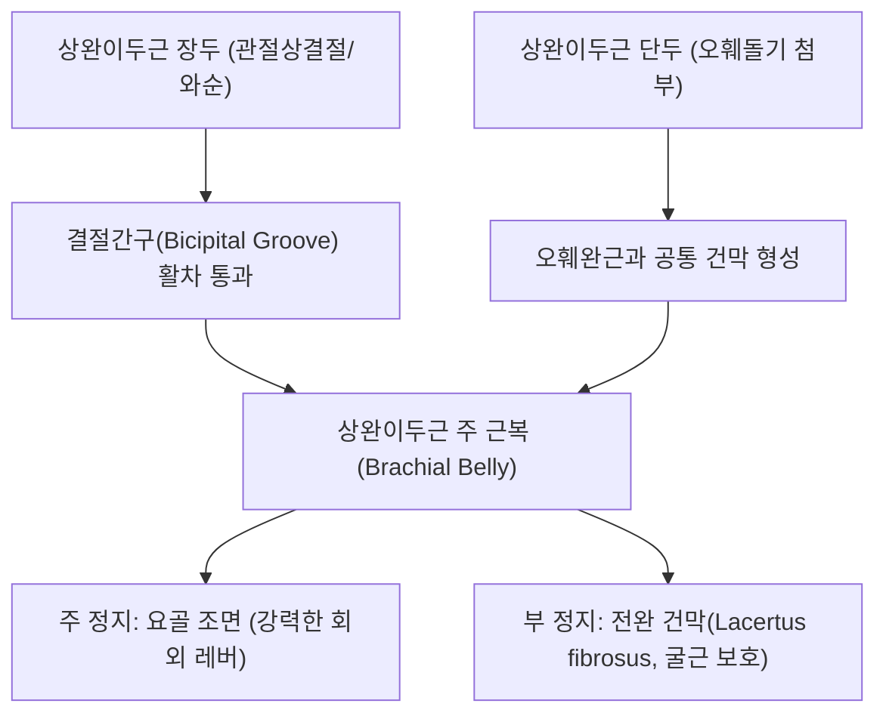
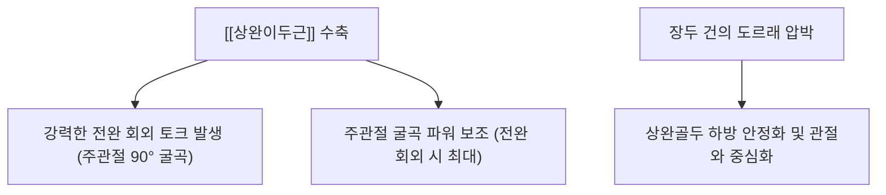
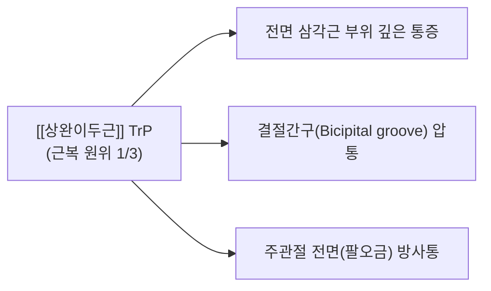

# [[상완이두근]](Biceps Brachii)

> **핵심 요약 (Key Summary)**:
> 견갑골 관절상결절(장두) 및 오훼돌기(단두)에서 기시하여 [[요골]] 조면 및 전완 근막 건막(Lacertus fibrosus)에 정지하는 2관절(bi-articular) 근육입니다.
> [[근피신경]](C5-C6)의 지배를 받으며, 전완 회외(Supination) 및 주관절 굴곡의 주동근이자 장두를 통해 상완골두 하방 안정화에 기여합니다.
> [[상완이두근 건초염]], [[SLAP|SLAP 병변]], 건 파열(Popeye 변형)의 핵심 근육이며, 복와위 주관절 회내 안전 자침 및 회외-굴곡 복합 재활이 표적입니다.

---
## 📌 목차
1. [해부학적 정밀 구조 및 지배 신경/혈관](#1-해부학적-정밀-구조-및-지배-신경혈관)
2. [생체역학·토크 분석 & 근막 사슬 (Biomechanical Synergy)](#2-생체역학토크-분석--근막-사슬-biomechanical-synergy)
3. [근막통증증후군(TP) & 연관통 패턴 (Travell & Simons)](#3-근막통증증후군tp--연관통-패턴-travell--simons)
4. [초음파 해부학(Sonoanatomy) 및 중재 시술 랜드마크](#4-초음파-해부학sonoanatomy-및-중재-시술-랜드마크)
5. [⭐ 원장님 심층 임상 고찰 및 원본 필기 (Clinical Pearls)](#5-원장님-심층-임상-고찰-및-원본-필기-clinical-pearls)
6. [관련 임상 질환 및 운동손상 증후군 총괄](#6-관련-임상-질환-및-운동손상-증후군-총괄)
7. [추나·도수치료(MET/PIR) & 침구·약침·재활 프로토콜](#7-추나도수치료metpir--침구약침재활-프로토콜)
8. [출처 및 학술 참고 문헌 (References)](#8-출처-및-학술-참고-문헌-references)

---
## 1. 해부학적 정밀 구조 및 지배 신경/혈관

| 항목 | 상세 내용 |
| :--- | :--- |
| **기시 (Origin)** | • **장두(Long head)**: 견갑골 관절상결절(Supraglenoid tubercle) 및 상부 관절와순 (관절강 내부를 관통하여 결절간구 주행) • **단두(Short head)**: 견갑골 오훼돌기 첨부 ([[오훼완근]]과 공통 건 형성) |
| **정지 (Insertion)** | [[요골]](Radius) 조면(Radial tuberosity) 및 전완 내측 건막(Lacertus fibrosus, 족저근막/전완굴근막 연속) |
| **신경 지배** | [[근피신경]](Musculocutaneous nerve, C5, C6) |
| **혈관 공급** | [[상완동맥]](Brachial artery)의 근육 분지 및 전상완회선동맥 분지 |
| **해부학적 특이성** | 장두 건은 결절간구(Bicipital groove)에서 횡상완인대 및 오훼상완인대에 의해 지지되는 특수 활차(pulley) 구조를 통과 |

---
## 2. 생체역학·토크 분석 & 근막 사슬 (Biomechanical Synergy)

### (1) 전완 회외 및 주관절 굴곡 (Supination & Flexion)
* **회외 토크의 핵심 엔진**:
  * 주관절이 90° 굴곡되었을 때 [[요골]] 조면이 회전축에서 가장 멀어져 **인체 최강의 전완 회외(Supination) 토크**를 발휘합니다 (드라이버 조이기, 문고리 돌리기).
  * 주관절 신전 상태에서는 회외 모멘트 암이 감소하여 [[회외근]]의 비중이 커집니다.
* **주관절 굴곡 파워**:
  * 전완이 회외된 상태에서 최대 굴곡력을 발휘하며, 회내 상태에서는 [[상완근]]과 [[상완요골근]]이 주도합니다.

### (2) 견관절 전방 및 상방 안정화 (장두의 역할)
* 장두 건이 상완골두 상부를 활차처럼 압박하여, 상완골 거상 시 골두가 관절와 상방으로 튀어나오는 전단을 억제하고 관절와 중심화(Glenohumeral centration)를 유지하여 [[어깨충돌 증후군|견관절 충돌증후군]]을 방지합니다.

---
## 3. 근막통증증후군(TP) & 연관통 패턴 (Travell & Simons)

* **발통점 형성 위치 (Trigger Point Location)**:
  * 근복 원위 1/3 부위(표재성 몽우리) 및 장두 건의 결절간구 통과부.
* **연관통 방사 패턴 (Referred Pain Pattern)**:
  * **전면 삼각근 및 결절간구 집중통**: 어깨 앞쪽 깊숙한 곳으로 쑤시고 뻐근한 통증 투사.
  * **주관절 전면 방사통**: 팔오금(주와부) 전면으로 찌릿한 당김 유발.
  * **악화 요인**: 무거운 짐을 앞으로 들어 올리기, 반복적인 나사 돌리기, 머리 위로 팔을 올리는 동작.

---
## 4. 초음파 해부학(Sonoanatomy) 및 중재 시술 랜드마크

* **결절간구 횡단 스캔 (Short-Axis View)**:
  * 상완골 대결절과 소결절 사이의 고랑(Bicipital groove)에서 고에코의 둥근 타원형 장두 건 단면을 확인합니다.
  * 건초 내 삼출액(Effusion), 활액막 증식, 아탈구(Subluxation) 여부를 평가합니다.
* **주와부 종단 스캔 (Long-Axis View of Distal Insertion)**:
  * 주관절 전면에서 프로브를 회외 상태로 대고 심부로 파고드는 원위 건이 요골 조면에 부착되는 경로를 추적합니다.
  * 건막(Lacertus fibrosus) 아래 주행하는 [[상완동맥]] 및 [[정중신경]]을 컬러 도플러로 식별하여 손상을 원천 회피합니다.

---
## 5. ⭐ 원장님 심층 임상 고찰 및 원본 필기 (Clinical Pearls)

### (1) 운동성 vs 지탱성 근육 감별 (원장님 핵심 임상 팁)
* **임상 팩트**: 현대인들은 운동성을 가지는 [[상완이두근]]보다 **지탱성을 가지는 [[상완근]], [[오훼완근]]의 문제가 훨씬 많습니다**.
* 환자가 팔꿈치나 어깨 앞 통증을 호소할 때 상완이두근만 만지작거리면 치료율이 떨어지며, 심층에서 지속적인 정적 부하를 받는 상완근과 오훼완근을 함께 타깃팅해야 만성 통증이 근본적으로 해결됩니다.

### (2) 안전 자침 기법 (상완동맥 손상 방지)
* 요골 조면 정지부 자침 시 상완동맥 손상을 피하기 위해 **복와위로 주관절을 회내(Pronation)시켜 안전하게 자침**합니다.
* 주관절을 회내시키면 요골 조면이 후외측으로 회전하면서 상완동맥과 정중신경이 주행하는 전내측 위험 구역에서 벗어나 안전 마진이 확보됩니다.

### (3) 상완이두근 이완기법과 관절 작용
* 상완이두근 이완기법은 팔꿈치 관절에 직접 작용하므로, 주관절 신전 제한이 동반된 [[외측상과염|테니스 엘보]]나 [[내측상과염|골퍼스 엘보]] 환자에게 필수적인 치료 단계입니다.

---
## 6. 관련 임상 질환 및 운동손상 증후군 총괄

| 임상 질환 / 증후군 | 병리적 연관 기전 | 주요 증상 및 이학적 검사 | 핵심 교정 타깃 |
| :--- | :--- | :--- | :--- |
| [[상완이두근 건초염]] | 결절간구 내 반복 마찰로 활액막 염증 | **Speed Test** (+) 결절간구 국소 압통 | 건초 소염약침 + 활동 조절 |
| [[SLAP|SLAP 병변]] | 장두건 기시부 상부 관절와순 견인 박리 | **O'Brien Test** (+) 팔 거상 시 염발음 | 관절와순 안정화 + 보존 치료 |
| 상완이두근 원위건 파열 | 강한 편심성 부하 시 요골 조면 건 박리 | Popeye Sign (원위부 근복 뭉침) | 보존적 재활 또는 수술 의뢰 |
| [[근피신경]] 포착 | 오훼완근 및 상완이두근 사이 신경 압박 | 전완 외측 감각 저하 및 굴곡 약화 | 오훼완근-상완이두근 간 침도 박리 |

---
## 7. 추나·도수치료(MET/PIR) & 침구·약침·재활 프로토콜

### (1) 한의학 경혈 매핑 & 자침법
* **경혈 매핑**: 천부(天府, LU3), 협백(俠白, LU4), 척택(尺澤, LU5), 곡택(曲澤, PC3)
* **자침 기법**:
  * 천부혈, 협백혈 부위에서 근복을 수직 직자하여 TrP를 해소하고, 척택혈 외측에서 건 부착부를 사자합니다.
  * 요골 조면 부착부 자침 시에는 반드시 전완을 회내시킨 상태에서 주와 외측으로 안전하게 접근합니다.

### (2) 상완이두근 MET (근에너지기법)
* 주관절 신전 및 전완 회내 상태로 제한 장벽을 설정한 후 환자에게 5초간 굴곡/회외 등척성 저항(20% 힘)을 준 뒤, 호기 시 부드럽게 주관절을 추가 신전하여 이완합니다.

---
## 8. 출처 및 학술 참고 문헌 (References)

1. **Simons, D. G., & Travell, J. G. (1999)**. *Myofascial Pain and Dysfunction: The Trigger Point Manual*, Vol. 1 (2nd ed.). Williams & Wilkins.
   - **[연구 요약]**: 상완이두근 발통점이 전면 삼각근 부위 및 주관절 전면으로 방사하는 통증 패턴 제시.
2. **Andrews, J. R. et al. (1985)**. *Am J Sports Med*, 13(5), 337-341.
   - *Glenoid labrum tears related to the long head of the biceps*. [PMID: 4051091](https://pubmed.ncbi.nlm.nih.gov/4051091/)
   - **[연구 요약]**: 상완이두근 장두 견인력에 의한 상부 관절와순 전후방 병변(SLAP tear)의 병태생리 최초 규명.
3. **StatPearls (2023)**. *Anatomy, Shoulder and Upper Limb, Biceps Muscle*.
   - **[임상 가이드]**: 근피신경 주행 경로, 상완이두근 활차 복합체 및 주관절 굴곡 역학.
