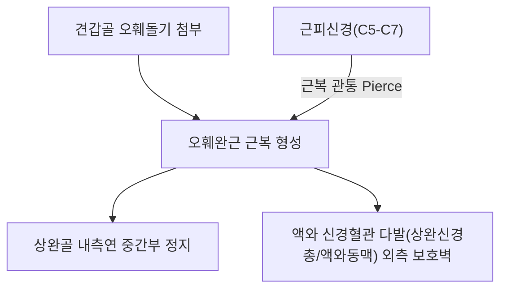
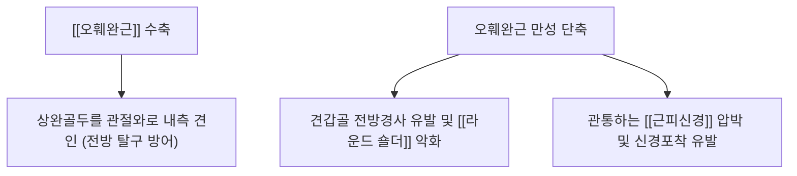
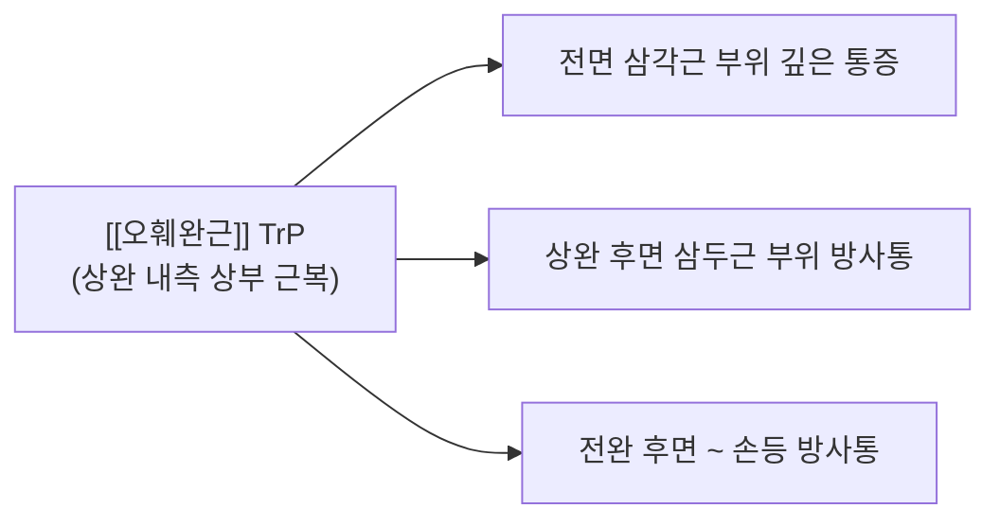

# [[오훼완근]](Coracobrachialis)

> **핵심 요약 (Key Summary)**:
> 견갑골 오훼돌기 첨부에서 기원하여 [[상완골]] 내측연 중간부에 정지하는 견관절 전내측의 핵심 굴곡·내전근입니다.
> 근복 중앙을 직접 관통하는 [[근피신경]](C5-C7)의 지배를 받으며, 상완골두를 관절와에 밀착시키고 외전 시 전방 탈구를 방어합니다.
> [[근피신경]] 포착 증후군, [[라운드 숄더]](앙와위 어깨 들림), 전방 어깨 통증의 주요 표적근이며, 액와부 신경혈관 회피 안전 촉진 및 침구 치료가 핵심입니다.

---
## 📌 목차
1. [해부학적 정밀 구조 및 지배 신경/혈관](#1-해부학적-정밀-구조-및-지배-신경혈관)
2. [생체역학·토크 분석 & 근막 사슬 (Biomechanical Synergy)](#2-생체역학토크-분석--근막-사슬-biomechanical-synergy)
3. [근막통증증후군(TP) & 연관통 패턴 (Travell & Simons)](#3-근막통증증후군tp--연관통-패턴-travell--simons)
4. [초음파 해부학(Sonoanatomy) 및 중재 시술 랜드마크](#4-초음파-해부학sonoanatomy-및-중재-시술-랜드마크)
5. [⭐ 원장님 심층 임상 고찰 및 원본 필기 (Clinical Pearls)](#5-원장님-심층-임상-고찰-및-원본-필기-clinical-pearls)
6. [관련 임상 질환 및 운동손상 증후군 총괄](#6-관련-임상-질환-및-운동손상-증후군-총괄)
7. [추나·도수치료(MET/PIR) & 침구·약침·재활 프로토콜](#7-추나도수치료metpir--침구약침재활-프로토콜)
8. [출처 및 학술 참고 문헌 (References)](#8-출처-및-학술-참고-문헌-references)

---
## 1. 해부학적 정밀 구조 및 지배 신경/혈관

| 항목 | 상세 내용 |
| :--- | :--- |
| **기시 (Origin)** | 견갑골 오훼돌기(Coracoid process) 첨부 ([[상완이두근]] 단두와 공통 건막 형성) |
| **정지 (Insertion)** | [[상완골]](Humerus) 체부 내측연 중간 1/3 지점 (소원근 및 대원근 부착부 반대편) |
| **신경 지배** | [[근피신경]](Musculocutaneous nerve, C5, C6, C7) - **신경이 근복을 직접 관통(Pierce)** |
| **혈관 공급** | [[상완동맥]](Brachial artery) 및 액와동맥 근육 분지 |
| **해부학적 특이성** | 액와 신경혈관 다발(상완신경총 및 액와동·정맥)의 바로 외측을 감싸며 전외측 보호벽 형성 |

---
## 2. 생체역학·토크 분석 & 근막 사슬 (Biomechanical Synergy)

### (1) 견관절 굴곡 및 내전 (Flexion & Adduction)
* 상완골을 앞으로 들어 올리고(굴곡 보조), 몸통 안쪽으로 모으는 내전 동작을 수행합니다.
* [[대흉근]], [[전면삼각근]]과 함께 물건을 안으로 끌어안거나 벽을 미는 동작에서 안정적인 지탱성을 제공합니다.

### (2) 견관절 전방 탈구 방어 기전
* 상완골두를 관절와(Glenoid fossa) 방향으로 당겨 밀착시킴으로써, 팔이 외전 및 외회전될 때 상완골두가 전하방으로 빠지는 아탈구를 기계적으로 방지합니다.

---
## 3. 근막통증증후군(TP) & 연관통 패턴 (Travell & Simons)

* **발통점 형성 위치 (Trigger Point Location)**:
  * 겨드랑이 바로 아래 상완 내측 상부 근복 중앙.
* **연관통 방사 패턴 (Referred Pain Pattern)**:
  * **전면 삼각근 부위 방사통**: 어깨 앞쪽으로 찌릿한 쑤심.
  * **상완 후면 방사통**: 상완삼두근 부위를 거쳐 팔꿈치 뒤쪽까지 뻗치는 연관통.
  * **손등 방사통**: 전완 배면을 타고 손등 부위까지 퍼져나가는 저림과 둔통 유발.
  * **악화 요인**: 등 뒤로 손을 올리는 열중쉬어 자세, 운전대 상단을 잡고 장시간 유지 시 통증 폭발.

---
## 4. 초음파 해부학(Sonoanatomy) 및 중재 시술 랜드마크

* **액와 주름 상방 횡단 스캔 (Axillary Transverse View)**:
  * 상완이두근 단두 바로 내측에서 상완골 내측연으로 주행하는 저에코 오훼완근 근복을 확인합니다.
  * **근복 중앙을 관통하는 고에코 타원형의 [[근피신경]]**을 실시간으로 추적 식별합니다.
* **혈관 회피 랜드마크**:
  * 오훼완근 바로 내측에 위치한 [[상완동맥]] 및 정중신경 다발을 컬러 도플러로 명확히 시각화하여 천자 경로에서 절대적으로 배제합니다.

---
## 5. ⭐ 원장님 심층 임상 고찰 및 원본 필기 (Clinical Pearls)

### (1) [[라운드 숄더]] 진단 (앙와위 어깨 들림) (원장님 핵심 팁)
* **임상 팩트**: **오훼완근이 단축되면 어깨를 앞으로 말리게 만들어, 환자가 베개 없이 반듯하게 누웠을 때(앙와위) 어깨가 바닥에 닿지 않고 위로 붕 들뜨게 됩니다**.
* 앙와위 어깨 들림 검사 시 [[소흉근]]과 함께 [[오훼완근]]의 단축을 반드시 평가해야 합니다.

### (2) [[근피신경]] 관통과 포착 증후군
* **해부학적 위험성**: [[근피신경]]이 [[오훼완근]] 근복을 직접 관통(Pierce)하므로 근육이 경직되면 신경이 바로 조여집니다.
* 전완 외측 저림과 함께 [[상완이두근]], [[상완근]]의 근력 약화가 동반될 때 경추 디스크(C6)로 오진하기 쉬우므로 오훼완근 압통 검사가 필수적입니다.
* 미용사, 도배사, 운전기사 등 장시간 팔을 든 채 일하는 직업군에서 만성 단축이 호발합니다.

### (3) 원장님 정밀 촉진법 (신경혈관 손상 절대 회피)
* 액와부에서 시작하여 [[상완이두근]]과 [[상완삼두근]] 사이를 손가락으로 부드럽게 파고들어 오훼완근 근복을 확인합니다.
* **주의사항**: 중간에 주행하는 **상완신경총 신경 다발과 상완동맥/정맥을 절대 강하게 누르거나 찌르지 않도록 주의**하며 상완골 내측 골면을 기준으로 안전하게 촉진합니다.

---
## 6. 관련 임상 질환 및 운동손상 증후군 총괄

| 임상 질환 / 증후군 | 병리적 연관 기전 | 주요 증상 및 이학적 검사 | 핵심 교정 타깃 |
| :--- | :--- | :--- | :--- |
| 근피신경 포착 증후군 | 오훼완근 관통부 섬유성 비후 및 신경 압박 | 전완 외측 피부 감각 이상, 주관절 굴곡 무력 | 오훼완근 침도 박리 + 신경가동술 |
| [[라운드 숄더]] | 오훼돌기를 전하방으로 당겨 견갑골 전방경사 | 앙와위 어깨 들림, [[어깨충돌 증후군]] 유발 | 오훼완근 스트레칭 + 능형근 강화 |
| 어깨 전방 불안정성 | 오훼완근 지탱력 약화 시 골두 전방 지지 부전 | 외전/외회전 시 상완골두 전방 아탈구감 | 오훼완근 정적 지탱 안정화 재활 |
| 야간 견관절 둔통 | 장시간 측와위 수면 시 오훼완근 압박 허혈 | 옆으로 누워 잘 때 어깨 앞 쑤심 | 수면 자세 교정 + TrP 해소 |

---
## 7. 추나·도수치료(MET/PIR) & 침구·약침·재활 프로토콜

### (1) 한의학 경혈 매핑 & 자침 포인트
* **경혈 매핑**: 극천(極泉, HT1), 청령(靑靈, HT2), 천부(天府, LU3)
* **자침 기법**:
  * 극천혈 외하방 1촌 부위에서 상완골 내측 골면을 향해 사자(45도)로 진입하여 상완동맥 손상을 피하면서 오훼완근 정지부 골막을 자극합니다.
  * 절대 흉벽이나 액와 심부로 직자하지 않으며 상완골 피질을 랜드마크로 삼습니다.

### (2) 오훼완근 MET (근에너지기법)
* 환자의 상완을 90° 외전, 신전 및 외회전시켜 오훼완근의 제한 장벽에 위치시킵니다.
* 환자에게 "20%의 약한 힘으로 팔을 몸통 안쪽으로 모으세요(내전 저항)"라고 지시하여 5~7초간 등척성 수축을 유도한 뒤, 호기 시 부드럽게 추가 신장합니다.

---
## 8. 출처 및 학술 참고 문헌 (References)

1. **Simons, D. G., & Travell, J. G. (1999)**. *Myofascial Pain and Dysfunction: The Trigger Point Manual*, Vol. 1 (2nd ed.). Williams & Wilkins.
   - **[연구 요약]**: 오훼완근 발통점이 전면 삼각근, 상완 후면 및 손등으로 방사하는 연관통 패턴 규명.
2. **Flatow, E. L. et al. (1989)**. *Clin Orthop Relat Res*, (244), 166-171.
   - *An anatomic study of the musculocutaneous nerve and its relationship to the coracoid process*. [PMID: 2743658](https://pubmed.ncbi.nlm.nih.gov/2743658/)
   - **[연구 요약]**: 오훼돌기와 근피신경의 해부학적 관계를 사체로 규명 — 오훼완근 부착부 주변 시술 시 신경 손상 방지의 해부학적 근거.
3. **StatPearls (2023)**. *Anatomy, Shoulder and Upper Limb, Coracobrachialis Muscle*.
   - **[임상 가이드]**: 근피신경 관통 변이 및 오훼완근 관련 전방 어깨 충돌 감별 진단.
