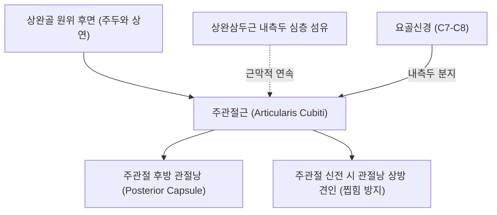
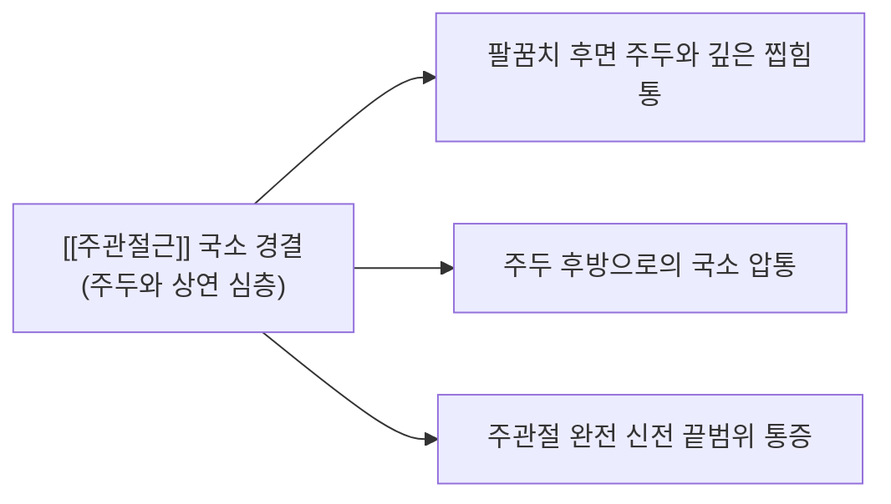

# [[주관절근]](Articularis Cubiti)

> **핵심 요약 (Key Summary)**:
> 상완골 원위 후면 주두와 상방에서 기시하여 주관절 후방 관절낭(Posterior capsule)에 정지하는 상완 후면 최심층의 미세 관절 조절근입니다.
> [[요골신경]](C7-C8, 상완삼두근 내측두 분지)의 지배를 받으며, 주관절 신전(Extension) 시 후방 관절낭을 상방으로 견인하여 주두와(Olecranon fossa) 사이에 관절낭이 끼이거나 찝히는(Impingement) 현상을 방지합니다.
> 주관절 후방 충돌 증후군, 신전 구축(Contracture), 주두 활액낭염 감별의 핵심 근육이며, 천정혈 심부 자침 및 주관절 신전 도수치료가 표적입니다.

---
## 📌 목차
1. [해부학적 정밀 구조 및 지배 신경/혈관](#1-해부학적-정밀-구조-및-지배-신경혈관)
2. [생체역학·토크 분석 & 근막 사슬 (Biomechanical Synergy)](#2-생체역학토크-분석--근막-사슬-biomechanical-synergy)
3. [근막통증증후군(TP) & 연관통 패턴 (Travell & Simons)](#3-근막통증증후군tp--연관통-패턴-travell--simons)
4. [초음파 해부학(Sonoanatomy) 및 중재 시술 랜드마크](#4-초음파-해부학sonoanatomy-및-중재-시술-랜드마크)
5. [⭐ 원장님 심층 임상 고찰 및 원본 필기 (Clinical Pearls)](#5-원장님-심층-임상-고찰-및-원본-필기-clinical-pearls)
6. [관련 임상 질환 및 운동손상 증후군 총괄](#6-관련-임상-질환-및-운동손상-증후군-총괄)
7. [추나·도수치료(MET/PIR) & 침구·약침·재활 프로토콜](#7-추나도수치료metpir--침구약침재활-프로토콜)
8. [출처 및 학술 참고 문헌 (References)](#8-출처-및-학술-참고-문헌-references)

---
## 1. 해부학적 정밀 구조 및 지배 신경/혈관

| 항목 | 상세 내용 |
| :--- | :--- |
| **기시 (Origin)** | [[상완골]](Humerus) 원위 후면 주두와(Olecranon fossa) 바로 상방 ([[상완삼두근]] 내측두 심부 섬유에서 파생) |
| **정지 (Insertion)** | 주관절 후방 관절낭(Posterior capsule of elbow joint) 및 후방 지방체(Posterior fat pad) |
| **신경 지배** | [[요골신경]](Radial nerve, C7, C8) - 상완삼두근 내측두로 가는 신경 분지 |
| **혈관 공급** | 심상완동맥(Profunda brachii artery)의 중측부동맥(Middle collateral artery) 분지 |
| **해부학적 상동성** | 하지의 슬관절에서 관절낭 찝힘을 방지하는 슬관절근(Articularis genus)과 완벽한 기능적·해부학적 상동 기관(Homologue) |

---
## 2. 생체역학·토크 분석 & 근막 사슬 (Biomechanical Synergy)

### (1) 주관절 신전 시 관절낭 찝힘 방지 (Capsular Retraction)
* 주관절이 굴곡 상태에서 완전 신전으로 전환될 때, [[척골]](Ulna)의 주두(Olecranon)가 상완골 후면의 주두와(Olecranon fossa) 속으로 깊숙이 들어갑니다.
* 이때 주관절근이 동시 수축하여 후방 관절낭과 후방 지방체를 위쪽으로 팽팽하게 당겨 올려줌으로써, **두 뼈 사이에 연부조직이 끼이거나 찝히는(Impingement) 현상을 완벽히 방지**합니다.

### (2) 근막 사슬 연계 (Anatomy Trains)
* **표재후방상지선(Superficial Back Arm Line)**의 최심층 관절 안전장치로, [[상완삼두근]]의 강력한 신전 토크가 관절낭을 손상시키지 않도록 국소 긴장도를 능동적으로 조절합니다.

---
## 3. 근막통증증후군(TP) & 연관통 패턴 (Travell & Simons)

* **발통점 형성 위치 (Trigger Point Location)**:
  * 주두 첨부 상방 1~2cm, 상완삼두근 건 심층의 주두와 상연 관절낭 부착부.
* **연관통 방사 패턴 (Referred Pain Pattern)**:
  * **팔꿈치 후면 심부 통증**: 팔을 끝까지 쭉 펼 때 팔꿈치 뒤쪽 깊은 곳에서 날카롭게 찝히는 통증 발생.
  * **주두와 압통**: 주관절 90도 굴곡 상태에서 주두 상연을 깊게 누르면 날카로운 압통 유발.
  * **악화 요인**: 투구 동작의 팔로우스루(Follow-through), 팔굽혀펴기 끝동작, 물건을 앞으로 강하게 밀 때 통증 악화.

---
## 4. 초음파 해부학(Sonoanatomy) 및 중재 시술 랜드마크

* **주관절 후방 종단 스캔 (Posterior Elbow Longitudinal View)**:
  * 주관절을 90도 굴곡시킨 상태에서 프로브를 주두와 상방에 세로로 대면, 상완골 피질의 웅덩이(주두와)와 그 내부를 채우는 고에코 지방체(Fat pad)를 확인합니다.
  * 상완삼두근 내측두 심층과 관절낭 사이에 위치한 얇은 저에코 근섬유 다발인 [[주관절근]]을 식별합니다.
* **주관절 동적 스캔 (Dynamic Scanning)**:
  * 팔꿈치를 수동으로 신전시킬 때 주관절근 섬유가 수축하며 관절낭과 지방체를 상방으로 끌어올리는 동적 활주를 확인합니다.

---
## 5. ⭐ 원장님 심층 임상 고찰 및 원본 필기 (Clinical Pearls)

### (1) 주관절 후방 충돌 증후군(Posterior Impingement)의 숨은 주범
* **임상 팩트**: 투수, 테니스 선수, 복싱 선수 등에서 "팔을 끝까지 펼 때 팔꿈치 뒤쪽이 찝히고 아프다"고 호소할 때, 골극(Osteophyte)이 없더라도 **주관절근의 기능 부전으로 인한 관절낭 미세 찝힘**이 원인인 경우가 대단히 많습니다.
* 주관절근이 단축되거나 섬유화되면 관절낭을 제때 당겨주지 못해 주두와 주두와 사이에 관절낭 주름이 반복적으로 끼여 만성 활액막염을 유발합니다.

### (2) 슬관절근(Articularis Genus)과의 완벽한 상동 구조
* 슬관절 신전 시 대퇴사두근 수축과 함께 슬관절근이 슬개상낭을 당겨 올리는 것처럼, 상지에서는 **주관절근이 주관절 신전 시 후방 관절낭을 당겨 올리는 안전벨트** 역할을 합니다.
* 상완삼두근 마비나 건 파열 환자에서 신전력뿐만 아니라 관절낭 찝힘으로 인한 극심한 관절통이 동반되는 이유가 바로 이 주관절근의 동반 마비 때문입니다.

### (3) 주관절 신전 구축(Contracture) 환자의 핵심 치료점
* 골절이나 깁스 고정 후 팔꿈치가 다 펴지지 않는 신전 제한 환자 치료 시, 상완이두근만 풀어서는 안 되며 후방 주두와의 주관절근과 관절낭 섬유화를 도침으로 박리해야 완전 신전이 회복됩니다.

---
## 6. 관련 임상 질환 및 운동손상 증후군 총괄

| 임상 질환 / 증후군 | 병리적 연관 기전 | 주요 증상 및 이학적 검사 | 핵심 교정 타깃 |
| :--- | :--- | :--- | :--- |
| 주관절 후방 충돌 증후군 | 관절낭 상방 견인 실패로 인한 주두 찝힘 | 완전 신전 시 후방 찝힘통, 신전 제한 | 주관절근 근막 이완 + 관절낭 감압 |
| 주관절 신전 구축 | 관절낭 섬유화 및 주관절근 위축 | 신전 가동범위 상실 (Extension deficit) | 후방 관절낭 도침 박리술 |
| 투수 후방 주관절통 | 반복적인 과신전 전단력으로 인한 건염 | 팔로우스루 시 팔꿈치 뒤 찌릿함 | 편심성 신전 조절 훈련 |
| 주두 후방 활액낭염 감별 | 표재성 주두낭염과 달리 심부 찝힘통 | 국소 부종 없이 관절 심부 통증 | 주두와 관절낭 표적 약침 |

---
## 7. 추나·도수치료(MET/PIR) & 침구·약침·재활 프로토콜

### (1) 한의학 경혈 매핑 & 자침법
* **경혈 매핑**: 천정(天井, TE10), 청랭연(淸冷淵, TE11)
* **자침 기법**:
  * 환자의 주관절을 90도 굴곡시키고 주두 상연 1촌의 천정혈 부위에서 상완삼두근 건 양측 골막을 따라 주두와 방향으로 45도 사자(25~30mm) 진입합니다.
  * 상완골 후면 골막에 부드럽게 닿은 후 주관절근 및 후방 관절낭 부착부를 미세 자극합니다.

### (2) 주관절 신전 도수교정 및 MET
* 환자의 팔꿈치를 최대 신전 제한 장벽까지 위치시킨 후, 환자에게 "20% 힘으로 팔꿈치를 구부리세요(굴곡 저항)"라고 지시하며 5초간 등척성 수축을 유도합니다.
* 호기 시 상완삼두근과 주관절근을 이완시키며 주관절을 1~2도 추가 신전시켜 관절낭 구축을 점진적으로 해소합니다.

---
## 8. 출처 및 학술 참고 문헌 (References)

1. **Gürses, I. A. et al. (2024)**. *J Anat*, 244(1), 120-131.
   - *Does the articularis cubiti muscle really exist? Anatomical, histological, and magnetic resonance imaging study with a narrative review of literature*. [PMID: 37565675](https://pubmed.ncbi.nlm.nih.gov/37565675/)
   - **[연구 요약]**: 사체 해부, 조직학, MRI를 통해 주관절근(Articularis cubiti)의 실존을 증명하고, 후방 관절낭 상방 견인 및 찝힘 방지 기전을 규명.
2. **Tubbs, R. S. et al. (2006)**. *Folia Morphol (Warsz)*, 65(1), 16-18.
   - *The subanconeus muscle*. [PMID: 16783731](https://pubmed.ncbi.nlm.nih.gov/16783731/)
   - **[연구 요약]**: 주관절근(Subanconeus)의 해부학적 기시·정지·신경 지배 및 주관절 생체역학적 기능 분석.
