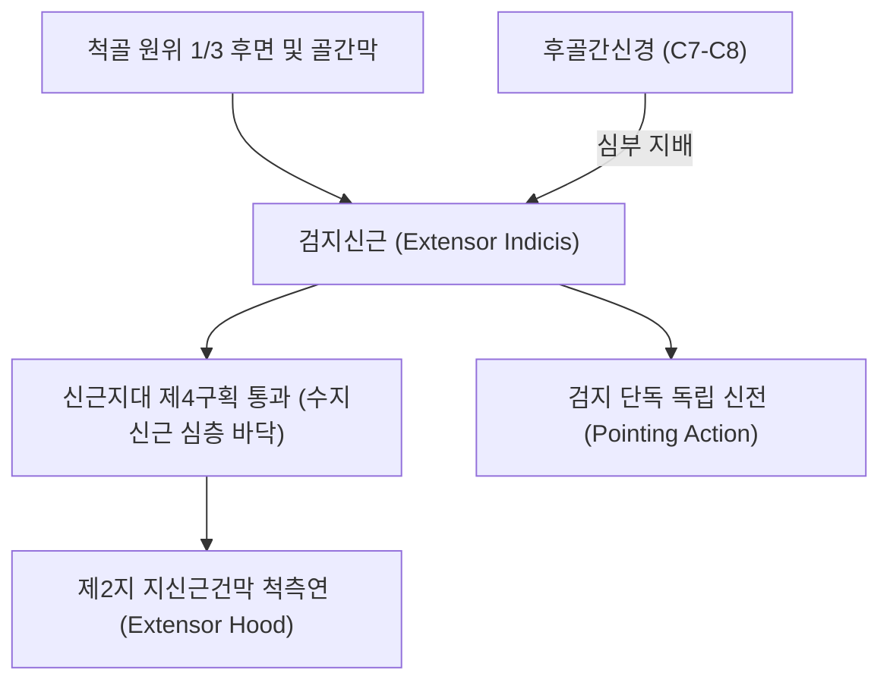
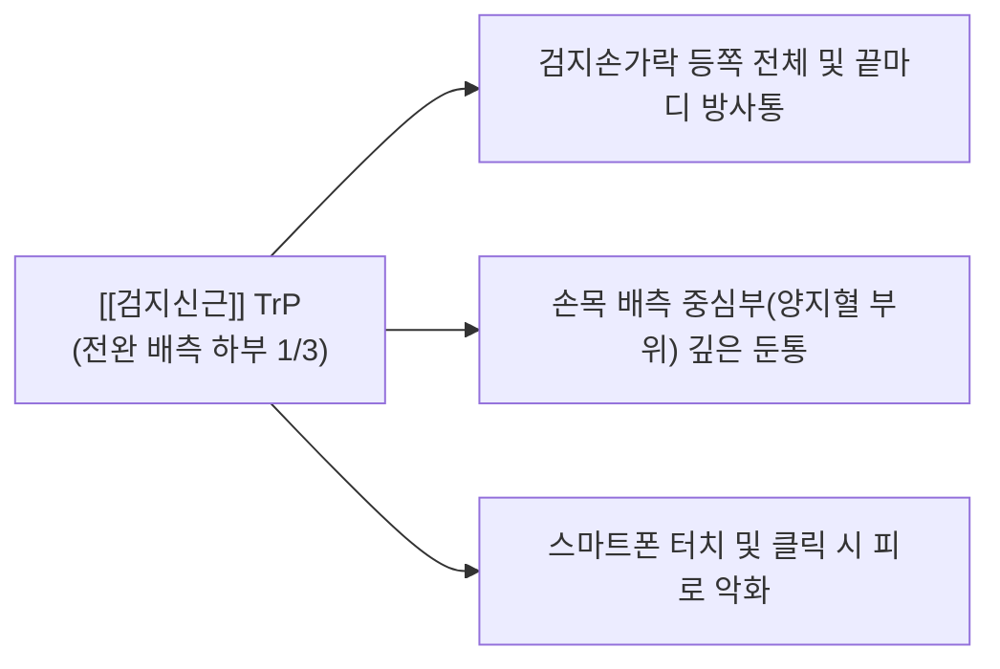

# [[검지신근]](Extensor Indicis, 시지신근)

> **핵심 요약 (Key Summary)**:
> [[척골]] 원위 1/3 후면 및 전완 골간막에서 기원하여 제2지(검지) 지신근건막 척측연에 정지하는 전완 심층의 검지 전담 신전근입니다.
> [[후골간신경]](PIN, C7-C8, [[요골신경]] 심부 분지)의 지배를 받으며, 다른 손가락과 독립적으로 검지(Index finger)만을 자유롭게 펴고 가리키는(Pointing) 정밀 동작을 주도합니다.
> 검지 독립 신전 장애, 손목 배측 제4구획 건초염, 스마트폰 검지 과사용통의 핵심 표적근이며, 전완 후면 하부 침구 및 지신근건막 이완이 표적입니다.

---
## 📌 목차
1. [해부학적 정밀 구조 및 지배 신경/혈관](#1-해부학적-정밀-구조-및-지배-신경혈관)
2. [생체역학·토크 분석 & 근막 사슬 (Biomechanical Synergy)](#2-생체역학토크-분석--근막-사슬-biomechanical-synergy)
3. [근막통증증후군(TP) & 연관통 패턴 (Travell & Simons)](#3-근막통증증후군tp--연관통-패턴-travell--simons)
4. [초음파 해부학(Sonoanatomy) 및 중재 시술 랜드마크](#4-초음파-해부학sonoanatomy-및-중재-시술-랜드마크)
5. [⭐ 원장님 심층 임상 고찰 및 원본 필기 (Clinical Pearls)](#5-원장님-심층-임상-고찰-및-원본-필기-clinical-pearls)
6. [관련 임상 질환 및 운동손상 증후군 총괄](#6-관련-임상-질환-및-운동손상-증후군-총괄)
7. [추나·도수치료(MET/PIR) & 침구·약침·재활 프로토콜](#7-추나도수치료metpir--침구약침재활-프로토콜)
8. [출처 및 학술 참고 문헌 (References)](#8-출처-및-학술-참고-문헌-references)

---
## 1. 해부학적 정밀 구조 및 지배 신경/혈관

| 항목 | 상세 내용 |
| :--- | :--- |
| **기시 (Origin)** | [[척골]](Ulna) 체부 후면 원위 1/3 및 인접 전완 골간막(Interosseous membrane) |
| **정지 (Insertion)** | 제2지(검지) 중수골두 배면에서 [[수지신근]]의 검지 건 척측연 및 지신근건막(Extensor hood) |
| **신경 지배** | [[후골간신경]](Posterior interosseous nerve, PIN, C7, C8 - [[요골신경]] 심부 분지) |
| **혈관 공급** | 후골간동맥(Posterior interosseous artery) 분지 및 전골간동맥 천공지 |
| **해부학적 특이성** | 손목 신근지대 제4구획에서 [[수지신근]]의 4개 건 바로 심층(바닥 쪽)을 단독으로 통과 |

---
## 2. 생체역학·토크 분석 & 근막 사슬 (Biomechanical Synergy)

### (1) 검지(제2지)의 완전 독립 신전 (Independent Index Extension)
* 다른 세 손가락(중지, 약지, 소지)을 꽉 쥔 상태에서도 검지만을 자유롭게 들어 올려 목표물을 가리키는(Pointing) 인간 고유의 정밀 운동을 전담합니다.
* [[수지신근]]의 검지 건 척측에 붙어 약간의 내전(Adduction, 중지 쪽으로 당김)력을 보조합니다.
* [[충양근(손)|충양근]] 및 [[골간근]]과의 협동을 통해 지간관절의 완전 신전과 미세 조절을 완성합니다.

### (2) 신근지대 제4구획(Fourth Compartment) 심층 주행
* 손목 배측에서 [[수지신근]]의 4개 건 바로 아래 바닥 면에 밀착되어 활주하므로, 손목 배굴 시 [[요골]]과 [[척골]] 사이 골간막 상방에서 마찰을 흡수합니다.

### (3) 근막 사슬 연계 (Anatomy Trains)
* **표재후방상지선(Superficial Back Arm Line)**의 심층 미세 분지로, 척골 원위 골막에서 검지 끝마디로 이어지는 정밀 신전 체인을 형성합니다.

---
## 3. 근막통증증후군(TP) & 연관통 패턴 (Travell & Simons)

* **발통점 형성 위치 (Trigger Point Location)**:
  * 전완 후면 하부 1/3, [[척골]] 후면 외측의 좁은 EI 근복 내에 형성.
* **연관통 방사 패턴 (Referred Pain Pattern)**:
  * **검지손가락 등쪽 방사통**: 검지손가락 손등 면 전체와 끝마디까지 찌릿하고 화끈거리는 방사통 투사.
  * **손목 배측 중심부 둔통**: 완관절 등쪽(양지혈 부위)으로 깊은 쑤심 유발.
  * **악화 요인**: 마우스 검지 클릭 반복, 스마트폰 터치, 정밀 수공구 작업 시 피로감 및 통증 발생.

---
## 4. 초음파 해부학(Sonoanatomy) 및 중재 시술 랜드마크

* **손목 상방 3cm 배측 횡단 스캔**:
  * [[척골]] 피질과 골간막 바로 위에 얹혀 있는 가장 심층의 작은 방추형 저에코 근육층인 [[검지신근]]을 식별합니다.
* **제4구획 내 건 단면 관계**:
  * [[수지신근]] 4개 건 바로 아래 바닥 면에 타원형의 EI 건이 밀착되어 주행하는 구조를 확인합니다.
* **침도 및 약침 안전 마진**:
  * [[척골]] 골막을 안전 랜드마크로 삼아 척골 후면을 향해 사자로 진입하여 근막 경결을 박리합니다.

---
## 5. ⭐ 원장님 심층 임상 고찰 및 원본 필기 (Clinical Pearls)

### (1) 주먹을 쥐고 검지만 펴는 'Pointing Test'의 임상 가치
* **검사법**: 환자에게 주먹을 꽉 쥐게 한 상태에서 검지만 위로 들어 올리게(Pointing) 합니다.
* **판정 기준**: 이때 검지가 잘 올라가지 않거나 손등 아래쪽이 뻐근하다면 [[수지신근]]이 아닌 **검지신근(Extensor indicis)의 단독 손상 또는 [[후골간신경]](PIN) 원위부 분지 포착**으로 확진합니다.

### (2) 신근지대 제4구획 건초염(Extensor Tenosynovitis) 감별
* 손목 등쪽 중앙이 붓고 아플 때, [[수지신근]]과 함께 검지신근 건초가 비후되어 있는 경우가 많습니다.
* 특히 검지만 까딱거릴 때 손목 등쪽에서 삐걱거리는 마찰음(Crepitus)이 들리면 제4구획 내 EI 건초염으로 판정합니다.

### (3) 건 이식(Tendon Transfer)의 훌륭한 공여건
* 검지는 [[수지신근]] 건이 함께 존재하므로, 검지신근 건을 절제하여 엄지의 [[장무지신근]](EPL) 파열 시 재건용 공여건으로 이식해도 검지 신전 기능이 온전히 보존됩니다.

---
## 6. 관련 임상 질환 및 운동손상 증후군 총괄

| 임상 질환 / 증후군 | 병리적 연관 기전 | 주요 증상 및 이학적 검사 | 핵심 교정 타깃 |
| :--- | :--- | :--- | :--- |
| 제4구획 건초염 | 제4구획 내 EI 건의 반복적 마찰 및 염증 | 검지 신전 시 손목 배측 통증, 마찰음 | 제4구획 건초 침도 감압술 |
| 검지 독립 신전 불능증 | [[후골간신경]] 원위부 신경 포착 또는 근복 단축 | 주먹 쥐고 검지 펴기 불가, Pointing 장애 | 척골 원위부 PIN 주행로 박리 |
| 스마트폰 검지 과사용통 | 검지 반복 탭핑에 의한 근복 피로 | 검지 배면 쑤심, 손등 하부 피로 | EI 근복 침구 및 허혈 압박 |
| 마우스 클릭 증후군 | 지속적인 검지 신전 상태로 인한 정적 긴장 | 검지 MCP 관절 및 손등 뻐근함 | EI 스트레칭 및 작업 인체공학 교정 |

---
## 7. 추나·도수치료(MET/PIR) & 침구·약침·재활 프로토콜

### (1) 한의학 경혈 매핑 & 자침법
* **경혈 매핑**: 회종(會宗, TE7), 지구(支溝, TE6) 하방, 양지(陽池, TE4)
* **자침 기법**:
  * [[척골]] 원위 1/3 부위 EI 근복 경결점(회종 하방)에 침을 척골 골막 방향으로 20도 사자(20~25mm) 진입하여 근막 연축을 해소합니다.
  * 양지혈 부위 제4구획 건초 내에 [[황련해독탕]] 약침 0.1cc를 주입하여 삼출액을 흡수시킵니다.

### (2) 검지신근 MET 및 스트레칭
* 환자가 주먹을 쥐고 손목을 완전 굴곡시킨 상태에서 검지 손가락만을 추가로 끝까지 굴곡시켜 검지신근을 최대로 신장합니다.

---
## 8. 출처 및 학술 참고 문헌 (References)

1. **Simons, D. G., & Travell, J. G. (1999)**. *Myofascial Pain and Dysfunction: The Trigger Point Manual*, Vol. 1 (2nd ed.). Williams & Wilkins.
   - **[연구 요약]**: 검지신근 발통점이 손목 배측 및 검지 전체로 방사하는 연관통 지도 제시.
2. **Kordestani, R. K. et al. (2026)**. *J Hand Surg Asian Pac Vol*, 31(4), 342-344.
   - *A Technique for Accurately Identifying and Harvesting the Extensor Indicis Proprius for Tendon Transfer*. [PMID: 41748548](https://pubmed.ncbi.nlm.nih.gov/41748548/)
   - **[연구 요약]**: 검지신근(EIP) 건의 정확한 식별 및 채취 기법 보고 — 장무지신근 재건 건 이전술 시 해부학적 랜드마크 규명.
3. **Standring, S. (2020)**. *Gray's Anatomy: The Anatomical Basis of Clinical Practice* (42nd ed.). Elsevier.
   - **[해부학 총론]**: 검지신근의 척골 기시부 해부학 및 제4 신전구획 주행 분석.
