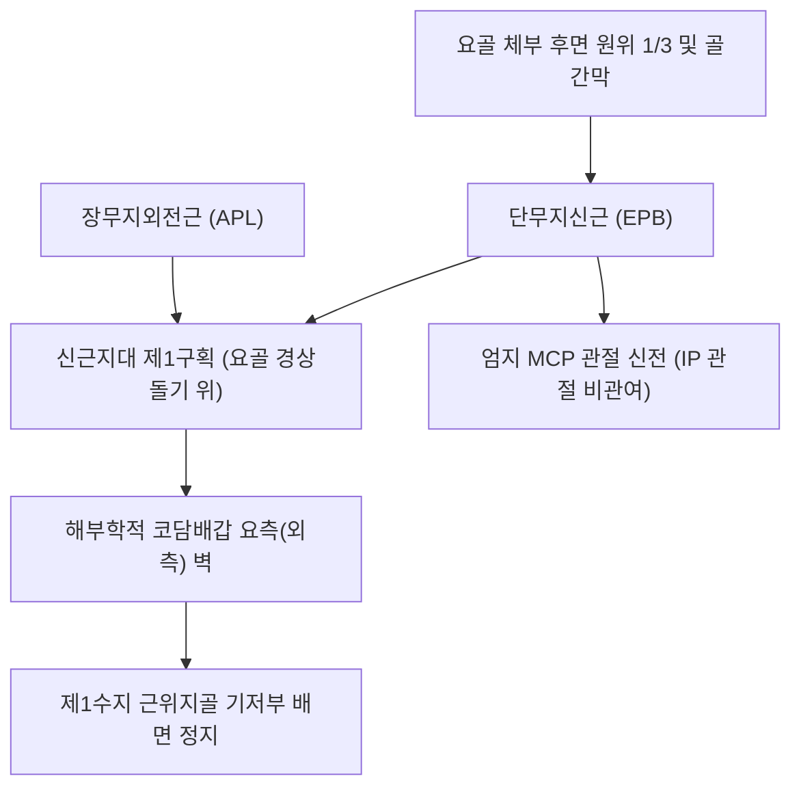
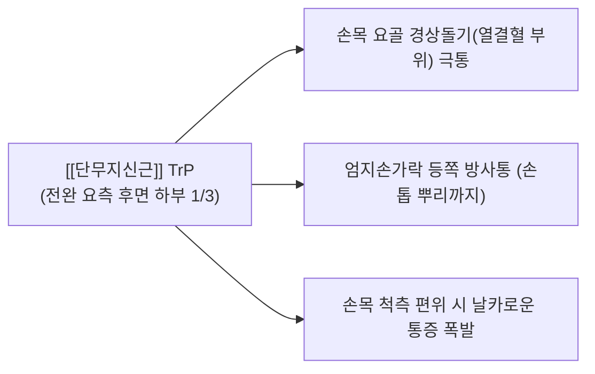

# [[단무지신근]](Extensor Pollicis Brevis, EPB)

> **핵심 요약 (Key Summary)**:
> [[요골]] 후면 원위 1/3 및 골간막에서 기원하여 엄지 근위지골 기저부 배면에 정지하는 전완 배측 심층의 엄지 신전근입니다.
> [[후골간신경]](PIN, C7-C8, [[요골신경]] 심부 분지)의 지배를 받으며, 신근지대 제1구획을 [[장무지외전근]]과 함께 통과하여 엄지 중수지관절(MCP) 신전을 주도합니다.
> **[[드퀘르뱅 증후군|드퀘르벵 증후군]](De Quervain's tenosynovitis)**의 최핵심 병변근이자 해부학적 코담배갑 요측 경계근이며, 열결·양계혈 침도 절개 및 제1구획 건초 감압이 표적입니다.

---
## 📌 목차
1. [해부학적 정밀 구조 및 지배 신경/혈관](#1-해부학적-정밀-구조-및-지배-신경혈관)
2. [생체역학·토크 분석 & 근막 사슬 (Biomechanical Synergy)](#2-생체역학토크-분석--근막-사슬-biomechanical-synergy)
3. [근막통증증후군(TP) & 연관통 패턴 (Travell & Simons)](#3-근막통증증후군tp--연관통-패턴-travell--simons)
4. [초음파 해부학(Sonoanatomy) 및 중재 시술 랜드마크](#4-초음파-해부학sonoanatomy-및-중재-시술-랜드마크)
5. [⭐ 원장님 심층 임상 고찰 및 원본 필기 (Clinical Pearls)](#5-원장님-심층-임상-고찰-및-원본-필기-clinical-pearls)
6. [관련 임상 질환 및 운동손상 증후군 총괄](#6-관련-임상-질환-및-운동손상-증후군-총괄)
7. [추나·도수치료(MET/PIR) & 침구·약침·재활 프로토콜](#7-추나도수치료metpir--침구약침재활-프로토콜)
8. [출처 및 학술 참고 문헌 (References)](#8-출처-및-학술-참고-문헌-references)

---
## 1. 해부학적 정밀 구조 및 지배 신경/혈관

| 항목 | 상세 내용 |
| :--- | :--- |
| **기시 (Origin)** | [[요골]](Radius) 체부 후면 원위 1/3면 및 인접 전완 골간막(Interosseous membrane) ([[장무지외전근]] 기시부 바로 하방) |
| **정지 (Insertion)** | 제1수지(엄지) 근위지골(Proximal phalanx) 기저부 등쪽면 |
| **신경 지배** | [[후골간신경]](Posterior interosseous nerve, PIN, C7, C8 - [[요골신경]] 심부 분지) |
| **혈관 공급** | 후골간동맥(Posterior interosseous artery) 및 요골동맥 근육 분지 |
| **해부학적 특이성** | 요골 경상돌기 위의 신근지대 제1구획에서 장무지외전근과 함께 통과하며, 코담배갑 외측 경계를 형성 |

---
## 2. 생체역학·토크 분석 & 근막 사슬 (Biomechanical Synergy)

### (1) 엄지 MCP(중수지관절) 신전 주동 (Thumb MCP Extensor)
* 엄지손가락 첫째 마디(MCP 관절)를 펴주는 일차 주동근입니다 (지간관절인 IP 관절은 [[장무지신근]]이 전담).
* 엄지 수근중수관절(CMC) 신전 및 외전을 약하게 보조합니다.

### (2) 신근지대 제1구획 및 해부학적 코담배갑 형성
* 요골 경상돌기(Radial styloid) 외측면의 좁은 고랑에서 [[장무지외전근]](APL)과 함께 제1구획 섬유골성 터널을 통과합니다.
* 장무지외전근과 함께 해부학적 코담배갑(Anatomical snuffbox)의 외측(전방) 경계를 형성합니다.

### (3) 근막 사슬 연계 (Anatomy Trains)
* **심층후방상지선(Deep Back Arm Line)**의 외측 지지대로 작용하여, 요골 골막에서 엄지 끝으로 이어지는 정밀 안정성을 완성합니다.

---
## 3. 근막통증증후군(TP) & 연관통 패턴 (Travell & Simons)

* **발통점 형성 위치 (Trigger Point Location)**:
  * 전완 요측 후면 하부 1/3, 요골 경상돌기 상방 4~6cm 지점의 EPB 근복 내에 형성.
* **연관통 방사 패턴 (Referred Pain Pattern)**:
  * **손목 요측 및 요골 경상돌기 통증**: 손목 엄지 쪽 뼈(열결혈 부위)로 날카롭고 찌릿한 통증 집중 투사.
  * **엄지손가락 배면 방사통**: 엄지손가락 등쪽을 따라 손톱 뿌리까지 뻗치는 통증 유발.
  * **악화 요인**: 젖병 수유, 아기 머리 받치기, 손목을 새끼손가락 쪽으로 꺾은 상태에서 엄지를 쥘 때 극심한 통증 폭발.

---
## 4. 초음파 해부학(Sonoanatomy) 및 중재 시술 랜드마크

* **신근지대 제1구획 횡단 스캔 (First Compartment Transverse View)**:
  * 요골 경상돌기 바로 위에서 프로브를 대면, 타원형 터널 내에 척측의 작은 [[단무지신근]](EPB) 건과 요측의 큰 [[장무지외전근]](APL) 건을 식별합니다.
* **독립 격막(Intra-compartmental Septum) 변이 확인 (핵심 랜드마크)**:
  * 제1구획 내부에 섬유성 격막이 존재하여 EPB와 APL이 독립된 서브 터널로 분리되어 있는지 여부를 반드시 초음파로 확인합니다.
* **침도 및 약침 안전 마진**:
  * 제1구획 바로 천층을 주행하는 요골신경 천자(Superficial radial nerve)와 요골동맥 분지를 컬러 도플러로 확인하여 시술 경로에서 완벽히 회피합니다.

---
## 5. ⭐ 원장님 심층 임상 고찰 및 원본 필기 (Clinical Pearls)

### (1) 드퀘르벵 증후군(De Quervain's Tenosynovitis)과 Finkelstein 검사
* **임상 팩트**: 산모, 유아를 돌보는 여성, 스마트폰 과사용자에게 다발하는 [[드퀘르뱅 증후군|드퀘르벵 병변]]은 **제1구획 내 단무지신근(EPB)과 장무지외전근(APL) 건초의 협착성 건초염**입니다.
* **Finkelstein Test**: 엄지를 손바닥 안으로 쥐고 주먹을 쥔 상태에서 손목을 강하게 척측(새끼손가락 쪽)으로 꺾을 때, 요골 경상돌기에 번개 치는 듯한 통증이 발생하면 양성입니다.

### (2) 제1구획 내 섬유성 격막(Septum) 변이와 시술 실패의 비밀
* **격막 변이율 40~50%**: 인구의 약 40~50%에서 제1구획 내부에 섬유성 중격(Septum)이 존재하여 **단무지신근(EPB)이 별도의 독립된 방(Sub-compartment)에 갇혀 있습니다**.
* **치료 불응 원인**: 스테로이드 주사나 단순 시술 시 큰 방(APL)만 감압되고 작은 방(EPB)이 감압되지 않으면 통증이 전혀 낫지 않습니다. 따라서 초음파로 EPB의 독립 격막 유무를 확인하고 EPB 터널을 정밀 절개해야 100% 완치됩니다.

### (3) 치료점 선택 요결
* 열결(LU7)혈과 양계(LI5)혈 부위의 비후된 제1구획 신근지대를 소침도로 종절개하여 건초 압력을 즉각 해소합니다.

---
## 6. 관련 임상 질환 및 운동손상 증후군 총괄

| 임상 질환 / 증후군 | 병리적 연관 기전 | 주요 증상 및 이학적 검사 | 핵심 교정 타깃 |
| :--- | :--- | :--- | :--- |
| [[드퀘르뱅 증후군|드퀘르벵 증후군]] | 제1구획 지대 비후 및 건 마찰 건초염 | Finkelstein 양성, 요골 경상돌기 압통 | 제1구획 신근지대 소침도 절개술 |
| EPB 독립 터널 협착증 | 제1구획 내 섬유성 격막에 의한 EPB 포착 | 주사 치료 불응, 엄지만 젖힐 때 극통 | EPB 독립 격막 침도 절제술 |
| 산후 손목 건초염 | 젖병 수유 및 아기 머리 받치기 과사용 | 손목 엄지 쪽 심한 부종과 통증 | 제1구획 약침 및 엄지 스플린트 |
| 해부학적 코담배갑 압통 | 주상골 골절 또는 EPB 건염 | 코담배갑 바닥 압통 | 방사선 검사 및 건초 침구 |

---
## 7. 추나·도수치료(MET/PIR) & 침구·약침·재활 프로토콜

### (1) 한의학 경혈 매핑 & 자침법
* **경혈 매핑**: 열결(列缺, LU7), 양계(陽谿, LI5), 편력(偏歷, LI6)
* **자침 기법**:
  * 열결혈 부위 요골 경상돌기 위에 소침도를 건 주행과 평행하게 15도 사자 진입하여 비후된 제1구획 지대를 종으로 2~3회 미세 절개합니다.
  * [[황련해독탕]] 약침 0.1cc를 건초 내로 점적 주입하여 삼출액과 염증을 신속 배제합니다.

### (2) 엄지 MCP 관절 MET 및 재활
* 제1 중수수근관절(CMC) 견인 후 엄지 MCP 관절을 굴곡시킨 상태에서 신전 등척성 저항(20% 힘, 5초)을 가한 뒤 부드럽게 추가 굴곡 신장합니다.

---
## 8. 출처 및 학술 참고 문헌 (References)

1. **Simons, D. G., & Travell, J. G. (1999)**. *Myofascial Pain and Dysfunction: The Trigger Point Manual*, Vol. 1 (2nd ed.). Williams & Wilkins.
   - **[연구 요약]**: 단무지신근 발통점이 엄지 배측 및 제1중수골 기저부로 방사하는 연관통 패턴 규명.
2. **Jackson, W. T. et al. (1986)**. *J Bone Joint Surg Am*, 68(6), 923-926.
   - *Anatomical variations in the first extensor compartment of the wrist. A clinical and anatomical study*. [PMID: 3733780](https://pubmed.ncbi.nlm.nih.gov/3733780/)
   - **[연구 요약]**: 제1 신전구획의 해부학적 격막 형성 빈도(40%) 및 드퀘르벵 치료 실패의 주원인 입증.
3. **Standring, S. (2020)**. *Gray's Anatomy: The Anatomical Basis of Clinical Practice* (42nd ed.). Elsevier.
   - **[해부학 총론]**: 단무지신근과 장무지외전근의 제1 신전구획 주행 및 코담배갑 해부학 분석.
