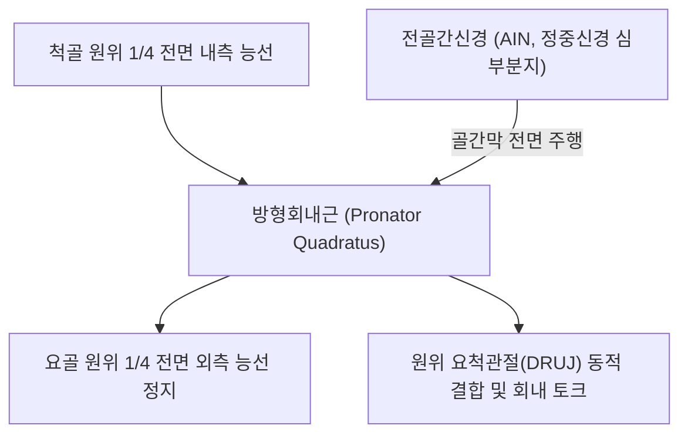
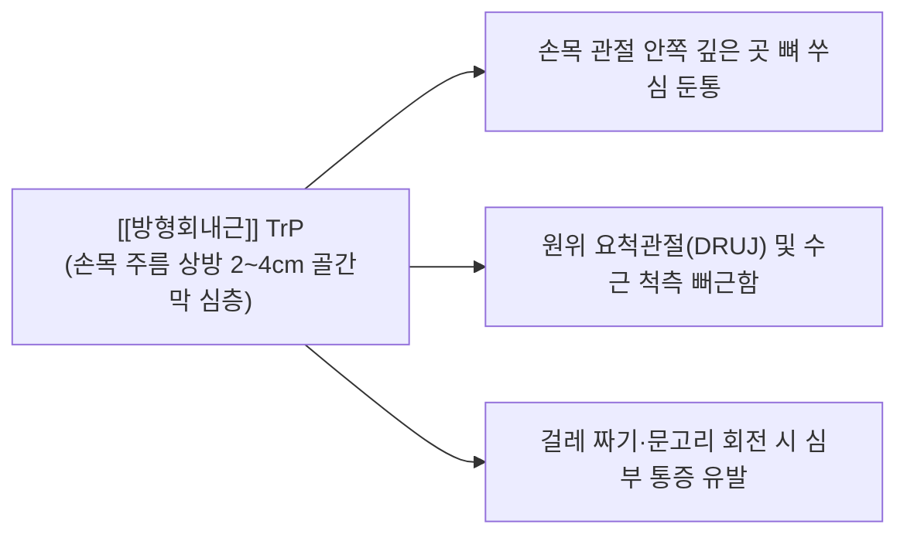

# [[방형회내근]](Pronator Quadratus)

> **핵심 요약 (Key Summary)**:
> [[척골]] 원위 1/4 전면 내측에서 기원하여 [[요골]] 원위 1/4 전면 외측에 정지하는 전완 최심층 사각형태의 일차적 회내근입니다.
> [[전골간신경]](AIN, [[정중신경]] 심부 분지, C7-C8)의 지배를 받으며, 부하와 상관없이 모든 전완 회내(Pronation)의 기초 엔진 및 원위 요척관절(DRUJ)을 동적 압박 안정화합니다.
> [[전골간신경]] 증후군(Kiloh-Nevin 증후군, OK sign 소실), 원위 요척관절 불안정증, 손목 심부 통증의 핵심 표적근이며, 간시·내관혈 심부 자침 및 골간막 접근이 표적입니다.

---
## 📌 목차
1. [해부학적 정밀 구조 및 지배 신경/혈관](#1-해부학적-정밀-구조-및-지배-신경혈관)
2. [생체역학·토크 분석 & 근막 사슬 (Biomechanical Synergy)](#2-생체역학토크-분석--근막-사슬-biomechanical-synergy)
3. [근막통증증후군(TP) & 연관통 패턴 (Travell & Simons)](#3-근막통증증후군tp--연관통-패턴-travell--simons)
4. [초음파 해부학(Sonoanatomy) 및 중재 시술 랜드마크](#4-초음파-해부학sonoanatomy-및-중재-시술-랜드마크)
5. [⭐ 원장님 심층 임상 고찰 및 원본 필기 (Clinical Pearls)](#5-원장님-심층-임상-고찰-및-원본-필기-clinical-pearls)
6. [관련 임상 질환 및 운동손상 증후군 총괄](#6-관련-임상-질환-및-운동손상-증후군-총괄)
7. [추나·도수치료(MET/PIR) & 침구·약침·재활 프로토콜](#7-추나도수치료metpir--침구약침재활-프로토콜)
8. [출처 및 학술 참고 문헌 (References)](#8-출처-및-학술-참고-문헌-references)

---
## 1. 해부학적 정밀 구조 및 지배 신경/혈관

| 항목 | 상세 내용 |
| :--- | :--- |
| **기시 (Origin)** | [[척골]](Ulna) 원위 1/4 전면(Anterior surface) 내측 능선 및 척골 골막 |
| **정지 (Insertion)** | [[요골]](Radius) 원위 1/4 전면 외측 능선 및 삼각절흔(Ulnar notch) 전방 경계 |
| **신경 지배** | [[전골간신경]](Anterior interosseous nerve, AIN, C7, C8, T1) - [[정중신경]]의 순수 운동 분지 |
| **혈관 공급** | 전골간동맥(Anterior interosseous artery, AIN과 동행) 및 수근동맥망 분지 |
| **해부학적 층위** | 전완 최심층에 위치하여 전완 굴근건군([[심지굴근]], [[장무지굴근]])과 골간막 사이에 밀착 |

---
## 2. 생체역학·토크 분석 & 근막 사슬 (Biomechanical Synergy)

### (1) 전완 회내(Pronation)의 일차적 주동 엔진 (Primary Pronator)
* 전완 회내 동작 시 부하나 속도와 상관없이 **가장 먼저, 지속적으로 100% 활성화**되는 유일한 일차 근육입니다.
* [[원회내근]]이 강한 저항이나 빠른 가속 시 동원되는 예비군이라면, 방형회내근은 일상적인 전완 회내의 기본 토크를 온전히 전담합니다.

### (2) 원위 요척관절(DRUJ)의 동적 압박 안정화 (Dynamic Stabilizer)
* 근섬유가 요골과 척골 사이를 수평으로 가로질러 주행하여, 수축 시 두 뼈를 강하게 밀착시켜 원위 요척관절의 이개를 방지하고 삼각섬유연골복합체(TFCC)를 보호합니다.

### (3) 근막 사슬 연계 (Anatomy Trains)
* **심층전방상지선(Deep Front Arm Line)**의 최심층 기저 안정자로, [[장무지굴근]] 및 [[심지굴근]] 건 하부에서 골간막과 결합하여 수근부의 안정성을 형성합니다.

---
## 3. 근막통증증후군(TP) & 연관통 패턴 (Travell & Simons)

* **발통점 형성 위치 (Trigger Point Location)**:
  * 손목 주름 상방 2~4cm 지점의 전완 심층, 요골과 척골 사이 중앙 골간막 부위에 형성.
* **연관통 방사 패턴 (Referred Pain Pattern)**:
  * **수근부 심부 쑤심**: 손목 관절 안쪽 깊은 곳에서 뼈가 쑤시는 듯한 둔통과 조임감 호소.
  * **원위 요척관절(DRUJ) 통증**: 손목을 비틀거나 젖힐 때 척측/요측 손목 심부에서 예리한 통증 발생.
  * **악화 요인**: 걸레를 짜거나 문고리를 돌리는 등 저항성 회내 동작 시 심한 심부 통증 유발.

---
## 4. 초음파 해부학(Sonoanatomy) 및 중재 시술 랜드마크

* **손목 원위 전면 횡단 스캔 (Distal Volar Forearm Transverse View)**:
  * 손목 주름 상방 3cm에서 프로브를 가로로 대면, 요골과 척골 피질(Bone cortex) 사이에 걸쳐진 사각형태의 저에코 근육층인 [[방형회내근]]이 명확히 관찰됩니다.
* **심층 랜드마크 관계**:
  * 천층에는 [[심지굴근]](FDP) 및 [[장무지굴근]](FPL) 건들이 주행하고, 그 바로 아래 골간막 위에 방형회내근이 밀착되어 있습니다.
  * 방형회내근 심면 바로 위에서 전골간동맥과 [[전골간신경]](AIN)의 단면을 확인합니다.
* **침도 및 약침 안전 마진**:
  * 천층의 요골동맥, 정중신경, 척골신경/혈관 다발을 회피하여 요골 내측연 혹은 척골 외측연을 따라 사자로 안전하게 진입합니다.

---
## 5. ⭐ 원장님 심층 임상 고찰 및 원본 필기 (Clinical Pearls)

### (1) 전골간신경 증후군(AIN Syndrome / Kiloh-Nevin)과 'OK Sign' 소실
* **임상 팩트**: 전골간신경(AIN)은 순수 운동신경으로 방형회내근, [[장무지굴근]](FPL), [[심지굴근]](FDP, 제2·3수지 분지)을 지배합니다.
* AIN이 포착되면 **감각 저하는 전혀 없으면서 엄지와 검지의 지간관절 굴곡 마비**가 발생합니다.
* **Pinch 검사 (OK Sign Test)**: 환자에게 엄지와 검지 끝을 동그랗게 모아 "OK" 사인을 만들게 했을 때, 정상적인 원형(Pinch)을 만들지 못하고 엄지 지간관절과 검지 원위지간관절이 펴지면서 지복부로 납작하게 맞닿는(Pulp-to-pulp contact) 기형적 모양이 나타나면 AIN 포착으로 확진합니다.

### (2) 원위 요척관절(DRUJ) 통증의 숨은 핵심 근육
* 손목 척측 통증 환자에서 TFCC 손상이나 관절염으로 진단받았으나 호전이 없을 때, 방형회내근의 단축과 발통점을 반드시 의심해야 합니다.
* 방형회내근이 단축되면 요골과 척골 원위부를 비틀어 회전 가동범위를 제한하고 관절면에 비정상적인 전단력을 가합니다.

### (3) 손목 터널 수술 후 잔여 통증의 주원인
* [[수근관 증후군]] 수술 후에도 손목 깊은 곳의 묵직한 통증이 지속될 때, 최심층의 방형회내근 근막 긴장을 이완시켜 주면 극적인 호전을 보입니다.

---
## 6. 관련 임상 질환 및 운동손상 증후군 총괄

| 임상 질환 / 증후군 | 병리적 연관 기전 | 주요 증상 및 이학적 검사 | 핵심 교정 타깃 |
| :--- | :--- | :--- | :--- |
| [[전골간신경]] 증후군 | 전골간신경 포착에 의한 FPL, FDP, PQ 마비 | OK Sign 소실(Pinch 불능), 감각 정상 | 전골간신경 주행로 침도 박리 |
| 원위 요척관절(DRUJ) 불안정증 | 방형회내근 약화 또는 단축 불균형 | 손목 회전 시 뚝 소리 및 통증, Piano key sign | 방형회내근 강화 및 MET 밸런스 |
| 만성 손목 심부 통증 증후군 | 방형회내근 발통점에 의한 골간막 긴장 | 손목 짚고 일어날 때 심부 둔통 | 방형회내근 심부 침도 및 약침 |
| 전완 회외 구축 및 가동제한 | 방형회내근 섬유화 구축 | 손바닥을 하늘로 뒤집는 회외 제한 | 방형회내근-회외근 상호억제 MET |

---
## 7. 추나·도수치료(MET/PIR) & 침구·약침·재활 프로토콜

### (1) 한의학 경혈 매핑 & 자침법
* **경혈 매핑**: 간시(間使, PC5), 내관(內關, PC6), 지구(支溝, TE6)
* **자침 기법**:
  * 내관혈 부위에서 굴근건들을 손가락으로 살짝 외측으로 밀어 젖힌 상태에서 침을 직자 진입(25~30mm)하여 방형회내근 근막층에 도달한 후 미세 자극합니다.
  * 중성어혈약침 또는 자하거약침 0.2cc를 주입하여 전골간신경 포착 부위 부종을 해소합니다.

### (2) 방형회내근 MET (근에너지기법)
* 환자의 팔꿈치를 90도 굴곡하고 손목을 중립으로 고정한 뒤 전완을 최대로 회외(Supination)시킵니다.
* 환자에게 "20% 힘으로 안쪽으로 돌리세요(회내 저항)"라고 지시하여 7초간 등척성 수축 후, 호기 시 전완을 부드럽게 추가 회외시켜 심층의 방형회내근을 신장합니다.

---
## 8. 출처 및 학술 참고 문헌 (References)

1. **Simons, D. G., & Travell, J. G. (1999)**. *Myofascial Pain and Dysfunction: The Trigger Point Manual*, Vol. 1 (2nd ed.). Williams & Wilkins.
   - **[연구 요약]**: 방형회내근 및 전완 심층 굴근군의 손목 심부 연관통 패턴 제시.
2. **Hill, N. A. et al. (1985)**. *J Hand Surg Am*, 10(1), 4-16.
   - *The incomplete anterior interosseous nerve syndrome*. [PMID: 3968404](https://pubmed.ncbi.nlm.nih.gov/3968404/)
   - **[연구 요약]**: 전골간신경의 해부학적 포착 부위 및 OK 사인 결손에 대한 임상적 진단 기준 제시.
3. **Standring, S. (2020)**. *Gray's Anatomy: The Anatomical Basis of Clinical Practice* (42nd ed.). Elsevier.
   - **[해부학 총론]**: 방형회내근의 전골간신경 지배 및 원위 요척관절 동적 안정화 기전 분석.
