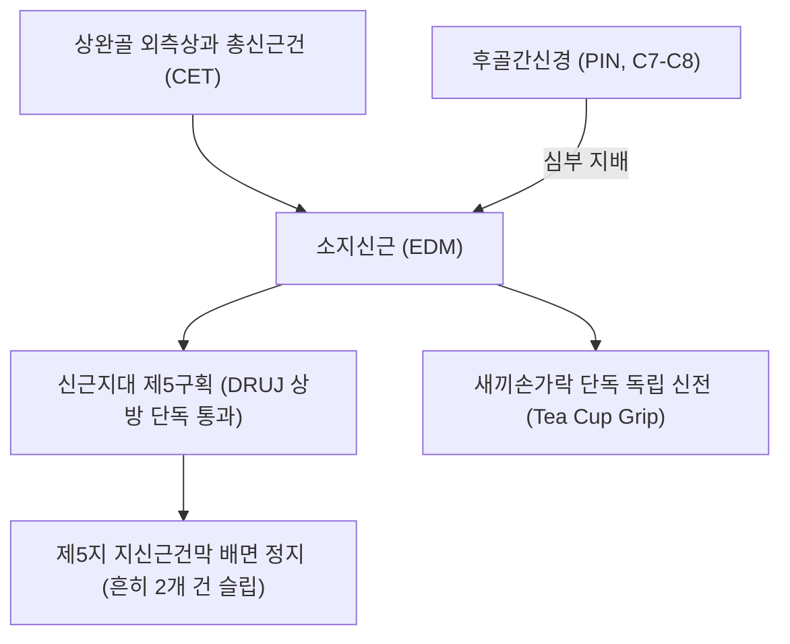
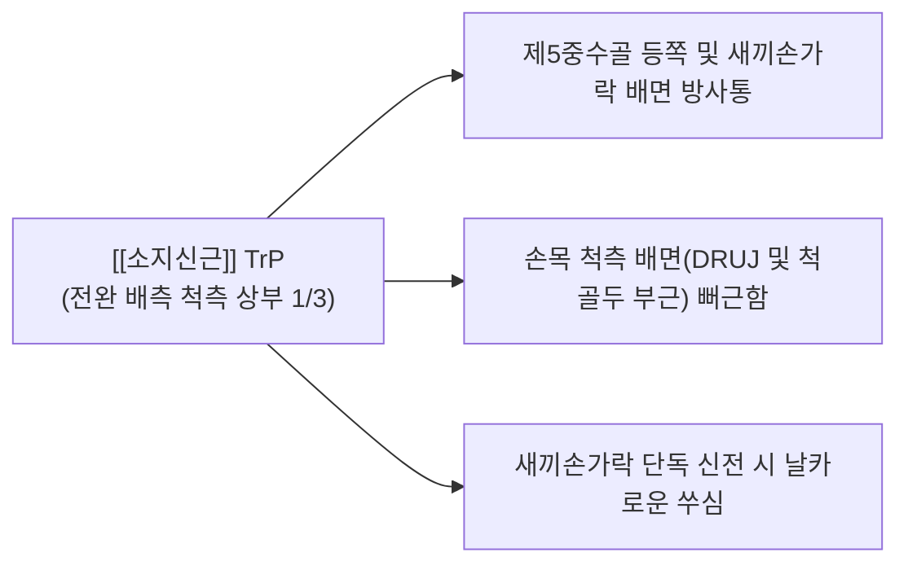

# [[소지신근]](Extensor Digiti Minimi, EDM)

> **핵심 요약 (Key Summary)**:
> [[상완골]] 외측상과 총신근건에서 기원하여 제5지(새끼손가락) 지신근건막 배면에 정지하는 전완 배측 척측 구획의 소지 전담 신전근입니다.
> [[후골간신경]](PIN, C7-C8, [[요골신경]] 심부 분지)의 지배를 받으며, 신근지대 제5구획을 단독으로 통과하여 새끼손가락만의 독립적 신전을 주도합니다.
> 새끼손가락 독립 신전 장애, 원위 요척관절(DRUJ) 상방 제5구획 건초염, 찻잔 파지통의 핵심 표적근이며, 양로혈 상방 침구 및 제5구획 건초 박리가 표적입니다.

---
## 📌 목차
1. [해부학적 정밀 구조 및 지배 신경/혈관](#1-해부학적-정밀-구조-및-지배-신경혈관)
2. [생체역학·토크 분석 & 근막 사슬 (Biomechanical Synergy)](#2-생체역학토크-분석--근막-사슬-biomechanical-synergy)
3. [근막통증증후군(TP) & 연관통 패턴 (Travell & Simons)](#3-근막통증증후군tp--연관통-패턴-travell--simons)
4. [초음파 해부학(Sonoanatomy) 및 중재 시술 랜드마크](#4-초음파-해부학sonoanatomy-및-중재-시술-랜드마크)
5. [⭐ 원장님 심층 임상 고찰 및 원본 필기 (Clinical Pearls)](#5-원장님-심층-임상-고찰-및-원본-필기-clinical-pearls)
6. [관련 임상 질환 및 운동손상 증후군 총괄](#6-관련-임상-질환-및-운동손상-증후군-총괄)
7. [추나·도수치료(MET/PIR) & 침구·약침·재활 프로토콜](#7-추나도수치료metpir--침구약침재활-프로토콜)
8. [출처 및 학술 참고 문헌 (References)](#8-출처-및-학술-참고-문헌-references)

---
## 1. 해부학적 정밀 구조 및 지배 신경/혈관

| 항목 | 상세 내용 |
| :--- | :--- |
| **기시 (Origin)** | [[상완골]](Humerus) 외측상과(Lateral epicondyle) 총신근건(CET) 및 인접 근간중격 |
| **정지 (Insertion)** | 제5지(새끼손가락) 기저부 지신근건막(Extensor expansion) 배면 (흔히 2개의 건 슬립으로 갈라져 정지) |
| **신경 지배** | [[후골간신경]](Posterior interosseous nerve, PIN, C7, C8 - [[요골신경]] 심부 분지) |
| **혈관 공급** | 후골간동맥(Posterior interosseous artery) 분지 |
| **해부학적 특이성** | [[척골]] 두 상방 원위 요척관절(DRUJ) 바로 위를 지나는 독립된 신근지대 제5구획을 단독으로 통과 |

---
## 2. 생체역학·토크 분석 & 근막 사슬 (Biomechanical Synergy)

### (1) 새끼손가락(제5지)의 완전 독립 신전 (Independent Little Finger Extension)
* 다른 손가락들을 주먹 쥔 상태에서도 새끼손가락만을 우아하게 단독으로 들어 올릴 수 있게 해줍니다 (찻잔을 쥘 때 새끼손가락을 펴는 동작).
* [[수지신근]]의 제5지 건속이 미약하거나 결손된 경우에도 소지신근이 온전히 신전 기능을 보전합니다.
* [[척측수근신근]](ECU)과의 협동을 통해 완관절 척측 배면의 안정화를 도모합니다.

### (2) 신근지대 제5구획(Fifth Compartment) 단독 통과
* [[요골]]과 [[척골]] 사이의 원위 요척관절(DRUJ) 바로 위를 지나는 독립된 제5구획 터널을 단독으로 통과합니다.

### (3) 근막 사슬 연계 (Anatomy Trains)
* **표재후방상지선(Superficial Back Arm Line)**의 외측 가장자리 축을 형성하여, [[외측상과염|외측상과 신근군]]에서 새끼손가락 끝마디로 이어집니다.

---
## 3. 근막통증증후군(TP) & 연관통 패턴 (Travell & Simons)

* **발통점 형성 위치 (Trigger Point Location)**:
  * [[상완골]] 외측상과 하방 전완 배측 척측 상부 1/3, [[수지신근]]과 [[척측수근신근]] 사이의 좁은 EDM 근복 내에 형성.
* **연관통 방사 패턴 (Referred Pain Pattern)**:
  * **새끼손가락 손등 방사통**: 제5중수골 등쪽 및 새끼손가락 배면 전체로 찌릿한 통증 투사.
  * **손목 척측 배면 뻐근함**: 원위 요척관절(DRUJ) 및 [[척골]] 두 부근으로 쑤심 방사.
  * **악화 요인**: 장시간 키보드 타이핑, 찻잔이나 악기 파지 시 통증 발생.

---
## 4. 초음파 해부학(Sonoanatomy) 및 중재 시술 랜드마크

* **손목 원위 배측 횡단 스캔 (Distal Dorsal Wrist View)**:
  * 원위 요척관절(DRUJ) 바로 상방에서 [[척골]] 두 외측에 위치한 타원형의 제5구획 건초 내 [[소지신근]] 건 단면을 식별합니다.
  * 건초 내 활액막염(Synovitis) 및 삼출액 유무를 확인합니다.
* **침도 및 약침 안전 마진**:
  * 척골두 피질을 초음파 가이드로 삼아 제5구획 지대 천층에서 정밀하게 침도 감압 시술을 시행합니다.

---
## 5. ⭐ 원장님 심층 임상 고찰 및 원본 필기 (Clinical Pearls)

### (1) 소지 독립 신전 검사 (Little Finger Pointing Test)
* **검사법**: 환자에게 제2~4손가락을 꽉 쥐게 한 뒤, 새끼손가락만 단독으로 펴보게 합니다.
* **판정 기준**: 이때 새끼손가락이 펴지지 않거나 손목 척측 배면에서 심한 통증이 재현되면 소지신근 손상 또는 제5구획 건초염으로 확진합니다.

### (2) 원위 요척관절(DRUJ) 통증과의 감별
* 제5구획은 DRUJ 바로 위에 위치하므로, 류마티스 관절염이나 퇴행성 변화로 DRUJ가 불안정해지면 소지신근 건이 골극에 마찰되어 자발 건 파열(Vaughan-Jackson 증후군)이 발생할 수 있습니다.

---
## 6. 관련 임상 질환 및 운동손상 증후군 총괄

| 임상 질환 / 증후군 | 병리적 연관 기전 | 주요 증상 및 이학적 검사 | 핵심 교정 타깃 |
| :--- | :--- | :--- | :--- |
| 제5구획 건초염 | DRUJ 상방 제5구획 내 EDM 건 마찰 | 새끼손가락 펴기 통증, 척골두 상방 압통 | 제5구획 건초 소침도 감압 |
| Vaughan-Jackson 증후군 | 척골두 골극에 의한 소지신근 건 마찰 파열 | 새끼손가락 능동 신전 급작 상실 | 정형외과 건 재건술 의뢰 |
| 소지 독립 신전 불능증 | [[후골간신경]] 분지 마비 또는 건 유착 | 주먹 쥐고 소지 펴기 불능 | EDM 근복 침구 및 신경 박리 |
| 피아니스트 소지 피로통 | 옥타브 연타 시 반복적 EDM 과긴장 | 제5중수골 배면 쑤심 | EDM 근복 이완 및 테이핑 |

---
## 7. 추나·도수치료(MET/PIR) & 침구·약침·재활 프로토콜

### (1) 한의학 경혈 매핑 & 자침법
* **경혈 매핑**: 양로(養老, SI6) 상방 1.5촌, 지구(支溝, TE6) 척측 0.5촌
* **자침 기법**:
  * [[척골]] 두 상방 제5구획 협착 부위에 소침도를 종으로 15도 사자하여 신근지대를 미세 박리합니다.
  * [[황련해독탕]] 약침 0.1cc를 건초 주위에 주입하여 염증을 가라앉힙니다.

### (2) 소지신근 스트레칭 및 재활
* 환자의 손목과 새끼손가락을 동시에 최대로 굴곡시켜 소지신근 섬유를 부드럽게 신장합니다.

---
## 8. 출처 및 학술 참고 문헌 (References)

1. **Simons, D. G., & Travell, J. G. (1999)**. *Myofascial Pain and Dysfunction: The Trigger Point Manual*, Vol. 1 (2nd ed.). Williams & Wilkins.
   - **[연구 요약]**: 소지신근 발통점의 척측 손등 및 새끼손가락 방사통 패턴 제시.
2. **Giacobazzi, M. et al. (2023)**. *J Hand Surg Glob Online*, 5(4), 474-476.
   - *Anomalous extensor digiti minimi with multiple slips and bulbous appearance*. [PMID: 37521549](https://pubmed.ncbi.nlm.nih.gov/37521549/)
   - **[연구 요약]**: 소지신근(EDM)의 다발성 건 슬립 변이 증례 보고 — 제5 신전구획 내 변이 인지와 시술 시 임상적 고려사항.
3. **Standring, S. (2020)**. *Gray's Anatomy: The Anatomical Basis of Clinical Practice* (42nd ed.). Elsevier.
   - **[해부학 총론]**: 소지신근의 제5 신전구획 단독 주행 경로 및 해부학적 변이 분석.
