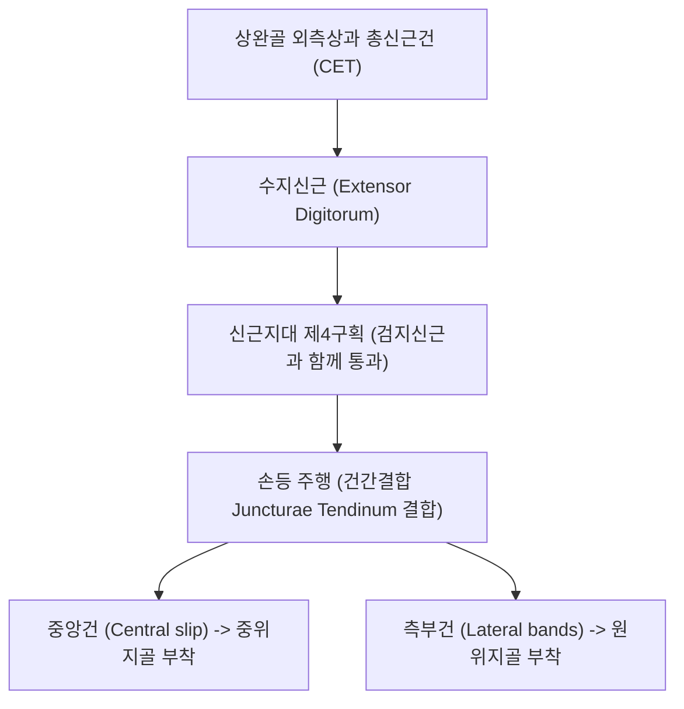
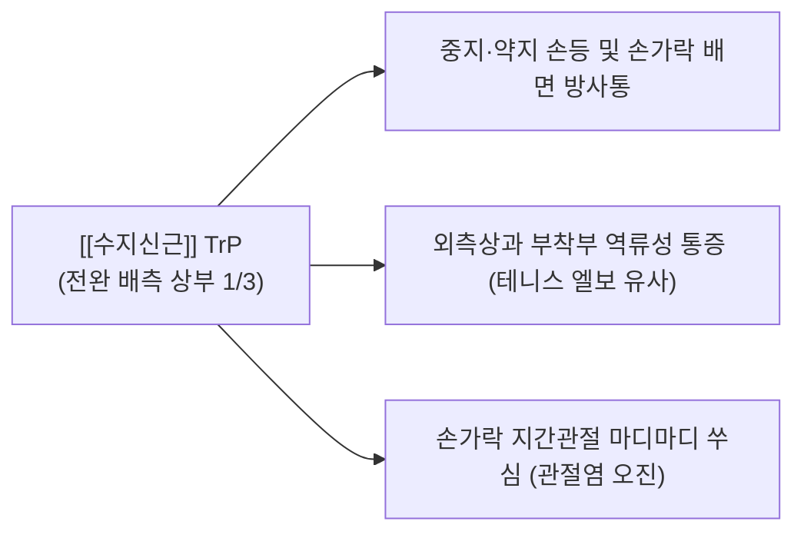

# [[수지신근]](Extensor Digitorum, ED)

> **핵심 요약 (Key Summary)**:
> [[상완골]] 외측상과 총신근건에서 기원하여 제2~5지 중위지골 및 원위지골 배면 지신근건막에 정지하는 전완 배측의 주동 수지 신전근입니다.
> [[후골간신경]](PIN, C7-C8, [[요골신경]] 심부 분지)의 지배를 받으며, 제2~5지 중수지관절(MCP)의 신전을 주도하고 건간결합(Juncturae tendinum)을 통해 손가락 간 장력을 공유합니다.
> [[외측상과염]](테니스 엘보 유사 통증), 손가락 신전 장애, 키보드/마우스 과사용 손등통의 핵심 표적근이며, 전완 배측 중심선 침구 및 건간결합 이완이 표적입니다.

---
## 📌 목차
1. [해부학적 정밀 구조 및 지배 신경/혈관](#1-해부학적-정밀-구조-및-지배-신경혈관)
2. [생체역학·토크 분석 & 근막 사슬 (Biomechanical Synergy)](#2-생체역학토크-분석--근막-사슬-biomechanical-synergy)
3. [근막통증증후군(TP) & 연관통 패턴 (Travell & Simons)](#3-근막통증증후군tp--연관통-패턴-travell--simons)
4. [초음파 해부학(Sonoanatomy) 및 중재 시술 랜드마크](#4-초음파-해부학sonoanatomy-및-중재-시술-랜드마크)
5. [⭐ 원장님 심층 임상 고찰 및 원본 필기 (Clinical Pearls)](#5-원장님-심층-임상-고찰-및-원본-필기-clinical-pearls)
6. [관련 임상 질환 및 운동손상 증후군 총괄](#6-관련-임상-질환-및-운동손상-증후군-총괄)
7. [추나·도수치료(MET/PIR) & 침구·약침·재활 프로토콜](#7-추나도수치료metpir--침구약침재활-프로토콜)
8. [출처 및 학술 참고 문헌 (References)](#8-출처-및-학술-참고-문헌-references)

---
## 1. 해부학적 정밀 구조 및 지배 신경/혈관

| 항목 | 상세 내용 |
| :--- | :--- |
| **기시 (Origin)** | [[상완골]](Humerus) 외측상과(Lateral epicondyle) 총신근건(CET), 인접 근간중격 및 전완 근막 |
| **정지 (Insertion)** | 제2~5지 중위지골 및 원위지골 배면 지신근건막(Extensor expansion) • 각 손가락 기저부에서 중앙건(Central slip)은 중위지골, 2개 측부건(Lateral bands)은 원위지골에 부착 |
| **신경 지배** | [[후골간신경]](Posterior interosseous nerve, PIN, C7, C8 - [[요골신경]] 심부 분지) |
| **혈관 공급** | 후골간동맥(Posterior interosseous artery) 및 요골회귀동맥 분지 |
| **해부학적 특이성** | 손목 신근지대 제4구획을 [[검지신근]]과 함께 통과하며, 손등에서 건간결합(Juncturae tendinum)으로 상호 결합 |

---
## 2. 생체역학·토크 분석 & 근막 사슬 (Biomechanical Synergy)

### (1) 제2~5지 MCP(중수지관절) 신전의 주동 엔진
* 중수지관절을 0도 이상으로 강력하게 젖히는(Hyperextension) 일차 주동근입니다.
* 지간관절(PIP, DIP)의 완전 신전은 수지신근 단독으로는 어려우며, 수내근인 [[충양근(손)|충양근]] 및 [[골간근]]과의 정밀한 협력이 필수적입니다.

### (2) 건간결합(Juncturae Tendinum)의 역학적 구속
* 손등 부위에서 인접한 신근건들 사이에 비스듬한 섬유성 연결 띠(건간결합)가 존재하여, 한 손가락(특히 제4지 약지)을 완전히 펼 때 인접 손가락이 함께 들리는 상호 구속 현상이 나타납니다.

### (3) 근막 사슬 연계 (Anatomy Trains)
* **표재후방상지선(Superficial Back Arm Line)**의 핵심 추진체로, 상완골 외측상과 → 수지신근 → 손등 지신근건막 → 손가락 끝마디로 연결됩니다.

---
## 3. 근막통증증후군(TP) & 연관통 패턴 (Travell & Simons)

* **발통점 형성 위치 (Trigger Point Location)**:
  * 전완 배측 중앙 상부 1/3, 외측상과 하방 4~8cm 지점의 건속 근복 내에 각각 독립된 발통점 형성.
* **연관통 방사 패턴 (Referred Pain Pattern)**:
  * **손등 및 손가락 배면 방사통**: 주로 제3지(중지)와 제4지(약지)의 손등과 손가락 끝까지 찌릿하고 쑤시는 통증 투사.
  * **외측상과 방사통**: 기시부로 역류하여 [[외측상과염|테니스 엘보]]와 구별이 어려운 팔꿈치 외측 통증 유발.
  * **악화 요인**: 장시간 키보드 타이핑, 피아노 연주, 물건을 쥐고 손가락을 펴는 동작 시 통증 급증.

---
## 4. 초음파 해부학(Sonoanatomy) 및 중재 시술 랜드마크

* **전완 배측 횡단 스캔 (Posterior Forearm Transverse View)**:
  * 요골과 척골 사이 골간막 상방 천층에 넓게 펼쳐진 4개 다발의 저에코 근육층인 [[수지신근]]을 확인합니다.
* **신근지대 제4구획 종단 스캔**:
  * 손목 배측 중앙에서 4개의 ED 건과 1개의 EI 건을 둘러싼 활액초의 비후 및 삼출액 여부를 관찰합니다.
* **침도 및 약침 안전 마진**:
  * 근복 심층에 주행하는 후골간신경(PIN)과 후골간동맥의 위치를 초음파로 확인 후, 근복 내에 안전하게 사자로 자침합니다.

---
## 5. ⭐ 원장님 심층 임상 고찰 및 원본 필기 (Clinical Pearls)

### (1) 테니스 엘보(외측상과염)와 수지신근의 동반 병변
* **임상 팩트**: 테니스 엘보 환자를 진찰할 때 [[단요측수근신근]](ECRB)만 검사해서는 안 되며, 환자에게 **손목은 중립으로 둔 채 손가락(특히 제3지, 제4지)만 강하게 펴게 하고 저항**을 주었을 때 외측상과에 통증이 재현되는지 확인해야 합니다.
* 외측상과염 환자의 약 30~40%에서 수지신근 기시부 병변이 동반되어 있으므로, 전완 배측 중앙의 수지신근 근복 치료를 병행해야 외측상과염이 재발하지 않습니다.

### (2) 약지(제4지)의 독립 신전 제한과 건간결합(Juncturae Tendinum)
* **임상 팩트**: 환자가 "넷째 손가락만 따로 펴려고 하면 잘 안 펴지고 손등이 당긴다"고 호소할 때, 이는 병적인 마비가 아니라 제3지와 제5지 건으로 연결된 해부학적 건간결합(Juncturae tendinum) 때문입니다.
* 그러나 건간결합 부위에 만성 염증이나 유착이 생기면 타이핑 시 손등 중앙에 뻐근한 결림이 지속되므로, 손등 중수골 사이 공간의 도침 이완이 효과적입니다.

### (3) 손가락 관절염으로 오진되는 수지신근 발통점
* 손가락 지간관절(PIP, DIP) 마디마디가 쑤시고 아파서 류마티스나 퇴행성 관절염으로 오진받는 환자 중 다수가 전완 상부 수지신근의 발통점에서 기인한 연관통입니다.

---
## 6. 관련 임상 질환 및 운동손상 증후군 총괄

| 임상 질환 / 증후군 | 병리적 연관 기전 | 주요 증상 및 이학적 검사 | 핵심 교정 타깃 |
| :--- | :--- | :--- | :--- |
| 수지신근 근막통증증후군 | 키보드/마우스 과사용에 의한 근복 TrP 활성화 | 손등 뻐근함, 중지·약지 방사통 | 전완 배측 ED 근복 침도 이완 |
| 신근지대 제4구획 건초염 | 제4구획 활액초 내 마찰 및 건 비후 | 손목 배측 중앙 종창, 굴신 시 마찰음 | 제4구획 신근지대 도침 감압 |
| 건간결합 증후군 | 손등 건간결합 부위 만성 견인 및 섬유화 | 제3·4중수골 사이 손등 찌릿함 | 중수골 간 건간결합 박리 |
| 손가락 신전 지연 및 강직 | 건의 활주 장애 및 근막 단축 | 아침에 손가락 펴기 뻣뻣함 | ED 건 활주 운동 및 온열 요법 |

---
## 7. 추나·도수치료(MET/PIR) & 침구·약침·재활 프로토콜

### (1) 한의학 경혈 매핑 & 자침법
* **경혈 매핑**: 수삼리(手三里, LI10) 후방 1촌, 지구(支溝, TE6), 사독(四瀆, TE9), 양지(陽池, TE4)
* **자침 기법**:
  * 사독혈과 지구혈 부근 수지신근의 가장 두터운 결절점에 침을 척골/요골 골간막 방향으로 30mm 사자 진입하여 경결을 해소합니다.
  * 손목 배측 제4구획 건초염에는 소염약침 0.1cc를 건초 주변에 정밀 주입합니다.

### (2) 수지신근 MET 및 건 활주 운동
* 팔꿈치를 완전 신전시키고 손목과 모든 손가락 관절(MCP, PIP, DIP)을 최대로 굴곡시켜 수지신근을 신장합니다.
* 환자에게 손가락들을 펴는 방향으로 20% 힘을 주도록 유도(등척성 저항 7초)한 뒤, 호기 시 추가 굴곡 신장합니다.

---
## 8. 출처 및 학술 참고 문헌 (References)

1. **Simons, D. G., & Travell, J. G. (1999)**. *Myofascial Pain and Dysfunction: The Trigger Point Manual*, Vol. 1 (2nd ed.). Williams & Wilkins.
   - **[연구 요약]**: 수지신근 발통점이 중지·약지 배면 및 손등으로 방사하는 연관통 지도 제시.
2. **von Schroeder, H. P. et al. (1995)**. *J Hand Surg Am*, 20(1), 27-34.
   - *Anatomy of the extensor tendons of the fingers: variations and multiplicity*. [PMID: 7722260](https://pubmed.ncbi.nlm.nih.gov/7722260/)
   - **[연구 요약]**: 지신근건막과 건간결합의 해부학적 변이 및 손상 시 외과적 재건 지침 제시.
3. **Standring, S. (2020)**. *Gray's Anatomy: The Anatomical Basis of Clinical Practice* (42nd ed.). Elsevier.
   - **[해부학 총론]**: 수지신근의 건간결합(Juncturae tendinum) 형태학적 분류 및 손가락 독립 신전 분석.
