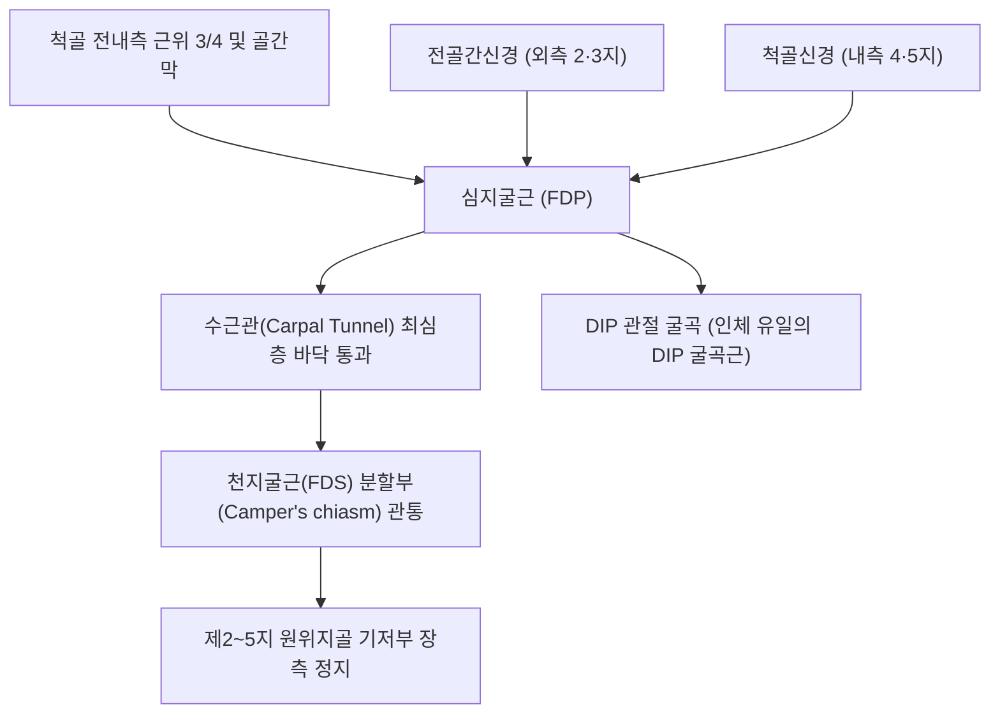
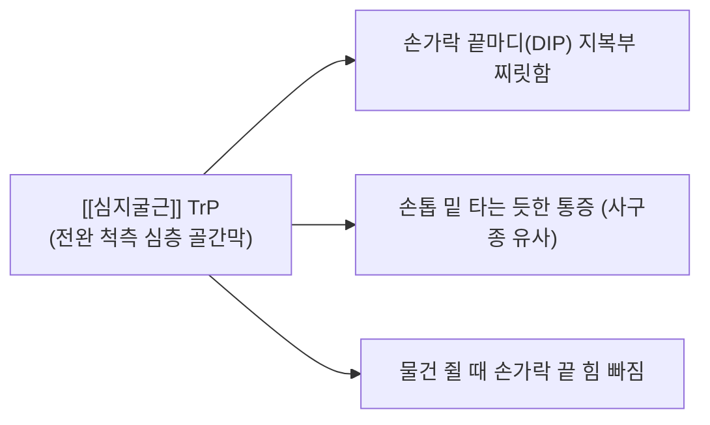

# [[심지굴근]](Flexor Digitorum Profundus, FDP)

> **핵심 요약 (Key Summary)**:
> [[척골]] 전내측 근위 3/4 및 골간막에서 기원하여 제2~5지 원위지골(끝마디뼈) 기저부 장측면에 정지하는 전완 최심층의 파워 수지 굴곡근입니다.
> 외측 2·3지는 [[정중신경]] 분지인 [[전골간신경]](AIN, C8-T1), 내측 4·5지는 [[척골신경]](C8-T1)의 **이중 신경 지배**를 받으며, DIP 관절을 굴곡시키는 인체 유일의 엔진입니다.
> [[전골간신경]] 증후군(검지 DIP 굴곡 불능, OK sign 붕괴), 척골신경 마비(갈퀴손 변형), 악력 상실의 핵심 표적근이며, 전완 심층 침구 및 수근관 감압이 표적입니다.

---
## 📌 목차
1. [해부학적 정밀 구조 및 지배 신경/혈관](#1-해부학적-정밀-구조-및-지배-신경혈관)
2. [생체역학·토크 분석 & 근막 사슬 (Biomechanical Synergy)](#2-생체역학토크-분석--근막-사슬-biomechanical-synergy)
3. [근막통증증후군(TP) & 연관통 패턴 (Travell & Simons)](#3-근막통증증후군tp--연관통-패턴-travell--simons)
4. [초음파 해부학(Sonoanatomy) 및 중재 시술 랜드마크](#4-초음파-해부학sonoanatomy-및-중재-시술-랜드마크)
5. [⭐ 원장님 심층 임상 고찰 및 원본 필기 (Clinical Pearls)](#5-원장님-심층-임상-고찰-및-원본-필기-clinical-pearls)
6. [관련 임상 질환 및 운동손상 증후군 총괄](#6-관련-임상-질환-및-운동손상-증후군-총괄)
7. [추나·도수치료(MET/PIR) & 침구·약침·재활 프로토콜](#7-추나도수치료metpir--침구약침재활-프로토콜)
8. [출처 및 학술 참고 문헌 (References)](#8-출처-및-학술-참고-문헌-references)

---
## 1. 해부학적 정밀 구조 및 지배 신경/혈관

| 항목 | 상세 내용 |
| :--- | :--- |
| **기시 (Origin)** | [[척골]](Ulna) 전내측 근위 3/4면 및 전완 골간막(Interosseous membrane), 주두 내측 골막 |
| **정지 (Insertion)** | 제2~5지 원위지골(Distal phalanx) 기저부 장측면 • [[천지굴근]](FDS) 건의 분할부(Camper's chiasm)를 관통하여 최종 부착 |
| **신경 지배** | **이중 신경 지배 (Dual Innervation)**: • **외측부 (제2, 3지)**: [[전골간신경]](AIN, C8, T1 - [[정중신경]] 심부 분지) • **내측부 (제4, 5지)**: [[척골신경]](Ulnar nerve, C8, T1) |
| **혈관 공급** | 전골간동맥(Anterior interosseous artery) 및 척골동맥 분지 |
| **해부학적 특이성** | 수근관 최심층 바닥을 주행하며, 4개 건 측면에서 4개의 [[충양근(손)|충양근]](Lumbricals)이 직접 기원 |

---
## 2. 생체역학·토크 분석 & 근막 사슬 (Biomechanical Synergy)

### (1) 제2~5지 DIP(원위지간관절) 굴곡의 유일한 엔진 (Only DIP Flexor)
* 인체에서 손가락 끝마디(DIP)를 능동적으로 구부릴 수 있는 유일무이한 근육입니다.
* DIP 관절뿐 아니라 PIP, MCP 관절 및 손목 관절 굴곡까지 연속적으로 연계되는 총체적 파지 토크를 발휘합니다.

### (2) 강력한 파지력(Power Grip)과 정밀 핀치(Pinch Grip)의 최종 잠금
* 손잡이나 도구를 꽉 쥘 때 손가락 끝마디를 말아 쥐는 최종 잠금력(Locking force)을 완성합니다.
* 건 측면에서 [[충양근(손)|충양근]]이 시작하여 배측 지신근건막으로 이어지므로 손가락 관절 간 굴곡-신전 조율의 중심축 역할을 합니다.

### (3) 근막 사슬 연계 (Anatomy Trains)
* **심층전방상지선(Deep Front Arm Line)**의 최원위 실행체로, 손가락 끝마디 골막까지 연결되어 상지의 최심층 인장력을 담당합니다.

---
## 3. 근막통증증후군(TP) & 연관통 패턴 (Travell & Simons)

* **발통점 형성 위치 (Trigger Point Location)**:
  * 전완 척측 심층, 주두 하방 5~10cm 지점의 척골 전면 골간막 부근 근복에 형성.
* **연관통 방사 패턴 (Referred Pain Pattern)**:
  * **손가락 끝마디(DIP) 찌릿함**: 해당 건이 향하는 손가락 끝마디 지복부로 번개가 치듯 찌릿하고 화끈거리는 방사통 투사.
  * **손톱 밑 통증**: 손톱 아래가 쑤시고 조이는 듯한 통증 유발.
  * **악력 저하**: 컵을 쥐거나 문고리를 돌릴 때 손가락 끝에 힘이 들어가지 않아 물건을 떨어뜨림.

---
## 4. 초음파 해부학(Sonoanatomy) 및 중재 시술 랜드마크

* **전완 원위 1/3 횡단 스캔 (Distal Forearm Transverse View)**:
  * 요골과 척골 피질 사이 골간막 바로 위에 밀착된 최심층 근육층으로 [[심지굴근]]이 관찰되며, 그 위에 [[천지굴근]](FDS) 층이 덮여 있습니다.
* **전골간신경(AIN) 및 척골신경과의 관계**:
  * FDP 근복 외측 표면에서 전골간동맥과 함께 주행하는 [[전골간신경]]을 식별하고, 내측 척골 가장자리에서 [[척골신경]]을 동시 확인합니다.
* **침도 및 약침 안전 마진**:
  * 정중신경과 척골신경-혈관 다발을 회피하여, 척골 내측연을 따라 피하에서 척골 골막을 스치듯 사자로 진입하는 경로가 가장 안전합니다.

---
## 5. ⭐ 원장님 심층 임상 고찰 및 원본 필기 (Clinical Pearls)

### (1) DIP 기능 분리 검사 및 신경 마비 감별의 황금률
* **임상 팩트**: DIP 관절 굴곡은 오직 심지굴근(FDP)만이 수행하므로, 신경 손상 위치를 완벽히 감별할 수 있습니다:
  * **검사법**: 환자의 PIP 관절을 신전 상태로 단단히 고정한 채, 손가락 끝마디(DIP)만 구부리도록 지시합니다.
  * **AIN(정중신경) 마비 시**: **검지(제2지) DIP 관절 굴곡 불능** → 엄지와 검지 끝마디를 동그랗게 모으지 못하고 지복부로 납작하게 맞닿는 **Pinch Sign(OK sign 붕괴)** 양성.
  * **척골신경 마비 시**: **제4, 5지 DIP 관절 굴곡 불능 및 충양근 마비** → MCP 신전 + IP 굴곡의 기형적 변형인 **Claw Hand(갈퀴손 변형)** 발현.

### (2) 암벽등반가 및 악기 연주자의 'A2/A4 활차 파열'과 FDP 건 탈선
* 클라이밍(크림프 그립)이나 현악기 연주 시 과도한 부하로 인해 수지 섬유초의 A2, A4 활차가 파열되면, FDP 건이 뼈에서 활처럼 활시위처럼 튀어나오는 활줄 현상(Bowstringing)이 발생합니다.
* 이 경우 단순 근육통으로 오인하여 강한 침도를 적용하면 안 되며, 초음파로 활차 파열을 확인하고 안정 고정을 시행해야 합니다.

### (3) 심지굴근 발통점과 손톱 밑 통증(사구종 오진 감별)
* 손톱 밑이 바늘로 찌르듯 아파서 사구체종양(Glomus tumor)으로 의심받는 환자 중 상당수가 전완 척골 심층의 FDP 근복 발통점에서 기인한 연관통입니다. FDP 발통점 압박 시 동일한 손톱 밑 찌릿함이 재현되는지 확인하십시오.

---
## 6. 관련 임상 질환 및 운동손상 증후군 총괄

| 임상 질환 / 증후군 | 병리적 연관 기전 | 주요 증상 및 이학적 검사 | 핵심 교정 타깃 |
| :--- | :--- | :--- | :--- |
| [[전골간신경]] 증후군 | AIN 포착에 의한 검지 FDP 마비 | 검지 DIP 굴곡 불가, OK 사인 소실 | 전골간신경 주행로 침도 박리 |
| 척골신경 포착성 마비 | 척골신경 압박으로 4·5지 FDP 마비 | Claw Hand, 4·5지 끝마디 굴곡 불능 | 주관절 터널 및 척골관 감압 |
| Jersey Finger(FDP 건 파열) | 저항에 대항한 급격한 손가락 신전 손상 | DIP 능동 굴곡 완전 소실, 건 수축 | 즉각적 정형외과 수술 의뢰 |
| 손가락 끝마디 방사통 증후군 | FDP 심층 발통점에 의한 원위 방사통 | 손톱 밑 통증, DIP 관절 조임 | FDP 척골 골막 부착부 도침 이완 |

---
## 7. 추나·도수치료(MET/PIR) & 침구·약침·재활 프로토콜

### (1) 한의학 경혈 매핑 & 자침법
* **경혈 매핑**: 극문(郄門, PC4) 심부, 소해(小海, SI8) 하방 3~4촌, 대릉(大陵, PC7)
* **자침 기법**:
  * 척골 내측연에서 척골 골막을 가이드로 삼아 소침도를 20도 사자로 진입, FDP 심층 건막의 유착을 골막에서 분리합니다.
  * 신경병증 회복을 위해 중성어혈약침 또는 자하거약침 0.3cc를 척골신경 및 AIN 주행부에 분할 주입합니다.

### (2) DIP 단독 신장 스트레칭
* 환자의 PIP 관절을 살짝 구부린 상태에서 시술자가 손가락 끝마디(DIP)만을 부드럽게 완전 신전시켜 FDP의 가장 원위부 섬유를 집중 스트레칭합니다.

---
## 8. 출처 및 학술 참고 문헌 (References)

1. **Simons, D. G., & Travell, J. G. (1999)**. *Myofascial Pain and Dysfunction: The Trigger Point Manual*, Vol. 1 (2nd ed.). Williams & Wilkins.
   - **[연구 요약]**: 심지굴근 발통점이 손바닥 및 손가락 끝마디 장측으로 방사하는 연관통 지도 제시.
2. **Leddy, J. P. et al. (1977)**. *J Hand Surg Am*, 2(1), 66-69.
   - *Avulsion of the profundus tendon insertion in athletes*. [PMID: 839056](https://pubmed.ncbi.nlm.nih.gov/839056/)
   - **[연구 요약]**: 운동 손상에서 심지굴근 건 박리 파열(Jersey finger)의 분류 및 임상 진단 기준 제시.
3. **Standring, S. (2020)**. *Gray's Anatomy: The Anatomical Basis of Clinical Practice* (42nd ed.). Elsevier.
   - **[해부학 총론]**: 심지굴근의 이중 신경 지배(AIN/Ulnar) 패턴 및 충양근 기시부 해부학 분석.
