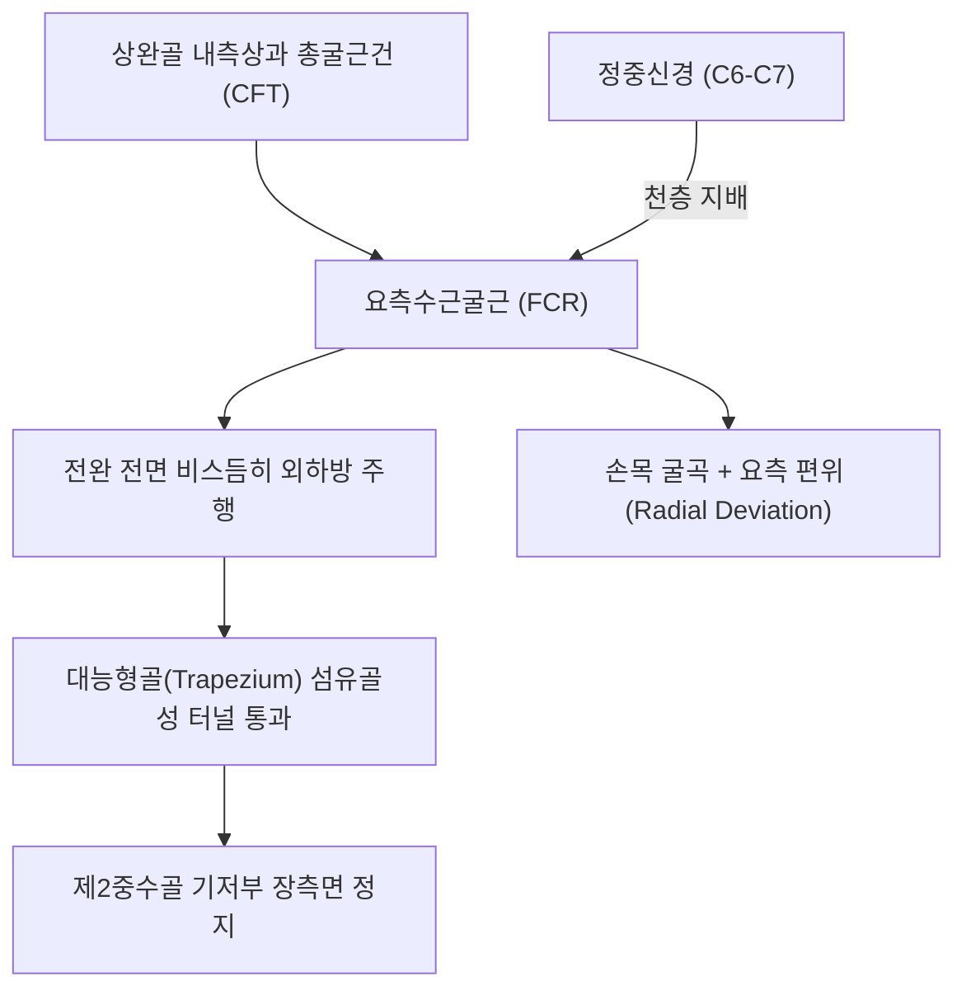
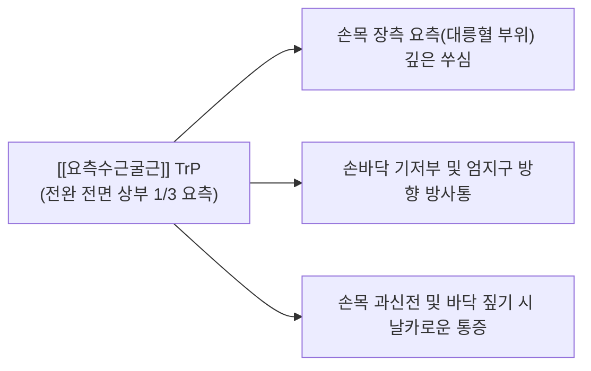

# [[요측수근굴근]](Flexor Carpi Radialis, FCR)

> **핵심 요약 (Key Summary)**:
> [[상완골]] 내측상과 총굴근건(CFT)에서 기시하여 제2중수골(및 제3중수골) 기저부 장측면에 정지하는 전완 전면 천층의 핵심 수근 굴곡근입니다.
> [[정중신경]](C6-C7)의 지배를 받으며, 손목 굴곡(Flexion) 및 요측 편위(Radial deviation)를 주도하고 [[내측상과염]](골퍼스 엘보)의 주동 발병근 중 하나입니다.
> FCR 건초염, STT(주상수근관절) 관절염 충돌, 수근관 외측 압박의 핵심 표적근이며, 대릉혈 외측 정밀 침구 및 전완 굴근막 이완이 표적입니다.

---
## 📌 목차
1. [해부학적 정밀 구조 및 지배 신경/혈관](#1-해부학적-정밀-구조-및-지배-신경혈관)
2. [생체역학·토크 분석 & 근막 사슬 (Biomechanical Synergy)](#2-생체역학토크-분석--근막-사슬-biomechanical-synergy)
3. [근막통증증후군(TP) & 연관통 패턴 (Travell & Simons)](#3-근막통증증후군tp--연관통-패턴-travell--simons)
4. [초음파 해부학(Sonoanatomy) 및 중재 시술 랜드마크](#4-초음파-해부학sonoanatomy-및-중재-시술-랜드마크)
5. [⭐ 원장님 심층 임상 고찰 및 원본 필기 (Clinical Pearls)](#5-원장님-심층-임상-고찰-및-원본-필기-clinical-pearls)
6. [관련 임상 질환 및 운동손상 증후군 총괄](#6-관련-임상-질환-및-운동손상-증후군-총괄)
7. [추나·도수치료(MET/PIR) & 침구·약침·재활 프로토콜](#7-추나도수치료metpir--침구약침재활-프로토콜)
8. [출처 및 학술 참고 문헌 (References)](#8-출처-및-학술-참고-문헌-references)

---
## 1. 해부학적 정밀 구조 및 지배 신경/혈관

| 항목 | 상세 내용 |
| :--- | :--- |
| **기시 (Origin)** | [[상완골]](Humerus) 내측상과(Medial epicondyle) 총굴근건(Common flexor tendon, CFT) 및 전완 근막 |
| **정지 (Insertion)** | 제2중수골(Second metacarpal) 기저부 장측면 (일부 섬유는 제3중수골 기저부 부착) |
| **신경 지배** | [[정중신경]](Median nerve, C6, C7) |
| **혈관 공급** | [[요골동맥]](Radial artery) 및 척골회귀동맥 분지 |
| **해부학적 특이성** | 수근관 내부로 들어가지 않고 대능형골(Trapezium) 고랑 속 독자적인 섬유골성 터널을 통과 |

---
## 2. 생체역학·토크 분석 & 근막 사슬 (Biomechanical Synergy)

### (1) 손목 굴곡 및 요측 편위 복합 토크
* 손목을 안쪽으로 구부리고(Flexion), 엄지손가락 쪽으로 비트는(Radial deviation) 강력한 복합 벡터를 형성합니다.
* [[척측수근굴근]](FCU)과 함께 작용할 때는 순수한 손목 굴곡을 완성하고, [[단요측수근신근]](ECRB) 및 [[장요측수근신근]](ECRL)과 함께 작용할 때는 순수한 요측 편위를 발생시킵니다.

### (2) 대능형골 활차(Pulley) 역학 및 마찰 취약성
* 손목 전면에서 대능형골의 깊은 고랑 속을 통과할 때 두터운 섬유초에 싸여 활차 운동을 하므로, 손목의 반복적인 과신전 시 대능형골 결절과의 기계적 마찰이 집중됩니다.

### (3) 근막 사슬 연계 (Anatomy Trains)
* **표재전방상지선(Superficial Front Arm Line)**의 핵심 주행로로, 상완골 내측상과 → FCR → 수근부 → 제2중수골로 이어지는 전방 인장력을 제공합니다.

---
## 3. 근막통증증후군(TP) & 연관통 패턴 (Travell & Simons)

* **발통점 형성 위치 (Trigger Point Location)**:
  * 상완골 내측상과 하방 4~7cm, 전완 전면 상부 1/3의 FCR 근복 내에 형성.
* **연관통 방사 패턴 (Referred Pain Pattern)**:
  * **손목 요측 장측부 통증**: 손목 주름 엄지 쪽(대릉혈~태연혈 사이)으로 깊고 뻐근한 연관통 투사.
  * **손바닥 기저부 방사통**: 수근부 중심을 지나 엄지구(Thenar eminence) 기저부로 쑤심 방사.
  * **악화 요인**: 바닥을 손바닥으로 짚고 일어나기, 골프 스윙, 무거운 쟁반 받치기 동작.

---
## 4. 초음파 해부학(Sonoanatomy) 및 중재 시술 랜드마크

* **손목 원위 장측 횡단 스캔 (Distal Volar Wrist View)**:
  * 손목 주름 상방에서 [[요골동맥]] 바로 내측에 위치한 타원형의 고에코 FCR 건 단면을 확인합니다.
  * FCR 건 바로 척측 심층에 위치한 [[정중신경]]의 위치를 명확히 대조 식별합니다.
* **대능형골 터널 종단 스캔**:
  * FCR 건이 대능형골 고랑을 통과하는 부위에서 건초 비후, 삼출액, 건 내부 저에코 건병증을 확인합니다.
* **침도 및 약침 안전 마진**:
  * 척측의 정중신경과 요측의 요골동맥 다발을 컬러 도플러로 식별한 후, FCR 건초 내로 평행 진입하여 안전하게 감압합니다.

---
## 5. ⭐ 원장님 심층 임상 고찰 및 원본 필기 (Clinical Pearls)

### (1) FCR 건초염(FCR Tenosynovitis)과 STT 관절염의 충돌
* **임상 팩트**: 환자가 "손목 앞쪽 엄지 밑이 쑤시고 손목을 뒤로 젖히거나 바닥을 짚을 때 찌릿하다"고 호소할 때 [[드퀘르뱅 증후군|드퀘르벵 증후군]]이나 [[수근관 증후군]]으로 오진하기 쉽습니다.
* 실제로는 FCR 건이 주상골(Scaphoid), 대능형골(Trapezium), 소능형골(Trapezoid)이 만나는 STT 관절 바로 위 좁은 골성 터널을 지나기 때문에, STT 관절염으로 인한 골극이 FCR 건을 톱날처럼 마찰시켜 발생하는 건초염인 경우가 많습니다.

### (2) 손목 주사/침도 시술의 절대 랜드마크
* 손목 주름 부위에서 FCR 건은 [[요골동맥]]과 [[정중신경]] 사이에 위치하는 가장 뚜렷한 촉진 기준점입니다.
* 정중신경 손상을 방지하기 위해 침도나 약침 시술 시 FCR 건의 주행을 확인하고 건의 외측 마진을 따라 안전하게 접근해야 합니다.

### (3) 내측상과염(골퍼스 엘보)과의 동반 병변
* [[내측상과염]] 환자에서 [[원회내근]]뿐 아니라 FCR 기시부 건병증이 동반되는 경우가 흔하므로, 전완을 회내시키며 손목을 굴곡할 때 내측상과에 통증이 재현되는지 평가해야 합니다.

---
## 6. 관련 임상 질환 및 운동손상 증후군 총괄

| 임상 질환 / 증후군 | 병리적 연관 기전 | 주요 증상 및 이학적 검사 | 핵심 교정 타깃 |
| :--- | :--- | :--- | :--- |
| FCR 건초염 | 대능형골 터널 내 마찰 및 건초 비후 | 바닥 짚기 통증, FCR 건 주행부 압통 | FCR 건초 소침도 감압술 |
| [[내측상과염]](골퍼스 엘보) | FCR 기시부 총굴근건 퇴행성 건병증 | 손목 저항 굴곡 시 내측상과 통증 | 기시부 골막 침도 박리 |
| STT 관절염 충돌 증후군 | STT 관절 골극에 의한 FCR 건 마모 | 엄지 기저부 심부 둔통, 악력 저하 | STT 관절 소염약침 + 테이핑 |
| 손목 굴곡 구축 | 전완 굴근군 만성 단축 | 손목 완전 배굴 제한 및 당김 | FCR 원심성 스트레칭 |

---
## 7. 추나·도수치료(MET/PIR) & 침구·약침·재활 프로토콜

### (1) 한의학 경혈 매핑 & 자침법
* **경혈 매핑**: 공손(孔孫) 상방 극문(郄門, PC4) 요측, 대릉(大陵, PC7) 외측 0.5촌, 열결(列缺, LU7) 내측
* **자침 기법**:
  * 전완 상부 FCR 근복 TrP에 호침을 30mm 직자하여 근막 연축을 해소합니다.
  * 손목 대릉혈 외측 FCR 건초 부착부에는 [[황련해독탕]] 약침 0.1cc를 건초 주위에 정밀 주입합니다.

### (2) FCR 근에너지기법 (MET)
* 주관절을 신전시킨 상태에서 손목을 완전 신전 및 척측 편위시켜 FCR을 최대로 신장 장벽에 위치시킵니다.
* 환자에게 "20% 힘으로 손목을 구부리며 엄지 쪽으로 젖히세요(굴곡+요측편위 저항)"라고 지시하며 5~7초간 등척성 수축 후 호기 시 추가 신장합니다.

---
## 8. 출처 및 학술 참고 문헌 (References)

1. **Simons, D. G., & Travell, J. G. (1999)**. *Myofascial Pain and Dysfunction: The Trigger Point Manual*, Vol. 1 (2nd ed.). Williams & Wilkins.
   - **[연구 요약]**: 요측수근굴근 발통점이 손목 전면 요측 및 손바닥으로 방사하는 연관통 패턴 규명.
2. **Gabel, G. T. et al. (1995)**. *J Bone Joint Surg Am*, 77(1), 106-112.
   - *Operative treatment of medial epicondylitis. Influence of concomitant ulnar neuropathy at the elbow*. [PMID: 7822340](https://pubmed.ncbi.nlm.nih.gov/7822340/)
   - **[연구 요약]**: 내측상과염 환자에서 요측수근굴근 및 원회내근 기시부 병변의 외과적 치료 결과 분석.
3. **Standring, S. (2020)**. *Gray's Anatomy: The Anatomical Basis of Clinical Practice* (42nd ed.). Elsevier.
   - **[해부학 총론]**: 요측수근굴근의 대능형골 섬유골성 터널 주행 및 정중신경과의 해부학적 관계.
