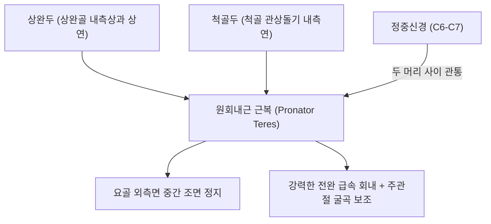
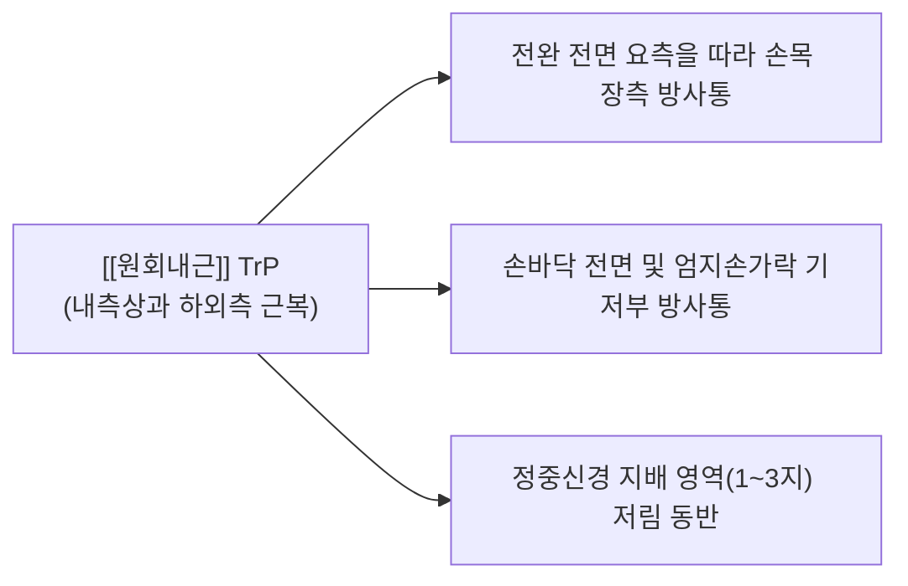

# [[원회내근]](Pronator Teres, PT)

> **핵심 요약 (Key Summary)**:
> [[상완골]] 내측상과(상완두) 및 [[척골]] 관상돌기(척골두)에서 기시하여 [[요골]] 외측면 중간부에 정지하는 전완 전상부의 강력한 파워 회내근입니다.
> 근복 두 머리 사이를 관통하는 [[정중신경]](C6-C7)의 지배를 받으며, 빠른 전완 회내(Pronation) 및 주관절 굴곡을 주도합니다.
> **원회내근 증후군(Pronator teres syndrome)**의 발생 진원지이자 [[내측상과염]](골퍼스 엘보) 동반근이며, 곡택혈 외하방 침도 박리 및 회외 스트레칭이 표적입니다.

---
## 📌 목차
1. [해부학적 정밀 구조 및 지배 신경/혈관](#1-해부학적-정밀-구조-및-지배-신경혈관)
2. [생체역학·토크 분석 & 근막 사슬 (Biomechanical Synergy)](#2-생체역학토크-분석--근막-사슬-biomechanical-synergy)
3. [근막통증증후군(TP) & 연관통 패턴 (Travell & Simons)](#3-근막통증증후군tp--연관통-패턴-travell--simons)
4. [초음파 해부학(Sonoanatomy) 및 중재 시술 랜드마크](#4-초음파-해부학sonoanatomy-및-중재-시술-랜드마크)
5. [⭐ 원장님 심층 임상 고찰 및 원본 필기 (Clinical Pearls)](#5-원장님-심층-임상-고찰-및-원본-필기-clinical-pearls)
6. [관련 임상 질환 및 운동손상 증후군 총괄](#6-관련-임상-질환-및-운동손상-증후군-총괄)
7. [추나·도수치료(MET/PIR) & 침구·약침·재활 프로토콜](#7-추나도수치료metpir--침구약침재활-프로토콜)
8. [출처 및 학술 참고 문헌 (References)](#8-출처-및-학술-참고-문헌-references)

---
## 1. 해부학적 정밀 구조 및 지배 신경/혈관

| 항목 | 상세 내용 |
| :--- | :--- |
| **기시 (Origin)** | • **상완두(Humeral head)**: [[상완골]](Humerus) 내측상과(Medial epicondyle) 총굴근건(CFT) 상연 • **척골두(Ulnar head)**: [[척골]](Ulna) 관상돌기(Coronoid process) 내측연 |
| **정지 (Insertion)** | [[요골]](Radius) 체부 외측면 중간 1/3 (원회내근 조면, Pronator tuberosity) |
| **신경 지배** | [[정중신경]](Median nerve, C6, C7) - **두 두(상완두-척골두) 사이를 직접 관통** |
| **혈관 공급** | 척골동맥(Ulnar artery), 전골간동맥 및 요골회귀동맥 분지 |
| **해부학적 특이성** | 정중신경이 두 근육 머리 사이를 지나고, 척골동맥은 척골두 심면으로 통과하여 교차 |

---
## 2. 생체역학·토크 분석 & 근막 사슬 (Biomechanical Synergy)

### (1) 전완 급속 회내 및 파워 토크 (Power Pronation)
* [[방형회내근]]이 일상적 회내의 기저 안정자라면, 원회내근은 **빠른 회전 속도나 강한 회내 저항**이 요구될 때 강력한 토크를 뿜어내는 가속 엔진입니다 (드라이버 조이기, 야구공 스크루볼 투구).
* 주관절 굴곡 각도가 90도 부근일 때 가장 효율적인 모멘트 암을 발휘합니다.

### (2) 정중신경의 역학적 포착 취약성
* 상완두와 척골두 사이를 연결하는 섬유성 아치(Fibrous band)가 만성 과사용으로 비후되면, 근육 수축 시 정중신경을 집게처럼 압박하여 **원회내근 증후군**을 유발합니다.

### (3) 근막 사슬 연계 (Anatomy Trains)
* **심층전방상지선(Deep Front Arm Line)** 및 **표재전방상지선**의 교차 관문으로, 내측상과에서 요골 체부 중앙을 잇는 대각선 회전 체인을 형성합니다.

---
## 3. 근막통증증후군(TP) & 연관통 패턴 (Travell & Simons)

* **발통점 형성 위치 (Trigger Point Location)**:
  * 상완골 내측상과 하외측 2~4cm, 전완 상부 사선 주행로의 근복 중앙부.
* **연관통 방사 패턴 (Referred Pain Pattern)**:
  * **전완 요측 및 손목 장측 통증**: 전완 앞쪽 요측을 타고 내려가 손목 주름부까지 뻐근한 연관통 투사.
  * **손바닥 및 손가락 방사통**: 손바닥 중앙과 엄지·검지 방향으로 찌릿한 당김 유발.
  * **악화 요인**: 걸레 비틀어 짜기, 드라이버 조이기, 무거운 짐을 손바닥을 아래로 하고 들기.

---
## 4. 초음파 해부학(Sonoanatomy) 및 중재 시술 랜드마크

* **주와부 원위 횡단 스캔 (Antecubital Transverse View)**:
  * 주관절 전면에서 프로브를 내측으로 비스듬히 대면, 상완골 내측상과에서 요골로 사선 주행하는 [[원회내근]] 근복을 식별합니다.
  * **상완두와 척골두 사이를 통과하는 고에코 원형의 [[정중신경]]**을 실시간으로 추적 관찰합니다.
* **동적 초음파 스캔**:
  * 전완을 능동적으로 회내시킬 때 두 근육 머리가 수축하며 정중신경을 동적으로 압박하는지 확인합니다.
* **침도 및 약침 안전 마진**:
  * 척골동맥이 척골두 심층으로 주행하므로 도플러로 확인 후, 상완두 외측연에서 정중신경 주행로 외측으로 안전하게 진입합니다.

---
## 5. ⭐ 원장님 심층 임상 고찰 및 원본 필기 (Clinical Pearls)

### (1) 원회내근 증후군 vs 수근관 증후군(CTS) 결정적 4대 감별 포인트
* **임상 팩트**: 두 질환 모두 [[정중신경]] 영역인 제1, 2, 3지와 4지 요측의 저림과 감각 저하를 유발하므로 반드시 다음 4가지로 감별해야 합니다:
  1. **수장지각신경(Palmar cutaneous branch) 침범 여부**: [[수근관 증후군]]에서는 이 신경이 횡수근인대 위 표층으로 지나가므로 **손바닥 감각이 정상**이지만, 원회내근 증후군에서는 정중신경 본간이 눌리므로 **손바닥 중앙부(어제혈 부위)까지 감각 저하/저림**이 발생합니다!
  2. **야간통(Nocturnal pain) 차이**: 수근관 증후군 환자는 자다가 손이 저려 깨서 터는 플릭 징후(Flick sign)가 전형적이나, 원회내근 증후군은 수면 중 통증보다 **낮에 회내 작업을 할 때 저림이 악화**됩니다.
  3. **국소 압통 및 Tinel 징후**: 곡택혈 외하방 원회내근 근복을 강하게 누르면 손가락 쪽으로 전기가 찌릿하게 방사됩니다.
  4. **저항성 회내 유발 검사**: 팔꿈치를 편 채 검사자의 손을 이기고 안쪽으로 돌리게(회내 저항) 할 때 1분 이내에 손가락 저림이 재현되면 원회내근 증후군으로 확진합니다.

### (2) 침도 박리 안전 접근법
* 상완두와 척골두 사이의 섬유성 띠(Arcade) 박리 시 정중신경 손상을 방지하기 위해 침도를 수직으로 찌르지 말고, 요골 골면 방향으로 사자하여 근육 긴장만 선택적으로 감압해야 합니다.

### (3) 내측상과염(골퍼스 엘보)의 주범
* 팔꿈치 안쪽 통증 환자 중 [[요측수근굴근]]과 함께 원회내근 상완두 기시부의 미세 건병증이 동반되므로 기시부 골막 치료를 병행해야 재발을 방지합니다.

---
## 6. 관련 임상 질환 및 운동손상 증후군 총괄

| 임상 질환 / 증후군 | 병리적 연관 기전 | 주요 증상 및 이학적 검사 | 핵심 교정 타깃 |
| :--- | :--- | :--- | :--- |
| 원회내근 증후군 | 두 머리 사이 섬유성 아케이드에 의한 정중신경 압박 | 손바닥 포함 1~3지 저림, 회내 저항 시 악화 | 원회내근 침도 박리 + 신경가동술 |
| [[내측상과염]](골퍼스 엘보) | 원회내근 기시부 총굴근건 반복 견인 건병증 | 내측상과 압통, 회내 저항 시 통증 | 기시부 골막 도침 + 소염약침 |
| 전완 회외 제한 증후군 | 원회내근 만성 단축 및 섬유화 구축 | 손바닥을 위로 뒤집는 동작 불능 | 원회내근 PIR 스트레칭 |
| 투수 팔꿈치 전내측통 | 가속기 전완 급속 회내 시 건 과부하 | 투구 시 내측 팔꿈치 찌릿함 | 편심성 회내 훈련 및 투구폼 교정 |

---
## 7. 추나·도수치료(MET/PIR) & 침구·약침·재활 프로토콜

### (1) 한의학 경혈 매핑 & 자침법
* **경혈 매핑**: 곡택(曲澤, PC3) 외하방 1~2촌, 소해(少海, HT3) 외측, 극문(郄門, PC4) 상방
* **자침 기법**:
  * 곡택혈 외하방 1.5촌 원회내근 최대 압통점에 침을 요골 방향으로 45도 사자(20~25mm) 진입하여 신경 손상을 피하면서 근막 연축을 박리합니다.
  * 정중신경 포착 해소를 위해 [[황련해독탕]] 약침 또는 중성어혈약침 0.2cc를 근막면에 분할 주입합니다.

### (2) 원회내근 MET (근에너지기법)
* 환자의 주관절을 신전시킨 상태에서 손목과 전완을 최대로 회외(Supination)시킵니다.
* 환자에게 "20% 힘으로 손바닥을 바닥 쪽으로 돌리세요(회내 저항)"라고 지시하며 7초간 등척성 수축 후, 호기 시 전완을 추가 회외 신장합니다.

---
## 8. 출처 및 학술 참고 문헌 (References)

1. **Simons, D. G., & Travell, J. G. (1999)**. *Myofascial Pain and Dysfunction: The Trigger Point Manual*, Vol. 1 (2nd ed.). Williams & Wilkins.
   - **[연구 요약]**: 원회내근 발통점이 전완 요측 및 손바닥, 엄지 방향으로 방사하는 연관통 패턴 규명.
2. **Hartz, C. R. et al. (1981)**. *J Bone Joint Surg Am*, 63(6), 885-890.
   - *The pronator teres syndrome: compressive neuropathy of the median nerve*. [PMID: 7240329](https://pubmed.ncbi.nlm.nih.gov/7240329/)
   - **[연구 요약]**: 원회내근에 의한 정중신경 압박 증후군(Pronator teres syndrome)의 해부학적 포착 기전 및 진단 기준 확립.
3. **Standring, S. (2020)**. *Gray's Anatomy: The Anatomical Basis of Clinical Practice* (42nd ed.). Elsevier.
   - **[해부학 총론]**: 원회내근의 상완두-척골두 해부학 및 정중신경과의 교차 관계 분석.
