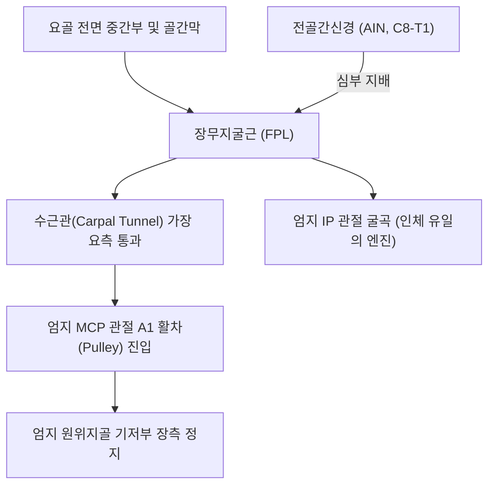
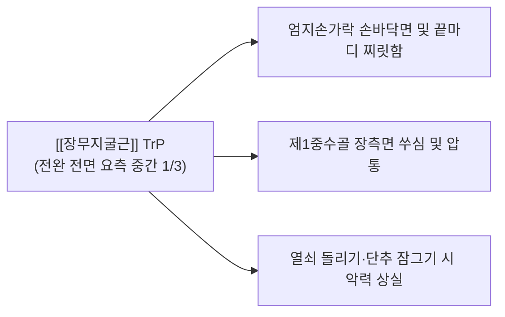

# [[장무지굴근]](Flexor Pollicis Longus, FPL)

> **핵심 요약 (Key Summary)**:
> [[요골]] 전면 중간 2/4 및 골간막에서 기원하여 엄지 원위지골 기저부 장측면에 정지하는 전완 심층의 독보적 엄지 굴곡근입니다.
> [[전골간신경]](AIN, [[정중신경]] 심부 분지, C8-T1)의 지배를 받으며, 엄지 지간관절(IP 관절)을 능동적으로 굴곡시키는 인체 유일의 엔진입니다.
> [[전골간신경]] 증후군(Pinch OK Sign 붕괴), [[방아쇠 수지|방아쇠 엄지]](Trigger Thumb), 수근관 내 마찰의 핵심 표적근이며, A1 활차 도침 절개 및 전완 심층 침구가 표적입니다.

---
## 📌 목차
1. [해부학적 정밀 구조 및 지배 신경/혈관](#1-해부학적-정밀-구조-및-지배-신경혈관)
2. [생체역학·토크 분석 & 근막 사슬 (Biomechanical Synergy)](#2-생체역학토크-분석--근막-사슬-biomechanical-synergy)
3. [근막통증증후군(TP) & 연관통 패턴 (Travell & Simons)](#3-근막통증증후군tp--연관통-패턴-travell--simons)
4. [초음파 해부학(Sonoanatomy) 및 중재 시술 랜드마크](#4-초음파-해부학sonoanatomy-및-중재-시술-랜드마크)
5. [⭐ 원장님 심층 임상 고찰 및 원본 필기 (Clinical Pearls)](#5-원장님-심층-임상-고찰-및-원본-필기-clinical-pearls)
6. [관련 임상 질환 및 운동손상 증후군 총괄](#6-관련-임상-질환-및-운동손상-증후군-총괄)
7. [추나·도수치료(MET/PIR) & 침구·약침·재활 프로토콜](#7-추나도수치료metpir--침구약침재활-프로토콜)
8. [출처 및 학술 참고 문헌 (References)](#8-출처-및-학술-참고-문헌-references)

---
## 1. 해부학적 정밀 구조 및 지배 신경/혈관

| 항목 | 상세 내용 |
| :--- | :--- |
| **기시 (Origin)** | [[요골]](Radius) 체부 전면 중간 2/4 및 인접 전완 골간막(Interosseous membrane) |
| **정지 (Insertion)** | 제1수지(엄지) 원위지골(Distal phalanx) 기저부 장측면 |
| **신경 지배** | [[전골간신경]](Anterior interosseous nerve, AIN, C8, T1 - [[정중신경]] 심부 분지) |
| **혈관 공급** | 전골간동맥(Anterior interosseous artery) 및 [[요골동맥]] 근육 분지 |
| **해부학적 특이성** | 수근관(Carpal tunnel)의 가장 요측 심층을 단독 통과하며, 엄지 종자골 사이를 지나 A1 활차를 관통 |

---
## 2. 생체역학·토크 분석 & 근막 사슬 (Biomechanical Synergy)

### (1) 엄지 IP(지간관절)의 유일한 굴곡 엔진 (Only Thumb IP Flexor)
* 인체에서 엄지손가락 끝마디(IP 관절)를 능동적으로 구부릴 수 있는 유일한 근육입니다.
* 열쇠를 쥐거나 펜을 잡을 때 엄지 끝을 구부려 꽉 쥐어짜는 최종 고정력(Key pinch)을 발휘합니다.
* [[단무지굴근(손)]]이 MCP 관절을 굴곡시킬 때 FPL은 끝마디까지 완벽히 말아 쥡니다.

### (2) 수근관 및 A1 활차 마찰 취약성
* 수근관의 요측 벽을 통과한 뒤 제1중수골두의 A1 활차를 통과하며 90도 각도로 꺾이므로, 엄지 과사용 시 A1 활차 부위에서 극심한 마찰과 결절 비후가 발생합니다.

### (3) 근막 사슬 연계 (Anatomy Trains)
* **심층전방상지선(Deep Front Arm Line)**의 최원위 종착지로, 요골 골막에서 엄지 원위지골 골막까지 이어지는 인장력을 제공합니다.

---
## 3. 근막통증증후군(TP) & 연관통 패턴 (Travell & Simons)

* **발통점 형성 위치 (Trigger Point Location)**:
  * 전완 전면 요측 중간 1/3 부위, 요골 피질 바로 내측의 FPL 근복 내에 형성.
* **연관통 방사 패턴 (Referred Pain Pattern)**:
  * **엄지 지복부 방사통**: 엄지손가락 손바닥 쪽과 끝마디(지복부)까지 번개가 치듯 찌릿한 통증 투사.
  * **제1중수골 통증**: 엄지 뿌리 뼈를 따라 조이는 듯한 통증 유발.
  * **악화 요인**: 가위질, 스마트폰 엄지 타이핑, 열쇠 돌리기 시 통증 폭발.

---
## 4. 초음파 해부학(Sonoanatomy) 및 중재 시술 랜드마크

* **전완 원위 1/3 장측 횡단 스캔**:
  * 요골 피질 바로 위에 얹혀 있는 저에코 FPL 근복을 확인하며, 그 내측의 [[심지굴근]](FDP)과 경계를 관찰합니다.
* **엄지 MCP 관절 A1 활차 종단 스캔**:
  * 제1중수골두 장측에서 FPL 건을 둘러싸고 있는 고에코성 섬유초(A1 pulley)의 비후 및 건 내부 결절(Nodule) 형성을 평가합니다.
* **침도 및 약침 안전 마진**:
  * 전완부에서는 요측의 [[요골동맥]] 맥동을 확인하여 회피하고, 엄지 수지부에서는 요·척측 수지신경혈관 다발을 회피하여 건 중심선상으로 안전하게 자침합니다.

---
## 5. ⭐ 원장님 심층 임상 고찰 및 원본 필기 (Clinical Pearls)

### (1) 전골간신경 증후군(AIN Syndrome)과 'OK Sign' 붕괴 (Pinch Sign 검사)
* **임상 팩트**: [[전골간신경]](AIN)이 [[원회내근]] 두 머리 사이나 전완 섬유 띠에 눌리면 감각 이상은 없으면서 장무지굴근(FPL)과 검지 [[심지굴근]](FDP)이 동시 마비됩니다.
* **Pinch 검사**: 환자에게 엄지와 검지 끝을 동그랗게 모아 "OK" 사인을 만들게 했을 때, 엄지 IP 관절이 펴진 채 지복부로 납작하게 맞닿는(Pulp-to-pulp) 기형적 모양이 나타나면 AIN 포착으로 확진합니다.

### (2) 방아쇠 엄지(Trigger Thumb)와 A1 활차 비후
* 엄지손가락을 구부렸다 펼 때 딸깍거리며 걸리는 [[방아쇠 수지|방아쇠 엄지]]는 FPL 건이 제1중수골두의 비후된 A1 활차에 걸려 발생합니다.
* 소침도로 제1중수골두 장측의 A1 활차를 건 주행 방향과 평행하게 종절개하면 건이 즉각 자유롭게 활주하여 수술 없이 완치됩니다.

### (3) 요골동맥 손상 회피 자침법
* 전완 하부 FPL 자침 시 요골동맥이 바로 외측을 지나므로, 반드시 요골동맥 맥동을 손가락으로 촉지하여 외측으로 밀어낸 상태에서 요골 골막면을 향해 안전하게 사자해야 합니다.

---
## 6. 관련 임상 질환 및 운동손상 증후군 총괄

| 임상 질환 / 증후군 | 병리적 연관 기전 | 주요 증상 및 이학적 검사 | 핵심 교정 타깃 |
| :--- | :--- | :--- | :--- |
| [[전골간신경]] 증후군 | AIN 포착에 의한 FPL 및 검지 FDP 마비 | Pinch Test 양성(OK sign 붕괴), 감각 정상 | 전골간신경 주행로 침도 박리 |
| [[방아쇠 수지|방아쇠 엄지]] | A1 활차 비후 및 FPL 건 결절 마찰 | 엄지 굴신 시 딸깍 걸림 및 통증 | A1 활차 소침도 종절개술 |
| FPL 건초염 | 수근관 및 엄지 활차 내 만성 마찰 | 엄지 굴곡 시 뻐근함, 국소 압통 | FPL 건초 약침 주입 |
| 엄지 파지력 약화 | FPL 만성 단축 또는 신경 포착 | 열쇠 돌리기 불능, 물건 떨어뜨림 | FPL 원심성 스트레칭 + 침구 |

---
## 7. 추나·도수치료(MET/PIR) & 침구·약침·재활 프로토콜

### (1) 한의학 경혈 매핑 & 자침법
* **경혈 매핑**: 공손(孔孫) 혈 상방 극문(郄門, PC4) 요측 0.5촌, 어제(魚際, LU10) 근위부, 열결(列缺, LU7) 내측
* **자침 기법**:
  * 전완 FPL 근복에는 침을 요골 골막을 향해 30도 사자(20~25mm) 진입하여 TrP를 해소합니다.
  * 방아쇠 엄지의 경우 어제혈 하방 A1 활차 부위에 소침도를 15도 사자 진입하여 비후된 활차 섬유를 1~2회 미세 절개합니다.
  * 소염을 위해 [[황련해독탕]] 약침 0.1cc를 활차 주변에 주입합니다.

### (2) 장무지굴근 MET (근에너지기법)
* 엄지손가락 MCP 관절과 IP 관절을 완전히 신전 및 외전시킨 상태에서 환자에게 "20% 힘으로 엄지 끝을 구부리세요(굴곡 저항)"라고 지시하며 5초간 등척성 수축 후, 호기 시 추가 신전 신장합니다.

---
## 8. 출처 및 학술 참고 문헌 (References)

1. **Simons, D. G., & Travell, J. G. (1999)**. *Myofascial Pain and Dysfunction: The Trigger Point Manual*, Vol. 1 (2nd ed.). Williams & Wilkins.
   - **[연구 요약]**: 장무지굴근 발통점이 엄지손가락 장측 및 제1중수골로 방사하는 연관통 패턴 규명.
2. **Hill, N. A. et al. (1985)**. *J Hand Surg Am*, 10(1), 4-16.
   - *The incomplete anterior interosseous nerve syndrome*. [PMID: 3968404](https://pubmed.ncbi.nlm.nih.gov/3968404/)
   - **[연구 요약]**: 전골간신경 포착으로 인한 장무지굴근 마비 및 OK 사인 결손의 임상적 진단 기준 제시.
3. **Standring, S. (2020)**. *Gray's Anatomy: The Anatomical Basis of Clinical Practice* (42nd ed.). Elsevier.
   - **[해부학 총론]**: 장무지굴근의 요골 기시부, 수근관 통과 주행 및 A1 활차 해부학 분석.
