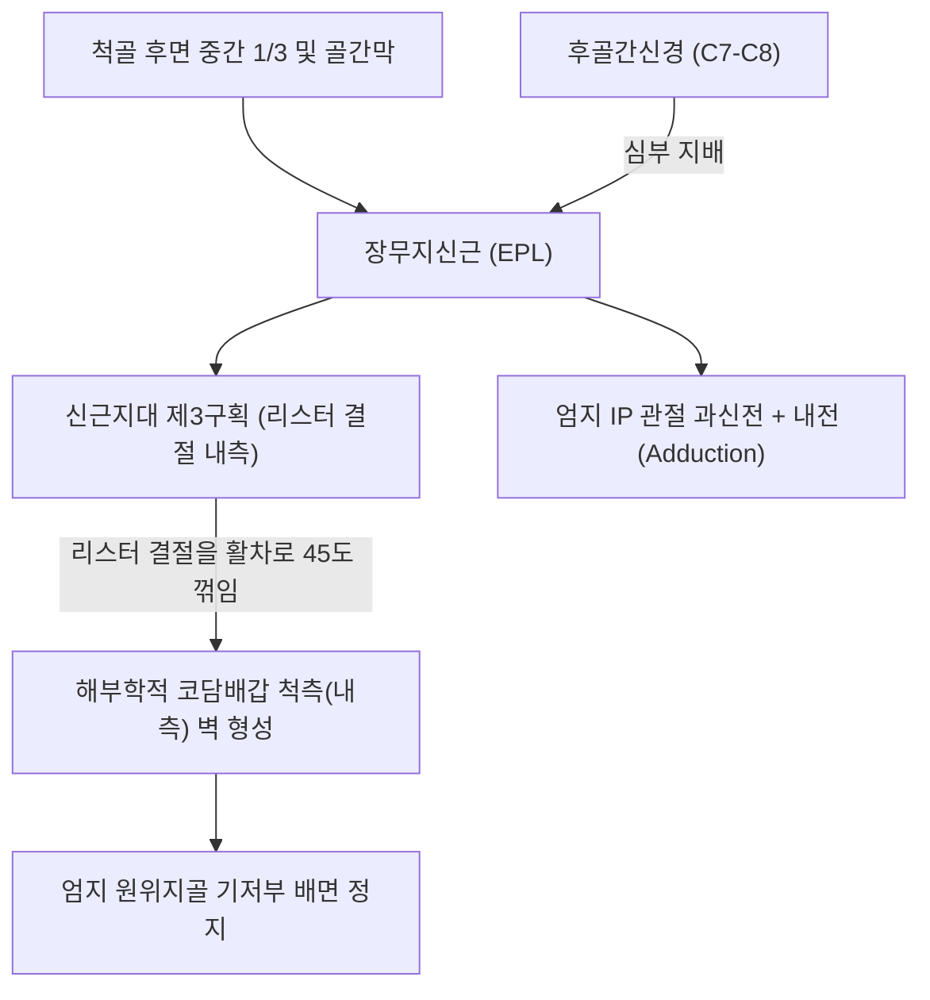
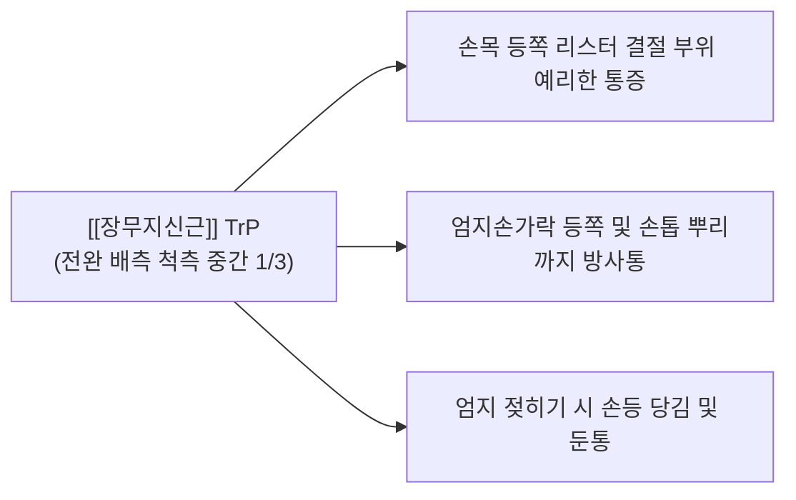

# [[장무지신근]](Extensor Pollicis Longus, EPL)

> **핵심 요약 (Key Summary)**:
> [[척골]] 후면 중간 1/3 및 골간막에서 기원하여 엄지 원위지골 기저부 배면에 정지하는 전완 배측 심층의 핵심 엄지 신전근입니다.
> [[후골간신경]](PIN, C7-C8, [[요골신경]] 심부 분지)의 지배를 받으며, 신근지대 제3구획을 단독으로 통과하고 리스터 결절(Lister's tubercle)을 활차 삼아 엄지 IP 관절 신전을 완성합니다.
> **콜레스 골절(Colles fracture) 후 지연성 건 파열**, 제3구획 건초염, 해부학적 코담배갑 척측통의 핵심 표적근이며, 리스터 결절 주변 침도 감압 및 신전 재활이 표적입니다.

---
## 📌 목차
1. [해부학적 정밀 구조 및 지배 신경/혈관](#1-해부학적-정밀-구조-및-지배-신경혈관)
2. [생체역학·토크 분석 & 근막 사슬 (Biomechanical Synergy)](#2-생체역학토크-분석--근막-사슬-biomechanical-synergy)
3. [근막통증증후군(TP) & 연관통 패턴 (Travell & Simons)](#3-근막통증증후군tp--연관통-패턴-travell--simons)
4. [초음파 해부학(Sonoanatomy) 및 중재 시술 랜드마크](#4-초음파-해부학sonoanatomy-및-중재-시술-랜드마크)
5. [⭐ 원장님 심층 임상 고찰 및 원본 필기 (Clinical Pearls)](#5-원장님-심층-임상-고찰-및-원본-필기-clinical-pearls)
6. [관련 임상 질환 및 운동손상 증후군 총괄](#6-관련-임상-질환-및-운동손상-증후군-총괄)
7. [추나·도수치료(MET/PIR) & 침구·약침·재활 프로토콜](#7-추나도수치료metpir--침구약침재활-프로토콜)
8. [출처 및 학술 참고 문헌 (References)](#8-출처-및-학술-참고-문헌-references)

---
## 1. 해부학적 정밀 구조 및 지배 신경/혈관

| 항목 | 상세 내용 |
| :--- | :--- |
| **기시 (Origin)** | [[척골]](Ulna) 체부 후면 중간 1/3면 및 인접 전완 골간막(Interosseous membrane) |
| **정지 (Insertion)** | 제1수지(엄지) 원위지골(Distal phalanx) 기저부 등쪽면 |
| **신경 지배** | [[후골간신경]](Posterior interosseous nerve, PIN, C7, C8 - [[요골신경]] 심부 분지) |
| **혈관 공급** | 후골간동맥(Posterior interosseous artery) 분지 및 [[요골동맥]] 분지 |
| **해부학적 특이성** | [[요골]] 후면의 리스터 결절(Lister's tubercle)을 도르래(Pulley) 삼아 45도 급격히 방향을 꺾으며 제3구획을 통과 |

---
## 2. 생체역학·토크 분석 & 근막 사슬 (Biomechanical Synergy)

### (1) 엄지 IP(지간관절)의 완전 신전 및 과신전
* [[단무지신근]](EPB)이 MCP 관절까지만 신전시키는 것과 달리, EPL은 **엄지손가락 끝마디(IP 관절)를 0도 이상으로 젖히는(Hyperextension) 유일한 신전 엔진**입니다.
* 리스터 결절을 축으로 주행 방향이 꺾이면서 엄지를 손바닥 안쪽으로 모으는 내전(Adduction) 벡터를 동시에 발휘합니다.

### (2) 리스터 결절(Lister's Tubercle)의 활차 압박 역학
* 요골 원위 배면의 리스터 결절 모서리를 돌면서 강한 인장력과 마찰 전단력을 지속적으로 받으므로, 활액초 마모 및 허혈성 괴사에 대단히 취약합니다.

### (3) 근막 사슬 연계 (Anatomy Trains)
* **표재후방상지선(Superficial Back Arm Line)**의 핵심 연계선으로, 척골 골막에서 엄지 원위지골 끝마디까지 사선으로 가로지르는 안정성 체인을 구축합니다.

---
## 3. 근막통증증후군(TP) & 연관통 패턴 (Travell & Simons)

* **발통점 형성 위치 (Trigger Point Location)**:
  * 전완 후면 중간 1/3, [[척골]] 후면 외측의 EPL 근복 내에 형성.
* **연관통 방사 패턴 (Referred Pain Pattern)**:
  * **손목 배측 통증**: 리스터 결절 주변과 제3구획 터널 부위로 깊은 쑤심 투사.
  * **엄지손가락 배면 방사통**: 해부학적 코담배갑을 지나 엄지 손톱 뿌리까지 찌릿한 연관통 방사.
  * **악화 요인**: 엄지를 치켜세우는 동작(Thumbs-up), 가위질, 볼링 투구.

---
## 4. 초음파 해부학(Sonoanatomy) 및 중재 시술 랜드마크

* **손목 원위 배측 횡단 스캔 (Lister's Tubercle View)**:
  * 요골 원위 배면에서 뾰족하게 솟아오른 리스터 결절(Lister's tubercle)을 뼈 랜드마크로 확인합니다.
  * 리스터 결절 바로 척측의 제3구획 활액초 내에서 타원형의 고에코 EPL 건 단면을 식별합니다.
* **동적 초음파 스캔**:
  * 엄지를 능동적으로 젖힐 때 EPL 건이 리스터 결절 모서리를 활주하며 방향을 바꾸는 동적 움직임을 관찰합니다.
* **침도 및 약침 안전 마진**:
  * 제2구획의 [[단요측수근신근]](ECRB) 건들과 교차하는 부위에서 건 손상을 피하며, 결절 외측 마진을 따라 안전하게 침도 진입합니다.

---
## 5. ⭐ 원장님 심층 임상 고찰 및 원본 필기 (Clinical Pearls)

### (1) 콜레스 골절(Colles Fracture) 후 지연성 EPL 건 파열(Delayed Rupture)
* **임상 팩트**: 손목 원위 요골 골절 후 깁스를 풀고 몇 주 뒤에 갑자기 "엄지손가락 끝마디가 위로 전혀 안 올라가요"라고 호소하는 경우가 있습니다.
* **발생 기전**: 리스터 결절 부위에서 골절편에 의해 건이 직접 마찰되거나, 골절 부종으로 건초 내 압력이 증가하여 EPL 건의 미세 영양 혈관이 폐색되면서 발생하는 **무혈성 괴사성 지연 파열**입니다.
* **대처**: 파열 확인 시 즉각 정형외과에 의뢰하여 [[검지신근]](EIP)을 이용한 건 이전술(Tendon Transfer)을 시행받도록 지도합니다.

### (2) 신근지대 제3구획 건초염과 드퀘르벵 감별
* [[드퀘르뱅 증후군|드퀘르벵 병변]]은 요골 경상돌기(제1구획)의 통증이지만, EPL 건초염은 리스터 결절(제3구획) 부위의 국소 압통과 마찰음이 특징입니다.
* 검사자가 리스터 결절을 누른 채 엄지를 수동 굴곡시킬 때 날카로운 통증이 재현되면 제3구획 건초염으로 확진합니다.

### (3) 치료점 선택 요결
* 양계(LI5)혈 내측 및 리스터 결절 척측의 비후된 제3구획 지대를 소침도로 미세 절개하여 활차 마찰을 해소합니다.

---
## 6. 관련 임상 질환 및 운동손상 증후군 총괄

| 임상 질환 / 증후군 | 병리적 연관 기전 | 주요 증상 및 이학적 검사 | 핵심 교정 타깃 |
| :--- | :--- | :--- | :--- |
| 지연성 EPL 건 파열 | 요골 원위 골절 후 리스터 결절 부위 무혈성 괴사 | 엄지 IP 관절 능동 신전 완전 소실 | 검지신근(EIP) 건 이전술 의뢰 |
| 제3구획 건초염 | 리스터 결절 통과부 반복 마찰 건초 비후 | 리스터 결절 압통, 엄지 신전 시 마찰음 | 제3구획 신근지대 소침도 감압술 |
| 교차 증후군(Intersection) | 제2구획(ECRL/ECRB)과 제3구획(EPL) 교차 마찰 | 손목 상방 4cm 삐걱거림 및 부종 | 교차부 도침 박리 + 소염약침 |
| 드러머 엄지 건초염 | 드럼 스틱 타격 시 반복적 엄지 과신전 | 엄지 등쪽 심한 피로통 | EPL 근복 침구 및 그립 교정 |

---
## 7. 추나·도수치료(MET/PIR) & 침구·약침·재활 프로토콜

### (1) 한의학 경혈 매핑 & 자침법
* **경혈 매핑**: 사독(四瀆, TE9) 부근 EPL 근복, 양계(陽谿, LI5) 내측, 양지(陽池, TE4) 요측
* **자침 기법**:
  * 전완 배측 중간 1/3 EPL 근복 경결점에 침을 척골 골막 방향으로 25mm 사자 진입하여 경결을 박리합니다.
  * 리스터 결절 주변 제3구획 협착에는 [[황련해독탕]] 약침 0.1cc를 건초 주변에 정밀 주입합니다.

### (2) 장무지신근 MET 및 스트레칭
* 엄지손가락 MCP 관절과 IP 관절을 손바닥 안으로 완전히 굴곡 및 외전시킨 상태에서 환자에게 "20% 힘으로 엄지를 뒤로 젖히세요(신전 저항)"라고 지시하며 5초간 등척성 수축 후 호기 시 추가 굴곡 신장합니다.

---
## 8. 출처 및 학술 참고 문헌 (References)

1. **Simons, D. G., & Travell, J. G. (1999)**. *Myofascial Pain and Dysfunction: The Trigger Point Manual*, Vol. 1 (2nd ed.). Williams & Wilkins.
   - **[연구 요약]**: 장무지신근 발통점이 손목 배측 리스터 결절 부위 및 엄지 배면으로 방사하는 연관통 지도 제시.
2. **Engkvist, O. et al. (1979)**. *Hand*, 11(1), 76-86.
   - *Rupture of the extensor pollicis longus tendon after fracture of the lower end of the radius--a clinical and anatomical study*. [PMID: 468007](https://pubmed.ncbi.nlm.nih.gov/468007/)
   - **[연구 요약]**: 요골 원위 골절 후 장무지신근 건의 지연성 파열 기전(리스터 결절 부위 혈류 차단 및 기계적 마모) 규명.
3. **Standring, S. (2020)**. *Gray's Anatomy: The Anatomical Basis of Clinical Practice* (42nd ed.). Elsevier.
   - **[해부학 총론]**: 장무지신근의 제3 신전구획 주행 및 리스터 결절 활차 역학 분석.
