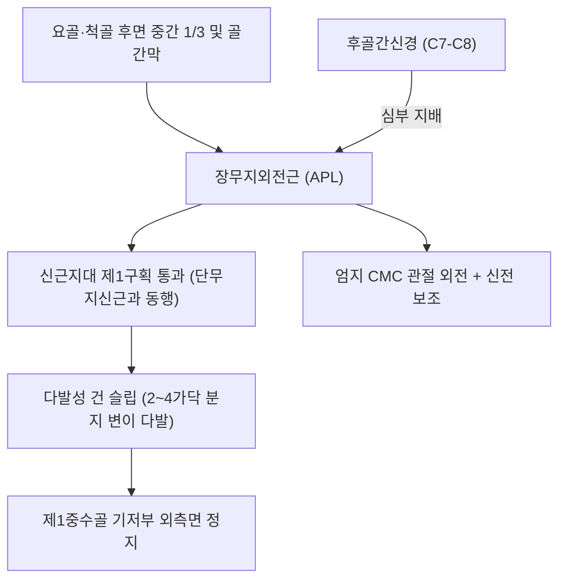
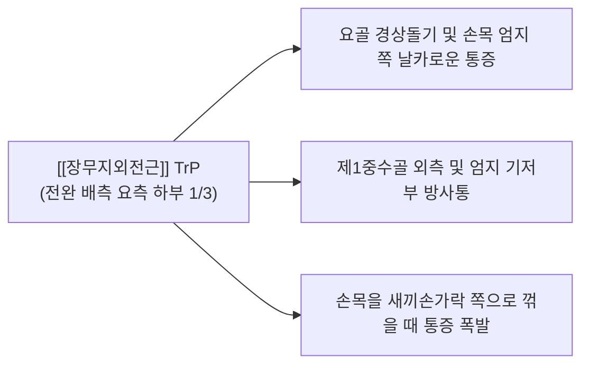

# [[장무지외전근]](Abductor Pollicis Longus, APL)

> **핵심 요약 (Key Summary)**:
> [[요골]] 및 [[척골]] 후면 중간 1/3과 골간막에서 기시하여 제1중수골 기저부 외측면에 정지하는 전완 배측 심층의 핵심 엄지 벌림근입니다.
> [[후골간신경]](PIN, C7-C8, [[요골신경]] 심부 분지)의 지배를 받으며, 신근지대 제1구획을 [[단무지신근]](EPB)과 함께 통과하여 엄지 CMC 관절의 외전을 주도합니다.
> **[[드퀘르뱅 증후군|드퀘르벵 증후군]]**, 근위부 교차 증후군(Intersection syndrome), 다발성 건 슬립 협착의 핵심 표적근이며, 열결혈 침도 절개 및 제1구획 감압이 표적입니다.

---
## 📌 목차
1. [해부학적 정밀 구조 및 지배 신경/혈관](#1-해부학적-정밀-구조-및-지배-신경혈관)
2. [생체역학·토크 분석 & 근막 사슬 (Biomechanical Synergy)](#2-생체역학토크-분석--근막-사슬-biomechanical-synergy)
3. [근막통증증후군(TP) & 연관통 패턴 (Travell & Simons)](#3-근막통증증후군tp--연관통-패턴-travell--simons)
4. [초음파 해부학(Sonoanatomy) 및 중재 시술 랜드마크](#4-초음파-해부학sonoanatomy-및-중재-시술-랜드마크)
5. [⭐ 원장님 심층 임상 고찰 및 원본 필기 (Clinical Pearls)](#5-원장님-심층-임상-고찰-및-원본-필기-clinical-pearls)
6. [관련 임상 질환 및 운동손상 증후군 총괄](#6-관련-임상-질환-및-운동손상-증후군-총괄)
7. [추나·도수치료(MET/PIR) & 침구·약침·재활 프로토콜](#7-추나도수치료metpir--침구약침재활-프로토콜)
8. [출처 및 학술 참고 문헌 (References)](#8-출처-및-학술-참고-문헌-references)

---
## 1. 해부학적 정밀 구조 및 지배 신경/혈관

| 항목 | 상세 내용 |
| :--- | :--- |
| **기시 (Origin)** | [[척골]](Ulna) 후면 중간 1/3, [[요골]](Radius) 후면 중간 1/3 및 인접 전완 골간막 |
| **정지 (Insertion)** | 제1중수골(First metacarpal) 기저부 요측 배면 (종종 대능형골에 부착하는 추가 슬립 존재) |
| **신경 지배** | [[후골간신경]](Posterior interosseous nerve, PIN, C7, C8 - [[요골신경]] 심부 분지) |
| **혈관 공급** | 후골간동맥(Posterior interosseous artery) 및 [[요골동맥]] 분지 |
| **해부학적 특이성** | 신근지대 제1구획을 단무지신근과 함께 통과하며, 인구의 70~80%에서 2~4개의 다발성 힘줄 가닥(Multiple slips)으로 분지 |

---
## 2. 생체역학·토크 분석 & 근막 사슬 (Biomechanical Synergy)

### (1) 엄지 CMC(수근중수관절) 외전 주동 (Thumb Abductor)
* 엄지손가락을 손바닥 평면에서 바깥쪽으로 벌리는(Abduction) 가장 강력한 일차 주동근입니다.
* 손목 관절의 요측 편위(Radial deviation)를 보조하며, 파지 시 손바닥의 너비를 넓혀주는 기초 기저부를 형성합니다.

### (2) 신근지대 제1구획 및 근위부 교차 역학
* 요골 경상돌기의 제1구획 섬유골성 터널 속을 [[단무지신근]](EPB)과 나란히 통과합니다.
* 전완 원위 1/3 지점에서 [[장요측수근신근]](ECRL) 및 [[단요측수근신근]](ECRB)의 건 위를 비스듬히 가로지르는 독특한 사선 주행을 보입니다.

### (3) 근막 사슬 연계 (Anatomy Trains)
* **심층후방상지선(Deep Back Arm Line)**의 외측 축을 이루며, 전완 골간막에서 제1중수골 외측으로 이어지는 장력을 전달합니다.

---
## 3. 근막통증증후군(TP) & 연관통 패턴 (Travell & Simons)

* **발통점 형성 위치 (Trigger Point Location)**:
  * 전완 후면 요측 하부 1/3, 요골 경상돌기 상방 5~7cm 지점의 APL 근복 내에 형성.
* **연관통 방사 패턴 (Referred Pain Pattern)**:
  * **손목 요측 통증**: 요골 경상돌기(열결혈 부위) 및 해부학적 코담배갑 외측으로 심한 쑤심 투사.
  * **엄지 기저부 방사통**: 제1중수골 등쪽을 따라 엄지손가락 뿌리 관절까지 찌릿한 연관통 방사.
  * **악화 요인**: 무거운 프라이팬 들기, 손목을 비틀며 걸레 짜기, 가위질.

---
## 4. 초음파 해부학(Sonoanatomy) 및 중재 시술 랜드마크

* **신근지대 제1구획 횡단 스캔 (First Compartment Transverse View)**:
  * 요골 경상돌기 상방에서 척측의 작은 [[단무지신근]](EPB) 건과 요측의 크고 다발성인 [[장무지외전근]](APL) 건을 식별합니다.
  * APL 건이 2가닥 이상으로 나뉘어 있는지, 활액초 비후 및 삼출액이 동반되어 있는지 확인합니다.
* **근위부 교차부 스캔 (Intersection View)**:
  * 손목 상방 4~6cm에서 APL과 EPB 근복이 ECRL/ECRB 건 위를 십자로 가로지르는 교차점을 초음파로 관찰합니다.
* **침도 및 약침 안전 마진**:
  * 제1구획 천층을 주행하는 요골신경 천자(Superficial radial nerve)와 요골동맥 분지를 컬러 도플러로 확인하여 손상을 절대 회피합니다.

---
## 5. ⭐ 원장님 심층 임상 고찰 및 원본 필기 (Clinical Pearls)

### (1) 다발성 건 슬립(Multiple Slips) 변이와 치료 저항성
* **임상 팩트**: 장무지외전근(APL)은 인구의 70~80%에서 단일 힘줄이 아니라 **2개, 3개, 심지어 4개의 독립된 힘줄 가닥으로 나뉘어 제1구획을 통과**합니다.
* 힘줄 가닥이 많을수록 좁은 제1구획 터널 내에서 마찰 면적이 비약적으로 넓어지고 부종이 심해집니다.
* 일반적인 침 치료나 약침 주입 시 굵은 본체 가닥만 치료되고 안쪽에 숨어 있는 미세 슬립이 감압되지 않으면 드퀘르벵 통증이 만성화되므로, 초음파로 다발성 슬립을 확인하고 전체 건초를 넓게 박리해야 합니다.

### (2) 근위부 교차 증후군(Intersection Syndrome)의 진원지
* 손목 상방 4~6cm 부위에서 삐걱거리는 마찰음과 함께 붓고 아픈 환자는 테니스 엘보나 드퀘르벵이 아니라, APL/EPB가 ECRL/ECRB를 타고 넘는 교차 증후군입니다. 이 부위에 소침도 박리와 소염약침이 특효입니다.

### (3) 치료점 선택 요결
* 열결(LU7)혈 부위에서 제1구획 지대를 소침도로 미세 절개하여 APL과 EPB 건초 내부 압력을 즉각 해소합니다.

---
## 6. 관련 임상 질환 및 운동손상 증후군 총괄

| 임상 질환 / 증후군 | 병리적 연관 기전 | 주요 증상 및 이학적 검사 | 핵심 교정 타깃 |
| :--- | :--- | :--- | :--- |
| [[드퀘르뱅 증후군|드퀘르벵 증후군]] | 제1구획 지대 비후 및 APL 건초 마찰 | Finkelstein 양성, 요골 경상돌기 압통 | 제1구획 신근지대 소침도 절개술 |
| 교차 증후군(Intersection) | APL 근복과 ECRL/ECRB 건 교차 마찰 | 손목 상방 4cm 삐걱거림, 마찰음 | 교차부 건막 침도 박리 |
| APL 다발성 슬립 협착증 | 다발성 건 슬립에 의한 터널 내부 과밀 | 주사 치료 후 잦은 재발, 엄지 외전통 | APL 다발성 건초 완전 감압 |
| 산후 모유수유 손목통 | 아기 머리 받치기 시 APL 지속적 과긴장 | 손목 엄지 쪽 욱신거림, 물건 떨어뜨림 | 제1구획 약침 및 엄지 스플린트 |

---
## 7. 추나·도수치료(MET/PIR) & 침구·약침·재활 프로토콜

### (1) 한의학 경혈 매핑 & 자침법
* **경혈 매핑**: 열결(列缺, LU7), 편력(偏歷, LI6), 양계(陽谿, LI5)
* **자침 기법**:
  * 열결혈 부위 요골 경상돌기 위에 소침도를 건 주행과 평행하게 15도 사자 진입하여 비후된 제1구획 신근지대를 종으로 미세 절개합니다.
  * [[황련해독탕]] 약침 0.1cc를 건초 내로 점적 주입하여 삼출액과 마찰 염증을 배제합니다.

### (2) 장무지외전근 MET (근에너지기법)
* 엄지손가락을 손바닥 안쪽으로 완전히 내전 및 굴곡시킨 상태에서 환자에게 "20% 힘으로 엄지를 바깥으로 벌리세요(외전 저항)"라고 지시하며 5초간 등척성 수축 후, 호기 시 추가 내전 신장합니다.

---
## 8. 출처 및 학술 참고 문헌 (References)

1. **Simons, D. G., & Travell, J. G. (1999)**. *Myofascial Pain and Dysfunction: The Trigger Point Manual*, Vol. 1 (2nd ed.). Williams & Wilkins.
   - **[연구 요약]**: 장무지외전근 발통점이 요골 경상돌기 및 제1중수골 외측으로 방사하는 연관통 패턴 규명.
2. **Jackson, W. T. et al. (1986)**. *J Bone Joint Surg Am*, 68(6), 923-926.
   - *Anatomical variations in the first extensor compartment of the wrist. A clinical and anatomical study*. [PMID: 3733780](https://pubmed.ncbi.nlm.nih.gov/3733780/)
   - **[연구 요약]**: 제1 신전구획 내 장무지외전근 다발성 건 슬립 변이 빈도(75% 이상) 및 드퀘르벵 치료 실패 상관성 분석.
3. **Standring, S. (2020)**. *Gray's Anatomy: The Anatomical Basis of Clinical Practice* (42nd ed.). Elsevier.
   - **[해부학 총론]**: 장무지외전근의 기시·정지 해부학 및 전완 배측 심층 근육군의 주행 분석.
