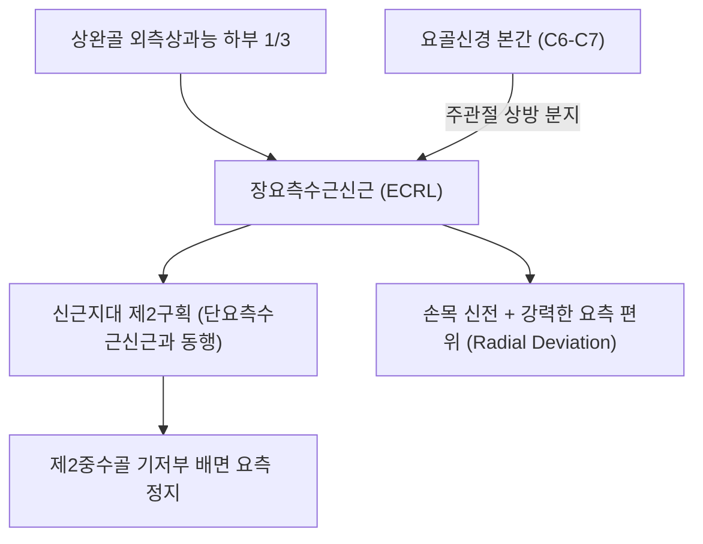
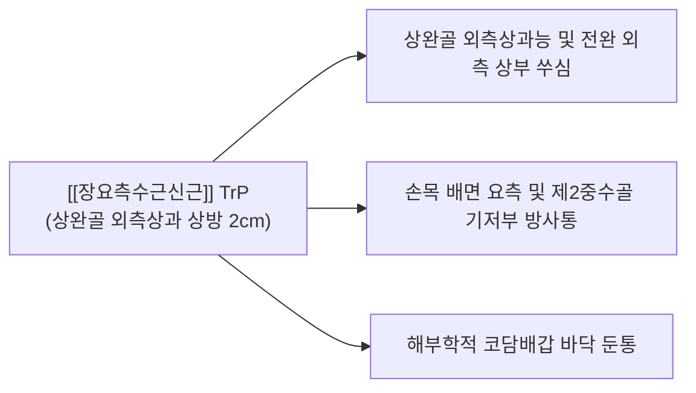

# [[장요측수근신근]](Extensor Carpi Radialis Longus, ECRL)

> **핵심 요약 (Key Summary)**:
> [[상완골]] 외측상과능 하부 1/3에서 기시하여 제2중수골 기저부 배면 요측에 정지하는 전완 외측 천층의 강력한 수근 신전·벌림근입니다.
> [[요골신경]](C6-C7) 본간의 직접 지배를 받으며, 손목 신전(Extension)과 요측 편위(Radial deviation)를 주도합니다.
> **[[외측상과염]](테니스 엘보) 상부 감별 질환**이자 제2수근중수관절 증후군의 핵심 표적근이며, 외측상과능 골막 도침 박리 및 편심성 신전 재활이 표적입니다.

---
## 📌 목차
1. [해부학적 정밀 구조 및 지배 신경/혈관](#1-해부학적-정밀-구조-및-지배-신경혈관)
2. [생체역학·토크 분석 & 근막 사슬 (Biomechanical Synergy)](#2-생체역학토크-분석--근막-사슬-biomechanical-synergy)
3. [근막통증증후군(TP) & 연관통 패턴 (Travell & Simons)](#3-근막통증증후군tp--연관통-패턴-travell--simons)
4. [초음파 해부학(Sonoanatomy) 및 중재 시술 랜드마크](#4-초음파-해부학sonoanatomy-및-중재-시술-랜드마크)
5. [⭐ 원장님 심층 임상 고찰 및 원본 필기 (Clinical Pearls)](#5-원장님-심층-임상-고찰-및-원본-필기-clinical-pearls)
6. [관련 임상 질환 및 운동손상 증후군 총괄](#6-관련-임상-질환-및-운동손상-증후군-총괄)
7. [추나·도수치료(MET/PIR) & 침구·약침·재활 프로토콜](#7-추나도수치료metpir--침구약침재활-프로토콜)
8. [출처 및 학술 참고 문헌 (References)](#8-출처-및-학술-참고-문헌-references)

---
## 1. 해부학적 정밀 구조 및 지배 신경/혈관

| 항목 | 상세 내용 |
| :--- | :--- |
| **기시 (Origin)** | [[상완골]](Humerus) 외측상과능(Lateral supracondylar ridge) 하부 1/3 및 외측 근간중격 |
| **정지 (Insertion)** | 제2중수골(Second metacarpal) 기저부 등쪽(배면) 요측면 |
| **신경 지배** | [[요골신경]](Radial nerve 본간, C6, C7) - 주관절 상방에서 분지 |
| **혈관 공급** | 요골회귀동맥(Radial recurrent artery) 및 [[요골동맥]] 근육 분지 |
| **해부학적 특이성** | 신근지대 제2구획을 [[단요측수근신근]](ECRB)과 함께 통과하며, 기시부가 외측상과보다 상방에 위치 |

---
## 2. 생체역학·토크 분석 & 근막 사슬 (Biomechanical Synergy)

### (1) 손목 신전 및 요측 편위의 강력한 모멘트 암
* 제2중수골 요측에 부착되어 있어, 손목을 뒤로 젖히는 동시에 엄지 쪽으로 꺾는 **요측 편위(Radial deviation)의 가장 강력한 토크**를 생성합니다.
* [[단요측수근신근]](ECRB)이 순수 신전을 담당한다면, ECRL은 손목을 요측으로 회전 고정하는 방향타 역할을 수행합니다.

### (2) 파지(Grip) 시 손목 안정화 및 굴근군 협응
* 주먹을 쥘 때 [[요측수근굴근]](FCR)과 협력하여 완관절을 약간 배굴 상태로 잠그며 파지력을 극대화합니다.

### (3) 근막 사슬 연계 (Anatomy Trains)
* **표재후방상지선(Superficial Back Arm Line)**의 외측 축을 형성하여, 상완골 외측상과능 → ECRL → 제2중수골로 이어지는 신전 체인을 구성합니다.

---
## 3. 근막통증증후군(TP) & 연관통 패턴 (Travell & Simons)

* **발통점 형성 위치 (Trigger Point Location)**:
  * 주관절 외측 주름 상방 2~3cm, 상완골 외측상과능 위의 ECRL 근복 상부에 형성.
* **연관통 방사 패턴 (Referred Pain Pattern)**:
  * **외측상과 상방 통증**: 테니스 엘보 부위보다 약간 위쪽의 뼈 모서리를 따라 쑤시는 통증 투사.
  * **손등 요측 방사통**: 전완 외측면을 타고 내려가 손목 등쪽 제2중수골 기저부 및 코담배갑 부위로 통증 방사.
  * **악화 요인**: 테니스 백핸드 스트로크, 손목을 엄지 쪽으로 꺾으며 망치질하기.

---
## 4. 초음파 해부학(Sonoanatomy) 및 중재 시술 랜드마크

* **상완골 외측상과능 종단 스캔 (Supracondylar Longitudinal View)**:
  * 프로브를 외측상과 상방 외측능선에 대면, [[상완요골근]] 바로 심층에서 상완골 피질에 부착되는 ECRL 근복 기시부를 확인합니다.
* **신근지대 제2구획 횡단 스캔**:
  * 리스터 결절 바로 요측의 제2구획 내에서 요측의 ECRL 건과 척측의 ECRB 건 단면을 식별합니다.
* **침도 및 약침 안전 마진**:
  * 상완골 외측 피질을 랜드마크로 삼아 골막면을 따라 안전하게 침도 진입하며, 심층의 [[요골신경]] 심부 분지 주행로를 초음파로 회피합니다.

---
## 5. ⭐ 원장님 심층 임상 고찰 및 원본 필기 (Clinical Pearls)

### (1) ECRL 병변과 테니스 엘보(외측상과염)의 감별 포인트
* **임상 팩트**: 순수 [[단요측수근신근]](ECRB) 병변은 외측상과 바로 아래 총신근건 부착부에서 극심한 압통이 나타나지만, **ECRL 병변은 외측상과보다 1~2cm 위쪽인 상완골 외측상과능(Lateral supracondylar ridge)**에서 뚜렷한 압통이 확인됩니다.
* 환자에게 손목을 신전시키면서 동시에 **엄지손가락 쪽으로 비틀게(요측 편위 저항)** 했을 때 통증이 유발되면 ECRB가 아닌 ECRL 병변으로 확진합니다.

### (2) 제2수근중수관절(CMC) 부착부 통증
* 제2중수골 기저부 정지부에 만성 견인 건염이 발생하면 손목 등쪽 검지 뿌리 부위가 콕콕 쑤시고 물건을 쥘 때 힘이 빠집니다.

### (3) 치료점 선택 요결
* 곡지(LI11)혈 상방 1촌 부위 외측상과능 골막에 소침도를 밀착시켜 유착된 ECRL 기시부를 긁어주는 골막 자극술을 시행합니다.

---
## 6. 관련 임상 질환 및 운동손상 증후군 총괄

| 임상 질환 / 증후군 | 병리적 연관 기전 | 주요 증상 및 이학적 검사 | 핵심 교정 타깃 |
| :--- | :--- | :--- | :--- |
| 외측상과능 건병증 | ECRL 기시부 반복 견인 손상 | 외측상과 상방 1.5cm 압통, 요측편위통 | ECRL 기시부 골막 도침 박리 |
| [[외측상과염]](테니스 엘보) 병발 | ECRB와 ECRL의 동반 퇴행 | 손목 신전 저항 시 외측 주관절 통증 | CET 복합 건초 소염약침 |
| 제2수근중수관절 증후군 | 제2중수골 저부 ECRL 건 부착부 견인통 | 검지 손등 기저부 압통, 배굴통 | 제2중수골 저부 침구 |
| 테니스 백핸드 과사용통 | 백핸드 임팩트 시 편심성 부하 | 전완 외측 상부 뻐근함, 악력 저하 | ECRL 원심성 재활 및 테이핑 |

---
## 7. 추나·도수치료(MET/PIR) & 침구·약침·재활 프로토콜

### (1) 한의학 경혈 매핑 & 자침법
* **경혈 매핑**: 곡지(曲池, LI11) 상방 1촌, 수삼리(手三里, LI10) 외측, 양계(陽谿, LI5) 척측
* **자침 기법**:
  * 외측상과 상방 1촌 ECRL 기시부 압통점에 침을 뼈에 닿을 때까지 수직 진입한 후 골막을 미세 자극합니다.
  * 소염을 위해 [[황련해독탕]] 약침 0.1cc를 외측상과능 건 부착부에 주입합니다.

### (2) ECRL 근에너지기법 (MET)
* 주관절을 완전 신전시키고 손목을 완전 굴곡 및 척측 편위시켜 ECRL을 최대로 신장 장벽에 위치시킵니다.
* 환자에게 "20% 힘으로 손목을 젖히며 엄지 쪽으로 꺾으세요(신전+요측편위 저항)"라고 지시하며 5초간 등척성 수축 후, 호기 시 추가 굴곡 신장합니다.

---
## 8. 출처 및 학술 참고 문헌 (References)

1. **Simons, D. G., & Travell, J. G. (1999)**. *Myofascial Pain and Dysfunction: The Trigger Point Manual*, Vol. 1 (2nd ed.). Williams & Wilkins.
   - **[연구 요약]**: 장요측수근신근 발통점이 상완골 외측상과능 및 손목 배측 요측으로 방사하는 연관통 패턴 규명.
2. **Nirschl, R. P. (1992)**. *Clin Sports Med*, 11(4), 851-870.
   - *Elbow tendinosis/tennis elbow*. [PMID: 1423702](https://pubmed.ncbi.nlm.nih.gov/1423702/)
   - **[연구 요약]**: 테니스 엘보에서 단요측수근신근(ECRB)과 장요측수근신근(ECRL) 병변의 해부학적 감별 진단 및 치료 지침 제시.
3. **Standring, S. (2020)**. *Gray's Anatomy: The Anatomical Basis of Clinical Practice* (42nd ed.). Elsevier.
   - **[해부학 총론]**: 장요측수근신근의 외측상과능 기시부 해부학 및 요골신경 본간 지배 구조 분석.
