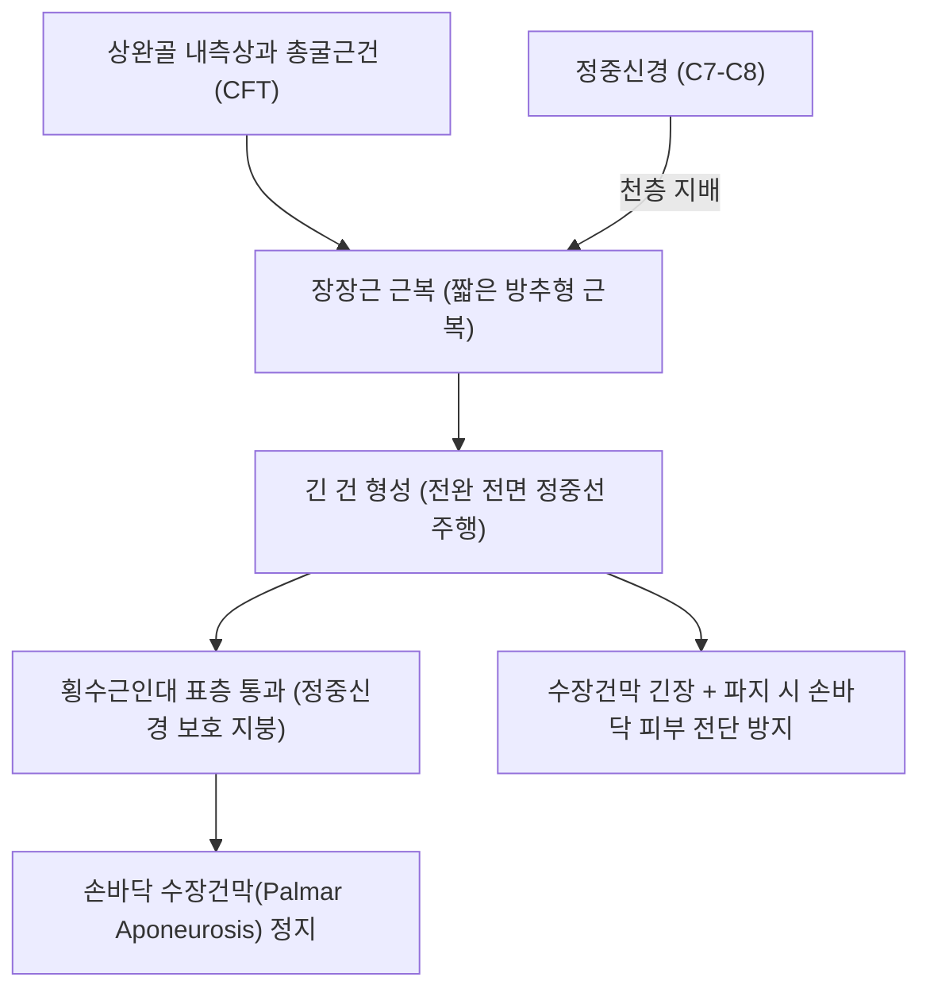
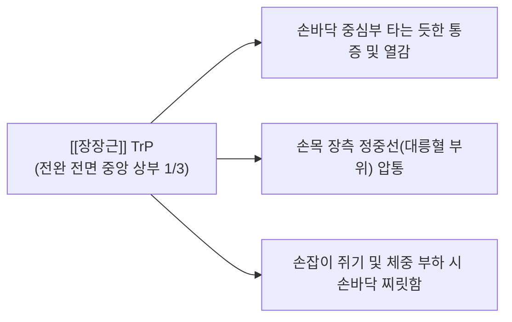

# [[장장근]](Palmaris Longus, 장수장근)

> **핵심 요약 (Key Summary)**:
> [[상완골]] 내측상과 총굴근건에서 기원하여 손바닥 수장건막(Palmar aponeurosis) 및 굴근지대에 정지하는 전완 전면 천층의 방추형 근육입니다.
> [[정중신경]](C7-C8)의 지배를 받으며, 수장건막을 팽팽하게 긴장시켜 파지(Grip) 시 손바닥 피부의 전단 미끄러짐을 방지하고 손목 굴곡을 약하게 보조합니다.
> **[[수근관 증후군]] 중재 시술의 절대 랜드마크**이자 듀피트렌 구축, 수장부 긴장통의 핵심 표적근이며, 대릉혈 심층 정중신경 회피 및 수장건막 이완이 표적입니다.

---
## 📌 목차
1. [해부학적 정밀 구조 및 지배 신경/혈관](#1-해부학적-정밀-구조-및-지배-신경혈관)
2. [생체역학·토크 분석 & 근막 사슬 (Biomechanical Synergy)](#2-생체역학토크-분석--근막-사슬-biomechanical-synergy)
3. [근막통증증후군(TP) & 연관통 패턴 (Travell & Simons)](#3-근막통증증후군tp--연관통-패턴-travell--simons)
4. [초음파 해부학(Sonoanatomy) 및 중재 시술 랜드마크](#4-초음파-해부학sonoanatomy-및-중재-시술-랜드마크)
5. [⭐ 원장님 심층 임상 고찰 및 원본 필기 (Clinical Pearls)](#5-원장님-심층-임상-고찰-및-원본-필기-clinical-pearls)
6. [관련 임상 질환 및 운동손상 증후군 총괄](#6-관련-임상-질환-및-운동손상-증후군-총괄)
7. [추나·도수치료(MET/PIR) & 침구·약침·재활 프로토콜](#7-추나도수치료metpir--침구약침재활-프로토콜)
8. [출처 및 학술 참고 문헌 (References)](#8-출처-및-학술-참고-문헌-references)

---
## 1. 해부학적 정밀 구조 및 지배 신경/혈관

| 항목 | 상세 내용 |
| :--- | :--- |
| **기시 (Origin)** | [[상완골]](Humerus) 내측상과(Medial epicondyle) 총굴근건(CFT) 및 인접 근간중격 |
| **정지 (Insertion)** | [[굴근지대]](Flexor retinaculum, 횡수근인대) 원위부 및 손바닥 부채꼴 수장건막(Palmar aponeurosis) |
| **신경 지배** | [[정중신경]](Median nerve, C7, C8) |
| **혈관 공급** | 척골동맥(Ulnar artery) 및 전골간동맥 분지 |
| **해부학적 특이성** | 손목 주름 정중앙에서 외측의 [[요측수근굴근]]과 내측의 [[척측수근굴근]] 사이에 위치하며, [[정중신경]]의 바로 표층 덮개 역할을 함. 인구의 약 10~15%에서 선천적 편측/양측 결손(Agenesis) 존재 |

---
## 2. 생체역학·토크 분석 & 근막 사슬 (Biomechanical Synergy)

### (1) 수장건막 긴장 및 손바닥 전단 미끄러짐 방지
* 수축 시 손바닥 수장건막을 텐트처럼 팽팽하게 당겨 올려, 손잡이나 도구를 강하게 쥘 때 손바닥 피부가 뼈에서 밀리거나 벗겨지는 전단 미끄러짐(Shear displacement)을 완벽히 방어합니다.
* 손목 굴곡력 자체는 약하지만, 손목 관절을 안정시키고 파지력을 지지하는 정적 인장체 역할을 수행합니다.

### (2) 정중신경의 기계적 완충 지붕 (Roof of Median Nerve)
* 손목 주름 부위에서 횡수근인대 바로 위를 통과하며, 하부의 [[정중신경]]을 외부의 직접적인 타박이나 압박으로부터 보호하는 쿠션 역할을 합니다.

### (3) 근막 사슬 연계 (Anatomy Trains)
* **표재전방상지선(Superficial Front Arm Line)**의 핵심 정지부로, [[상완골]] 내측상과 → [[원회내근]], [[요측수근굴근]], [[장장근]], [[척측수근굴근]] 및 [[천지굴근]]과 함께 전완 굴근군을 형성하며, 손바닥 수장건막 → 손가락 섬유초로 연결되는 손바닥 전체의 천층 인장막을 완성합니다.

---
## 3. 근막통증증후군(TP) & 연관통 패턴 (Travell & Simons)

* **발통점 형성 위치 (Trigger Point Location)**:
  * 전완 전면 정중선 상부 1/3, 내측상과 하방 4~6cm 근복 내에 형성.
* **연관통 방사 패턴 (Referred Pain Pattern)**:
  * **손바닥 중심부 화끈거림**: 손바닥 정중앙 수장건막 부위로 타는 듯한 통증과 바늘로 찌르는 듯한 과민성 연관통 투사.
  * **손목 굴측 둔통**: 손목 주름 한가운데(대릉혈) 부위로 뻐근한 결림 유발.
  * **악화 요인**: 테니스 라켓 파지, 지팡이 짚기, 손바닥으로 체중을 지탱할 때 통증 급증.

---
## 4. 초음파 해부학(Sonoanatomy) 및 중재 시술 랜드마크

* **손목 원위 전면 횡단 스캔 (Distal Volar Wrist View)**:
  * 손목 주름 정중앙에서 외측의 [[요측수근굴근]] 건과 내측의 [[척측수근굴근]] 건 사이, 피하 가장 표층에 위치한 타원형의 고에코 장장근 건 단면을 식별합니다.
  * **장장근 건 바로 심층 1~2mm 아래에 위치한 그물망 형태의 [[정중신경]]**과 [[굴근지대]](횡수근인대)의 층위 관계를 명확히 평가합니다.
* **동적 초음파 스캔**:
  * 엄지와 새끼손가락을 맞대고 손목을 굴곡시킬 때 장장근 건이 표층에서 팽팽해지며 정중신경 상방을 덮는 활주를 확인합니다.
* **침도 및 약침 안전 마진**:
  * 대릉혈에서 침도 시술 시 장장근 건의 바로 아래는 정중신경이므로, 건의 바로 요측이나 척측 가장자리를 안전 통로로 삼아 [[굴근지대]] 심층으로 진입합니다.

---
## 5. ⭐ 원장님 심층 임상 고찰 및 원본 필기 (Clinical Pearls)

### (1) 수근관(Carpal Tunnel) 침도/주사 치료의 절대 랜드마크
* **임상 팩트**: 손목 주름 정중앙(대릉혈 부위)에서 장장근건은 [[정중신경]]의 바로 표층 덮개 역할을 합니다.
* 대릉혈에서 침도나 약침을 시술할 때, 장장근건 바로 아래에 정중신경이 지나가므로 **장장근건을 정통으로 수직 직자하면 신경 손상 위험이 극도로 높아집니다**.
* 따라서 시술자는 반드시 장장근건을 손가락으로 확인한 후, **건의 바로 요측([[요측수근굴근|FCR]] 사이) 혹은 척측([[척측수근굴근|FCU]] 사이) 마진을 통해 15~30도 사자**로 진입해야 정중신경을 완벽히 회피하며 수근관을 안전하게 감압할 수 있습니다.

### (2) 선천적 결손(10~15%)과 Schaeffer 검사
* 인구의 10~15%는 장장근이 선천적으로 결손되어 있습니다.
* **Schaeffer Test**: 엄지와 새끼손가락 끝을 맞대고 손목을 살짝 구부리게 했을 때, 손목 중앙에 굵은 줄처럼 튀어나오는 건이 없으면 장장근 결손으로 판정합니다.
* 결손된 환자의 경우 정중신경이 피하 바로 아래에 노출되어 있으므로 수근관 시술 시 더욱 각별한 주의가 필요합니다.

### (3) 듀피트렌 구축(Dupuytren's Contracture)과의 연계
* 장장근건이 정지하는 수장건막이 유전적·체질적 요인으로 결절화되고 비후되어 손가락(특히 4, 5지)이 펴지지 않는 듀피트렌 구축 환자에서, 수장건막의 긴장 완화 및 침도 절개술이 초기 기능 보존에 기여합니다.

---
## 6. 관련 임상 질환 및 운동손상 증후군 총괄

| 임상 질환 / 증후군 | 병리적 연관 기전 | 주요 증상 및 이학적 검사 | 핵심 교정 타깃 |
| :--- | :--- | :--- | :--- |
| [[수근관 증후군]] | 횡수근인대 비후 및 정중신경 압박 | 손가락 1~3지 저림, Tinel/Phalen 양성 | 수근관 횡수근인대 도침 감압술 |
| 듀피트렌 구축 | 수장건막의 만성 증식성 결절화 및 구축 | 손바닥 몽우리, 4·5지 신전 불능 | 수장건막 섬유성 결절 침도 박리 |
| 수장통증증후군 | 장장근 TrP에 의한 수장건막 허혈통 | 손바닥 중심부 작열통, 손잡이 압통 | 장장근 근복 침구 및 수장부 이완 |
| 도구 파지성 수장건초염 | 망치·라켓 등의 반복적 손바닥 압박 | 수근부 뻐근함, 손바닥 굳은살 통증 | 작업 보호대 착용 및 약침 치료 |

---
## 7. 추나·도수치료(MET/PIR) & 침구·약침·재활 프로토콜

### (1) 한의학 경혈 매핑 & 자침법
* **경혈 매핑**: 극문(郄門, PC4) 혈, 간시(間使, PC5), 내관(內關, PC6), 대릉(大陵, PC7), 노궁(勞宮, PC8)
* **자침 기법**:
  * 전완 상부 1/3 장장근 근복 TrP에 침을 20~25mm 직자하여 근막 연축을 해소합니다.
  * 손바닥 노궁혈 부위 수장건막 결절에는 호침을 골간막 방향으로 사자하여 건막 긴장을 이완시킵니다.
  * 수근관 감압을 위해 대릉혈 요측 2mm 지점에서 [[황련해독탕]] 약침 0.1cc를 횡수근인대 천층 및 심층에 분할 주입합니다.

### (2) 장장근 및 수장건막 MET
* 주관절을 완전 신전시키고 손목과 모든 손가락을 최대로 과신전시켜 장장근과 수장건막을 최대로 신장합니다.
* 환자에게 "20% 힘으로 손목과 손가락을 가볍게 구부리세요(굴곡 저항)"라고 지시하며 5~7초간 등척성 수축 후, 호기 시 손바닥과 손목을 부드럽게 추가 신전합니다.

---
## 8. 출처 및 학술 참고 문헌 (References)

1. **Simons, D. G., & Travell, J. G. (1999)**. *Myofascial Pain and Dysfunction: The Trigger Point Manual*, Vol. 1 (2nd ed.). Williams & Wilkins.
   - **[연구 요약]**: 장장근 발통점이 손바닥 중심부 및 손목 장측으로 방사하는 연관통 패턴 규명.
2. **Sebastin, S. J. et al. (2005)**. *J Hand Surg Br*, 30(4), 406-408.
   - *Does the absence of the palmaris longus affect grip and pinch strength?*. [PMID: 15935531](https://pubmed.ncbi.nlm.nih.gov/15935531/)
   - **[연구 요약]**: 장장근 선천적 결손이 악력 및 핀치력에 미치는 영향 분석 — 해부학적 변이와 임상적 중요성 규명.
3. **Standring, S. (2020)**. *Gray's Anatomy: The Anatomical Basis of Clinical Practice* (42nd ed.). Elsevier.
   - **[해부학 총론]**: 장장근의 수장건막 연결 구조, 정중신경과의 층위 관계 및 건 이식 활용 분석.
