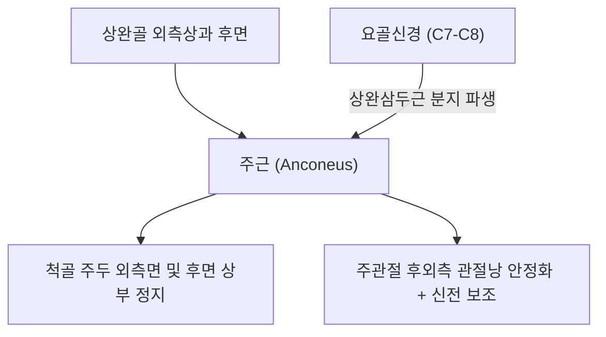
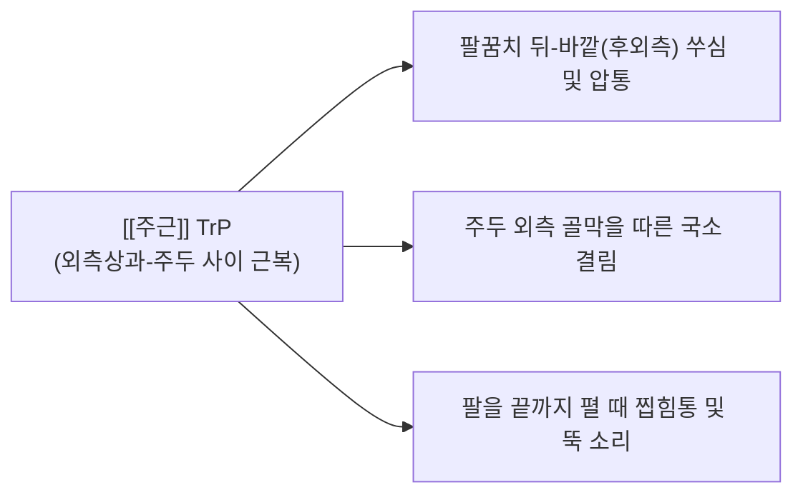

# [[주근]](Anconeus)

> **핵심 요약 (Key Summary)**:
> [[상완골]] 외측상과 후면에서 기시하여 [[척골]] 주두 외측면 및 상부 후면에 정지하는 주관절 후외측의 작은 삼각형 근육입니다.
> [[요골신경]](C7-C8, [[상완삼두근]] 내측두 분지)의 지배를 받으며, 주관절 완전 신전 보조 및 전완 회전 시 척골의 외측 이탈을 방지하는 동적 안정자입니다.
> **[[외측상과염]](테니스 엘보) 잔여 후외측통**, 주두 외측 충돌, 완관절 안정성 장애의 핵심 표적근이며, 천정혈 외측 침도 박리 및 신전 재활이 표적입니다.

---
## 📌 목차
1. [해부학적 정밀 구조 및 지배 신경/혈관](#1-해부학적-정밀-구조-및-지배-신경혈관)
2. [생체역학·토크 분석 & 근막 사슬 (Biomechanical Synergy)](#2-생체역학토크-분석--근막-사슬-biomechanical-synergy)
3. [근막통증증후군(TP) & 연관통 패턴 (Travell & Simons)](#3-근막통증증후군tp--연관통-패턴-travell--simons)
4. [초음파 해부학(Sonoanatomy) 및 중재 시술 랜드마크](#4-초음파-해부학sonoanatomy-및-중재-시술-랜드마크)
5. [⭐ 원장님 심층 임상 고찰 및 원본 필기 (Clinical Pearls)](#5-원장님-심층-임상-고찰-및-원본-필기-clinical-pearls)
6. [관련 임상 질환 및 운동손상 증후군 총괄](#6-관련-임상-질환-및-운동손상-증후군-총괄)
7. [추나·도수치료(MET/PIR) & 침구·약침·재활 프로토콜](#7-추나도수치료metpir--침구약침재활-프로토콜)
8. [출처 및 학술 참고 문헌 (References)](#8-출처-및-학술-참고-문헌-references)

---
## 1. 해부학적 정밀 구조 및 지배 신경/혈관

| 항목 | 상세 내용 |
| :--- | :--- |
| **기시 (Origin)** | [[상완골]](Humerus) 외측상과(Lateral epicondyle) 후면 및 인접 관절낭 |
| **정지 (Insertion)** | [[척골]](Ulna) 주두(Olecranon) 외측면 및 척골 체부 후면 근위 1/4 (사선 능선) |
| **신경 지배** | [[요골신경]](Radial nerve, C7, C8) - 상완삼두근 내측두 분지에서 파생 |
| **혈관 공급** | 중측부동맥(Middle collateral artery) 및 재발골간동맥 분지 |
| **해부학적 특이성** | [[상완삼두근]] 내측두와 근막적으로 거의 연속되어 있으며, 주관절 후외측 관절낭을 직접 보강 |

---
## 2. 생체역학·토크 분석 & 근막 사슬 (Biomechanical Synergy)

### (1) 주관절 완전 신전의 미세 조절 및 관절낭 긴장 유지
* 주관절 신전 시 [[상완삼두근]]을 보조하여 마지막 10~15도의 완전 신전 잠금(Terminal extension)을 부드럽게 완성합니다.
* 신전 시 주관절 후외측 관절낭이 관절강 사이에 끼이지 않도록 팽팽하게 긴장도를 조절합니다 ([[주관절근]]과의 기능적 협응).

### (2) 전완 회내/회외 시 척골 동적 안정화
* 전완이 회내될 때 요골두가 회전하며 척골을 외측으로 밀어내는 전단력이 발생하는데, 주근이 즉각 수축하여 척골을 상완골에 밀착시켜 관절의 외측 벌어짐(Gapping)을 기계적으로 방지합니다.

### (3) 근막 사슬 연계 (Anatomy Trains)
* **표재후방상지선(Superficial Back Arm Line)**의 주관절 후외측 삼각 보강대로 작용합니다.

---
## 3. 근막통증증후군(TP) & 연관통 패턴 (Travell & Simons)

* **발통점 형성 위치 (Trigger Point Location)**:
  * 상완골 외측상과와 척골 주두 사이의 후외측 삼각 오목 부위 근복 내에 형성.
* **연관통 방사 패턴 (Referred Pain Pattern)**:
  * **팔꿈치 후외측 통증**: 외측상과 바로 뒤쪽과 주두 외측면에 걸친 국소적인 예리한 압통.
  * **신전 끝범위 통증**: 팔꿈치를 끝까지 쭉 펼 때 뒤쪽 바깥에서 뚝 소리가 나거나 찝히는 불쾌감 유발.
  * **악화 요인**: 팔굽혀펴기 끝동작, 테니스 백핸드, 탁구 스매싱.

---
## 4. 초음파 해부학(Sonoanatomy) 및 중재 시술 랜드마크

* **주관절 후외측 사선 스캔 (Posterolateral Oblique View)**:
  * 외측상과와 주두 사이에 프로브를 비스듬히 대면, 피하 바로 아래에서 주관절 후외측 관절낭을 덮고 있는 삼각형의 저에코 근육층인 [[주근]]을 확인합니다.
* **동적 초음파 스캔**:
  * 전완을 회내-회외 및 굴곡-신전시킬 때 주근의 활주와 후외측 관절낭의 안정성을 실시간으로 평가합니다.
* **침도 및 약침 안전 마진**:
  * 심층의 요골두 및 상완골 소두 관절연골 손상을 피하기 위해 주두 외측 골막면을 랜드마크로 사자 진입합니다.

---
## 5. ⭐ 원장님 심층 임상 고찰 및 원본 필기 (Clinical Pearls)

### (1) 테니스 엘보 치료 후 남은 '팔꿈치 뒤-바깥 통증'의 숨은 주범
* **임상 팩트**: [[외측상과염]](테니스 엘보) 치료를 성공적으로 마친 후에도 환자가 "팔꿈치 뒤쪽 바깥이 여전히 뻐근하고, 팔을 끝까지 펼 때 뚝 소리가 나거나 찝힌다"고 호소할 때, 그 원인은 거의 100% **주근(Anconeus)의 잔여 발통점 및 구축** 때문입니다.
* 외측상과만 치료하고 주근을 놓치면 테니스 엘보가 완치되지 않은 것처럼 오인하기 쉬우므로, 외측상과 뒤쪽 삼각 오목 부위를 반드시 엄지손가락으로 깊게 압진해야 합니다.

### (2) 회내 시 척골 외측 안정화 기전
* 전완을 회내시킬 때 척골 주두가 외측으로 밀려나는 것을 방어하므로, 걸레를 짜거나 문고리를 돌릴 때 팔꿈치 뒤쪽 바깥이 찌릿한 환자에게 주근 치료가 특효입니다.

### (3) 치료점 선택 요결
* 곡지(LI11)혈과 천정(TE10)혈 사이의 후외측 삼각 함몰부(주근 최대 결절점)에 소침도를 척골 골막 방향으로 30도 사자 진입하여 유착된 근막을 1~2회 미세 박리합니다.

---
## 6. 관련 임상 질환 및 운동손상 증후군 총괄

| 임상 질환 / 증후군 | 병리적 연관 기전 | 주요 증상 및 이학적 검사 | 핵심 교정 타깃 |
| :--- | :--- | :--- | :--- |
| 테니스 엘보 잔여 후외측통 | 외측상과염 후속 주근 근막 TrP 잔존 | 팔꿈치 뒤-바깥 뻐근함, 신전 시 통증 | 주근 근복 침도 박리 |
| 주관절 후외측 충돌 증후군 | 주근 단축으로 인한 후외측 관절낭 찝힘 | 완전 신전 시 후외측 찝힘, 염발음 | 주근 이완 + 관절낭 감압술 |
| 주두 점액낭염 감별 | 심부 주근 병변과 표재성 점액낭염 감별 | 국소 낭종 종창 없이 깊은 압통 | 주근 골막 자극 침구 |
| 던지기 선수 팔꿈치통 | 감속기(Deceleration) 주근 과부하 | 투구 후 팔꿈치 후외측 찌릿함 | 주근 원심성 재활 훈련 |

---
## 7. 추나·도수치료(MET/PIR) & 침구·약침·재활 프로토콜

### (1) 한의학 경혈 매핑 & 자침법
* **경혈 매핑**: 천정(天井, TE10) 외측 1촌, 주료(肘髎, LI12) 후방
* **자침 기법**:
  * 외측상과와 주두 사이의 함몰부에 위치한 주근 근복에 침을 척골 골막을 향해 15~20mm 사자 진입하여 경결을 해소합니다.
  * 소염 및 관절 안정화를 위해 [[황련해독탕]] 약침 0.1cc를 주근 심층 관절낭 주변에 주입합니다.

### (2) 주근 MET 및 스트레칭
* 주관절을 완전 굴곡시키고 전완을 최대로 회외시켜 주근을 신장 장벽에 위치시킵니다.
* 환자에게 "20% 힘으로 팔꿈치를 펴면서 안쪽으로 돌리세요(신전+회내 저항)"라고 지시하며 5초간 등척성 수축 후, 호기 시 추가 굴곡 신장합니다.

---
## 8. 출처 및 학술 참고 문헌 (References)

1. **Simons, D. G., & Travell, J. G. (1999)**. *Myofascial Pain and Dysfunction: The Trigger Point Manual*, Vol. 1 (2nd ed.). Williams & Wilkins.
   - **[연구 요약]**: 주근 발통점이 팔꿈치 후외측 및 외측상과 후면으로 방사하는 연관통 패턴 규명.
2. **Tubbs, R. S. et al. (2006)**. *Folia Morphol (Warsz)*, 65(1), 16-18.
   - *The subanconeus muscle*. [PMID: 16783731](https://pubmed.ncbi.nlm.nih.gov/16783731/)
   - **[연구 요약]**: 주근 및 주관절근(Subanconeus)의 해부학적 기시·정지·신경 지배 및 주관절 생체역학적 기능 분석.
3. **Standring, S. (2020)**. *Gray's Anatomy: The Anatomical Basis of Clinical Practice* (42nd ed.). Elsevier.
   - **[해부학 총론]**: 주근의 외측상과 기시부 및 척골 주두 외측 부착부 해부학 분석.
