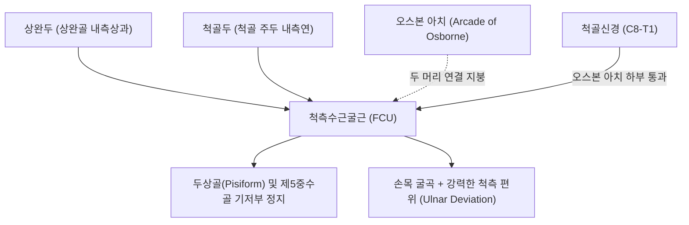
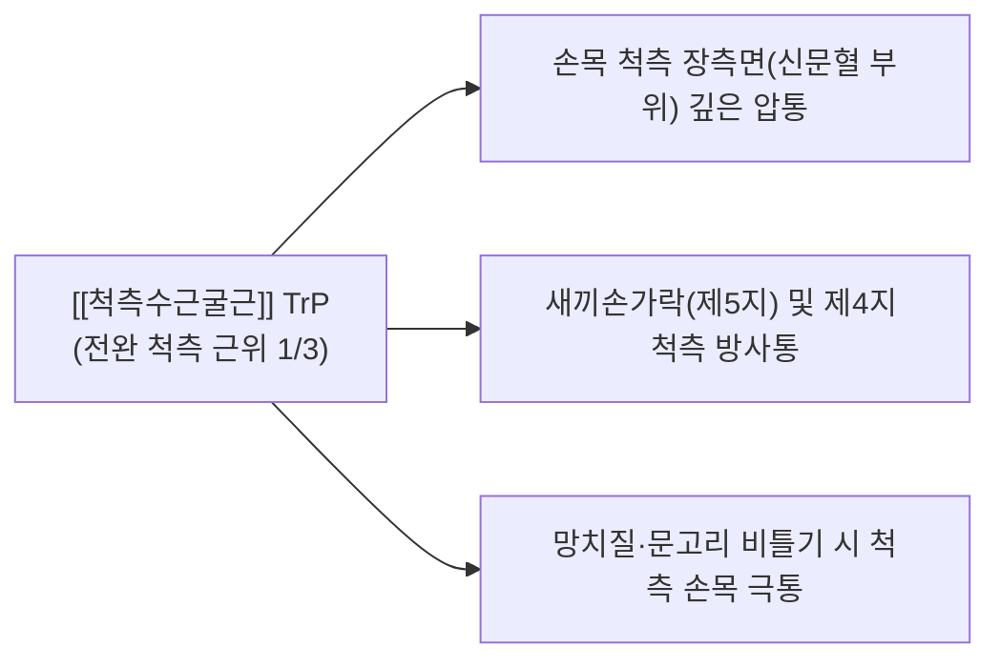

# [[척측수근굴근]](Flexor Carpi Ulnaris, FCU)

> **핵심 요약 (Key Summary)**:
> [[상완골]] 내측상과(상완두) 및 [[척골]] 주두(척골두)에서 기시하여 두상골(Pisiform) 및 제5중수골 기저부에 정지하는 전완 내측 천층의 핵심 수근 굴곡근입니다.
> 전완 천층 굴근군 중 유일하게 **[[척골신경]](C8-T1)**의 직접 지배를 받으며, 손목 굴곡(Flexion) 및 척측 편위(Ulnar deviation)를 주도합니다.
> **[[주관절 터널 증후군]](Cubital tunnel syndrome)**, 두상골 충돌증후군, 손목 척측통의 핵심 표적근이며, 오스본 아치(Arcade of Osborne) 도침 박리 및 신문혈 침구가 표적입니다.

---
## 📌 목차
1. [해부학적 정밀 구조 및 지배 신경/혈관](#1-해부학적-정밀-구조-및-지배-신경혈관)
2. [생체역학·토크 분석 & 근막 사슬 (Biomechanical Synergy)](#2-생체역학토크-분석--근막-사슬-biomechanical-synergy)
3. [근막통증증후군(TP) & 연관통 패턴 (Travell & Simons)](#3-근막통증증후군tp--연관통-패턴-travell--simons)
4. [초음파 해부학(Sonoanatomy) 및 중재 시술 랜드마크](#4-초음파-해부학sonoanatomy-및-중재-시술-랜드마크)
5. [⭐ 원장님 심층 임상 고찰 및 원본 필기 (Clinical Pearls)](#5-원장님-심층-임상-고찰-및-원본-필기-clinical-pearls)
6. [관련 임상 질환 및 운동손상 증후군 총괄](#6-관련-임상-질환-및-운동손상-증후군-총괄)
7. [추나·도수치료(MET/PIR) & 침구·약침·재활 프로토콜](#7-추나도수치료metpir--침구약침재활-프로토콜)
8. [출처 및 학술 참고 문헌 (References)](#8-출처-및-학술-참고-문헌-references)

---
## 1. 해부학적 정밀 구조 및 지배 신경/혈관

| 항목 | 상세 내용 |
| :--- | :--- |
| **기시 (Origin)** | • **상완두(Humeral head)**: [[상완골]](Humerus) 내측상과(Medial epicondyle) 총굴근건(CFT) • **척골두(Ulnar head)**: [[척골]](Ulna) 주두(Olecranon) 내측연 및 척골 체부 후면 근위 2/3 골막 |
| **정지 (Insertion)** | 두상골(Pisiform) 및 두구인대/두중수인대를 거쳐 유구골 구(Hook of hamate)와 제5중수골 기저부 |
| **신경 지배** | [[척골신경]](Ulnar nerve, C8, T1) - **전완 표재 굴근 중 유일한 척골신경 지배근** |
| **혈관 공급** | 척골동맥(Ulnar artery) 및 후척골회귀동맥 분지 |
| **해부학적 특이성** | 상완두와 척골두 사이를 잇는 오스본 인대(Arcade of Osborne) 아래로 척골신경이 진입하여 주관절 터널 형성 |

---
## 2. 생체역학·토크 분석 & 근막 사슬 (Biomechanical Synergy)

### (1) 손목 굴곡 및 척측 편위의 일차 주동 엔진
* 손목을 안쪽으로 구부리고 새끼손가락 쪽으로 비트는 척측 편위(Ulnar deviation)의 가장 강력한 토크를 발휘합니다.
* [[척측수근신근]](ECU)과 함께 작용하여 손목을 척측으로 강하게 고정하며, 망치질이나 도끼질의 내려찍기 파워를 완성합니다.

### (2) 주관절 터널 및 척골신경 압박 역학
* 팔꿈치를 90도 이상 굴곡시킬 때 오스본 아치가 팽팽하게 당겨지며 주관절 터널 내부 용적이 최대 55%까지 감소합니다.
* 이때 FCU의 상완두와 척골두가 수축하면 척골신경을 주두와 내측상과 사이 고랑에서 강하게 압박합니다.

### (3) 근막 사슬 연계 (Anatomy Trains)
* **표재전방상지선(Superficial Front Arm Line)**의 척측 축으로, 상완골 내측상과 → FCU → 두상골 → 소지구 근막으로 이어집니다.

---
## 3. 근막통증증후군(TP) & 연관통 패턴 (Travell & Simons)

* **발통점 형성 위치 (Trigger Point Location)**:
  * 전완 척측 상부 1/3, 내측상과 하방 3~6cm 지점의 FCU 근복 내에 형성.
* **연관통 방사 패턴 (Referred Pain Pattern)**:
  * **손목 척측부 통증**: 두상골 부근(신문혈 부위)과 손목 주름 안쪽으로 날카로운 연관통 투사.
  * **새끼손가락 방사통**: 제5수지와 제4수지 척측 절반으로 찌릿한 저림과 쑤심 방사.
  * **악화 요인**: 팔꿈치를 구부린 채 턱을 괴거나 스마트폰을 장시간 들고 통화할 때 악화.

---
## 4. 초음파 해부학(Sonoanatomy) 및 중재 시술 랜드마크

* **주관절 내측 횡단 스캔 (Cubital Tunnel View)**:
  * 내측상과와 주두 사이 고랑에서 오스본 인대 아래 타원형 저에코의 [[척골신경]] 단면을 확인합니다.
  * 척측수근굴근 상완두와 척골두 사이로 신경이 진입하는 협착 부위를 실시간 평가합니다.
* **손목 원위 척측 횡단 스캔 (Pisiform View)**:
  * 두상골 바로 외측 표층에서 척골신경과 척골동맥이 주행하는 가이온 터널(Guyon's canal)을 확인합니다.
* **침도 및 약침 안전 마진**:
  * 척골신경 및 척골동맥 손상을 방지하기 위해, 두상골 척측 마진을 따라 사자로 안전하게 진입합니다.

---
## 5. ⭐ 원장님 심층 임상 고찰 및 원본 필기 (Clinical Pearls)

### (1) 주관절 터널 증후군(Cubital Tunnel Syndrome)과 오스본 아치(Arcade of Osborne)
* **임상 팩트**: 척측수근굴근의 상완두와 척골두 사이를 연결하는 섬유성 아케이드인 **오스본 아치(Arcade of Osborne)**는 척골신경이 인체에서 가장 흔하게 포착되는 핵심 부위입니다.
* 환자가 "팔꿈치를 구부리고 자거나 통화할 때 넷째·다섯째 손가락이 저리다"고 호소할 때, 주두와 내측상과 사이 FCU 기시부 아케이드를 소침도로 종절개하여 신경 감압을 시행하면 저림이 즉각 소실됩니다.

### (2) 두상골(Pisiform) 정지부 건초염과 가이온 터널 포착 감별
* 두상골 바로 외측으로 척골신경 본간이 지나가므로, 두상골 통증 환자 치료 시 척골신경 손상을 피하기 위해 침끝을 항상 두상골 골막면에 밀착시켜 외측 신경을 침범하지 않도록 주의해야 합니다.

### (3) 골퍼스 엘보(내측상과염) 동반 병변
* 내측상과 총굴근건염 환자에서 [[요측수근굴근]], [[원회내근]]과 함께 FCU 상완두 부착부 염증이 동반되므로, 내측상과 후내측면 골막 자극을 병행해야 합니다.

---
## 6. 관련 임상 질환 및 운동손상 증후군 총괄

| 임상 질환 / 증후군 | 병리적 연관 기전 | 주요 증상 및 이학적 검사 | 핵심 교정 타깃 |
| :--- | :--- | :--- | :--- |
| [[주관절 터널 증후군]] | 오스본 아치에 의한 척골신경 포착 | 4·5지 저림, 주관절 Tinel 양성, Froment Sign | 오스본 인대 도침 감압술 |
| 두상골 충돌/건염 | FCU 건 정지부 만성 견인 건병증 | 두상골 압통, 손목 척측 굴곡통 | 두상골 골막 침도 박리 |
| 가이온 터널 증후군 | 두상골 외측 척골신경 압박 | 4·5지 감각 저하, 수내근 위축 | 가이온 터널 지붕 인대 감압 |
| 내측상과염(골퍼스 엘보) | FCU 기시부 만성 과부하 건병증 | 손목 척측 굴곡 저항 시 내측상과통 | 기시부 골막 자극 침구 |

---
## 7. 추나·도수치료(MET/PIR) & 침구·약침·재활 프로토콜

### (1) 한의학 경혈 매핑 & 자침법
* **경혈 매핑**: 소해(少海, HT3), 소해(小海, SI8) 하방 1촌, 신문(神門, HT7), 음극(陰郄, HT6)
* **자침 기법**:
  * 소해(SI8) 하방 1촌 오스본 아치 부위에 침을 척골 골막을 향해 15도 사자(15~20mm) 진입하여 척골신경 주위 섬유 띠를 미세 감압합니다.
  * 손목 신문혈 부위 두상골 척측연에 [[황련해독탕]] 약침 0.1cc를 주입하여 건초염을 해소합니다.

### (2) 척측수근굴근 MET (근에너지기법)
* 주관절을 완전 신전시키고 손목을 완전 신전 및 요측 편위시켜 FCU를 최대로 신장 장벽에 위치시킵니다.
* 환자에게 "20% 힘으로 손목을 구부리며 새끼손가락 쪽으로 꺾으세요(굴곡+척측편위 저항)"라고 지시하며 5초간 등척성 수축 후, 호기 시 추가 신전 신장합니다.

---
## 8. 출처 및 학술 참고 문헌 (References)

1. **Simons, D. G., & Travell, J. G. (1999)**. *Myofascial Pain and Dysfunction: The Trigger Point Manual*, Vol. 1 (2nd ed.). Williams & Wilkins.
   - **[연구 요약]**: 척측수근굴근 발통점이 손목 척측 및 제4·5수지로 방사하는 연관통 지도 제시.
2. **Hu, T., & Zhou, H. (2026)**. *Ann Med Surg (Lond)*, 104, 422-435.
   - *Geometric and biomechanical perspectives on ulnar nerve compression in cubital tunnel syndrome: pathomechanics and clinical implications*. [PMID: 41496932](https://pubmed.ncbi.nlm.nih.gov/41496932/)
   - **[연구 요약]**: 주관절 터널 내 척골신경 압박의 병역학 — FCU 두 기시두(오스본 아케이드)와 관절 굴곡 시 신경 압박 요인 규명.
3. **Standring, S. (2020)**. *Gray's Anatomy: The Anatomical Basis of Clinical Practice* (42nd ed.). Elsevier.
   - **[해부학 총론]**: 주관절 터널 내 척골신경 주행과 두상골 부착부 척측수근굴근의 생체역학 분석.
