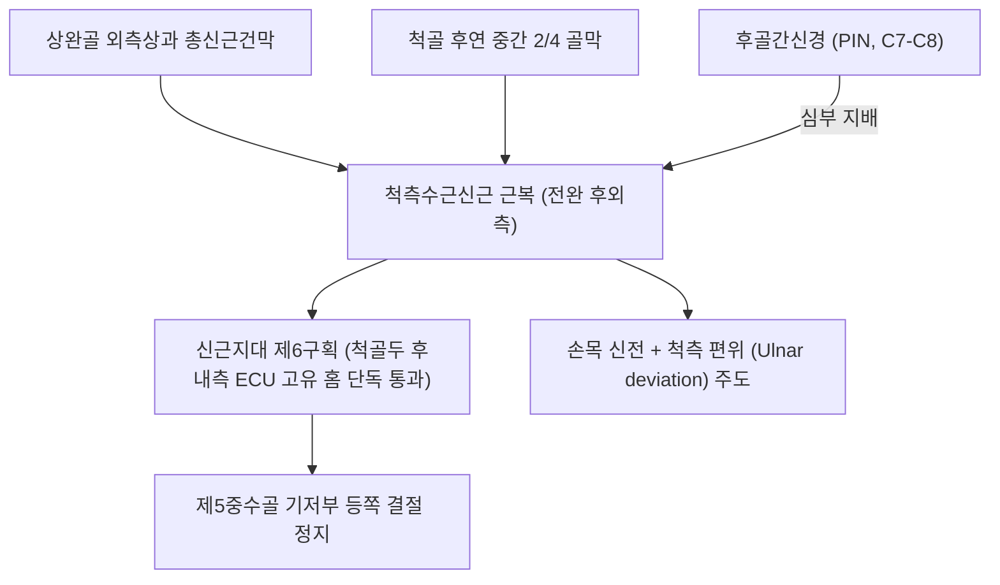
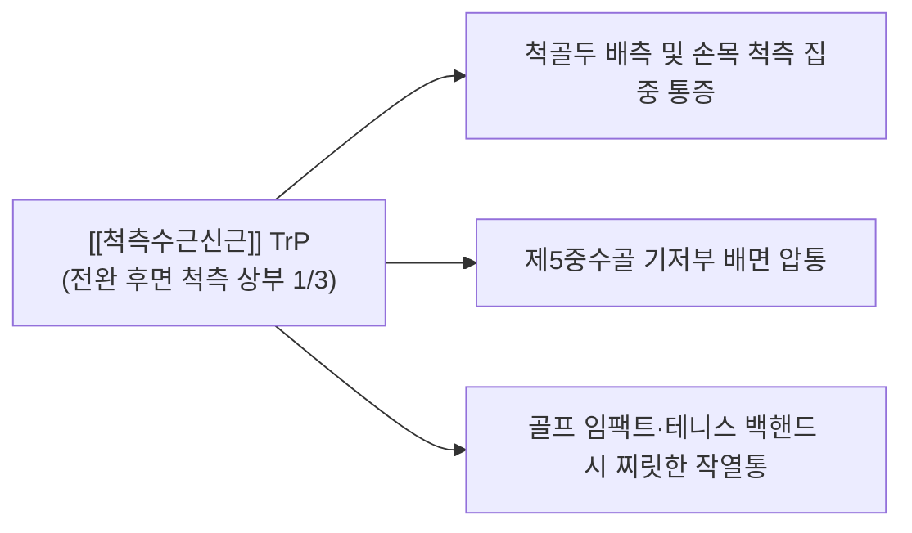

# [[척측수근신근]](Extensor Carpi Ulnaris, ECU)

> **핵심 요약 (Key Summary)**:
> [[상완골]] 외측상과 총신근건막 및 [[척골]] 후연에서 기원하여 제5[[중수골]] 기저부 등쪽 결절에 정지하는 전완 후외측의 핵심 손목 신전·척측편위근입니다.
> [[후골간신경]](PIN, C7-C8, [[요골신경]] 심부 분지)의 지배를 받으며, 신근지대 제6구획을 단독 통과하여 손목 신전 및 척측 편위(Ulnar deviation)를 주도합니다.
> [[삼각섬유연골복합체 손상(TFCC 손상)]] 감별, ECU 건초염 및 아탈구(Snapping ECU)의 핵심 병변근이며, 양로혈 침구 및 제6구획 건초 박리가 표적입니다.

---
## 📌 목차
1. [해부학적 정밀 구조 및 지배 신경/혈관](#1-해부학적-정밀-구조-및-지배-신경혈관)
2. [생체역학·토크 분석 & 근막 사슬 (Biomechanical Synergy)](#2-생체역학토크-분석--근막-사슬-biomechanical-synergy)
3. [근막통증증후군(TP) & 연관통 패턴 (Travell & Simons)](#3-근막통증증후군tp--연관통-패턴-travell--simons)
4. [초음파 해부학(Sonoanatomy) 및 중재 시술 랜드마크](#4-초음파-해부학sonoanatomy-및-중재-시술-랜드마크)
5. [⭐ 원장님 심층 임상 고찰 및 원본 필기 (Clinical Pearls)](#5-원장님-심층-임상-고찰-및-원본-필기-clinical-pearls)
6. [관련 임상 질환 및 운동손상 증후군 총괄](#6-관련-임상-질환-및-운동손상-증후군-총괄)
7. [추나·도수치료(MET/PIR) & 침구·약침·재활 프로토콜](#7-추나도수치료metpir--침구약침재활-프로토콜)
8. [출처 및 학술 참고 문헌 (References)](#8-출처-및-학술-참고-문헌-references)

---
## 1. 해부학적 정밀 구조 및 지배 신경/혈관

| 항목 | 상세 내용 |
| :--- | :--- |
| **기시 (Origin)** | [[상완골]](Humerus) 외측상과(Lateral epicondyle) 총신근건막(CET) 및 [[척골]](Ulna) 후연(Posterior border) 중간 2/4 골막 |
| **정지 (Insertion)** | 제5[[중수골]](Fifth metacarpal) 기저부 결절 등쪽면(Dorsal tubercle) |
| **신경 지배** | [[후골간신경]](Posterior interosseous nerve, PIN, C7, C8 - [[요골신경]] 심부 분지) |
| **혈관 공급** | 후골간동맥(Posterior interosseous artery) 분지 |
| **해부학적 특이성** | 신근지대 제6구획(Sixth compartment)을 단독 주행하며, 척골두 후내측의 ECU 고유 홈(Sulcus)을 통과하여 [[삼각섬유연골복합체 손상(TFCC 손상)]]의 배측 지붕 형성 |

---
## 2. 생체역학·토크 분석 & 근막 사슬 (Biomechanical Synergy)

### (1) 손목 신전(Extension) 및 척측 편위(Ulnar Deviation)
* 전완 신근군 중 유일하게 **척측 편위(Ulnar deviation)** 모멘트 암을 갖는 근육입니다.
* [[척측수근굴근]](FCU)과 길항·협동 짝힘(Force couple)을 형성하여 순수한 손목 척측 편위를 만들어내며, [[장요측수근신근]](ECRL) 및 [[단요측수근신근]](ECRB)의 요측 편위 토크를 견제하여 손목 신전 궤적을 정중앙으로 유지합니다.
* 파워 그립, 골프 임팩트, 테니스 포핸드 타구 시 손목이 과도하게 요측으로 꺾이지 않도록 지탱하는 원위 외측 앵커입니다.

### (2) 신근지대 제6구획(Sixth Compartment) 독자 주행
* 척골두 후내측의 고유 홈(ECU sulcus) 내에 안착되어 독자적인 섬유골성 터널(제6구획)을 통과합니다.
* 이는 원위 요척관절(DRUJ)의 배측 안정성을 보강하고, [[삼각섬유연골복합체 손상(TFCC 손상)]]의 배측 인대 지대와 긴밀히 유착되어 손목 회전 운동 시 TFCC를 보호합니다.

### (3) 근막 사슬 연계 (Anatomy Trains)
* **표재후방상지선(Superficial Back Arm Line)**의 척측 배면 기둥으로 작용하며, 상완골 외측상과 → [[척측수근신근]] → 제5중수골 골막으로 이어지는 후외측 안정화 체인을 완성합니다.

---
## 3. 근막통증증후군(TP) & 연관통 패턴 (Travell & Simons)

* **발통점 형성 위치 (Trigger Point Location)**:
  * 전완 후면 척측 상부 1/3, 척골 후연 외측의 ECU 근복 중심부에 형성.
* **연관통 방사 패턴 (Referred Pain Pattern)**:
  * **손목 척측 배면 극심한 통증**: 척골두 및 제5중수골 기저부 배면으로 타는 듯하고 찌릿한 통증 투사.
  * **전완 척측 후면 쑤심**: 전완 뒤쪽 새끼손가락 라인을 따라 묵직한 조임감 유발.
  * **악화 요인**: 골프 스윙 시 뒤땅 치기, 테니스 탑스핀 포핸드, 무거운 냄비를 손목 척측으로 기울여 들 때 통증 폭발.

---
## 4. 초음파 해부학(Sonoanatomy) 및 중재 시술 랜드마크

* **손목 원위 척측 횡단 스캔 (Distal Ulnar Transverse View)**:
  * 척골두 후내측의 ECU 고유 홈(Sulcus)에 안착되어 있는 타원형 고에코의 ECU 건 단면 확인.
* **동적 아탈구 평가 (Dynamic Snapping Test)**:
  * 초음파 프로브를 댄 상태에서 전완을 완전 회내(Pronation) 및 손목을 굴곡·척측편위시킬 때, 건이 척골 홈 밖으로 튕겨 나가는 아탈구(Subluxation) 여부를 실시간 동적 평가.
* **침도 및 약침 안전 마진**:
  * 척골신경 배측 피부분지가 인접해 주행하므로 신경 주행을 확인한 후 제6구획 지대 천층만을 선택적으로 종절개 박리.

---
## 5. ⭐ 원장님 심층 임상 고찰 및 원본 필기 (Clinical Pearls)

### (1) 스내핑 ECU(Snapping ECU)와 제6구획 지대 파열
* 골프, 테니스, 야구 선수들이 손목을 비틀며 회내-굴곡할 때 "손목 뒤쪽 새끼손가락 뼈 위에서 힘줄이 툭툭 걸리고 튕기면서 아프다"고 호소합니다.
* 이는 제6 신전지대(ECU subsheath)가 파열되어 건이 척골 홈에서 빠져나오는 **ECU 아탈구**입니다.
* 급성기에는 테이핑과 깁스 고정(전완 회외위 고정)이 우선이며, 만성 건초염으로 이행된 경우에만 침도와 약침으로 건초를 안정화해야 합니다.

### (2) TFCC(삼각섬유연골) 파열과의 결정적 감별
* 손목 척측 통증 환자에서 TFCC 파열로 수술을 권유받는 경우가 많으나, 실제 원인은 ECU 건초염인 경우가 흔합니다.
* **감별 팁**: 손목 관절강 척측 함요부(TFCC fovea sign) 압통과 함께, **손목을 젖히며 새끼손가락 쪽으로 꺾을 때(ECU 저항 검사) 척골두 바로 위에서 통증이 집중**되면 ECU 질환입니다.

### (3) 외측상과염(테니스 엘보)과의 연계
* 상완골 외측상과에 부착되는 근육 중 [[단요측수근신근]], [[수지신근]] 외에 ECU도 함께 기원하므로, 외측상과 후연에 국한된 잔여 통증이 지속될 때는 ECU 기시부 건막을 반드시 함께 감압해야 합니다.

---
## 6. 관련 임상 질환 및 운동손상 증후군 총괄

| 임상 질환 / 증후군 | 병리적 연관 기전 | 주요 증상 및 이학적 검사 | 핵심 교정 타깃 |
| :--- | :--- | :--- | :--- |
| ECU 건초염 | 제6구획 내 마찰 및 만성 견인성 염증 | 척골두 후면 압통, 손목 신전-척측편위통 | 제6구획 건초 침도 감압술 |
| 스내핑 ECU(건 아탈구) | ECU 지대 파열로 인한 건 탈구 | 회내-굴곡 시 건 튕김(Snapping), 불안정 | 회외위 고정 및 건초 안정화 |
| [[삼각섬유연골복합체 손상(TFCC 손상)]] 병발 | ECU 건염과 TFCC 배측 지대 동반 손상 | 척수근 관절 척측 둔통, 회전통 | ECU 건초 및 DRUJ 안정화 침구 |
| [[외측상과염]] 후방형 잔여통 | ECU 기시부 총신근건 후연 병변 | 외측상과 후연 압통, Cozen 시 척측통 | ECU 기시부 골막 도침 박리 |

---
## 7. 추나·도수치료(MET/PIR) & 침구·약침·재활 프로토콜

### (1) 한의학 경혈 매핑 & 자침법
* **경혈 매핑**: 양로(養老, SI6), 완골(腕骨, SI4), 지구(支溝, TE6) 척측 1촌
* **자침 기법**:
  * **양로(SI6)**: 척골두 배측 함요처로 제6구획 건초염 침도 및 약침 치료의 최우선 특효혈.
  * 완골(SI4) 부위 제5중수골 기저부 건 정지부 인접 침구.
  * 지구혈 척측 1촌 전완 배측 ECU 근복 발통점에 호침을 20~25mm 직자.
  * 건초 내 부종 해소를 위해 [[황련해독탕]] 약침 0.2cc를 제6구획 건초 주변에 분할 주입.

### (2) ECU 스트레칭 & MET (근에너지기법)
* 팔꿈치를 완전 신전시키고 손목을 최대로 굴곡(Flexion) 및 요측 편위(Radial deviation)시켜 ECU를 최대로 신장합니다.
* 환자에게 손목을 뒤로 젖히며 새끼손가락 쪽으로 당기는(신전+척측편위) 방향으로 20% 힘으로 7초간 등척성 수축을 유도한 후, 호기 시 추가 굴곡 및 요측 편위를 적용합니다.

---
## 8. 출처 및 학술 참고 문헌 (References)

1. **Standring, S. (2020)**. *Gray's Anatomy: The Anatomical Basis of Clinical Practice* (42nd ed.). Elsevier.
   - **[해부학 총론]**: 척측수근신근의 제6 신전구획 주행 및 TFCC 배측 지대와의 해부학적 상호작용 분석.
2. **Simons, D. G., & Travell, J. G. (1999)**. *Myofascial Pain and Dysfunction: The Trigger Point Manual*, Vol. 1 (2nd ed.). Williams & Wilkins.
   - **[연구 요약]**: ECU 발통점이 척골두 배측 및 제5중수골 후면으로 방사하는 연관통 지도 제시.
3. **Campbell, D. et al. (2013)**. *Br J Sports Med*, 47(17), 1105-1111.
   - *Sports-related extensor carpi ulnaris pathology: a review of functional anatomy, sports injury and management*. [PMID: 24096897](https://pubmed.ncbi.nlm.nih.gov/24096897/)
   - **[연구 요약]**: 라켓 스포츠 및 골프 선수에서 ECU 건병증과 아탈구의 스포츠 의학적 진단 및 치료 프로토콜.
