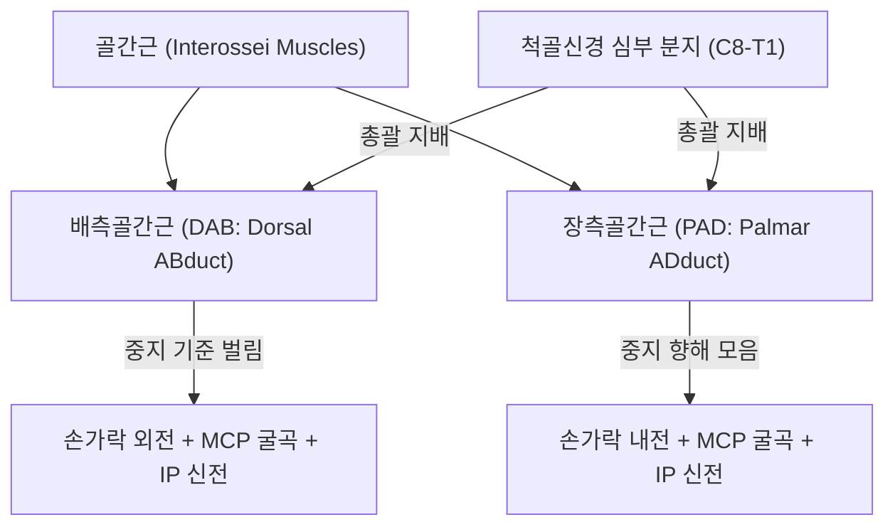
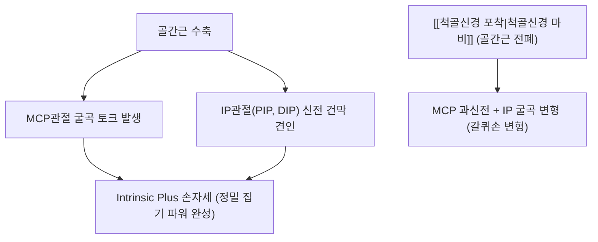
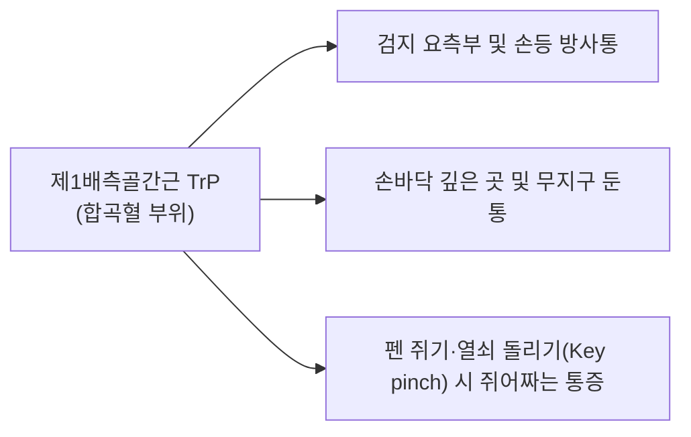

# [[골간근]](Interossei Muscles)

> **핵심 요약 (Key Summary)**:
> 수부 [[중수골]] 및 족부 중족골 사이에 위치하는 심부 고유 내재근으로 [[배측골간근(손)|배측골간근]](DAB, 외전)과 [[장측골간근(손)|장측골간근]](PAD, 내전)으로 구성됩니다.
> 수부는 [[척골신경]] 심지(Deep motor branch, C8-T1), 족부는 [[외측족저신경]] 심지의 지배를 받으며, MP관절 굴곡 및 IP관절 신전(Z-movement)으로 정밀 집기력을 완성합니다.
> [[척골신경 포착|척골신경 마비]] 시 수부 골간근 위축과 [[Froment's sign|Froment 징후]], **갈퀴손 변형(Claw Hand)**을 초래하며, 합곡·팔사혈 약침 및 중수골간 횡가동 추나가 핵심입니다.

---
## 📌 목차
1. [해부학적 분류 및 수부·족부 대비 (DAB vs PAD)](#1-해부학적-분류-및-수부족부-대비-dab-vs-pad)
2. [생체역학·토크 분석 & Z-movement (Biomechanical Synergy)](#2-생체역학토크-분석--z-movement-biomechanical-synergy)
3. [근막통증증후군(TP) & 연관통 패턴 (Travell & Simons)](#3-근막통증증후군tp--연관통-패턴-travell--simons)
4. [초음파 해부학(Sonoanatomy) 및 중재 시술 랜드마크](#4-초음파-해부학sonoanatomy-및-중재-시술-랜드마크)
5. [⭐ 원장님 심층 임상 고찰 및 원본 필기 (Clinical Pearls)](#5-원장님-심층-임상-고찰-및-원본-필기-clinical-pearls)
6. [관련 임상 질환 및 신경학적 평가 총괄](#6-관련-임상-질환-및-신경학적-평가-총괄)
7. [추나·도수치료(MET/PIR) & 침구·약침·재활 프로토콜](#7-추나도수치료metpir--침구약침재활-프로토콜)
8. [출처 및 학술 참고 문헌 (References)](#8-출처-및-학술-참고-문헌-references)

---
## 1. 해부학적 분류 및 수부·족부 대비 (DAB vs PAD)

| 구분 | [[배측골간근(손)|배측골간근]] (Dorsal Interossei, DI) | [[장측골간근(손)|장측골간근]] (Palmar Interossei, PI) |
| :--- | :--- | :--- |
| **기억 공식** | **DAB** (Dorsal = ABduction, 벌림) | **PAD** (Palmar/Plantar = ADduction, 모음) |
| **수부 기준축** | 제3수지(중지, Middle finger) 중심축 | 제3수지를 향해 모음 |
| **기시 (Origin)** | 인접한 두 [[중수골]](Metacarpal) 대면 골체 (총 4개, 2두 깃모양 Bipennate) | 제2, 4, 5중수골 장측면 (총 3개, 단두 Unipennate) |
| **정지 (Insertion)** | 해당 수지 [[근위지골]](Proximal phalanx) 기저부 및 [[신근건막]] | 해당 수지 [[근위지골]] 기저부 및 [[신근건막]] |
| **수부 신경 지배** | [[척골신경]] 심부 분지 (Deep branch of ulnar N., C8-T1) | [[척골신경]] 심부 분지 (C8-T1) |
| **족부 신경 지배** | [[외측족저신경]] 심지 (Deep branch of lateral plantar N., S1-S2) | [[외측족저신경]] 심지 (S1-S2) |

---
## 2. 생체역학·토크 분석 & Z-movement (Biomechanical Synergy)

### (1) 충양근과의 협동 작용 (Intrinsic Plus Position)
* 골간근의 힘줄 섬유는 중수지절(MCP) 관절의 굴곡 회전축 앞쪽(장측)을 지나고, 지간(IP) 관절의 신전 회전축 뒤쪽([[신근건막]])으로 주행합니다.
* 따라서 수축 시 **MCP관절은 굴곡(Flexion)시키고, 근위 및 원위 지간(PIP, DIP)관절은 신전(Extension)**시키는 특유의 Z자 집기 자세(Z-movement, Intrinsic Plus)를 완성합니다.

---
## 3. 근막통증증후군(TP) & 연관통 패턴 (Travell & Simons)

* **발통점 형성 위치 (Trigger Point Location)**:
  * 제1중수골과 제2중수골 사이 근복 중앙 (합곡혈 부위, 제1배측골간근).
* **특징적 증상 및 연관통**:
  * 펜을 쥐거나 열쇠를 돌릴 때(Key pinch) 엄지와 검지 사이에 심한 쑤심과 쥐어짜는 듯한 통증.
  * 손가락 마디마디가 뻣뻣하고 관절염으로 오진되기 쉬운 손가락 측면 통증 유발.

---
## 4. 초음파 해부학(Sonoanatomy) 및 중재 시술 랜드마크

* **초음파 스캔 뷰**:
  * 손등에서 중수골 사이에 프로브를 횡으로 위치시키면 중수골 단면 사이에 끼여 있는 배측골간근과 심층의 장측골간근 층판을 관찰할 수 있습니다.
  * 컬러 도플러로 중수골 사이를 관통하는 장측/배측 중수동맥의 주행을 확인하고 혈관 손상을 회피합니다.
* **침도 및 약침 안전 마진**:
  * 중수골 골체 표면을 랜드마크 삼아 골간막 심층으로 안전하게 진입하여 근막 유착을 분리합니다.

---
## 5. ⭐ 원장님 심층 임상 고찰 및 원본 필기 (Clinical Pearls)

### (1) 프로망 징후(Froment Sign) 감별 진단 노하우
* **검사 방법**: 환자에게 엄지와 검지 사이에 얇은 종이나 명함을 꽉 쥐게 하고, 검사자가 이를 강하게 빼앗으려 당깁니다.
* **병적 반응**:
  * [[척골신경 포착|척골신경 마비]]로 제1배측골간근과 [[무지내전근(손)]]이 약화된 환자는 종이를 놓치지 않기 위해 **[[정중신경]] 지배의 [[장무지굴근]](FPL)을 보상 수축시켜 엄지 끝관절(IP 관절)을 갈고리처럼 굽히는 현상([[Froment's sign|Froment 징후 양성]])**을 보입니다.

### (2) 중수골간 횡방향 가동술 (추나 이완 팁)
* 중수골 사이를 양손 엄지로 위아래로 잡고 전후(손등-손바닥) 방향으로 미세하게 엇갈려 활주시추면(Metacarpal shear mobilization), 만성 마우스 사용이나 타이핑으로 굳어진 골간근의 경결과 수부 횡아치 유착이 수초 만에 부드럽게 풀립니다.

### (3) 합곡(合谷)혈 및 팔사(八邪)혈 침구·약침 임상 노하우
* **합곡(LI4)**: 제1배측골간근 중심부로, 직자 시 제1배측골간근을 관통하여 심부 [[무지내전근(손)]]까지 도달하며 수부 신경 흥분을 진정시킵니다.
* **팔사(EX-UE9)**: 손가락 사이 물갈퀴 부위에서 중수골 사이 공간을 향해 1~1.5촌 사자하면 각 골간근의 건막 유착을 신속히 박리할 수 있습니다.

---
## 6. 관련 임상 질환 및 신경학적 평가 총괄

| 임상 질환 / 증후군 | 병리적 연관 기전 | 주요 증상 및 이학적 검사 | 핵심 교정 타깃 |
| :--- | :--- | :--- | :--- |
| **갈퀴손 변형(Claw Hand)** | [[척골신경 포착|척골신경 마비]]로 골간근 및 [[충양근(손)]] 마비 | 제4, 5지 MCP관절 과신전 + IP관절 굴곡 | 척골신경 감압 + 골간근 재생 약침 |
| [[Froment's sign|Froment 징후 양성]] | 제1배측골간근 및 [[무지내전근(손)]] 근력 저하 | 종이 당길 때 엄지 IP관절 굴곡 보상 | 내재근 강화 + 정중신경 과부하 완화 |
| 중수골간 근위축 | 경추 신경근증 또는 흉곽출구증후군 만성화 | 손등 중수골 사이가 푹 꺼지는 위축 | 팔사혈 약침 + 신경가동술 |
| 수부 내재근 긴장성 근막통 | 키보드·스마트폰 과사용에 의한 골간근 과부하 | 손가락 사이 뻐근함, 집기 피로 | 합곡·팔사혈 침도 및 추나 가동술 |

---
## 7. 추나·도수치료(MET/PIR) & 침구·약침·재활 프로토콜

### (1) 한의학 경혈 매핑 & 약침 프로토콜
* **경혈 매핑**: 합곡(合谷, LI4), 팔사(八邪, EX-UE9), 태충(LR3), 팔풍(八風, EX-LE10)
* **약침 처방**:
  * [[척골신경 포착|척골신경 마비]] 및 골간근 위축 부위에 [[황련해독탕]] 약침 또는 자하거약침을 각 골간강마다 0.2ml씩 분주하여 근위축 회복 및 신경 재생을 유도합니다.

### (2) 내재근 강화 운동 (Intrinsic Muscle Exercise)
* 수건 집기 운동, 손가락 사이에 고무줄을 끼우고 벌리는 외전 저항 운동을 통해 수부 정밀 집기력을 재교육합니다.

---
## 8. 출처 및 학술 참고 문헌 (References)

1. **Neumann, D. A. (2017)**. *Kinesiology of the Musculoskeletal System: Foundations for Rehabilitation* (3rd ed.). Elsevier.
   - **[생체역학 총론]**: 수부 및 족부 골간근의 DAB/PAD 생체역학, Intrinsic-plus 자세 형성 및 신근건막과의 기능적 연계 분석.
2. **Standring, S. (2020)**. *Gray's Anatomy: The Anatomical Basis of Clinical Practice* (42nd ed.). Elsevier.
   - **[해부학 총론]**: 장측 및 배측 골간근의 기시·정지 해부학, 척골신경 심지 및 외측족저신경 지배 경로 총괄.
3. **Yang, T. & Rui, Y. J. (2022)**. *J Plast Surg Hand Surg*, 56(5), 310-317.
   - *Innervation of the lumbrical and interosseous muscles in hand: analysis of distribution of nerve fascicles and quantification of their surface projections*. [PMID: 34581658](https://pubmed.ncbi.nlm.nih.gov/34581658/)
   - **[연구 요약]**: 수부 충양근과 골간근의 척골신경 신경속 분포 분석 및 표면 투사 정량화.
