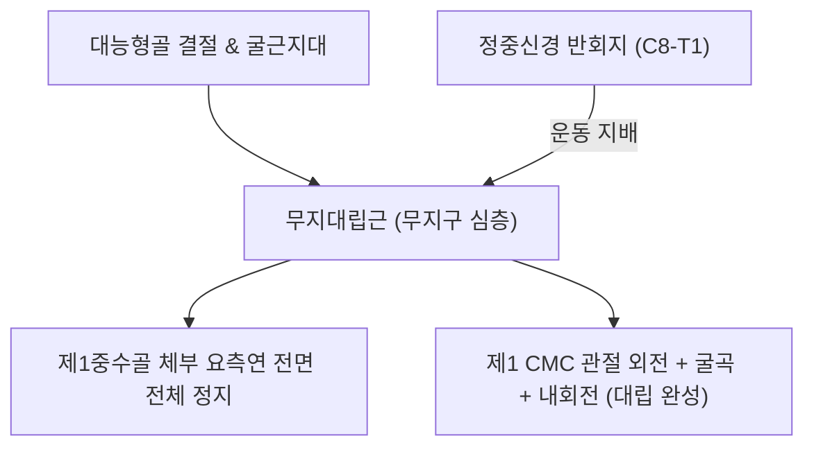
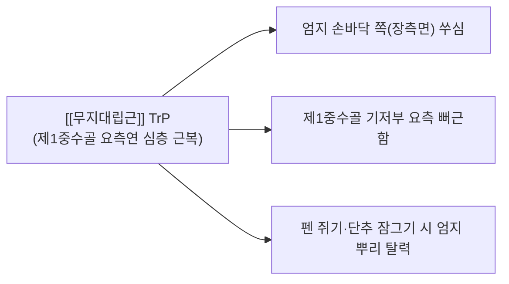

# [[무지대립근]](Opponens Pollicis, OP)

> **핵심 요약 (Key Summary)**:
> 대능형골 결절 및 [[굴근지대]]에서 기원하여 제1[[중수골]] 요측연 전면에 정지하는 무지구 심층의 핵심 대립근입니다.
> [[정중신경]] 반회지(Recurrent motor branch, C8-T1)의 지배를 받으며, 제1중수골을 장측 외전·굴곡·내회전시켜 엄지가 다른 손가락과 마주보게 하는 대립(Opposition)을 전담합니다.
> [[수근관 증후군]](정중신경 마비에 의한 Ape Hand 변형 및 대립 불능), 정밀 핀치 상실, 손바닥 횡아치 붕괴의 핵심 진단 표적근이며, 어제혈 심부 침구 및 대능형-중수관절(CMC) 교정이 주요 치료점입니다.

---
## 📌 목차
1. [해부학적 정밀 구조 및 지배 신경/혈관](#1-해부학적-정밀-구조-및-지배-신경혈관)
2. [생체역학·토크 분석 & 근막 사슬 (Biomechanical Synergy)](#2-생체역학토크-분석--근막-사슬-biomechanical-synergy)
3. [근막통증증후군(TP) & 연관통 패턴 (Travell & Simons)](#3-근막통증증후군tp--연관통-패턴-travell--simons)
4. [초음파 해부학(Sonoanatomy) 및 중재 시술 랜드마크](#4-초음파-해부학sonoanatomy-및-중재-시술-랜드마크)
5. [⭐ 원장님 심층 임상 고찰 및 원본 필기 (Clinical Pearls)](#5-원장님-심층-임상-고찰-및-원본-필기-clinical-pearls)
6. [관련 임상 질환 및 운동손상 증후군 총괄](#6-관련-임상-질환-및-운동손상-증후군-총괄)
7. [추나·도수치료(MET/PIR) & 침구·약침·재활 프로토콜](#7-추나도수치료metpir--침구약침재활-프로토콜)
8. [출처 및 학술 참고 문헌 (References)](#8-출처-및-학술-참고-문헌-references)

---
## 1. 해부학적 정밀 구조 및 지배 신경/혈관

| 항목 | 상세 내용 |
| :--- | :--- |
| **기시 (Origin)** | 대능형골(Trapezium) 결절 및 [[굴근지대]](Flexor retinaculum / 횡수근인대) |
| **정지 (Insertion)** | 제1[[중수골]](1st Metacarpal bone) 체부 요측(외측)연 전면 전체 |
| **신경 지배** | [[정중신경]](Median nerve, C8-T1) 반회지(Recurrent motor branch, Million Dollar Nerve) |
| **혈관 공급** | 요골동맥의 천장동맥궁(Superficial palmar arch) 분지 및 주무지동맥(Princeps pollicis artery) |
| **무지구 층판 위치** | [[단무지외전근]](APB)의 바로 심층에 위치하며, 제1중수골 골간 전체를 요측에서 감싸며 부착 |

---
## 2. 생체역학·토크 분석 & 근막 사슬 (Biomechanical Synergy)

### (1) 엄지 대립의 절대적 주동근 (Prime Mover of Thumb Opposition)
* 제1 수근중수관절(CMC joint)에서 제1[[중수골]]을 **외전(Abduction) → 굴곡(Flexion) → 내회전(Medial rotation/Pronation)**의 3차원 복합 운동으로 유도합니다.
* 엄지 손가락 끝 지문면이 제2~5지 지문면과 정확히 맞닿게 함으로써 인간 손 기능의 60% 이상을 차지하는 정밀 파지(Precision grip, Tip-to-tip pinch)를 가능케 합니다.

### (2) 손바닥 횡아치(Distal Transverse Arch) 오므림 형성
* 소지의 [[소지대립근]](Opponens digiti minimi)과 대칭적으로 마주 보며 수축하여 손바닥을 둥근 그릇 형태(Cup shape)로 오므리는 횡아치 안정성을 제공합니다.

### (3) 협동근 및 길항근 역학 관계
* **대립 협동근**: [[단무지외전근]](외전 초기 유도), [[단무지굴근(손)]](MCP 굴곡 보조), [[소지대립근]](원위 횡아치 대칭 거상).
* **대립 길항근**: [[장무지신근]], [[단무지신근]], [[장무지외전근]](엄지를 손등·외측으로 신전 및 외전시키는 후방 구획 근육군).

### (4) 근막 사슬 (Myofascial Chains)
* 토마스 마이어 근막경선 중 **심층전방상지선(Deep Front Arm Line, DFAL)**의 종착지입니다. [[소흉근]] → [[상완이두근]] 단두 → 요골 골막 → 무지구 근막 사슬로 연결됩니다.

---
## 3. 근막통증증후군(TP) & 연관통 패턴 (Travell & Simons)

* **발통점 위치**:
  * 제1중수골 요측 연을 따라 단무지외전근 심층의 근복 중앙부에 형성.
* **연관통 패턴 (Referral Pain Pattern)**:
  * 엄지의 손바닥 쪽(장측면)과 제1중수골 기저부 요측으로 쑤시고 뻐근한 통증 방사.
  * 손목 요측의 수근관절부로 통증이 확산되어 드퀘르벵 건초염([[장무지외전근]]·[[단무지신근]] 건염)이나 제1 CMC 관절염으로 오인되기 쉬움.
* **임상 증상**:
  * 펜 잡기, 젓가락질, 단추 채우기, 병뚜껑 돌리기 시 엄지 뿌리가 아파 손에서 물건을 떨어뜨림.

---
## 4. 초음파 해부학(Sonoanatomy) 및 중재 시술 랜드마크

* **초음파 스캔 뷰 (Short & Long Axis)**:
  * 트랜스듀서를 제1중수골 요측 전면에 장축 및 단축으로 위치시키면, 가장 표층의 [[단무지외전근]] 아래에서 제1중수골 피질골을 직접 덮고 있는 무지대립근 섬유가 확인됩니다.
* **중재 시술 안전 마진 및 신경 랜드마크**:
  * 수근관 원위부 횡수근인대 외측 절흔에서 분지되는 [[정중신경]] 반회지(Recurrent motor branch)는 천층 굴근지대 상면이나 근간막을 관통하므로, 과도하게 근위부 내측으로 침도를 깊게 자입하면 운동신경 손상 위험이 있습니다.
  * 안전 자입선: 제1중수골 외측 골막에 바늘을 직접 접촉시키는 골막 자극 방식으로 신경 손상을 회피합니다.

---
## 5. ⭐ 원장님 심층 임상 고찰 및 원본 필기 (Clinical Pearls)

### (1) 정중신경 마비와 원숭이 손(Ape Hand) 변형의 핵심 기전
* [[수근관 증후군]] 말기나 수근부 정중신경 열상 시 [[정중신경]] 반회지가 마비되면 무지대립근과 [[단무지외전근]]이 전폐되어 엄지의 회전 기능이 완전히 소실됩니다.
* 결과적으로 엄지가 손가락 평면과 나란히 뒤로 젖혀지는 **원숭이 손(Ape Hand) 변형**이 고착화되어, 펜 잡기나 동전 줍기 등 섬세한 일상생활 동작(ADL)이 영구 불능 상태에 빠집니다.

### (2) Million Dollar Nerve 손상 주의
* 정중신경 반회지는 손상 시 엄지 대립 불능으로 인한 장애율이 막대하여 수술실에서 '백만 달러 신경'으로 불립니다.
* 무지구 근위부 절개나 심부 침도 치료 시 제1중수골 기저부 근위 1cm 내측 영역은 극도로 신중하게 접근해야 합니다.

### (3) 제1 CMC 관절염(Rhizarthrosis)과의 상호 악순환
* 스마트폰 타이핑 과사용으로 무지대립근이 과긴장·단축되면 제1중수골 기저부를 대능형골 관절면에 강하게 압박하여 관절 연골 마모와 골극 형성을 가속화합니다. 무지대립근 이완은 CMC 관절염 통증 경감의 필수 전제조건입니다.

---
## 6. 관련 임상 질환 및 운동손상 증후군 총괄

| 임상 질환 / 증후군 | 병리적 연관 기전 | 주요 증상 및 이학적 검사 | 핵심 교정 타깃 |
| :--- | :--- | :--- | :--- |
| [[수근관 증후군]](CTS) | 정중신경 압박에 따른 반회지 허혈 | 무지구 위축, 대립 불능, Phalen/Tinel 양성 | [[굴근지대]] 감압 및 무지구 침도 |
| Ape Hand 변형 | 정중신경 완전 마비로 인한 대립근 위축 | 엄지의 손바닥 외측 편위, 대립 검사 불능 | 신경 회복 침구 및 수근 횡아치 보조기 |
| 제1 CMC 관절염 | 무지대립근 단축에 따른 관절 내 압박 증가 | Grind test 양성, 엄지 기저부 국소 종통 | 제1 CMC 견인 추나 및 무지대립근 MET |
| 스마트폰 수지 건막염 | 엄지 반복 내회전 및 반복 파지로 인한 TP | 제1지 장측 방사통, 핀치 그립 피로 | 어제혈 심부 도침 및 근막 이완 |

---
## 7. 추나·도수치료(MET/PIR) & 침구·약침·재활 프로토콜

### (1) 한의학 경혈 매핑 & 자침법
* **경혈 매핑**: 어제(魚際, LU10), 노궁(勞宮, PC8)
* **자침 기법**:
  * **어제(LU10)**: 제1중수골 요측 중앙, 무지대립근의 기시-정지 중간 지점. 심부 도침 자입 시 제1중수골 골막을 긁어주어 근막 유착 박리 (15~20mm 직자).
  * **노궁(PC8)**: 손바닥 중앙 노궁 방향으로의 사자를 통해 무지구 횡아치 이완 유도.
  * 근막 연축 완화를 위해 [[황련해독탕]] 약침 0.2cc를 제1중수골 골막 인접 근복에 주입.

### (2) 추나 및 도수치료 (MET / 관절 가동술)
* **제1 CMC 관절 견인-신전 가동 추나**: 시술자의 한 손으로 대능형골을 고정하고 다른 손으로 제1중수골을 잡고 원위 견인(Long-axis traction) 후 신전 및 외회전 유도.
* **MET**: 환자에게 엄지를 새끼손가락 방향으로 대립(오므리기)하게 저항을 주고 5~7초간 등척성 수축 후, 호기 시 엄지를 손등 쪽으로 신전·외회전 신장.

---
## 8. 출처 및 학술 참고 문헌 (References)

1. **Standring, S. (2020)**. *Gray's Anatomy: The Anatomical Basis of Clinical Practice* (42nd ed.). Elsevier.
   - **[해부학 총론]**: 무지대립근의 제1 수근중수관절(CMC) 3차원 회전 생체역학 및 정중신경 반회지 해부학적 변이 분석.
2. **Simons, D. G., & Travell, J. G. (1999)**. *Myofascial Pain and Dysfunction: The Trigger Point Manual*, Vol. 1 (2nd ed.). Williams & Wilkins.
   - **[연구 요약]**: 무지대립근 발통점이 엄지 장측 및 무지구 요측으로 방사하는 연관통 패턴 제시.
3. **Kozin, S. H. (1998)**. *J Hand Surg Am*, 23(5), 852-858.
   - *The anatomy of the recurrent branch of the median nerve*. [PMID: 9763261](https://pubmed.ncbi.nlm.nih.gov/9763261/)
   - **[연구 요약]**: 정중신경 반회지의 횡수근인대 대비 주행 변이(Extraligamentous vs Subligamentous vs Transligamentous) 분류 및 무지대립근 지배 분석.
