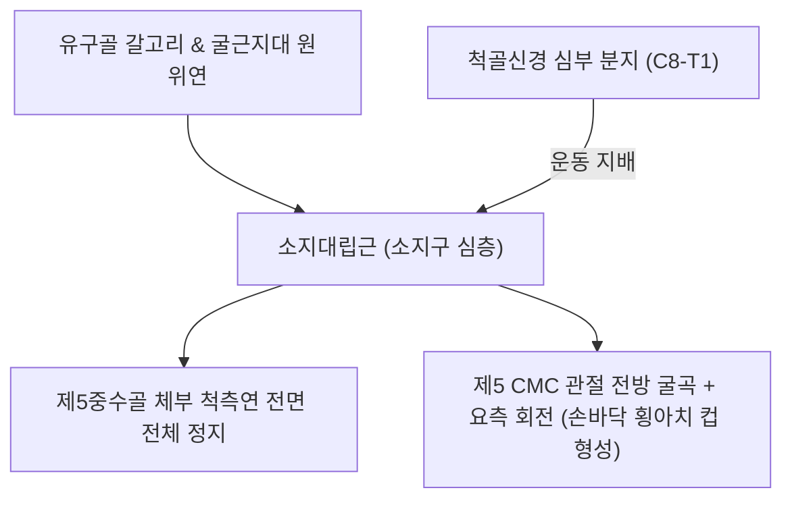
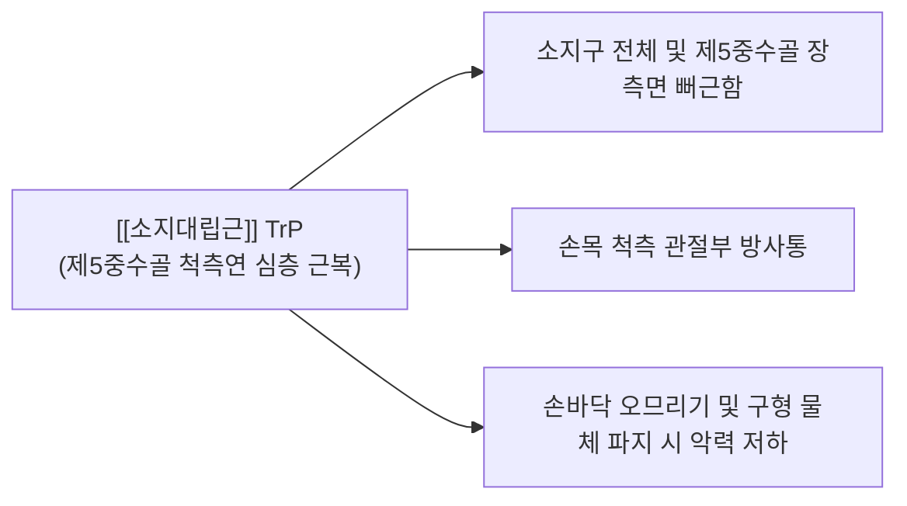

# [[소지대립근]](Opponens Digiti Minimi, ODM)

> **핵심 요약 (Key Summary)**:
> 유구골 갈고리(Hook of hamate) 및 [[굴근지대]]에서 기원하여 제5[[중수골]] 체부 척측연 전면 전체에 정지하는 소지구 심층 대립근입니다.
> [[척골신경]] 심부 분지(Deep motor branch, C8-T1)의 지배를 받으며, 제5중수골을 전방 및 요측으로 회전시켜 손바닥 횡아치를 오므리는 컵(Cup) 형성을 전담합니다.
> [[척골신경 포착|척골신경 마비]](손바닥 편평 변형 및 소지 대립 장애), 파지 컵 붕괴, 손바닥 횡아치 불안정증의 핵심 표적근이며, 소부혈 심부 침구 및 제5 CMC 교정이 주요 치료점입니다.

---
## 📌 목차
1. [해부학적 정밀 구조 및 지배 신경/혈관](#1-해부학적-정밀-구조-및-지배-신경혈관)
2. [생체역학·토크 분석 & 근막 사슬 (Biomechanical Synergy)](#2-생체역학토크-분석--근막-사슬-biomechanical-synergy)
3. [근막통증증후군(TP) & 연관통 패턴 (Travell & Simons)](#3-근막통증증후군tp--연관통-패턴-travell--simons)
4. [초음파 해부학(Sonoanatomy) 및 중재 시술 랜드마크](#4-초음파-해부학sonoanatomy-및-중재-시술-랜드마크)
5. [⭐ 원장님 심층 임상 고찰 및 원본 필기 (Clinical Pearls)](#5-원장님-심층-임상-고찰-및-원본-필기-clinical-pearls)
6. [관련 임상 질환 및 운동손상 증후군 총괄](#6-관련-임상-질환-및-운동손상-증후군-총괄)
7. [추나·도수치료(MET/PIR) & 침구·약침·재활 프로토콜](#7-추나도수치료metpir--침구약침재활-프로토콜)
8. [출처 및 학술 참고 문헌 (References)](#8-출처-및-학술-참고-문헌-references)

---
## 1. 해부학적 정밀 구조 및 지배 신경/혈관

| 항목 | 상세 내용 |
| :--- | :--- |
| **기시 (Origin)** | 유구골(Hamate) 갈고리(Hook of hamate) 및 [[굴근지대]](Flexor retinaculum) 원위연 |
| **정지 (Insertion)** | 제5[[중수골]](5th Metacarpal bone) 체부 척측(내측)연 전면 전체 |
| **신경 지배** | [[척골신경]](Ulnar nerve, C8-T1) 심부 분지(Deep motor branch) |
| **혈관 공급** | 척골동맥의 심장동맥궁(Deep palmar arch) 및 척측 수근분지 |
| **소지구 층판 위치** | [[소지외전근(손)]] 및 [[단소지굴근(손)]]의 **심층에 위치**하여 제5중수골 골간 전체를 전내측에서 감싸며 부착 |

---
## 2. 생체역학·토크 분석 & 근막 사슬 (Biomechanical Synergy)

### (1) 제5지 대립 및 횡수근 아치 컵 형성 (Little Finger Opposition & Palmar Cupping)
* 제5 수근중수관절(CMC joint)에서 제5중수골을 전방 굴곡 및 요측(외측)으로 회전시켜 손바닥의 오목한 굴곡 웅덩이(Palmar cup)를 깊게 만듭니다.
* 엄지의 [[무지대립근]]과 대칭적으로 마주 보며 수축하여 손바닥 횡아치(Distal transverse arch)의 양쪽 기둥을 오므려 물을 떠 마시거나 구형(Sphere) 물체를 완벽히 감싸 쥡니다.

### (2) 협동근 및 길항근 역학 관계
* **대립 협동근**: [[무지대립근]](엄지 대립), [[단수장근]](피하 주름 형성 및 컵 지지), [[단소지굴근(손)]].
* **대립 길항근**: [[척측수근신근]], [[소지신근]](제5중수골 및 수지의 후방 신전).

### (3) 근막 사슬 (Myofascial Chains)
* **심층전방상지선(Deep Front Arm Line, DFAL)**의 척측 종착점으로, 전완 골간막 및 심층 굴근막과 긴밀한 긴장도를 공유합니다.

---
## 3. 근막통증증후군(TP) & 연관통 패턴 (Travell & Simons)

* **발통점 위치**:
  * 제5중수골 체부 척측연을 따라 단소지굴근 심층의 근복 중앙부.
* **연관통 패턴 (Referral Pain Pattern)**:
  * 소지구 전체와 제5중수골 장측면 및 손목 척측 관절부로 뻐근하고 둔한 연관통 방사.
  * 손등 제5중수골 부위로 통증이 뚫고 나가는 듯한 심부 둔통 호소.
* **임상 증상**:
  * 손바닥을 오므려 물을 뜰 때 물이 새어 나가고, 둥근 과일이나 야구공을 쥘 때 새끼손가락 쪽 손바닥이 받쳐주지 못함.

---
## 4. 초음파 해부학(Sonoanatomy) 및 중재 시술 랜드마크

* **초음파 스캔 뷰 (Sonoanatomy)**:
  * 제5중수골 장축 스캔 시, 고에코성의 중수골 피질골 표면을 직접 덮고 있는 얇은 저에코성 근육층이 소지대립근입니다. 그 표층으로 [[단소지굴근(손)]] 섬유가 관찰됩니다.
* **중재 시술 안전 마진**:
  * 제5중수골 척측 골막을 타깃으로 침도를 직자하여 뼈에 닿게 한 후 미세 박리(Bone contact technique)합니다.
  * 근위부 유구골 갈고리 주변의 [[척골신경]] 심부 분지 손상을 피하기 위해 중수골 체부 중앙 1/3 영역에서 시술합니다.

---
## 5. ⭐ 원장님 심층 임상 고찰 및 원본 필기 (Clinical Pearls)

### (1) 손바닥 편평 변형(Flat Hypothenar)과 아치 붕괴
* [[척골신경 포착|척골신경 마비]] 시 소지대립근이 마비되면 **손바닥 안쪽이 편평해져(Flat palm) 횡아치가 완전히 무너지고, 물건을 쥘 때 새끼손가락이 붕 떠서 밀착력을 상실**합니다.
* 피아노 건반을 누를 때 5번 손가락이 지탱하지 못하고 무너지는(Collapse) 핵심 원인입니다.

### (2) 제5 CMC 관절 불안정증과의 연계
* 제5 CMC 관절은 제2·3 CMC 관절에 비해 가동성이 크기 때문에(약 20~30° 굴신 가동성), 소지대립근이 약화되거나 단축되면 관절의 아탈구 및 만성 척측 수근부 통증을 유발합니다.

### (3) Ape Hand(정중신경)와 Claw Hand(척골신경)의 비교
* Ape hand는 엄지 대립근이 마비되어 발생하지만 소지대립근은 정상 작동합니다.
* Claw hand에서는 소지대립근 마비로 손바닥 횡아치가 붕괴되어 손이 완전히 평평하게 굳어집니다.

---
## 6. 관련 임상 질환 및 운동손상 증후군 총괄

| 임상 질환 / 증후군 | 병리적 연관 기전 | 주요 증상 및 이학적 검사 | 핵심 교정 타깃 |
| :--- | :--- | :--- | :--- |
| [[척골신경 포착|척골신경 마비]] | 척골신경 손상으로 소지 대립 전폐 | Flat Hand 변형, 구형 파지 불능 | 척골신경 자극 및 소지구 침구 |
| 손바닥 횡아치 붕괴 | 소지대립근과 무지대립근 협응 상실 | 손바닥 돔 소실, 물병 쥘 때 미끄러짐 | 소지대립근 MET 및 수근골 교정 |
| 제5 CMC 관절염 | 소지대립근 단축에 의한 관절 압박 | 제5중수골 기저부 통증, 축성 압박 검사 양성 | 제5 CMC 관절 견인 추나 및 도침 |
| 악기 연주자 수지 붕괴증 | 제5지 지지근 피로에 의한 아치 함몰 | 타건 시 손목 척측 피로, 악력 저하 | 소부혈 침도 및 횡아치 재활 |

---
## 7. 추나·도수치료(MET/PIR) & 침구·약침·재활 프로토콜

### (1) 한의학 경혈 매핑 & 자침법
* **경혈 매핑**: 소부(少府, HT8), 완골(腕骨, SI4)
* **자침 기법**:
  * **소부(HT8)**: 심경의 형혈로 소지대립근의 정지부인 제5중수골 척측 골막을 직접 자극하는 침도 요혈 (15~20mm 직자).
  * **완골(SI4)**: 제5 CMC 관절부 감압 및 소지대립근 기시부 유착 박리.
  * 소지구 근막 이완을 위해 [[황련해독탕]] 약침 0.2cc를 제5중수골 골막 인접 근복에 주입.

### (2) 추나 및 도수치료 (MET / 제5 CMC 가동술)
* **제5 CMC 관절 굴곡-외전 가동 추나**: 시술자가 유구골을 고정하고 제5중수골을 잡아 손바닥 쪽으로 밀어 넣으며 회전 가동성 회복.
* **소지대립근 MET**: 환자에게 새끼손가락을 엄지 쪽으로 오므리게 저항(5초) 후, 호기 시 제5중수골을 손등 쪽으로 편평하게 펴주는 신장 적용.

---
## 8. 출처 및 학술 참고 문헌 (References)

1. **Standring, S. (2020)**. *Gray's Anatomy: The Anatomical Basis of Clinical Practice* (42nd ed.). Elsevier.
   - **[해부학 총론]**: 소지대립근의 제5 CMC 관절 3차원 회전 운동 메커니즘 및 척골신경 심지 지배 분석.
2. **Simons, D. G., & Travell, J. G. (1999)**. *Myofascial Pain and Dysfunction: The Trigger Point Manual*, Vol. 1 (2nd ed.). Williams & Wilkins.
   - **[연구 요약]**: 소지대립근 발통점이 소지구 전체 및 제5중수골 장측으로 방사하는 연관통 패턴 제시.
3. **Georgiev, G. P. (2020)**. *Clin Anat*, 33(2), 326.
   - *Hypothenar muscles-A popular object of anatomy and surgery and some misdescriptions*. [PMID: 31880333](https://pubmed.ncbi.nlm.nih.gov/31880333/)
   - **[연구 요약]**: 소지구 심층의 소지대립근 및 인접 근육들의 해부학적 변이와 척골신경 심지 지배 경로 분석.
