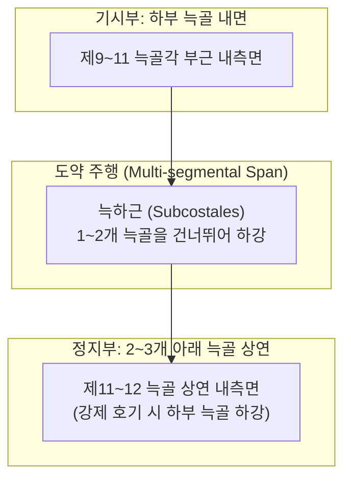
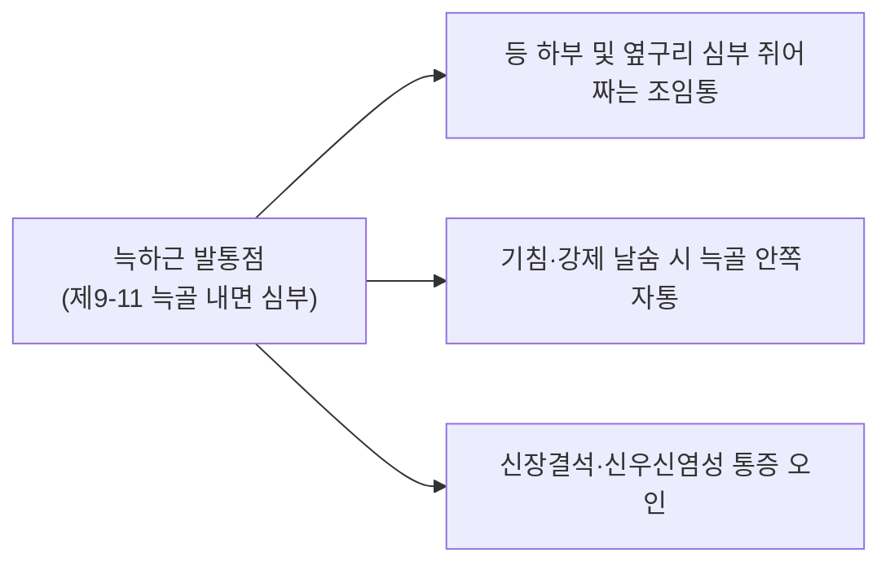

# [[늑하근]](Subcostales Muscle)

> **핵심 요약 (Key Summary)**:
> 하부 늑골(주로 제9~11번) 늑골각 부근의 내면에서 기원하여 1~2개의 늑골을 건너뛰어 2~3개 아래 늑골 상연 내면에 정지하는 흉벽 최심층 호흡 근육입니다.
> 해당 구역 [[늑간신경]](T9-T11 전지)의 지배를 받으며, [[내늑간근]]의 최심층 섬유와 연속되어 강제 호기 시 하부 늑골을 아래로 끌어내려 흉곽 하부를 압축합니다.
> 골프 스윙 체간 회전 손상 및 격렬한 만성 기침 후의 하부 늑간통증, [[늑간신경통]]의 숨은 병변근이며, 하위 늑골 상연 안전 사자 및 장문·경문혈 연계 감압이 주요 치료점입니다.

---
## 📌 목차
1. [해부학적 정밀 구조 및 지배 신경/혈관](#1-해부학적-정밀-구조-및-지배-신경혈관)
2. [생체역학·토크 분석 & 근막 사슬 (Biomechanical Synergy)](#2-생체역학토크-분석--근막-사슬-biomechanical-synergy)
3. [근막통증증후군(TP) & 연관통 패턴 (Travell & Simons)](#3-근막통증증후군tp--연관통-패턴-travell--simons)
4. [초음파 해부학(Sonoanatomy) 및 중재 시술 랜드마크](#4-초음파-해부학sonoanatomy-및-중재-시술-랜드마크)
5. [⭐ 원장님 심층 임상 고찰 및 원본 필기 (Clinical Pearls)](#5-원장님-심층-임상-고찰-및-원본-필기-clinical-pearls)
6. [관련 임상 질환 및 운동손상 증후군 총괄](#6-관련-임상-질환-및-운동손상-증후군-총괄)
7. [추나·도수치료(MET/PIR) & 침구·약침·재활 프로토콜](#7-추나도수치료metpir--침구약침재활-프로토콜)
8. [출처 및 학술 참고 문헌 (References)](#8-출처-및-학술-참고-문헌-references)

---
## 1. 해부학적 정밀 구조 및 지배 신경/혈관

| 항목 | 상세 내용 |
| :--- | :--- |
| **기시 (Origin)** | 하부 [[늑골]](주로 제9~11늑골)의 늑골각 부근 내측면(Internal surface near angle of ribs) |
| **정지 (Insertion)** | 1~2개 늑골을 건너뛰어 **2~3개 아래 하위 [[늑골]]의 상연 내측면** |
| **주행 방향** | 후하방 사선 방향(Posterior-Inferiorly ↘) — [[내늑간근]]의 주행 방향과 동일하나 여러 늑골을 도약(Span)하여 주행 |
| **신경 지배** | 하부 [[늑간신경]](Intercostal nerves, T9-T11 전지) |
| **혈관 공급** | 후늑간동맥(Posterior intercostal arteries)의 측부 분지 및 늑골하동맥 |
| **해부학적 층판 위치** | 흉벽 내면에서 벽측 흉막(Parietal pleura)과 직접 맞닿아 있는 **최심늑간근(Innermost intercostal)과 동일 평면의 최심층 구조** |

---
## 2. 생체역학·토크 분석 & 근막 사슬 (Biomechanical Synergy)

* **하부 흉곽 강제 호기 하강 (Depression of Lower Ribs)**:
  * 여러 분절을 한꺼번에 건너뛰어 부착되는 지렛대 구조 덕분에, 단일 분절 늑간근보다 훨씬 큰 모멘트암을 형성하여 하부 늑골을 강력하게 아래로 끌어내림.
  * 재채기, 격렬한 기침, 관악기 연주, 복압 상승 시 하부 흉곽 용적을 급격히 축소.
* **흉벽 후하부 내벽 장력 지지**:
  * 복강 내압이 급상승할 때 하부 늑간 공간이 바깥쪽으로 불룩하게 팽출되지 않도록 내벽을 견고하게 지지.
* **협동근 및 길항근 역학 관계**:
  * **호기 협동근**: [[내늑간근]], [[하후거근]], [[내복사근]], [[외복사근]], [[복횡근]].
  * **흡기 길항근**: [[외늑간근]], [[횡격막]], [[늑골거근]].
* **근막 사슬 (Myofascial Chains)**:
  * **심부 전방선(Deep Front Line, DFL)** 및 복벽 횡근막(Transversalis fascia)과 흉곽 내벽 근막의 이행부.

---
## 3. 근막통증증후군(TP) & 연관통 패턴 (Travell & Simons)

* **발통점 위치**:
  * 등 하부 제9~11늑골 사이, 척추 외측 5~8cm 부근의 늑골 내측 심부.
* **연관통 패턴 (Referral Pain Pattern)**:
  * 등 하부에서 옆구리, 측복부로 깊숙하게 조여드는 묵직하고 뻐근한 심부 둔통 방사.
  * 기침을 하거나 숨을 깊게 내쉴 때 갈비뼈 안쪽이 쥐어짜듯 결림.
* **임상 증상**:
  * 환자가 "갈비뼈 속 깊은 곳이 결리는데 손으로 겉을 만져서는 닿지 않는다"고 호소.
  * 몸통을 비틀며 허리를 숙일 때 옆구리 안쪽에서 찌릿한 늑간 마찰감 발생.

---
## 4. 초음파 해부학(Sonoanatomy) 및 중재 시술 랜드마크

* **초음파 스캔 뷰 (Sonoanatomy)**:
  * 등 하부 늑간극 사상 스캔 시, 피하지방 → 등 표층 근육 → 늑간근 복합체 → 최심층에서 흉막선(Pleural line) 바로 위에 위치하는 얇은 근육 띠 확인.
* **중재 시술 안전 마진 (기흉 절대 주의)**:
  * 늑하근은 벽측 흉막과 바로 맞닿아 있으므로, 절대 수직 직자를 해서는 안 됨.
  * 안전 자입선: 반드시 **하위 [[늑골]]의 상연 외측 피질골에 바늘을 접촉(Bone contact)**시킨 후, 골막을 미끄러지듯 10~15° 사자로 진입하여 늑막 관통을 원천 차단.

---
## 5. ⭐ 원장님 심층 임상 고찰 및 원본 필기 (Clinical Pearls)

* **최심늑간근과의 연속성과 하부 늑벽 안정화**:
  * 늑하근은 독립된 별개의 근육이라기보다 **[[내늑간근]]의 최심층 판(Innermost intercostal)이 여러 늑골을 건너뛰며 특화된 형태**임.
  * 흉곽의 하부(T9-T12)는 늑골의 가동성이 크고 복강 장기(간, 비장, 신장)와 인접하므로, 늑하근의 도약 주행이 하부 흉벽의 입체적 동적 안정성을 지탱함.
* **골프 스윙 임팩트 손상과 늑하근 염좌**:
  * 골프 스윙 시 체간을 강하게 비틀며 하강시킬 때 늑하근에 강한 부하가 걸리며 미세 염좌가 호발함.
  * 표층 늑간근 치료로 호전되지 않는 난치성 등-옆구리 결림의 핵심 원인이 늑하근 심부 유착임.

---
## 6. 관련 임상 질환 및 운동손상 증후군 총괄

| 임상 질환 / 증후군 | 병리적 연관 기전 | 주요 증상 및 이학적 검사 | 핵심 교정 타깃 |
| :--- | :--- | :--- | :--- |
| [[늑간신경통]] | 하부 늑골구 신경혈관 압박 | 하부 늑간을 따르는 날카로운 방사통 | 하위 늑골 상연 도침 및 늑간신경 감압 |
| **골프 하부 늑벽 염좌** | 스윙 회전력에 의한 다분절 근막 파열 | 스윙 시 옆구리 심부 결림, 기침 시 통증 | 늑하근 골막 접촉 침구 및 소염 약침 |
| **만성 호기 억제 증후군** | 늑하근 만성 경직으로 하부 늑골 고정 | 날숨 제한, 복식 호흡 부전 | 흉곽 하부 확장 도수 및 호흡 재활 |

---
## 7. 추나·도수치료(MET/PIR) & 침구·약침·재활 프로토콜

* **한의학 경혈 매핑**:
  * **장문(LR13)**: 제11늑골 전단 하연, 간경의 모혈이자 하부 늑간-복벽 이행부 요혈.
  * **경문(GB25)**: 제12늑골 선단 하연, 담경의 모혈로 신장부 및 하부 흉벽 통증의 필수혈.
  * **화타협척혈**: T9-T11 극돌기 외측 0.5촌, 늑하근 지배 신경근 조절.
* **추나 및 도수치료 (하부 늑골 가동 추나)**:
  * 환자를 측와위로 두고 시술자의 전완으로 제9~11늑골을 감싼 후, 흡기 시 늑골을 외상방으로 유도하고 호기 시 부드럽게 압박하여 가동성 복원.
* **재활 운동 (Lower Rib Expansion Breathing)**:
  * 양손으로 하부 갈비뼈를 감싸 쥐고 숨을 들이쉬며 갈비뼈를 양옆으로 팽창시켰다가, 숨을 끝까지 내쉬며 양손으로 갈비뼈를 조여주는 늑하근 자가 이완 호흡(10회 반복).

---
## 8. 출처 및 학술 참고 문헌 (References)

* Standring, S. *Gray's Anatomy: The Anatomical Basis of Clinical Practice*. 42nd ed. Elsevier, 2020: 952-954.
  * `[연구 요약]`: 늑하근의 하부 늑골 내면 기시 해부학 및 여러 늑골을 건너뛰는 도약 주행과 호기 역학 분석.
* Simons, D. G., & Travell, J. G. *Myofascial Pain and Dysfunction: The Trigger Point Manual*. Vol 1. 2nd ed. Williams & Wilkins, 1999: 845-852.
  * `[연구 요약]`: 흉벽 최심층 근육군의 발통점 및 등 하부·옆구리로 투사되는 심부 둔통 패턴 분석.
* Bayoglu R, et al. *Twente spine model: A complete and coherent dataset for musculo-skeletal modeling of the thoracic and cervical regions of the human spine*. J Biomech, 2017; 53: 111-123. [PMID: 28465030](https://pubmed.ncbi.nlm.nih.gov/28465030/)
  * `[연구 요약]`: 흉곽 및 척추 심층 근육(늑하근, 늑골거근, 늑간근)의 정밀 3차원 근골격 모델링을 통한 호흡 및 체간 회전 토크 기여도 규명.
