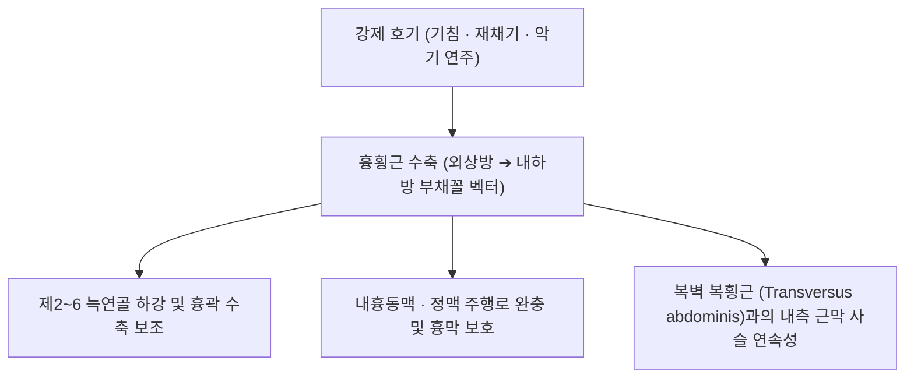

# [[흉횡근]](Transversus Thoracis)

> **핵심 요약 (Key Summary)**:
> 흉골체 하부 후면, 검상돌기 후면 및 제4~7늑연골 내면에서 기원하여 제2~6늑연골 내면 및 하연에 정지하는 전흉벽 최심층의 호흡 보조근입니다.
> 제2~6 [[늑간신경]](T2-T6)의 지배를 받으며, 강제 호기 시 늑연골을 하강시키고 내흉동맥·정맥의 후방 보호벽 역할을 수행합니다.
> 흉골하 심부 둔통, 늑연골염 및 개흉술 후 흉벽 통증의 핵심 관련근이며, 초음파 유도하 TTP 평면 및 늑연골 내측 안전 사자 침구가 주요 치료점입니다.

---
## 📌 목차
1. [해부학적 정밀 구조 및 지배 신경/혈관](#1-해부학적-정밀-구조-및-지배-신경혈관)
2. [생체역학·토크 분석 & 근막 사슬 (Biomechanical Synergy)](#2-생체역학토크-분석--근막-사슬-biomechanical-synergy)
3. [근막통증증후군(TP) & 연관통 패턴 (Travell & Simons)](#3-근막통증증후군tp--연관통-패턴-travell--simons)
4. [초음파 해부학(Sonoanatomy) 및 중재 시술 랜드마크](#4-초음파-해부학sonoanatomy-및-중재-시술-랜드마크)
5. [⭐ 원장님 심층 임상 고찰 및 원본 필기 (Clinical Pearls)](#5-원장님-심층-임상-고찰-및-원본-필기-clinical-pearls)
6. [관련 임상 질환 및 운동손상 증후군 총괄](#6-관련-임상-질환-및-운동손상-증후군-총괄)
7. [추나·도수치료(MET/PIR) & 침구·약침·재활 프로토콜](#7-추나도수치료metpir--침구약침재활-프로토콜)
8. [출처 및 학술 참고 문헌 (References)](#8-출처-및-학술-참고-문헌-references)

---
## 1. 해부학적 정밀 구조 및 지배 신경/혈관

| 항목 | 상세 내용 |
| :--- | :--- |
| **기시 (Origin)** | [[흉골]]체(Body of sternum) 하부 1/3 후면, 검상돌기(Xiphoid process) 후면, 제4~7[[늑골]](늑연골) 후내면 |
| **정지 (Insertion)** | 제2~6번 늑연골(Costal cartilages)의 하연 및 내면 (외상방을 향해 방사상 부채꼴 주행) |
| **신경 지배** | 제2~6 [[늑간신경]](Intercostal nerves, T2-T6 전지) |
| **혈관 공급** | 내흉동맥(Internal thoracic artery)의 흉골지 및 전늑간동맥 가지 |
| **해부학적 층판 위치** | 전흉벽 최심층에 위치하며, [[외늑간근]], [[내늑간근]] 및 최심늑간근보다 심부, 벽측 흉막(Parietal pleura)의 바로 전방에 밀착. 내흉동맥과 정맥이 흉횡근의 앞면과 늑연골 뒷면 사이를 주행 |

---
## 2. 생체역학·토크 분석 & 근막 사슬 (Biomechanical Synergy)

* **강제 호기 시 늑연골 하강 (Active Expiratory Depression)**:
  * 안정 호기 시에는 폐의 탄성 반동으로 충분하나, 기침, 재채기, 운동 중 강제 호기 시 늑연골을 안쪽 아래로 당겨 흉강 체적을 급격히 축소시킴.
* **내흉동·정맥의 해부학적 보호벽**:
  * 흉골 양측 1~2cm를 따라 수직 주행하는 내흉혈관의 후방을 지지하여 심장 수술(CABG 등) 및 흉벽 외상 시 혈관을 완충 보호.
* **복벽 [[복횡근]]과의 기능적 연속성**:
  * 복강 최심층의 복횡근이 흉강 내면으로 연속되어 올라온 상방 연장선 구조로서, [[횡격막]]과 함께 체간 내압의 전방 안정성 보조.

---
## 3. 근막통증증후군(TP) & 연관통 패턴 (Travell & Simons)

* **발통점 정밀 위치 (TrP Locations)**:
  * 흉골연 외측 1~2cm 지점, 제3~5늑간 내면 부착부.
* **연관통 패턴 (Referral Pain Pattern)**:
  * **흉골하 심부 둔통**: 가슴뼈 바로 뒤쪽이 뻐근하게 쥐어짜이거나 결리는 심부 통증 유발.
  * **호기성 악화**: 깊은 숨을 내쉬거나 기침, 재채기 시 흉골 뒤쪽이 찢어지는 듯한 불쾌한 통증 투사.
* **임상 감별 포인트**:
  * 심혈관계 질환([[협심증]], 심근경색)의 심전도 및 효소 수치가 정상인 비심장성 흉통 및 [[늑간신경통]]과 감별 필수.

---
## 4. 초음파 해부학(Sonoanatomy) 및 중재 시술 랜드마크

* **초음파 스캔 뷰 (Sonoanatomy)**:
  * 흉골 傍(Parasternal) 시상 및 사상 스캔 시, [[대흉근]] → 늑연골/내늑간근 → **흉횡근(얇은 저에코성 층판)** → 고에코성 벽측 흉막선 순으로 명확히 관찰.
  * 흉횡근 전면에서 박동하는 내흉동맥(Internal thoracic artery)의 도플러 신호 확인.
* **중재 시술 안전 마진 (기흉 절대 주의)**:
  * 흉횡근 바로 뒤가 흉막강이므로 **직자(Perpendicular needling)는 절대 금기**이며, [[기흉]] 방지가 최우선.
  * 늑연골 표면을 가이드 삼아 흉골 방향으로 완만하게 눕혀 사자(Oblique needling) 자입.

---
## 5. ⭐ 원장님 심층 임상 고찰 및 원본 필기 (Clinical Pearls)

* **흉골하 통증의 감별 진단 (원장님 팁)**:
  * 심장내과 검사에서 "이상 없다"는 진단을 받았으나 가슴 깊은 곳이 답답하고 결린다는 환자는 **흉횡근의 만성 허혈성 연축**을 반드시 의심해야 함.
  * 표층의 [[흉골근]] 압통(단중혈 사혈 표적)과 달리, 흉횡근은 흉골 뒤쪽 깊은 곳에서 발생하는 기침 유발성 통증이 감별 포인트임.
* **만성 호흡기 질환자의 호기근 피로**:
  * 만성 기관지염, 천식, 흡연 환자에서 기침을 장기간 반복하면 흉횡근이 과긴장되어 전흉벽 강직을 초래함.
  * 늑연골 내측연 안전 사자 침치료와 호기 이완 추나로 전흉벽 장력을 해소하면 호흡이 극적으로 편안해짐.

---
## 6. 관련 임상 질환 및 운동손상 증후군 총괄

| 임상 질환 / 증후군 | 병리적 연관 기전 | 주요 증상 및 이학적 검사 | 핵심 교정 타깃 |
| :--- | :--- | :--- | :--- |
| **비심장성 흉골하 흉통** | 흉횡근 근막 연축 및 허혈 | 가슴 깊은 곳 뻐근함, 심호흡 시 결림 | 흉골연 외측 늑연골 사자 침구 |
| **늑연골염(Costochondritis)** | 제2~5 늑연골 부착부 만성 견인 | 늑연골 접합부 압통, 기침 시 통증 | 흉횡근 근막 감압 및 소염 [[약침]] |
| **개흉술 후 통증 증후군** | 흉골 절개 후 흉횡근 반흔 유착 | 수술 부위 심부 찌릿한 신경병증 통증 | 흉횡근 평면 도침 및 약침 이완 |
| **만성 기침 유발성 흉통** | 반복적 강제 호기에 의한 근피로 | 기침 시 흉골 후면 격통, 흉벽 압박감 | 흉골 가동 추나 및 족소음신경 자침 |

---
## 7. 추나·도수치료(MET/PIR) & 침구·약침·재활 프로토콜

* **한의학 경혈 매핑**:
  * **신봉(KI23), 영허(KI24), 신장(KI25)**: 흉골체 양측 2촌 선상 족소음신경 요혈로 흉횡근 부착부 직상방 위치.
* **추나 및 도수치료 (전흉벽 호기 이완 기법)**:
  * 시술자가 환자의 흉골체 위에 손바닥을 대고 호기 시 하후방으로 가볍게 압박하여 늑연골과 흉횡근의 신장 유도하는 [[도수치료]] 기법.
* **재활 운동 (Chest Expansion & Diaphragmatic Retraining)**:
  * 과도한 흉식 호기를 억제하고 [[횡격막]] 복식호흡을 회복시키는 90/90 호흡 훈련 병행.

---
## 8. 출처 및 학술 참고 문헌 (References)

* Piraccini E, et al. (2024). Optimal techniques of ultrasound-guided superficial and deep parasternal intercostal plane blocks: a cadaveric study. *Regional Anesthesia and Pain Medicine*, 49(5): 315-320. [PMID: 37460213](https://pubmed.ncbi.nlm.nih.gov/37460213/)
  * `[연구 요약]`: 흉횡근 평면(Transversus thoracis plane)의 카다바 해부학적 층판 및 초음파 유도하 약액 확산 경로 분석.
* Fujii S, et al. (2019). Transversus thoracis muscle plane block in cardiac surgery: a pilot feasibility study. *Regional Anesthesia and Pain Medicine*, 44(5): 550-554. [PMID: 30902911](https://pubmed.ncbi.nlm.nih.gov/30902911/)
  * `[연구 요약]`: 흉횡근 평면 차단술의 전흉벽 진통 효과 및 내흉혈관-흉막 간 안전 랜드마크 규명.
* Standring, S. *Gray's Anatomy: The Anatomical Basis of Clinical Practice*. 42nd ed. Elsevier, 2020: 955.
  * `[연구 요약]`: 흉횡근의 기시, 정지, 제2~6 늑간신경 지배 및 늑골 하강 호기 역학 총설.
