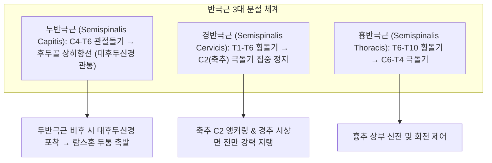
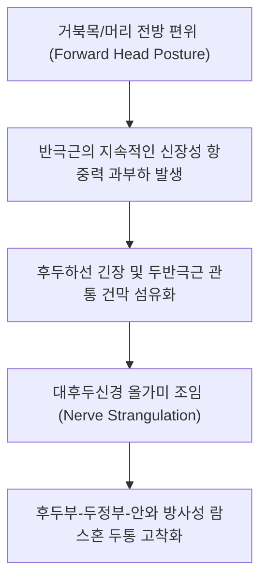

# [[반극근]](Semispinalis / 반가시근)

> **핵심 요약 (Key Summary)**:
> 척추 횡돌기에서 기시하여 4~6개 분절을 건너뛰며 상방의 극돌기 및 후두골에 정지하는 [[두반극근]](Capitis), [[경반극근]](Cervicis), 흉반극근(Thoracis) 복합체.
> [[척수신경]] 경·흉수 후지(Dorsal rami)의 지배를 받으며, 경추 및 흉추의 강력한 신전과 반대측 회전을 담당하는 목/등의 메인 엔진.
> 주치 병증은 [[경추성 두통]](대후두신경 포착), [[람스혼 두통]], 거북목 증후군 및 뒷목의 만성 뻐근함.

---
## 📌 목차
1. [해부학적 정밀 구조 및 지배 신경/혈관](#1-해부학적-정밀-구조-및-지배-신경혈관)
2. [생체역학·토크 분석 & 근막 사슬 (Biomechanical Synergy)](#2-생체역학토크-분석--근막-사슬-biomechanical-synergy)
3. [근막통증증후군(TP) & 연관통 패턴 (Travell & Simons)](#3-근막통증증후군tp--연관통-패턴-travell--simons)
4. [초음파 해부학(Sonoanatomy) 및 중재 시술 랜드마크](#4-초음파-해부학sonoanatomy-및-중재-시술-랜드마크)
5. [⭐ 원장님 심층 임상 고찰 및 원본 필기 (Clinical Pearls)](#5-원장님-심층-임상-고찰-및-원본-필기-clinical-pearls)
6. [관련 임상 질환 및 운동손상 증후군 총괄](#6-관련-임상-질환-및-운동손상-증후군-총괄)
7. [추나·도수치료(MET/PIR) & 침구·약침·재활 프로토콜](#7-추나도수치료metpir--침구약침재활-프로토콜)
8. [출처 및 학술 참고 문헌 (References)](#8-출처-및-학술-참고-문헌-references)

---
## 1. 해부학적 정밀 구조 및 지배 신경/혈관

| 항목 | 상세 내용 |
| :--- | :--- |
| **3대 분절 구성** | • **[[두반극근]](Semispinalis capitis)**: C4-T6 횡돌기/관절돌기 기시 → 후두골 상하향선 사이 정지 (대후두신경이 관통) • **[[경반극근]](Semispinalis cervicis)**: T1-T6 횡돌기 기시 → 축추(C2) 극돌기에 가장 두껍게 정지 • **흉반극근 (Semispinalis thoracis)**: T6-T10 횡돌기 기시 → C6-T4 극돌기 정지 |
| **대후두신경 관통 관계** | **[[대후두신경]](Greater occipital nerve, C2 후지)**이 두반극근 건막을 관통하여 후두부 피하로 주행 |
| **신경 지배** | 경추 및 흉추 [[척수신경]] 후지(Dorsal rami) |
| **혈관 공급** | 후두동맥(Occipital artery) 및 심경동맥(Deep cervical artery) |

---
## 2. 생체역학·토크 분석 & 근막 사슬 (Biomechanical Synergy)

* **경추 신전 및 머리 무게 지탱 (Cervical Anti-Gravity Engine)**:
  * 머리가 앞으로 떨어지는 중력 토크에 대항하여 목을 세우고 경추 전만(Cervical lordosis)을 지지하는 가장 강력한 표층-심부 가교 근육.
* **C2(축추) 극돌기 집중 앵커링**:
  * 경반극근의 두꺼운 섬유 다발이 C2 극돌기에 모여 부착되어 상부 경추 회전 시 강력한 중심축 안정화 토크 제공.
* **반대측 회전 (Contralateral Rotation)**:
  * 사선 주행 섬유로 인해 편측 수축 시 목과 머리를 반대 방향으로 회전시킴.

---
## 3. 근막통증증후군(TP) & 연관통 패턴 (Travell & Simons)

* **발통점(Trigger Point) 위치**:
  * **두반극근 TrP**: 후두골 부착부 하방 2~3cm, 천주혈 부근 근복.
  * **경반극근 TrP**: C2 극돌기 외측 및 C4-C5 높이의 척추 옆 고랑.
* **연관통 방사 패턴**:
  * **[[람스혼 두통]](Ram's Horn Headache)**: 후두부에서 시작하여 측두부를 거쳐 눈썹 및 눈 뒤통증(Retro-orbital pain)으로 뻗치는 뿔 모양 두통.
  * 정수리(두정부)가 타는 듯하거나 머리카락을 만지기만 해도 아픈 두피 이질통(Allodynia) 동반.

---
## 4. 초음파 해부학(Sonoanatomy) 및 중재 시술 랜드마크

* **초음파 스캔 랜드마크 (C2 레벨 후두부 단축 뷰)**:
  * 표층의 [[승모근]]과 [[판상근]] 아래 위치한 두껍고 넓은 두반극근 근복 식별.
  * 두반극근과 [[하두사근]] 사이를 주행하여 두반극근을 뚫고 나오는 [[대후두신경]] 단면 확인.
* **자침 안전 마진 (Safety Margins)**:
  * 천주(BL10), 풍지(GB20) 내측: 후두골 골면 방향으로 15~30도 사자 20~30mm.
  * 척수강 내 진입을 방지하기 위해 상내측 직자가 아닌 후두골 골면을 향해 침끝 조준.

---
## 5. ⭐ 원장님 심층 임상 고찰 및 원본 필기 (Clinical Pearls)

* **대후두신경 포착과 람스혼 두통(Ram's Horn Headache) (원장님 핵심 팁 100% 보존)**:
  * 대후두신경(C2 후지)은 두반극근 근육을 뚫고 피하로 나오는 특이한 주행을 가짐.
  * 거북목 자세로 두반극근이 과도하게 긴장·단축되면 관통부가 신경을 옥죄는 올가미로 작용하여 **후두부에서 눈 주위로 돌아 나오는 람스혼 두통**이 발생함.
  * 두반극근 관통부(천주혈 상방)를 도침으로 미세 절개하여 신경을 감압(Neurolysis)하면 만성 편두통이 즉각 소실됨.
* **C2 극돌기 압통과 경반극근 건막염**:
  * 베개를 잘못 베고 자서 고개가 안 돌아갈 때(낙침), C2 극돌기 측면을 누르면 극심한 자지러지는 통증이 나타나며 이는 경반극근 부착부의 급성 건막염 소견임.

---
## 6. 관련 임상 질환 및 운동손상 증후군 총괄

| 임상 질환 / 증후군 | 병리적 연관 기전 | 주요 증상 및 이학적 검사 | 핵심 교정 타깃 |
| :--- | :--- | :--- | :--- |
| [[경추성 두통]] | 두반극근 연축으로 대후두신경 포착 및 C2-3 분절 이상 | 후두부-정수리-안구 방사통, 경추 회전 시 두통 악화 | 두반극근 관통부 도침, 상부경추 추나 |
| 대후두신경통 | 대후두신경 압박으로 인한 후두부 발작성 찌릿함 | 빗질할 때 두피 통증, 틴넬 징후 양성 | 신경 포착부 약침, 두반극근 이완 |
| 거북목/일자목 통증 | 머리 전방 편위로 인한 반극근의 신장성 과부하 | 뒷목 묵직함, 어깨 승모근 연쇄 뭉침 | 턱 당기기(Chin-tuck), 반극근 강화 |
| 급성 경추 염좌 (낙침) | C2 극돌기 경반극근 부착부 급성 염좌 | 고개 회전 제한(한쪽으로 못 돌림), C2 압통 | 풍지·천주 침구 치료, 온열 요법 |

---
## 7. 추나·도수치료(MET/PIR) & 침구·약침·재활 프로토콜

* **한의학 경혈 매핑 및 침구 프로토콜**:
  * 천주(BL10), 풍지(GB20), C2-C5 화타협척혈 직자 25~35mm.
  * 도침 요법: 두반극근 후두골 부착부 및 대후두신경 관통 부위 유착 미세 절개 감압.
  * 약침 치료: 대후두신경 주변에 신바로약침 또는 황련해독탕약침 0.5cc 주입.
* **도수 치료 및 자가 관리**:
  * **친턱 운동 (Chin-Tuck Exercise)**: 턱을 목젖 쪽으로 당겨 경추 심부 굴근을 활성화하고 과긴장된 반극근을 이완.
  * **후두하 이완 수기**: 앙와위에서 검지와 중지로 두반극근 후두골 부착부를 받쳐 올리며 경추 견인.

---
## 8. 출처 및 학술 참고 문헌 (References)

1. **Tubbs, R. S., Watanabe, K., Loukas, M., & Cohen-Gadol, A. A. (2014)**. The intramuscular course of the greater occipital nerve: novel findings with potential implications for operative interventions and occipital neuralgia. *Surg Neurol Int*, 5, 155. [PMID: 25422783](https://pubmed.ncbi.nlm.nih.gov/25422783/)
   - `[연구 요약]`: 대후두신경(GON)이 두반극근 건막을 관통하는 근육 내 주행 해부 규명 및 반극근 긴장에 의한 GON 올가미 포착과 후두통·경추성 두통의 병태생리 정립.
2. **Standring, S. (2020)**. *Gray's Anatomy: The Anatomical Basis of Clinical Practice* (42nd ed.). Elsevier: 822-823.
   - `[연구 요약]`: 두반극근과 대후두신경의 관통 해부학 및 경반극근의 C2 집중 정지 분석.
3. **Travell, J. G., & Simons, D. G. (1999)**. *Myofascial Pain and Dysfunction*. Williams & Wilkins.
   - `[연구 요약]`: 반극근 발통점과 람스혼 연관통 투사 기전 정립.
