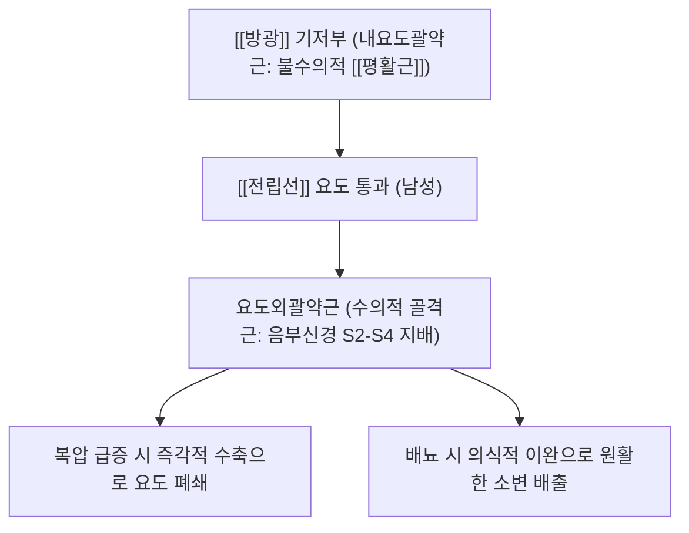
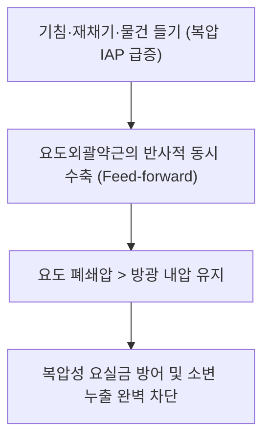

# [[요도외괄약근]](External Urethral Sphincter / 바깥요도조임근)

> **핵심 요약 (Key Summary)**:
> 비뇨생식삼각(Urogenital triangle) 심회음간극(Deep perineal pouch)에 위치하여 막성 요도(Membranous urethra)를 둘러싸는 수의근성 조임근.
> [[음부신경]](Pudendal nerve, S2-S4) 회음지의 체성 신경 지배를 받으며, 배뇨의 수의적 제어 및 복압 상승 시 소변 누출을 차단하는 2차 요 자제(Urinary continence) 제동기.
> 주치 병증은 [[복압성 요실금]](SUI), 전립선 절제 후 요실금(PPI), 배뇨근-괄약근 협동장애(DSD) 및 만성 골반통증증후군(CPPS).

---
## 📌 목차
1. [해부학적 정밀 구조 및 지배 신경/혈관](#1-해부학적-정밀-구조-및-지배-신경혈관)
2. [생체역학·토크 분석 & 근막 사슬 (Biomechanical Synergy)](#2-생체역학토크-분석--근막-사슬-biomechanical-synergy)
3. [근막통증증후군(TP) & 연관통 패턴 (Travell & Simons)](#3-근막통증증후군tp--연관통-패턴-travell--simons)
4. [초음파 해부학(Sonoanatomy) 및 중재 시술 랜드마크](#4-초음파-해부학sonoanatomy-및-중재-시술-랜드마크)
5. [⭐ 원장님 심층 임상 고찰 및 원본 필기 (Clinical Pearls)](#5-원장님-심층-임상-고찰-및-원본-필기-clinical-pearls)
6. [관련 임상 질환 및 운동손상 증후군 총괄](#6-관련-임상-질환-및-운동손상-증후군-총괄)
7. [추나·도수치료(MET/PIR) & 침구·약침·재활 프로토콜](#7-추나도수치료metpir--침구약침재활-프로토콜)
8. [출처 및 학술 참고 문헌 (References)](#8-출처-및-학술-참고-문헌-references)

---
## 1. 해부학적 정밀 구조 및 지배 신경/혈관

| 항목 | 상세 내용 |
| :--- | :--- |
| **남성 구조** | [[전립선]] 첨부(Apex) 바로 하방에서 막성 요도를 오메가(Ω) 모양 또는 원통형으로 둘러싸며 전립선 외막과 연속 |
| **여성 구조** | 요도 중하부 2/3를 둘러싸며 요도질괄약근(Urethrovaginal sphincter) 및 요도압박근(Compressor urethrae)과 복합체 형성 |
| **기시 및 정지** | [[치골]] 결합 후면, 좌골치골지(Ischiopubic ramus) 내측막 및 회음체(Perineal body) |
| **신경 지배** | [[음부신경]](Pudendal nerve, S2-S4) 회음지(Perineal branch) 및 골반신경총 체성 운동 분지 |
| **혈관 공급** | 내음부동맥(Internal pudendal a.)의 요도구동맥(Artery of bulb) 및 하방광동맥 분지 |

---
## 2. 생체역학·토크 분석 & 근막 사슬 (Biomechanical Synergy)

* **이중 밸브 요 자제 메커니즘 (Dual-Valve Continence Mechanism)**:
  * 불수의성 평활근인 내요도괄약근이 평상시 기저 폐쇄압을 유지하고, 골격근인 요도외괄약근이 기침이나 운동 등 복압 급증 시 능동적으로 조여 누출을 차단.
* **배뇨근-괄약근 상반 억제 (Reciprocal Inhibition)**:
  * 방광 배뇨근(Detrusor)이 수축할 때 천수 배뇨반사에 의해 요도외괄약근이 완전히 이완되어야 저항 없는 배뇨 완성.
* **근막 사슬 연계 (Anatomy Trains)**:
  * 심부전방선(Deep Front Line)의 골반저 기저판으로 [[골반저근]](항문거근, 심회음횡근)과 직접 근막적으로 결합.

---
## 3. 근막통증증후군(TP) & 연관통 패턴 (Travell & Simons)

* **발통점(Trigger Point) 위치**:
  * 비뇨생식삼각 심부, 치골결합 하방 2~3cm 회음체 주변.
* **연관통 방사 패턴**:
  * **회음부 및 요도 작열통**: 배뇨 시 요도 끝이 찌릿하고 화끈거리며, 사정 직후 회음부 깊은 곳의 쥐어짜는 듯한 통증 호소.
  * 하복부(치골 상부) 및 서혜부로 확산되는 뻐근한 불쾌감.
* **임상적 특징**:
  * 장시간 운전이나 좌식 생활, 만성 스트레스로 골반저가 과긴장된 청장년층에서 세균성 감염 없이도 배뇨통과 빈뇨 유발.

---
## 4. 초음파 해부학(Sonoanatomy) 및 중재 시술 랜드마크

* **초음파 스캔 랜드마크 (경회음 초음파 - Transperineal Ultrasound)**:
  * 치골결합 하방에 트랜스듀서를 밀착하고 시상면 스캔 시, 방광경부와 연결된 요도의 주행 및 막성 요도를 감싸는 저에코성 근육 링 확인.
  * 케겔 수축 시 괄약근이 요도를 전상방으로 당기며 내강이 닫히는 동적 움직임 관찰.
* **자침 안전 마진 (Safety Margins)**:
  * 회음혈(CV1) 자침 시 요도관이나 직장 벽을 관통하지 않도록, 치골 후면 골면을 가이드 삼아 전상방으로 45도 사자(깊이 20~30mm).

---
## 5. ⭐ 원장님 심층 임상 고찰 및 원본 필기 (Clinical Pearls)

* **전립선암 수술(RP) 후 요실금과 외괄약근 보존 (원장님 팁 100% 보존)**:
  * 전립선 전절제술을 받으면 방광경부의 내요도괄약근이 함께 절제되므로, 수술 후에는 **요도외괄약근이 소변을 막는 유일한 보루**가 됨.
  * 술 후 환자가 기저귀를 찰 정도로 요실금이 심할 때, 천골부 차료혈(BL32) 전침과 회음부 약침을 병행하여 음부신경을 자극하면 괄약근 수축력이 빠르게 회복됨.
* **복압성 요실금(SUI)에서의 골반저 해먹 기전**:
  * 기침할 때 질 전벽과 요도하 근막(DeLancey 해먹)이 외괄약근을 단단히 받쳐주어야 요도가 눌려 잠김.
  * 출산 후 골반저 이완으로 해먹 지지가 무너지면 외괄약근이 허공에서 수축하여 밸브가 새므로, 중극·관원혈 자침과 [[골반저근]] 재활이 필수적임.
* **과긴장성 골반저와 비세균성 전립선염 감별**:
  * 청년 남성이 요도 작열통과 잔뇨감을 호소할 때 항생제만 장기 복용하는 경우가 많음. 이는 요도외괄약근의 만성 연축인 경우가 대다수이므로 골반저 근막 이완과 좌욕이 근본 치료임.

---
## 6. 관련 임상 질환 및 운동손상 증후군 총괄

| 임상 질환 / 증후군 | 병리적 연관 기전 | 주요 증상 및 이학적 검사 | 핵심 교정 타깃 |
| :--- | :--- | :--- | :--- |
| [[복압성 요실금]](SUI) | 외괄약근 지지력 약화 및 골반저 이완 | 기침, 재채기, 줄넘기 시 소변 누출 | [[골반저근]] [[전침]], [[케겔 운동]] |
| 전립선 절제 후 요실금 | 수술 시 외괄약근 미세 손상 및 내괄약근 결손 | 기립 시 즉각적 요 누출, 패드 의존 | 차료혈 음부신경 자극 전침, 골반저 재활 |
| 배뇨근-괄약근 협동장애 (DSD) | 척수 손상 후 배뇨 시 괄약근 불완전 이완 | 소변 줄기 끊김, 잔뇨량 증가, 수신증 위험 | 천골 신경조절술, [[도침]] 감압 |
| 만성 골반통증증후군 (CPPS) | 요도외괄약근 만성 연축 및 TrP 형성 | 회음부 통증, 배뇨통, 사정통 | 회음·곡골혈 약침, 골반저 온열 도수 |

---
## 7. 추나·도수치료(MET/PIR) & 침구·약침·재활 프로토콜

* **한의학 경혈 매핑 및 침구 프로토콜**:
  * 복부: 중극(CV3), 관원(CV4), 곡골(CV2).
  * 회음부: 회음(CV1).
  * 천골부: 차료(BL32), 중료(BL33), 백환수(BL30).
  * 0.30×40mm 침으로 차료혈에 45도 하방 자입하여 제2·3 천골신경공을 통해 음부신경 줄기 자극(2Hz 저주파 전침).
* **골반저 바이오피드백 & [[케겔 운동]] (Kegel Exercise)**:
  * 소변을 끊는 느낌으로 요도외괄약근을 5초간 수축 후 5초간 완전히 이완하는 훈련을 1회 10회, 하루 3세트 반복.
* **골반 [[추나요법]]**:
  * 치골결합 전단 변위를 교정하고 천골의 후방 아탈구를 정렬하여 비뇨생식격막의 정상 장력 회복 및 [[추나요법]] 회복.

---
## 8. 출처 및 학술 참고 문헌 (References)

1. **Grivas, N., et al. (2026)**. Anatomy of the Prostatic Urethra and Sphincters: Normal and Pathological Variants. *Eur Urol Focus*, 12(5), 450-462. [PMID: 42323253](https://pubmed.ncbi.nlm.nih.gov/42323253/)
   - `[연구 요약]`: 전립선 요도 및 요도외괄약근 복합체의 정밀 3차원 해부학적 구조, 신경혈관 주행 및 요 자제 제어 기전 규명.
2. **DeLancey, J. O. L. (1994)**. Structural support of the urethra as it relates to stress urinary incontinence: the hammock hypothesis. *Am J Obstet Gynecol*, 170(6), 1713-1723.
   - `[연구 요약]`: 요도외괄약근과 요도하 질 전벽 지지 해먹 구조의 생체역학적 요실금 방어 기전 정립.
3. **Standring, S. (2020)**. *Gray's Anatomy: The Anatomical Basis of Clinical Practice* (42nd ed.). Elsevier: 1290-1294.
   - `[연구 요약]`: 남성 및 여성 요도괄약근 복합체의 발생학, 신경 지배 및 회음부 근막 층판 해부학 분석.
