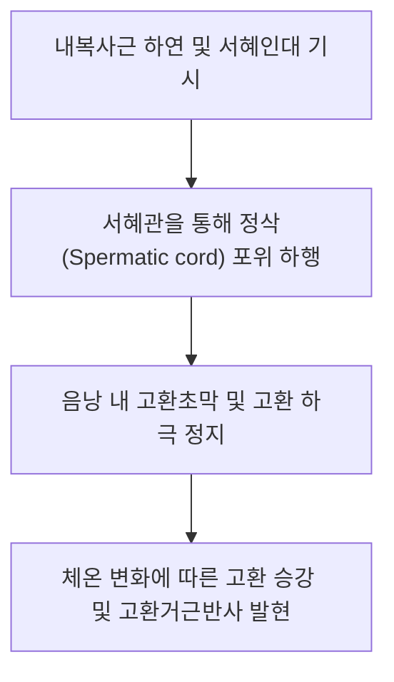
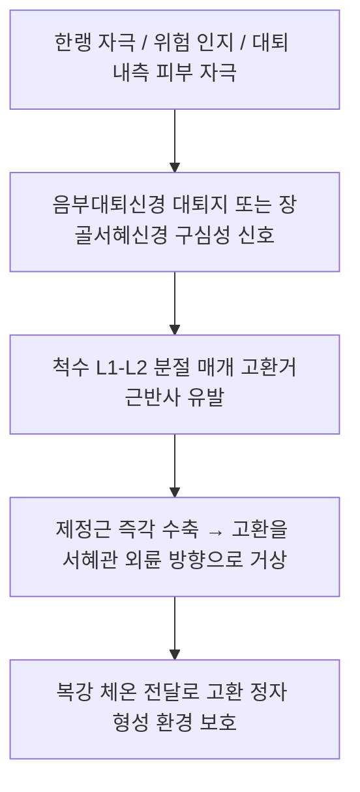

# [[제정근]](Cremaster / 고환올림근)

> **핵심 요약 (Key Summary)**:
> [[내복사근]] 하연 및 [[서혜인대]] 심부에서 기시하여 정삭(Spermatic cord)을 나선형으로 둘러싸며 고환초막(Tunica vaginalis)에 정지하는 비뇨생식기 특수 골격근.
> [[음부대퇴신경]](Genitofemoral nerve, L1-L2) 생식기분지의 지배를 받으며, 고환의 체온 유지 승강 운동 및 고환거근반사(Cremasteric reflex)를 담당.
> 주치 병증은 [[고환 염전|고환염전]](Testicular torsion 감별), 음부대퇴신경통, 만성 고환통(Orchialgia) 및 [[서혜부 통증증후군]].

---
## 📌 목차
1. [해부학적 정밀 구조 및 지배 신경/혈관](#1-해부학적-정밀-구조-및-지배-신경혈관)
2. [생체역학·토크 분석 & 근막 사슬 (Biomechanical Synergy)](#2-생체역학토크-분석--근막-사슬-biomechanical-synergy)
3. [근막통증증후군(TP) & 연관통 패턴 (Travell & Simons)](#3-근막통증증후군tp--연관통-패턴-travell--simons)
4. [초음파 해부학(Sonoanatomy) 및 중재 시술 랜드마크](#4-초음파-해부학sonoanatomy-및-중재-시술-랜드마크)
5. [⭐ 원장님 심층 임상 고찰 및 원본 필기 (Clinical Pearls)](#5-원장님-심층-임상-고찰-및-원본-필기-clinical-pearls)
6. [관련 임상 질환 및 운동손상 증후군 총괄](#6-관련-임상-질환-및-운동손상-증후군-총괄)
7. [추나·도수치료(MET/PIR) & 침구·약침·재활 프로토콜](#7-추나도수치료metpir--침구약침재활-프로토콜)
8. [출처 및 학술 참고 문헌 (References)](#8-출처-및-학술-참고-문헌-references)

---
## 1. 해부학적 정밀 구조 및 지배 신경/혈관

| 항목 | 상세 내용 |
| :--- | :--- |
| **기시 (Origin)** | [[내복사근]](Internal oblique m.) 하연의 근육 섬유 및 [[서혜인대]](Inguinal ligament) 중간 1/3 심부 |
| **정지 (Insertion)** | 정삭(Spermatic cord) 주위를 둘러싸며 하행하여 음낭 내 고환초막(Tunica vaginalis) 및 고환 하극 |
| **신경 지배** | [[음부대퇴신경]](Genitofemoral nerve, L1-L2)의 생식기분지(Genital branch) |
| **혈관 공급** | 하복벽동맥(Inferior epigastric a.) 분지인 고환거근동맥(Cremasteric artery) |
| **해부학적 공간** | 서혜관(Inguinal canal)을 관통하며 정삭의 중간 피막(Cremasteric fascia & muscle)을 형성 |

---
## 2. 생체역학·토크 분석 & 근막 사슬 (Biomechanical Synergy)

* **고환 정자 생성 최적 온도 유지 (Spermatogenesis Thermoregulation)**:
  * 고환이 복강 체온(37℃)보다 약 2~3℃ 낮은 상태를 유지하도록 외부 온도에 반응하여 수축(거상) 및 이완(하수)을 조절.
* **외상 방어 수축**:
  * 투쟁-도피 반응이나 하복부 충격 시 고환을 서혜부 쪽으로 끌어올려 외부 충격으로부터 보호.
* **근막 사슬 연계 (Anatomy Trains)**:
  * 심부전방선(Deep Front Line) 하단의 골반-서혜부 연결 고리로 [[내복사근]], [[복횡근]] 및 [[골반저근]]과 기능적으로 결합.

---
## 3. 근막통증증후군(TP) & 연관통 패턴 (Travell & Simons)

* **발통점(Trigger Point) 위치**:
  * 서혜관 외륜(External inguinal ring) 바로 하방, 치골결절 외상방 1~2cm 부위.
* **연관통 방사 패턴**:
  * **음낭 및 고환 심부 둔통**: 고환 자체가 묵직하게 조여들고 당기는 통증.
  * 서혜부 주름선을 따라 하복부 및 대퇴 전내측 상부로 뻗치는 연관통.
* **임상적 특징**:
  * 오래 서 있거나 고관절을 신전할 때 제정근이 견인되어 고환 결림 악화.

---
## 4. 초음파 해부학(Sonoanatomy) 및 중재 시술 랜드마크

* **초음파 스캔 랜드마크 (서혜관 종단 및 음낭 상부 횡단 스캔)**:
  * 서혜관 내에서 정삭을 감싸고 있는 얇은 저에코성 제정근 섬유 띠 확인.
  * 고환거근동맥의 도플러 혈류 신호 관찰 (고환염전 시 혈류 소실 감별).
* **자침 안전 마진 (Safety Margins)**:
  * 정관(Ductus deferens) 및 고환동정맥의 직접 천자를 절대 방지하기 위해 서혜관 심부 직자는 엄격히 금기.
  * 기충(ST30), 충문(SP12) 등 서혜부 경혈에서 [[치골]] 결합 골면을 가이드 삼아 외측으로 완만하게 사자.

---
## 5. ⭐ 원장님 심층 임상 고찰 및 원본 필기 (Clinical Pearls)

* **고환염전(Testicular Torsion) 응급 감별과 고환거근반사 (원장님 핵심 팁)**:
  * 급성 고환 통증 환자가 내원했을 때 가장 먼저 시행해야 할 이학적 검사가 **고환거근반사(Cremasteric reflex)**임.
  * 대퇴 내측 상부 피부를 뭉툭한 기구로 아래에서 위로 긁었을 때 동측 고환이 즉각 위로 올라오면 음성([[부고환염]] 등), **반사가 완전히 소실되어 있으면 즉각적인 고환염전 의심 하에 비뇨의학과 응급 전원(골든타임 6시간)** 필수.
* **음부대퇴신경 포착과 만성 고환통**:
  * [[대요근]] 경련이나 서혜부 탈장 수술 후 반흔으로 음부대퇴신경 생식기분지가 포착되면 제정근이 지속적으로 연축하여 만성 고환 당김증이 발생함. L1-L2 화타협척혈 전침이 주효함.
* **온열 요법의 주의점**:
  * 고환 부위에 직접 고온 뜸이나 강한 온열을 가하면 제정근의 체온 조절 기전을 마비시키고 정자 활동성을 급격히 떨어뜨리므로, 서혜부 온열 치료 시 음낭 차폐 필수.

---
## 6. 관련 임상 질환 및 운동손상 증후군 총괄

| 임상 질환 / 증후군 | 병리적 연관 기전 | 주요 증상 및 이학적 검사 | 핵심 교정 타깃 |
| :--- | :--- | :--- | :--- |
| [[고환 염전|고환염전]] | 정삭 비틀림으로 제정근 연축 및 혈류 차단 | 급성 극심한 고환통, 고환거근반사 소실 | 비뇨의학과 즉각 응급 의뢰 |
| 음부대퇴신경통 | L1-L2 신경근 또는 서혜관 내 신경 포착 | 서혜부 화끈거림, 음낭 전면 이상감각 | L1-L2 협척혈 전침, 서혜관 [[약침]] |
| 만성 고환통 (Orchialgia) | 제정근 만성 과긴장 및 TrP | 고환이 위로 바짝 당겨지며 뻐근함 | 제정근 이완, 온수 좌욕 |
| 간접 서혜부 탈장 | 서혜관 개방 및 제정근막 이완 | 기침 시 서혜부 돌출, 복압 증가 시 팽륜 | 탈장대 적용 및 수술적 교정 |

---
## 7. 추나·도수치료(MET/PIR) & 침구·약침·재활 프로토콜

* **한의학 경혈 매핑 및 침구 프로토콜**:
  * 요추부: 요추 L1~L2 화타협척혈(EX-B2), 신수(BL23).
  * 복부 및 서혜부: 기충(ST30), 충문(SP12), 곡골(CV2), 관원(CV4).
  * 하지 원위부: 음릉천(SP9), 삼음교(SP6), 태충(LR3).
  * L1-L2 협척혈에서 음부대퇴신경 기시부를 향해 40~50mm 직자하여 저주파 [[전침]] 적용.
* **골반-요추 추나요법**:
  * 요추 L1-L2 분절의 회전 및 측굴 변위를 교정하여 음부대퇴신경의 신경근 압박 해소.
* **서혜부 연부조직 이완술 (Inguinal Soft Tissue Release)**:
  * 서혜인대 상하 연부조직을 호기 타이밍에 맞추어 부드럽게 외측으로 견인하여 서혜관 긴장 완화.

---
## 8. 출처 및 학술 참고 문헌 (References)

1. **Intraoperative study of afferent and efferent connections in the upper lumbar spinal cord - Part 1: Cremasteric reflex (2026)**. *Clin Neurophysiol*, 178, 120-131. [PMID: 42115006](https://pubmed.ncbi.nlm.nih.gov/42115006/)
   - `[연구 요약]`: 상부 요수(L1-L2) 척수 분절에서 고환거근반사의 구심성 및 원심성 신경 경로 정밀 전기생리학적 규명.
2. **Standring, S. (2020)**. *Gray's Anatomy: The Anatomical Basis of Clinical Practice* (42nd ed.). Elsevier: 1282-1284.
   - `[연구 요약]`: 제정근의 내복사근 기시, 서혜관 주행 및 정삭 피막 형성 해부학 분석.
3. **Travell, J. G., & Simons, D. G. (1999)**. *Myofascial Pain and Dysfunction*. Williams & Wilkins.
   - `[연구 요약]`: 서혜부 및 복벽 근육 발통점과 비뇨생식기 방사통 패턴 정립.
