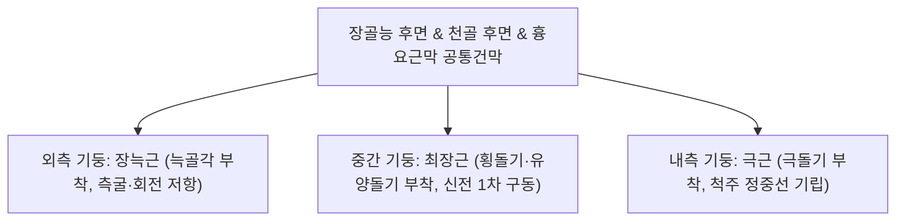
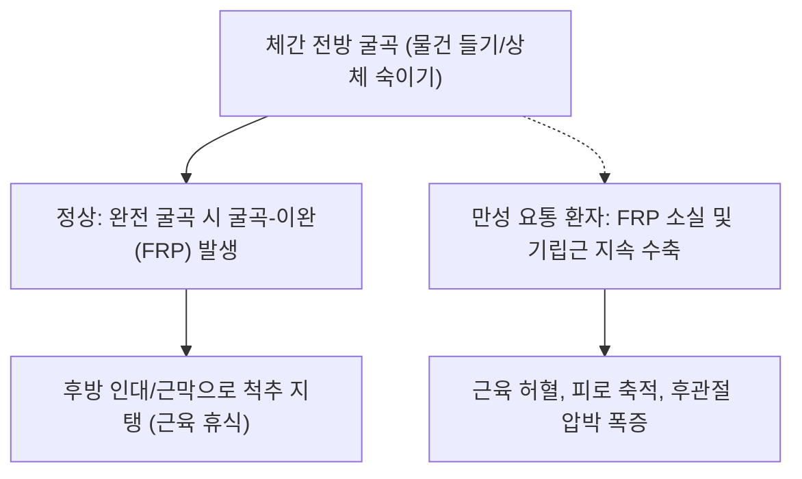

# [[척추기립근]](Erector Spinae / 척주세움근)

> **핵심 요약 (Key Summary)**:
> 장골능, 천골 후면 및 요추 극돌기 건막(Erector spinae aponeurosis)에서 공통 기시하여 늑골과 척추, 후두골로 상행하는 [[장늑근]], [[최장근]], [[극근]] 3대 종주 기둥 복합체.
> 전 척추 레벨 [[척수신경 후지|척수신경]] 후지(Dorsal rami)의 분절성 지배를 받으며, 중력에 저항하여 척주 전체를 일으켜 세우는 인체 후면의 메인 마스트(Main mast).
> 주치 병증은 급·만성 [[요통]], 일자허리 및 굽은등(Flat back & Kyphosis), 척추 피로골절, 천장관절염 및 [[이상근]] 보상 과부하.

---
## 📌 목차
1. [해부학적 정밀 구조 및 지배 신경/혈관](#1-해부학적-정밀-구조-및-지배-신경혈관)
2. [생체역학·토크 분석 & 근막 사슬 (Biomechanical Synergy)](#2-생체역학토크-분석--근막-사슬-biomechanical-synergy)
3. [근막통증증후군(TP) & 연관통 패턴 (Travell & Simons)](#3-근막통증증후군tp--연관통-패턴-travell--simons)
4. [초음파 해부학(Sonoanatomy) 및 중재 시술 랜드마크](#4-초음파-해부학sonoanatomy-및-중재-시술-랜드마크)
5. [⭐ 원장님 심층 임상 고찰 및 원본 필기 (Clinical Pearls)](#5-원장님-심층-임상-고찰-및-원본-필기-clinical-pearls)
6. [관련 임상 질환 및 운동손상 증후군 총괄](#6-관련-임상-질환-및-운동손상-증후군-총괄)
7. [추나·도수치료(MET/PIR) & 침구·약침·재활 프로토콜](#7-추나도수치료metpir--침구약침재활-프로토콜)
8. [출처 및 학술 참고 문헌 (References)](#8-출처-및-학술-참고-문헌-references)

---
## 1. 해부학적 정밀 구조 및 지배 신경/혈관

| 기둥 (Column) | 근육 구성 | 기시 및 주행 | 정지부 |
| :--- | :--- | :--- | :--- |
| **외측 기둥 (Lateral)** | **[[장늑근]](Iliocostalis)** | 장골능 후부, 요흉건막 → [[요장늑근]], 흉장늑근, 경장늑근 | 12개 [[늑골]]각(Rib angles) 및 C4-C6 [[횡돌기]] |
| **중간 기둥 (Intermediate)** | **[[최장근]](Longissimus)** | 공통건막, 요추 횡돌기 → [[흉최장근]], 경최장근, 두최장근 | 전 흉추/경추 횡돌기 및 유양돌기(Mastoid process) |
| **내측 기둥 (Medial)** | **[[극근]](Spinalis)** | 하위 [[극돌기]] → 흉극근, 경극근, 두극근 | 상위 척추 극돌기 및 [[후두골]] |

---
## 2. 생체역학·토크 분석 & 근막 사슬 (Biomechanical Synergy)

* **양측 수축 (Bilateral Action)**:
  * 척추 전체를 강력히 신전시켜 기립 자세 유지 및 숙인 상체를 일으켜 세우는 주동력원.
* **편측 수축 (Unilateral Action)**:
  * 장늑근의 긴 모멘트암을 활용하여 동측 측굴(Lateral flexion)을 일으키며, 회전을 동적 제어.
* **굴곡-이완 현상 (Flexion-Relaxation Phenomenon: FRP)**:
  * 상체를 앞으로 깊게 숙일 때(완전 굴곡 시점), 정상적인 척추기립근은 전자기적 활동을 멈추고(Myoelectric silence) [[흉요근막]]과 인대 등 수동 조직에 장력을 넘겨줌. 만성 요통 환자는 이 FRP가 깨져 굴곡 끝에서도 기립근이 연축 상태를 유지.
* **근막 사슬 연계 (Anatomy Trains)**:
  * 표재후방선(Superficial Back Line, SBL): 족저근막 → 아킬레스건/[[비복근]] → 햄스트링 → 천골결절인대 → **척추기립근** → 모상건막으로 연결되는 직립 자세의 핵심 고속도로.

---
## 3. 근막통증증후군(TP) & 연관통 패턴 (Travell & Simons)

* **발통점(Trigger Point) 위치**:
  * **흉장늑근/흉최장근 TrP**: T10-L1 높이의 척추 옆 근복 (견갑골 하각 하방).
  * **요장늑근/요최장근 TrP**: L1-L3 높이, 장골능 상방 3~5cm 지점.
* **연관통 방사 패턴**:
  * **허리 및 둔부 통증**: 허리 전체가 끊어질 듯 아프며, 엉덩이(천장관절 및 둔부 외측)로 통증 투사.
  * 하부 흉추 기립근 TrP는 옆구리와 하복부, 서혜부로 통증을 방사하여 내과 질환(요로결석, 담낭염)으로 오진되기도 함.

---
## 4. 초음파 해부학(Sonoanatomy) 및 중재 시술 랜드마크

* **초음파 스캔 랜드마크 (요추 횡단면 단축 뷰)**:
  * 요추 횡단면 스캔 시, 표층의 [[흉요근막]] 아래 외측의 장늑근과 내측의 최장근, 최심부의 [[다열근]] 층상 경계면 식별.
* **자침 안전 마진 (Safety Margins)**:
  * 신수(BL23), 대장수(BL25), 지실(BL52): 극돌기 외측 1.5촌 및 3촌에서 직자 30~50mm.
  * 흉추 레벨에서는 폐 천자(기흉)를 방지하기 위해 늑골 골면을 향해 사자 15~20mm로 심도 엄격 제어.

---
## 5. ⭐ 원장님 심층 임상 고찰 및 원본 필기 (Clinical Pearls)

* **일자허리(Flat Back) vs 스웨이백(Sway Back)과 기립근의 상태 (원장님 핵심 팁 100% 보존)**:
  * **일자허리**: 요추 전만이 소실되어 기립근이 지속적으로 늘어난 채 굳어있는 **신장성 긴장(Eccentric strain)** 상태임 → 침으로 강하게 털기보다 [[장요근]]/[[대퇴직근]]을 교정하고 기립근 단축 재활 필요.
  * **과전만/스웨이백**: 요추 하부 기립근이 과도하게 단축되어 척추를 꺾고 있는 상태 → 신수혈, 대장수혈 심부 도침 및 장늑근 근막 이완 필수.
* **기립근 연축 시 둔부(이상근/중둔근) 보상 연쇄**:
  * 기립근이 지치면 체중 부하가 골반으로 떨어져 [[이상근]]과 [[중둔근]]이 2차적으로 뭉치며 좌골신경통을 모방함. 기립근 치료 없이 엉덩이만 치료해서는 요둔통이 절대 완치되지 않음.

---
## 6. 관련 임상 질환 및 운동손상 증후군 총괄

| 임상 질환 / 증후군 | 병리적 연관 기전 | 주요 증상 및 이학적 검사 | 핵심 교정 타깃 |
| :--- | :--- | :--- | :--- |
| 급성 요추 염좌 (Lumbago) | 무거운 물건을 들 때 기립근의 급격한 편심성 파열 | 허리를 전혀 펴지 못함, 기립근 판자상 강직 | 기립근 침구 이완, 작약감초탕 |
| 만성 흉요부 근막통증증후군 | 장시간 좌식 생활로 흉요근막 및 기립근 만성 허혈 | 아침 기상 시 요통, 오후 보행 시 피로 악화 | 배수혈 도침술, 흉요근막 감압 |
| FRP 결손성 요통 | 굴곡-이완 현상 소실로 요추 굴곡 시 기립근 경련 | 허리 숙일 때 통증, 신전 복귀 시 멈칫거림 | 요천추 안정화 추나, FRP 회복 훈련 |
| 척추 분리증/전방전위증 | 척추 후궁 협부 결손으로 기립근이 척추체를 억지 지탱 | 서 있을 때 요통 악화, 허리 뒤로 젖힘 제한 | 기립근 긴장 완화, 코어 복근 강화 |

---
## 7. 추나·도수치료(MET/PIR) & 침구·약침·재활 프로토콜

* **한의 침구 및 도침 요법**:
  * 침구 치료: 간수(BL18), 비수(BL20), 신수(BL23), 대장수(BL25), 관원수(BL26), 지실(BL52) 직자 30~50mm.
  * 도침 요법: 장골능 상연 부착부 및 흉요근막 이행부의 만성 석회화 건골막 유착 박리.
  * 약침 치료: 요추 심부 후관절 및 기립근 경결점에 신바로약침 1.0cc 주입.
* **도수 치료 및 자가 관리**:
  * **척추 캣카우 (Cat-Cow) 스트레칭**: 네발기기 자세에서 척주를 둥글게 말았다가 부드럽게 젖히며 기립근의 전 분절성 수축-이완 유도.
  * **맥켄지 신전 운동 (McKenzie Extension)**: 엎드려 상체를 팔꿈치로 받쳐 올리며 요추 전만을 회복하고 기립근 휴식 유도.

---
## 8. 출처 및 학술 참고 문헌 (References)

1. **Geisser, M. E., Haig, A. J., Wallbom, A. S., & Wiggert, E. A. (2004)**. Pain-related fear, lumbar flexion, and dynamic EMG among persons with chronic musculoskeletal low back pain. *Clin J Pain*, 20(2), 61-69. [PMID: 14770044](https://pubmed.ncbi.nlm.nih.gov/14770044/)
   - `[연구 요약]`: 만성 근골격계 요통 환자에서 통증 관련 공포와 요추 굴곡-이완 현상(FRP) 소실 간의 동적 근전도(dynamic EMG) 상관관계 규명.
2. **Standring, S. (2020)**. *Gray's Anatomy: The Anatomical Basis of Clinical Practice* (42nd ed.). Elsevier: 819-821.
   - `[연구 요약]`: 척추기립근 3대 기둥(장늑근, 최장근, 극근)의 부착부 및 척수신경 후지 지배 분석.
3. **Travell, J. G., & Simons, D. G. (1999)**. *Myofascial Pain and Dysfunction*. Williams & Wilkins.
   - `[연구 요약]`: 흉요부 척추기립근 발통점과 허리·둔부 방사통 패턴 정립.

### 📎 개념 학습 보충 (2026-09-23 논문 연계)

* **척추기립근 — '부하 분담' 관점에서 읽는 만성 요통 운동 근거 (Front Public Health 2023;11:1155225, [PMID: 38035307](https://pubmed.ncbi.nlm.nih.gov/38035307/))**:
  - 만성 요통 75 RCT·5,254명 네트워크 메타분석에서 태극권(SMD −2.11)·요가(−1.76)·필라테스(−1.52)·코어안정화(기능 −1.04)가 상위 중재로 보고됐다. 이들 운동의 공통 기전 해석이 **심부 안정화 근육과 표층 기립근의 협응·부하 분담 회복**이다.
  - 진료실 적용: ① 요둔통 환자에서 기립근 경결(도침·약침·흉요근막 감압) 치료 후 태극권·요가 동작을 처방해 협응을 재학습시킨다 ② FRP(굴곡-이완 현상) 소실 환자는 신전 패턴 과부하를 피하고 등척성 유지 훈련부터 시작.
  - 관련: [[복횡근]] · [[다열근]] · [[대둔근]] · [[2026-09-23_재활운동의학_심층리뷰]] 2번

### 📎 개념 학습 보충 (2026-10-08 논문 연계)

* 원본: [[2026-10-08_통합의학약리학_심층리뷰]] / [[2026-10-08_통합의학약리학_개념학습]]
  - 요추 추간판 탈출증 환자에서 도수치료 + 해동피 겔 첩부제 2주 후 MF·RMS 군간 차이가 없었다.
  - 해석: 외용 첩부제의 이득은 통증(VAS)과 기능(ODI)에서 먼저 나타나며, 2주 내 기립근 활성 변화로는 설명되지 않는다.
  - 임상 번안: 기립근 경결은 통증기에는 침·약침·도침으로 다루고, 부하 재개는 통증 안정 후 점진적 과부하로 설계한다.
  - 관련 개념: [[다열근]] · [[요추 추간판 탈출증]] · [[점진적 과부하]] · [[도수치료]]

### 📎 개념 학습 보충 (2026-10-11 논문 연계)

* **골반·요추 도수 접촉의 표층 기준(2026-10-11 리뷰 2번)**: J Clin Med 2023;12(9):3310, [PMID: 37176750](https://pubmed.ncbi.nlm.nih.gov/37176750/)
  - 천장관절 HVLA에서 장골능·천골 부위를 접촉·지렛점으로 썼고, 시술 후 요추 가동성(수정 Schober)을 재평가했다. 척추기립근 긴장은 요추 가동성 제한의 흔한 배경이다.
  - 관련: [[요추]] · [[천골]] · [[HVLA]] · [[만성 골반통]] · [[2026-10-11_부인과소아과_심층리뷰]] 2번
