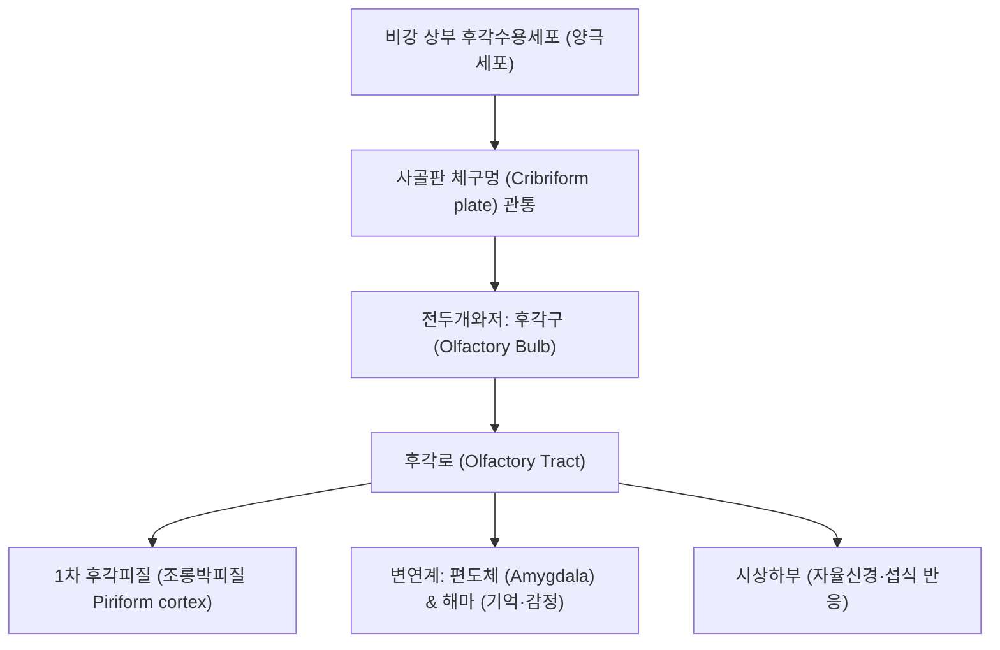

# ⚡ [[1. 후각신경|후각신경]] (Olfactory Nerve / 嗅神經, 제1뇌신경 CN I)

> **핵심 3줄 요약 (Key Summary)**:
> - 🗺️ **신경 기원 & 해부학적 주행**: 비강 상부 후각점막의 양극신경원에서 기시하여 [[사골]](Cribriform plate)의 체판을 통과한 뒤 후각구(Olfactory bulb)와 후각로를 거쳐 대뇌 측두엽 조롱박피질(Piriform cortex) 및 편도체로 직접 연결되는 유일하게 시상을 거치지 않는 특수감각신경이다.
> - 🎯 **감각 지배 & 뇌 기능 연계**: 후각 수용체를 통해 기체 분자를 인지하며, [[변연계]](Limbic system)와 직결되어 정서, 기억, 식욕 및 자율신경 반응을 유도한다.
> - ⚠️ **임상 핵심 & 신경퇴행 조기 선별**: 전두부 외상 시 사골판 골절로 인한 후각 소실 및 뇌척수액 비루(CSF rhinorrhea)가 호발하며, [[파킨슨병]]과 [[알츠하이머병]]의 가장 초기 전구 증상으로 후각 감퇴(Hyposmia)가 나타난다.
> - 🔍 주요 이학적 검사 & 자침 안전: 비자극성 냄새(커피, 비누)를 이용한 편측 후각 식별 검사를 시행하며, 안면부 [[영향]](LI20), [[인당]](EX-HN3), [[상영향]] 자침으로 비강 혈류를 촉진한다.

---

## 1. 신경 기원 & 해부학적 분지 경로 (Anatomy & Course)
후각신경(Olfactory nerve, CN I)은 특수내장구심성(SVA) 섬유로 구성된 순수 감각신경이다.

* **신경 기원 (Origin & Receptors)**:
  * 비강 상비갑개와 비중격 상부의 후각상피에 위치한 양극성 후각수용세포(Bipolar olfactory receptor cells)의 무수신경섬유(C-fiber) 다발이다.
  * 중추신경계의 직접적인 돌출부로서 평생에 걸쳐 신경세포가 재생되는 독특한 생물학적 특성을 지닌다.
* **해부학적 통로 및 주행 (Pathway)**:
  * 약 15~20개의 신경섬유 다발이 사골(Ethmoid bone)의 사골판(Cribriform plate)에 뚫린 미세한 체구멍들을 통과하여 전두개와(Anterior cranial fossa)저로 진입한다.
  * 전두엽 안와면 하방의 후각구(Olfactory bulb)에서 승모세포(Mitral cell) 및 방울세포(Tufted cell)와 시냅스를 형성한다.
  * 후각로(Olfactory tract)를 통해 주행하여 내측 및 외측 후각선조로 갈라져 시상(Thalamus)을 거치지 않고 대뇌 피질(후각피질, 편도체, 내후각뇌피질)로 직접 투사된다.

---

## 2. 신경 지배 맵 & 기능 네트워크 (Innervation Map)

### 1) 감각 지배 영역 (Sensory Domain)
* **후각 인지 (Olfaction)**: 수천 가지의 휘발성 후각 분자를 구별하는 특수 감각.
* **미각과의 상호작용 (Flavor Perception)**: 음식의 풍미(Flavor)를 결정하는 후각 기여(레트로네이절 후각).

### 2) 뇌 기능 네트워크 (Functional Network)
* 감정과 본능적 공포/쾌락을 조절하는 [[편도체]] 및 장기 기억을 담당하는 [[해마]]와 강력히 연계되어 '프루스트 현상(냄새를 통한 기억 회상)'을 유발한다.

---

## 3. 호발 포착 부위 & 터널 증후군 병태생리
후각신경은 말초 터널이 아닌 두개골 관통 부위와 두개강 내 기계적 손상에 취약하다.

* **사골판 전단 손상 (Cribriform Plate Shear Injury)**:
  * 교통사고, 낙상 등 두부 외상(특히 후두부 충격 시 반충 손상) 시 뇌가 전후로 요동치면서 사골판 구멍을 통과하는 연약한 후각신경 섬유들이 전단(Shearing)되어 영구적 후각 탈실이 발생한다.
* **전두개와 종양성 압박 (Foster Kennedy Syndrome)**:
  * 후각신경구 부위의 수막종(Olfactory groove meningioma)이 성장하면 동측의 후각 소실 및 시신경 위축, 반대측 유두부종(Papilledema)이 유발된다.
* **바이러스 감염 후 후각신경 손상 (Post-viral Anosmia)**:
  * 감기, 인플루엔자, COVID-19 감염 후 후각지지세포 및 신경원 손상으로 후각 감퇴와 착후증(Parosmia)이 호발한다.

---

## 4. 손상 레벨별 임상 증상 & 신경학적 결손

| 손상 레벨 / 원인 | 주요 임상 증상 | 신경학적 결손 및 동반 징후 |
| :--- | :--- | :--- |
| **사골판 골절 / 외상** | 편측 또는 양측 급성 후각 상실(Anosmia) | 뇌척수액 비루(맑은 콧물, 당 검사 양성), 기두증, 뇌수막염 위험 |
| **후각신경구 수막종** | 서서히 진행하는 편측 후각 저하 | [[두통]], 성격 변화, 동측 시력 저하(Foster Kennedy 증후군) |
| **퇴행성 질환 (초기)** | 미세한 냄새 식별 장애(Hyposmia) | [[파킨슨병]] 운동 증상 발현 수년 전 선행, [[알츠하이머병]] 조기 징후 |
| **바이러스/상기도 감염** | 후각 감퇴 및 이상 후각(악취 착후증) | 미각 저하 동반 호소, 비강 점막 부종 |

---

## 5. 관련 이학적 검사 & 신경 감별 매트릭스

| 이학적 검사명 | 검사 방법 및 유발 기전 | 양성 반응 | 관련 감별 질환 |
| :--- | :--- | :--- | :--- |
| **편측 후각 선별 검사 (Odorous Identification Test)** | 한쪽 콧구멍을 막고 커피가루, 비누 등 비자극성 냄새를 맡게 함 (암모니아, 알코올 등 삼차신경 자극제 배제) | 냄새 인지 불가 또는 식별 장애 | 외상성 신경 절단, 전두엽 종양, [[파킨슨병]] |
| **타깃 후각 척도 검사 (CCCRC / UPSIT)** | 표준화된 다채널 냄새 스틱으로 후각 역치 및 식별력 정량 평가 | 표준 점수 미달 (Hyposmia / Anosmia) | 신경인성 후각 장애 vs 비폐색성 비염 |
| **뇌척수액 비루 검사 (Target Sign / Glucose Test)** | 고개를 숙일 때 비강으로 떨어지는 액체를 거즈에 받아 Halo sign 및 포도당 농도 확인 | 맑은 액체 번짐 및 포도당 검출 | 사골판 골절 및 두개저 결손 (응급 신경외과 의뢰) |

---

## 6. 한의 신경 치료 프로토콜 (약침·침도·신경수기) (+ 양방 치료·의뢰 기준)

* **비강 주위 혈류 개선 침구 요법**:
  * [[영향]](LI20), [[상영향]](비통), [[인당]](EX-HN3), [[찬죽]](BL2) 자침을 통해 사골동 및 비강 점막 미세순환을 촉진하고 지각신경 자극을 전달한다.
* **후두하 및 경추 추나요법**:
  * 뇌척수액 순환을 개선하고 전두개저 긴장을 완화하기 위해 상부경추 교정과 후두하근막 이완 추나를 적용한다.
* **신경 재생 및 개규 한약 처방**:
  * 기혈 순환과 감각기능 회복을 위해 [[통규탕]], [[창이자산]], [[당귀작약산]]을 체질에 맞추어 변증 투여한다.
* **양방 치료 & 의뢰 기준 (Conventional Treatment & Referral)**:
  * **약물 치료**: 급성 염증성/바이러스성 후각 장애 시 경구 스테로이드 단기 요법 및 후각 재훈련(Olfactory training) 권고.
  * **응급 의뢰 트리거**: 외상 후 지속되는 맑은 비루(CSF leak 의심), 진행성 편측 시력 저하 동반 두통, 신경학적 결손 동반 시 즉시 뇌 MRI/CT 촬영 의뢰.

---

## 7. 💡 사용자 진료실 핵심 필기 & 임상 팁 (원문 보존)
- 뇌(대뇌)와 바로 연결되어 있는 특수감각신경이다.
- 순수 감각신경(Special Visceral Afferent)으로 시상(Thalamus)을 경유하지 않는 유일한 뇌신경이다.
- 후각 검사 시 알코올이나 암모니아는 비강 점막의 삼차신경(V2)을 자극하므로 절대로 후각신경 단독 검사물로 쓰면 안 되며, 반드시 커피, 계피, 바닐라 같은 비자극성 향료를 써야 한다.
- 노인 환자가 "입맛이 없고 밥맛이 변했다"고 호소할 때 실제 미각 소실이 아니라 후각신경 퇴행에 의한 풍미 상실(Anosmia)인 경우가 흔하며, 이는 [[파킨슨병]] 전구 증상일 가능성을 반드시 염두에 두어야 한다.

---

## 8. 출처 및 학술 참고 문헌 (References)

- Watanabe H et al. (2026). [Olfactory Nerve: The Vulnerability Inherent in its Unique System and Neurological Diseases]. *Brain Nerve*. 78(4):303-311. PMID: 41974432
  - [연구 요약] 후각신경의 고유한 해부학적 취약성과 사골판 통과부의 전단 손상 기전, 파킨슨병 및 알츠하이머병 초기 신경퇴행성 마커로서의 후각 경로 병태생리 고찰.

- Ota T et al. (2025). Mini-anterior interhemispheric approach prioritizing preservation of the olfactory nerve function for unruptured anterior communicating aneurysm clipping. *Surg Neurol Int*. 16:361. PMID: 41036035
  - [연구 요약] 전두동 및 두개저 수술 시 후각신경과 후각구 보존을 위한 미세신경외과적 박리 기법 및 술후 후각 기능 보존 임상 분석.
