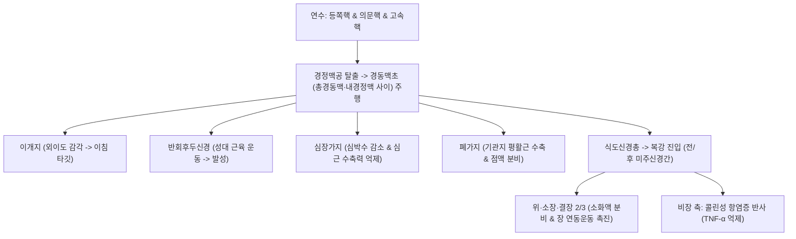

# ⚡ [[10. 미주신경|미주신경]] (Vagus Nerve / 迷走神經, 제10뇌신경 CN X)

> **핵심 3줄 요약 (Key Summary)**:
> - 🗺️ **신경 기원 & 해부학적 주행**: 연수 외측 후외측구에서 기시하여 [[경정맥공]]을 탈출한 뒤 경동맥초(Carotid sheath) 내에서 [[총경동맥]]과 [[내경정맥]] 사이를 주행, 흉강과 종격을 거쳐 [[식도]]열공을 통해 복강 오장육부로 방대하게 퍼져나가는 인체 최장 뇌신경이다.
> - 🎯 **부교감신경계 사령탑 & 콜린성 항염증 반사**: 흉곽(심장 박동 억제, 기관지 수축) 및 복부 소화관(위산 분비, 장 연동운동 촉진) 장기를 독점 지배하며, 비장 대식세포의 TNF-α 생성을 차단하는 **콜린성 항염증 반사(Cholinergic anti-inflammatory pathway)**를 총지휘한다.
> - ⚠️ **임상 핵심 & 반회후두신경 쉰 목소리**: 성대 운동을 지배하는 반회후두신경(좌측은 대동맥궁, 우측은 쇄골하동맥을 회주) 손상 시 바람 빠지는 쉰 목소리(Hoarseness)와 사레가 발생하므로, 갑상선 수술 후 또는 폐첨부 종양, [[대동맥류]]를 감별해야 한다.
> - 🔍 주요 이학적 검사 & 미주신경 자극: 구개수 편위 및 연하 반사를 확인하며, 귓바퀴 이갑강 침구(이침) 자극 및 [[족삼리]](ST36), [[내관]](PC6) 자침을 통해 비침습 미주신경 조절(taVNS)을 시행한다.

---

## 1. 신경 기원 & 해부학적 분지 경로 (Anatomy & Course)
미주신경(Vagus nerve, CN X)은 부교감 신경 섬유가 전체의 75% 이상을 차지하는 거대한 혼합신경이다.

* **연수 4대 기원핵 (Medullary Nuclei)**:
  * **미주신경 등쪽핵 (Dorsal motor nucleus of vagus)**: 흉복부 내장기로 가는 부교감 절전섬유 방출.
  * **의문핵 (Nucleus ambiguus)**: 인두 수축근, 후두 내인근, 연구개 근육 지배 체운동 섬유 및 심장 억제 부교감 섬유 방출.
  * **고속핵 (Nucleus tractus solitarius)**: 흉복부 내장 감각 및 후두개 미각 정보 수용.
  * **삼차신경 척수로핵**: 외이도, 고막 외면, 후두개 경막 감각 수용.
* **주요 분지 및 주행 경로**:
  * **이개지 (Arnold's nerve)**: 외이도와 귓바퀴 오목한 부위 감각 담당 (자극 시 기침 반사 유발).
  * **상후두신경 (Superior laryngeal nerve)**: 내지는 후두 점막 감각, 외지는 윤상갑상근(고음 발성) 지배.
  * **반회후두신경 (Recurrent laryngeal nerve)**:
    * **우측**: 쇄골하동맥 하방을 감아돌아 기관식도구로 상행.
    * **좌측**: **대동맥궁(Aortic arch)** 하방 인대 부위를 깊게 감아돌아 상행 (경로가 훨씬 길어 흉강 내 병변에 극도로 취약).
    * 지배: 윤상갑상근을 제외한 모든 후두 내인근(성대 개폐 및 발성).

---

## 2. 신경 지배 맵 & 기능 네트워크 (Innervation Map)

---

## 3. 호발 포착 부위 & 터널 증후군 병태생리
* **좌측 반회후두신경의 흉강 내 압박 (Ortner's Syndrome)**:
  * 대동맥류, 승모판 협착증으로 인한 좌심방 비대, 종격동 림프절 종대, 폐첨부 종양(Pancoast tumor)에 의해 긴 주행 경로의 좌측 반회후두신경이 압박되어 쉰 목소리 발생.
* **경부 수술성 의원성 손상**:
  * 갑상선 절제술, 경동맥 내막절제술, 전방경추유합술(ACDF) 중 견인이나 절단으로 반회후두신경 마비 호발.
* **자율신경 불균형 및 만성 염증**:
  * 만성 스트레스와 교감신경 과항진으로 미주신경 긴장도(Vagal tone)가 저하되면 전신성 미세염증과 소화기 운동 장애, 심박변이도(HRV) 저하 초래.

---

## 4. 손상 레벨별 임상 증상 & 신경학적 결손

| 손상 위치 | 운동 장애 증상 | 감각 및 자율신경 이상 | 대표 원인 및 징후 |
| :--- | :--- | :--- | :--- |
| **편측 미주신경 본간** | 연하장애, **구개수 건측 편위** | 동측 성대 마비, 위장 연동 저하 | 경정맥공 종양, 두개저 수술 |
| **양측 미주신경 완전 손상** | 양측 성대 정중위 고정 | **급성 질식(호흡곤란), 빈맥, 위마비** | 치명적 응급 질환 (즉각 기도 삽관) |
| **반회후두신경 단독 손상** | **바람 빠지는 쉰 목소리 (Hoarseness)** | 성대 마비로 인한 사레들림 | 갑상선 수술, 대동맥류, [[폐암]] |
| **미주신경성 실신 (Vasovagal)** | 일시적 뇌혈류 저하 | 극심한 서맥, 저혈압, 식은땀, 졸도 | 감정적 충격, 장시간 기립, 통증 |

---

## 5. 관련 이학적 검사 & 신경 감별 매트릭스

| 이학적 검사명 | 검사 방법 및 유발 기전 | 양성 반응 | 관련 감별 질환 |
| :--- | :--- | :--- | :--- |
| **구개수 운동 검사 ("아-" 소리 내기)** | 입을 크게 벌리고 "아-" 소리를 내게 함 | 마비된 쪽 연구개가 올라가지 않고 **구개수가 건측으로 끌려감** | 미주신경 본간(의문핵) 손상 |
| **발성 및 기침 검사 (Cough & Phonation)** | 기침을 강하게 시키고 "이-" 발성 관찰 | 바람 빠지는 듯한 쉰 목소리, 폭발적 기침 불가 | 반회후두신경 마비 (성대 폐쇄 부전) |
| **심박변이도 검사 (HRV Test)** | 5분간 심전도 R-R 간격 변이도 계측 | HF(고주파 성분) 저하, LF/HF 비율 급증 | 미주신경 긴장도 저하, [[자율신경실조증]] |

---

## 6. 한의 신경 치료 프로토콜 (약침·침도·신경수기) (+ 양방 치료·의뢰 기준)

* **경피적 이개 미주신경 자극 침구술 (taVNS)**:
  * 미주신경 이개지가 분포하는 귓바퀴 안쪽 **이갑강(Concha)** 부위에 [[이침]] 또는 전기 침 자극을 가하여 뇌간 NTS를 직접 활성화하고 심신 안정, 불면, 우울, 염증을 조절한다.
* **소화기 및 자율신경 조절 사암침법**:
  * 복부 [[중완]](CV12), 사지 말단의 [[내관]](PC6), [[족삼리]](ST36), [[삼음교]](SP6) 자침을 통해 장관 미주신경망을 활성화하고 위장관 연동운동을 촉진한다.
* **조화기혈 및 안신 한약 처방**:
  * 자율신경 실조 및 만성 신경인성 염증에 [[시호가용골모려탕]], [[반하사심탕]], [[보혈안신탕]]을 처방한다.
* **양방 치료 & 의뢰 기준 (Conventional Treatment & Referral)**:
  * 외상이나 수술력 없는 환자에게서 갑작스러운 편측 성대 마비(쉰 목소리)가 발생하면 흉부 CT를 촬영하여 대동맥류 또는 폐첨부 악성 종양을 감별해야 한다.

---

## 7. 💡 사용자 진료실 핵심 필기 & 임상 팁 (원문 보존)
- **부교감신경의 독보적 대명사**: 뇌신경 중 가장 넓은 영역으로 뻗어나가 심장, 폐, 위, 소장, 대장 등 **오장육부 전체를 지배하는 부교감신경계의 절대적 사령탑**이다.
- **진료실 반회후두신경 손상 캐치 팁**:
  - 갑상선 암 수술, 목 디스크 앞쪽 수술(ACDF)을 받은 환자가 "수술 후부터 목소리가 바람 빠지는 소리가 나고 사레가 자주 들린다"고 하면 반회후두신경 손상을 1초 만에 진단해야 한다.
  - 특히 좌측 목소리 마비 환자가 수술 병력이 없다면 흉부 X-ray나 CT를 통해 **대동맥류 또는 폐첨부 종양** 여부를 반드시 확인해야 한다.
- **이침(귀 침)을 통한 전신 미주신경 리셋 노하우**:
  - 불안, [[불면]], 만성 [[소화불량]], [[공황장애]] 환자에게 귓바퀴 안쪽 오목한 부위(이갑강/이갑정)에 침을 놓거나 피내침을 붙여주면, 미주신경 귀 분지를 통해 뇌간 NTS로 전기 신호가 들어가 즉각적인 심박 안정과 복부 복명 및 [[부항]] 요법(장 운동 소리)이 유도된다.
- **미주신경 자극(VNS)의 임상 응용**:
  - 한의학의 [[이침]] 및 **[[족삼리]]-[[내관]]** 자침은 비침습적으로 미주신경을 자극(taVNS)하여 콜린성 항염증 반사(Cholinergic anti-inflammatory reflex)를 유도하는 최적의 임상 도구이다.

---

## 8. 출처 및 학술 참고 문헌 (References)

- Yadav S et al. (2026). Vagus nerve stimulation as a novel therapeutic approach for musculoskeletal diseases. *Am J Med Sci*. 371(3):208-215. PMID: 40914202
  - [연구 요약] 미주신경 자극(VNS)의 콜린성 항염증 반사를 통한 류마티스 관절염 및 근골격계 만성 염증 질환 조절 메커니즘과 임상 적용성 분석.

- Austelle CW et al. (2024). Vagus nerve stimulation (VNS): recent advances and future directions. *Clin Auton Res*. 34(6):529-547. PMID: 39363044
  - [연구 요약] 비침습적 경피 이개 미주신경 자극(taVNS)의 신경 면역학적 기전, 뇌가소성 향상, 뇌전증 및 난치성 우울증 임상 치료 성적 고찰.
