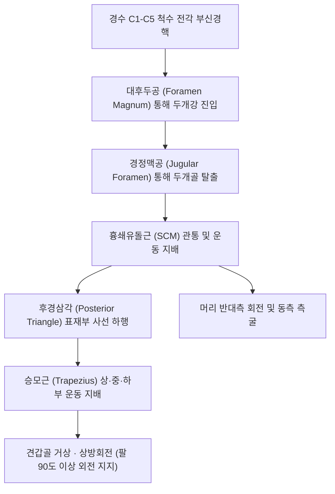

# ⚡ [[11. 부신경|부신경]] (Accessory Nerve / 副神經, 제11뇌신경 CN XI)

> **핵심 3줄 요약 (Key Summary)**:
> - 🗺️ **신경 기원 & 해부학적 주행**: 상부 경수(C1~C5/C6) 전각의 부신경핵에서 기시하여 척수근들이 대후두공(Foramen magnum)을 통해 머리뼈 속으로 들어갔다가 경정맥공(Jugular foramen)을 통해 다시 탈출하여 후경삼각 표재부를 사선으로 하행하는 순수 체운동신경이다.
> - 🎯 **목과 어깨 2대 근육 절대 지배**: [[흉쇄유돌근]](SCM, 경부 회전 및 굴곡)과 [[승모근]](Trapezius, 견갑골 거상·상방회전·안정화) 단 2개 근육만을 전담 지배하여 견갑상완 리듬(Scapulohumeral rhythm)을 유지한다.
> - ⚠️ **임상 핵심 & 의원성 림프절 생검 손상**: 후경삼각에서 쇄골상 2~3cm 상방의 얕은 피하층을 주행하므로, 경부 림프절 조직검사나 지방종 절제술 후 신경이 손상되어 어깨 처짐(Drooping shoulder)과 90도 이상 외전 불능, 둔통이 호발한다.
> - 🔍 주요 이학적 검사 & 감별: 승모근 마비성 익상견갑(Scapular winging, 팔 외전 시 날개뼈 하각 외측 편위)을 전거근 마비와 감별하며, [[천용]](SI17), [[천정]](LI17), [[견정]](GB21) 자침 및 신경 재생 치료를 시행한다.

---

## 1. 신경 기원 & 해부학적 분지 경로 (Anatomy & Course)
부신경(Spinal accessory nerve, CN XI)은 뇌신경으로 분류되나 실제로는 척수에서 기원하여 두개강을 경유하는 유일무이한 척수 기원 뇌신경이다.

* **신경 기원 및 독특한 주행 (U-Turn Pathway)**:
  * 경수 C1~C5(또는 C6) 척수 전각 후외측의 부신경핵에서 기시.
  * 척수 외측면을 따라 섬유들이 합류하여 상행한 뒤 대후두공(Foramen magnum)을 통해 두개강 후두개와로 진입.
  * 설인신경, 미주신경과 함께 **경정맥공(Jugular foramen)**을 통과하여 두개골 밖으로 탈출.
* **경부 주행 및 분지 (Cervical Course)**:
  * [[흉쇄유돌근]](SCM)의 상부 1/3 지점 심부 내측으로 진입하여 근육에 운동지를 제공하고 관통하여 탈출.
  * **후경삼각(Posterior cervical triangle)**의 천경근막(Investing fascia) 바로 심부, 광경근 아래의 매우 얕은 피하층을 대각선으로 비스듬히 가로질러 주행.
  * 쇄골 상방 약 2~3cm 높이에서 [[승모근]](Trapezius)의 전연 속으로 진입하여 종말.

---

## 2. 신경 지배 맵 & 기능 네트워크 (Innervation Map)

---

## 3. 호발 포착 부위 & 터널 증후군 병태생리
* **후경삼각 내 의원성 손상 (Iatrogenic Injury, 호발 1위)**:
  * 흉쇄유돌근 후연과 승모근 전연 사이의 후경삼각 부위에서 신경을 보호하는 근육층이 전혀 없고 얕은 근막에만 싸여 있으므로, 경부 림프절 생검, 종양 절제술, 미용 성형술 중 신경이 절단되거나 견인 손상되기 극히 쉽다.
* **직접적 둔상 및 채찍질 손상 (Whiplash Injury)**:
  * 어깨 부위의 무거운 배낭 압박(Backpack palsy), 야구 배트나 하키 스틱 등의 타격 손상, 교통사고 편타 손상으로 인한 과도한 경부 측굴 시 견인 손상.
* **흉쇄유돌근 근막 포착**:
  * 사경증(Torticollis)이나 만성 근막통증증후군으로 SCM 내부 통과부에서 신경 포착 발생.

---

## 4. 손상 레벨별 임상 증상 & 신경학적 결손

| 손상 부위 | 마비 근육 | 임상 증상 및 외형적 변형 | 기능적 결손 |
| :--- | :--- | :--- | :--- |
| **경정맥공 탈출 직후 (근위부)** | [[흉쇄유돌근]] + [[승모근]] 전체 | 고개 반대측 회전력 약화 + 어깨 완전 처짐 | 머리 회전 장애 및 팔 거상 완전 불능 |
| **후경삼각 부위 (원위부, 흔함)** | **[[승모근]] 단독 마비 (SCM 정상)** | **환측 어깨가 아래·앞쪽으로 축 처짐 (Drooping shoulder)** | **팔 외전 90도 이상 거상 장애**, 둔통 |

---

## 5. 관련 이학적 검사 & 신경 감별 매트릭스

| 이학적 검사명 | 검사 방법 및 유발 기전 | 양성 반응 | 관련 감별 질환 |
| :--- | :--- | :--- | :--- |
| **승모근 근력 검사 (Shoulder Shrug)** | 양측 어깨를 으쓱하고 위로 올리게 한 뒤 저항을 가함 | 환측 어깨가 저항을 이기지 못하고 주저앉음 | 부신경 마비 vs 회전근개 파열 |
| **익상견갑 1초 감별 (팔 외전 검사)** | 팔을 옆으로 90도 이상 들어올리게 함 | 견갑골 상각이 외측으로 벌어지며 날개뼈가 아래로 처짐 | **승모근 마비 (부신경)** |
| **벽 밀기 검사 (Wall Push-up)** | 벽을 두 손으로 강하게 밀게 함 | 견갑골 척추연 전체가 뒤로 불쑥 솟아오름 | **전거근 마비 (장흉신경)** |

---

## 6. 한의 신경 치료 프로토콜 (약침·침도·신경수기) (+ 양방 치료·의뢰 기준)

* **부신경 주행 삼각 축 표적 침구 요법**:
  * 흉쇄유돌근 후연의 [[천용]](SI17), [[천정]](LI17) 라인과 승모근 침입점인 [[견정]](GB21), [[견외수]](SI14)를 삼각 축으로 자침하고 저주파 전침을 적용하여 마비된 승모근 근위축을 방지한다.
* **초음파 유도하 부신경 수압박리술(Hydrodissection) 및 약침**:
  * 후경삼각 내 흉쇄유돌근 후연 탈출 부위에 초음파 가이드하에 자하거약침을 주입하여 신경 재생을 촉진하고 주변 흉경근막 유착을 침도로 박리한다.
* **견갑대 정골 추나요법**:
  * 어깨 처짐으로 인한 쇄골-견봉관절 및 견흉관절의 부정렬을 교정하고 견갑골 안정화 운동을 지도한다.
* **양방 치료 & 의뢰 기준 (Conventional Treatment & Referral)**:
  * 림프절 수술 직후 발생한 완전 신경 단열 의심 시 3~6개월 이내 조기 신경 봉합술 또는 신경 이식술(Sural nerve graft)을 위해 신경외과/정형외과로 의뢰.

---

## 7. 💡 사용자 진료실 핵심 필기 & 임상 팁 (원문 보존)
- **기원과 출현의 특이성**: 신경세포체는 척수(C1-C5 전각)에 있으면서 대후두공으로 머리뼈 속으로 들어갔다가 다시 경정맥공으로 빠져나오는 독특한 경로를 거치는 순수 운동신경이다.
- **단 2개 근육의 절대 지배**: 부신경은 오직 **목빗근([[흉쇄유돌근]])과 등세모근([[승모근]])** 2개 근육만을 전담 지배한다.
- **경부 림프절 생검 후 어깨 통증 환자 주의**:
  - "목에 멍울이 있어서 림프절 조직검사(생검)를 한 뒤부터 팔이 안 올라가고 어깨가 축 처져서 아프다"고 내원하는 환자는 100% 후경삼각 내 부신경 의원성 손상이다.
- **익상견갑 1초 감별 룰**:
  - 벽을 앞으로 밀어보라고 했을 때 날개뼈가 뜨면 $
ightarrow$ **[[전거근]](장흉신경)**.
  - 팔을 옆으로 나란히 들어보라고 했을 때 날개뼈가 바깥 아래로 처지면 $
ightarrow$ **[[승모근]](부신경)**.
- **치료 포인트 집약**: 흉쇄유돌근 후연의 [[천용]], [[천정]] 라인과 승모근 침입점인 [[견정]]을 삼각 축으로 잡고 침 치료 및 약침 치료를 시행하면 연축성 사경과 승모근 마비성 통증에 탁월한 효과를 볼 수 있다.

---

## 8. 출처 및 학술 참고 문헌 (References)

- Ye AL et al. (2024). Chronic shoulder pain due to spinal accessory nerve palsies present opportunities for improved care integration. *Pain Manag*. 14(7):347-353. PMID: 39269163
  - [연구 요약] 후경삼각 내 의원성 부신경 손상으로 인한 만성 견관절 통증 및 승모근 마비의 진단 지연(평균 21개월) 분석과 다학제 조기 중재 프로토콜.

- Alanazi S et al. (2024). Spinal Accessory Nerve Injury following Spinal Adjustment: Case Report and Literature Review of the Outcome of Accessory Nerve Pathology as Result of Blunt Trauma (Spinal Accessory Nerve Palsy after Spinal Adjustment). *Case Rep Orthop*. 2024:7440745. PMID: 38456196
  - [연구 요약] 비인증 경추 수기 조작 및 둔상에 의한 부신경 마비 증례와 보존적 재활 치료를 통한 승모근 근력 회복 경과 고찰.
