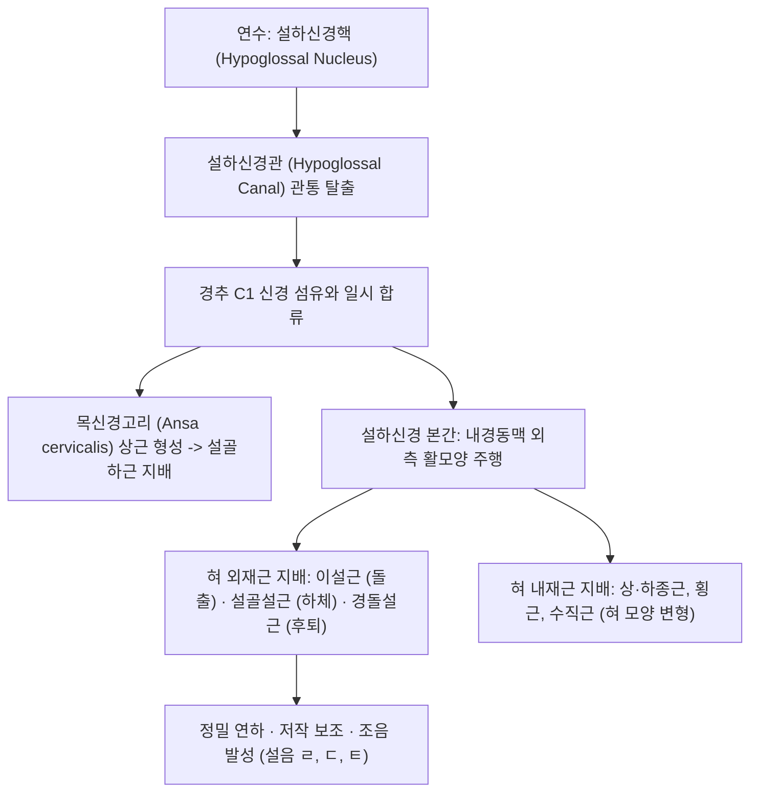

# ⚡ [[12. 설하신경|설하신경]] (Hypoglossal Nerve / 舌下神經, 제12뇌신경 CN XII)

> **핵심 3줄 요약 (Key Summary)**:
> - 🗺️ **신경 기원 & 해부학적 주행**: 연수 복측 능형와 바닥의 설하신경핵에서 기시하여 설하신경관(Hypoglossal canal)을 통해 두개골을 탈출한 뒤 경동맥초 심부를 하행, [[악하선|악하삼각]]을 거쳐 하악각 하방에서 혀뿌리로 진입하는 순수 체운동신경이다.
> - 🎯 **혀의 모든 근육 독점 지배**: 구개설근(CN X 지배) 하나를 제외한 **혀의 모든 외재근([[이설근]], [[설골설근]], [[경돌설근]]) 및 모든 내재근(상하종근, 횡근, 수직근)**을 단독 지배하여 음식물 저작, 연하 및 정밀 발성을 총괄하며 [[구음장애]]를 방지한다.
> - ⚠️ **임상 핵심 & 혀 내밀기 3초 감별 룰**: 혀를 앞으로 내밀었을 때 마비된 쪽(환측)으로 혀가 삐뚤어지면 말초성 하부운동신경원(LMN) 마비이며 혀 위축과 근섬유다발수축(Fasciculation)이 동반되고, 반대쪽으로 편위되면 중추성 [[뇌졸중]](UMN)이다.
> - 🔍 주요 이학적 검사 & 자침 노하우: 구음장애("라, 르, 다, 타" 설음 뭉개짐)를 테스트하며, 턱밑 [[염천]](CV23)혈을 혀뿌리 방향으로 45~60도 사침(1~1.5촌)하여 신경 자극을 극대화한다.

---

## 1. 신경 기원 & 해부학적 분지 경로 (Anatomy & Course)
설하신경(Hypoglossal nerve, CN XII)은 혀의 운동을 독점적으로 지배하는 순수 체운동(GSE) 신경이다.

* **연수 기원 (Medullary Origin)**:
  * 제4뇌실 바닥의 설하신경삼각(Hypoglossal triangle) 하방에 위치한 설하신경핵에서 기시.
  * 피라미드(Pyramid)와 올리브(Olive) 사이의 전외측구(Preolivary sulcus)에서 여러 개의 신경근사로 출현.
* **두개골 탈출 및 주행**:
  * 후두골 대후두공 외측벽에 위치한 **설하신경관(Hypoglossal canal)**을 단독으로 통과하여 두개골 밖으로 탈출.
  * C1 척수신경 섬유와 잠시 합류한 뒤, 내경동맥과 내경정맥 사이를 하행하다가 악하선 심부에서 [[설골]] 상방으로 활 모양(U자형 곡선)을 그리며 전방 주행.
* **혀 진입 및 종말**:
  * 설골설근(Hyoglossus)의 외측 표면을 지나 [[설하선]] 심부로 들어가 혀의 내외재근으로 분지.

---

## 2. 신경 지배 맵 & 기능 네트워크 (Innervation Map)

---

## 3. 호발 포착 부위 & 터널 증후군 병태생리
* **후두과 증후군 (Occipital Condyle Syndrome)**:
  * 후두골 과부(Occipital condyle)의 골절, 악성 종양 전이 또는 결핵성 골염으로 설하신경관이 파괴되어 심한 후두통과 함께 동측 설하신경 마비 호발.
* **내경동맥 박리 및 가성동맥류**:
  * 설하신경이 내경동맥의 바로 외측을 감아돌며 주행하므로, 내경동맥 박리(CAD) 시 신경이 압박되어 단독 혀 마비 발생.
* **루게릭병 (근위축성 측삭경화증, ALS)**:
  * 설하신경핵의 퇴행으로 혀의 심한 위축과 벌레가 기어가는 듯한 근섬유다발수축(Fasciculation)이 호발.

---

## 4. 손상 레벨별 임상 증상 & 신경학적 결손

| 손상 레벨 | 혀 내밀기 시 편위 방향 | 혀의 위축 및 연축 | 동반 질환 및 감별 |
| :--- | :--- | :--- | :--- |
| **말초성 병변 (LMN, 설하신경핵/신경)** | **환측(마비된 쪽)으로 혀가 편위됨** | **동측 혀 위축 현저, 주름 형성, 섬유다발수축** | 설하신경관 손상, 경부 수술, 종양 |
| **중추성 병변 (UMN, 피질연수로/뇌졸중)** | **건측(병변 반대쪽)으로 혀가 편위됨** | **혀 위축 없음, 섬유수축 없음** | [[뇌경색]], [[뇌출혈]], 반대측 편마비 동반 |
| **양측성 설하신경 손상** | 혀 돌출 완전 불능 (바닥에 누워있음) | 양측 혀 완전 위축, 극심한 [[연하장애|연하곤란]] | 기도 폐쇄 위험, [[루게릭병]](ALS) 말기 |

---

## 5. 관련 이학적 검사 & 신경 감별 매트릭스

| 이학적 검사명 | 검사 방법 및 유발 기전 | 양성 반응 | 관련 감별 질환 |
| :--- | :--- | :--- | :--- |
| **혀 돌출 검사 (Tongue Protrusion Test)** | 혀를 정중선 앞으로 길게 내밀게 함 | 혀끝이 한쪽으로 확연히 삐뚤어짐 | 설하신경 마비 핵심 스크리닝 |
| **혀 근력 저항 검사 (Cheek Push Test)** | 혀로 볼 안쪽을 밀게 하고 검사자가 밖에서 손가락으로 누름 | 환측 볼을 미는 힘이 현저히 약함 | 혀 근력 약화 정량 평가 |
| **조음 발성 검사 (Lingual Sound Test)** | "라, 르, 다, 타", "랄랄라"를 빠르게 반복 발음하게 함 | 혀끝이 입천장에 닿지 않아 발음이 뭉개짐 | 설하신경성 구음장애(Dysarthria) |

---

## 6. 한의 신경 치료 프로토콜 (약침·침도·신경수기) (+ 양방 치료·의뢰 기준)

* **염천혈(CV23) 심부 사침 특수 자침술**:
  * 설골 상연 정중앙의 [[염천]](CV23)에서 바늘 끝을 **환자의 혀뿌리(설근부) 방향으로 45~60도 각도로 비스듬히 깊숙이(1~1.5촌)** 자침하여 강한 득기감을 유도함으로써 설하근과 설하신경을 직접 자극한다.
* **설하 설침 및 경혈 전침 치료**:
  * 혀 안쪽의 [[금진]], [[옥액]] 사혈 요법으로 설하 정맥 울혈을 소퇴시키고, [[아문]](GV15), [[풍지]](GB20), [[염천]](CV23)에 전침 저주파(1~2Hz)를 통전하여 연수 설하신경핵을 활성화한다.
* **개음통락 및 활혈거풍 한약 처방**:
  * 뇌졸중 후유증성 구음장애 및 혀 마비에 [[지황음자]], [[보양환오탕]], [[성향정기산]]을 처방한다.
* **양방 치료 & 의뢰 기준 (Conventional Treatment & Referral)**:
  * 외상 병력 없이 갑자기 발생한 편측 혀 마비 및 후두통은 후두과 종양 전이나 내경동맥 박리 가능성이 높으므로 즉시 뇌 MRI/MRA 촬영을 의뢰한다.

---

## 7. 💡 사용자 진료실 핵심 필기 & 임상 팁 (원문 보존)
- **순수 운동신경의 대표**: 설하신경은 감각 섬유가 없는 100% 순수 체성운동신경으로, 오직 혀의 모든 근육을 통솔한다.
- **혀 내밀기 3초 감별 공식 (기억법)**:
  - 환자가 혀를 내밀었을 때 혀가 한쪽으로 삐뚤어지면:
    - **"마비된 혀가 아픈 쪽(환측)을 가리킨다" $
ightarrow$ 말초성 설하신경 손상 (LMN: 환측 편위 + 혀 주름/위축)**.
    - **"마비된 혀가 건강한 쪽(마비 반대편)을 가리킨다" $
ightarrow$ 중추성 뇌졸중 (UMN: 반대측 편위 + 혀 위축 없음)**.
- **구음장애(말 어눌함) 진찰 팁**:
  - 혀의 근력이 떨어지면 설음인 **"라, 르, 다, 타"** 발음이 가장 먼저 뭉개진다. 환자에게 "랄랄라", "다가닥"을 빠르게 발음해보게 하면 1초 만에 설하신경 이상을 감지할 수 있다.
- **염천혈 자침 노하우**:
  - 염천혈은 수직으로 찌르면 혀에 닿지 않는다. 반드시 **턱밑 뼈(설골) 바로 윗선에서 바늘 끝을 환자의 혀뿌리(설근부) 방향으로 45~60도 각도로 비스듬히 깊숙이(1~1.5촌)** 자침하여 득기감을 느껴야 혀 마비 회복 속도가 비약적으로 빨라진다.

---

## 8. 출처 및 학술 참고 문헌 (References)

- Hikichi H et al. (2020). Hypoglossal Nerve Palsy due to Compression by a Persistent Primitive Hypoglossal Artery: Case Report. *J Stroke Cerebrovasc Dis*. 29(2):104459. PMID: 31839548
  - [연구 요약] 잔존 원시 설하신경동맥(PPHA)의 혈관성 압박에 의한 단독 설하신경 마비 증례 및 혀 위축의 임상 양상 분석.

- Karşıdağ S et al. (2021). What can be the cause of hypoglossal nerve palsy?. *Emerg Med J*. 38(4):302-307. PMID: 34449425
  - [연구 요약] 응급 및 외래 진료 환경에서 설하신경 마비의 다양한 원인 질환(두개저 종양, 혈관 박리, 외상, 감염)별 감별 진단 가이드라인.
